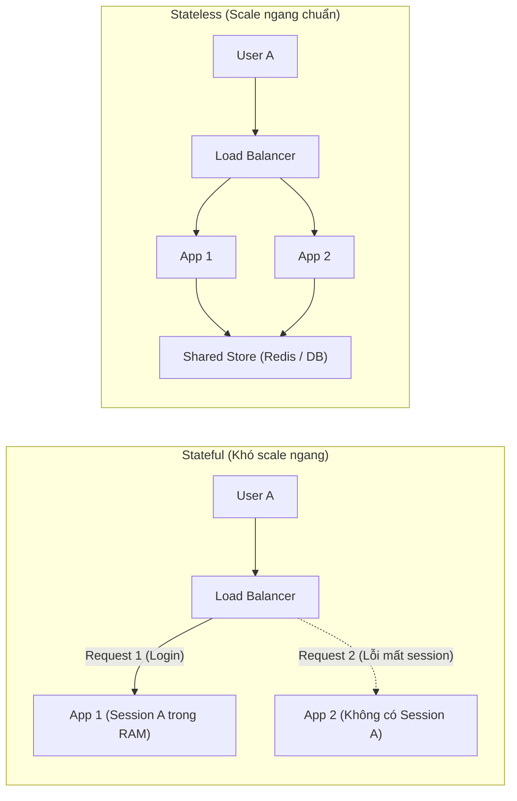
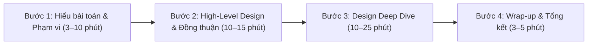

# Bài học Giai đoạn 0 — Phần 3: Concepts Nền Tảng & Ước Lượng

[← Quay lại GĐ 0 README](./README.md) · [Tiếp theo: Phần 4 — Thực hành TechStore →](./02-thuc-hanh-techstore.md)

> **Tài liệu đối chiếu:** `[P]` Xu Vol.1 ch.1–3, DDIA ch.1, `system-design-primer` · `[W]` `ByteByteGoHq/system-design-101`

---

## Mục lục
1. [Vertical vs Horizontal Scaling & Stateless vs Stateful](#1-vertical-vs-horizontal-scaling--stateless-vs-stateful)
2. [Load Balancer (L4/L7), Reverse Proxy & CDN](#2-load-balancer-l4l7-reverse-proxy--cdn)
3. [Latency, Throughput, Percentile (p50/p99), SLA/SLO & "Số 9"](#3-latency-throughput-percentile-p50p99-slaslo--số-9)
4. [CAP & PACELC (Mức khái niệm)](#4-cap--pacelc-mức-khái-niệm)
5. [Ước lượng nhanh (Back-of-the-Envelope Estimation)](#5-ước-lượng-nhanh-back-of-the-envelope-estimation)
6. [Framework 4 bước trong System Design](#6-framework-4-bước-trong-system-design)

---

## 1. Vertical vs Horizontal Scaling & Stateless vs Stateful

### 1.1. Vertical Scaling (Scale Up) vs Horizontal Scaling (Scale Out)

| Tiêu chí | Vertical Scaling (Scale Up) | Horizontal Scaling (Scale Out) |
| :--- | :--- | :--- |
| **Cách làm** | Nâng cấp phần cứng 1 máy (thêm CPU, RAM, SSD NVMe) | Thêm nhiều máy/instance chạy song song sau Load Balancer |
| **Độ phức tạp** | Rất thấp, không cần sửa kiến trúc app | Cao hơn: cần Load Balancer, quản lý state tập trung, đồng bộ |
| **Giới hạn (Trần)** | Có giới hạn vật lý & chi phí tăng phi tuyến ở cấu hình cao | Gần như mở rộng tuyến tính nếu app stateless |
| **High Availability** | Có Single Point of Failure (SPOF) — máy chết là sập toàn bộ | Chịu lỗi tốt — 1 máy chết còn máy khác phục vụ |
| **Khi nào chọn?** | Giai đoạn đầu, traffic vừa phải, DB quan hệ chưa cần shard | Traffic lớn, cần HA, cần auto-scale theo giờ cao điểm |

> [!TIP]
> Trong phỏng vấn và thực tế: **không phải lúc nào cũng nhảy thẳng sang Horizontal Scaling**. Nhiều hệ thống vừa hoặc DB giai đoạn đầu scale up rất rẻ và đơn giản trước khi cần phức tạp hóa kiến trúc.

### 1.2. Stateless vs Stateful Architecture

- **Stateful Server:** Lưu trạng thái phiên làm việc (ví dụ: `HttpSession` trong RAM, file upload tạm trên ổ đĩa local) ngay trên chính instance xử lý request.
  - **Vấn đề khi scale ngang:** Nếu User A đăng nhập ở `Server 1`, request sau Load Balancer định tuyến sang `Server 2`, `Server 2` không biết User A là ai → lỗi mất phiên. Dùng *Sticky Sessions* (IP/Cookie affinity) làm phân tải lệch và mất phiên khi `Server 1` sập.
- **Stateless Server:** Mọi request mang đủ ngữ cảnh (ví dụ JWT) hoặc server đọc/ghi state từ một **shared data store** bên ngoài (Redis cho session/cart, S3/MinIO cho file, PostgreSQL cho dữ liệu nghiệp vụ).
  - **Lợi ích:** Có thể bật/tắt/restart bất kỳ instance Spring Boot nào sau Load Balancer mà user không bị rớt phiên; hỗ trợ auto-scaling mượt mà.

---

## 2. Load Balancer (L4/L7), Reverse Proxy & CDN

### 2.1. Forward Proxy vs Reverse Proxy vs Load Balancer

- **Forward Proxy:** Đứng trước **Client**, đại diện cho client gọi ra Internet (ẩn IP client, lọc truy cập nội bộ, cache chung cho mạng công ty).
- **Reverse Proxy:** Đứng trước **Server**, nhận request thay cho backend server (che giấu IP thật của server, SSL termination, nén gzip, cache tĩnh, rate limit).
- **Load Balancer (LB):** Là một dạng reverse proxy chuyên phân phối traffic đều (hoặc thông minh) ra **nhiều backend server**, đồng thời thực hiện **health check** để tự loại bỏ node chết.

### 2.2. Load Balancer Layer 4 (L4) vs Layer 7 (L7)

| Tiêu chí | L4 Load Balancer (Transport Layer) | L7 Load Balancer (Application Layer) |
| :--- | :--- | :--- |
| **Thông tin đọc được** | Chỉ IP nguồn/đích và Port TCP/UDP | Đọc toàn bộ HTTP header, URL path, cookie, body |
| **Cơ chế hoạt động** | Chuyển tiếp gói tin (NAT / DSR), không giải mã TLS hoặc parse HTTP | Terminate TCP/TLS, đọc HTTP request rồi mở kết nối mới tới backend |
| **Hiệu năng / Độ trễ** | Cực nhanh, tốn ít CPU/RAM, chịu tải triệu kết nối/s | Chậm hơn L4 một chút do parse HTTP & xử lý TLS |
| **Tính linh hoạt** | Không route được theo `/api/orders` vs `/api/products` | Route theo path, host, header, A/B testing, Canary, WebSocket upgrade |
| **Ví dụ phổ biến** | AWS NLB, IPVS, HAProxy (mode tcp), Nginx stream | Nginx HTTP, Envoy, AWS ALB, HAProxy (mode http) |

> **Thực tế kiến trúc lớn:** Thường dùng **L4 LB ở ngoài cùng** (chịu tải packet cực lớn + Anycast/ECMP) trỏ vào cụm **L7 LB / API Gateway** (Nginx/Envoy) bên trong để route thông minh.

### 2.3. Các thuật toán Load Balancing phổ biến
1. **Round Robin:** Chia lần lượt `1 → 2 → 3 → 1`. Tốt khi các server cấu hình giống nhau và request nặng tương đương.
2. **Weighted Round Robin:** Máy mạnh nhận trọng số cao hơn (ví dụ tỷ lệ `2:1:1`).
3. **Least Connections:** Gửi tới server đang có ít kết nối mở nhất — phù hợp khi thời gian xử lý mỗi request chênh lệch lớn.
4. **IP Hash / Consistent Hashing:** Hash IP (hoặc header/key) để cùng 1 client/key thường xuyên vào 1 node (hữu ích cho cache local hoặc sticky routing).

### 2.4. CDN (Content Delivery Network)
CDN là mạng lưới server phân tán toàn cầu (**Edge PoPs**) lưu bản sao nội dung gần người dùng về mặt địa lý (ảnh sản phẩm TechStore, JS/CSS bundle, video).
- **Push CDN:** Chủ động đẩy file lên CDN khi có dữ liệu mới. Phù hợp site nhỏ, nội dung ít thay đổi, muốn kiểm soát chặt dung lượng lưu trên CDN.
- **Pull CDN (phổ biến nhất):** Lần đầu user ở Tokyo gọi `cdn.techstore.vn/img/a.jpg` → Edge chưa có (**cache miss**) → Edge kéo từ Origin Server → lưu lại theo `Cache-Control: max-age=...` (**TTL**) → các user sau nhận trực tiếp từ Edge (**cache hit**).
- **Lợi ích cốt lõi:** Giảm mạnh **latency** cho user ở xa origin, giảm tải băng thông & CPU cho origin server.
- **Lưu ý vận hành:** Cần chiến lược **cache invalidation** (đổi tên file theo content hash `app.3f8a1.js` hoặc gọi Purge API) và đặt **TTL** hợp lý.

---

## 3. Latency, Throughput, Percentile (p50/p99), SLA/SLO & "Số 9"

### 3.1. Latency vs Response Time vs Throughput
- **Latency:** Thời gian một request phải chờ để bắt đầu được xử lý hoặc thời gian truyền/xử lý thuần túy của hệ thống (thường đo bằng ms).
- **Response Time:** Tổng thời gian từ lúc client gửi request đến lúc nhận đủ response (gồm network round-trip + queue time + service processing time).
- **Throughput:** Số lượng công việc xử lý được trên một đơn vị thời gian: **QPS** (*Queries Per Second*), **RPS** (*Requests Per Second*), hoặc **MB/s**.

> **Mối quan hệ quan trọng:** Khi tải (concurrency) tăng vượt ngưỡng bão hòa CPU/DB connection pool, **throughput chững lại hoặc tụt xuống**, còn **latency tăng vọt theo hàm mũ** (Little's Law & queueing effect).

### 3.2. Tại sao phải nhìn Percentile (`p50`, `p95`, `p99`) thay vì Trung bình (`avg`)?

Độ trễ thực tế của hệ thống web **không tuân theo phân phối chuẩn** mà bị **lệch phải (right-skewed / long-tail)**.
- **`p50` (Median):** 50% số request nhanh hơn hoặc bằng giá trị này (trải nghiệm "thông thường").
- **`p95`:** 95% request nhanh hơn mốc này (5% chậm hơn).
- **`p99`:** 99% request nhanh hơn mốc này — **1% chậm nhất** thường là những user mua nhiều hàng nhất (giỏ hàng to, lịch sử dài) hoặc dính GC pause / cold cache / lock contention!

**Ví dụ minh họa vì sao `avg` đánh lừa:**
Giả sử có 100 request: 99 request mất **10 ms**, nhưng 1 request dính DB lock mất **2,010 ms**.
- `avg` = `(99 × 10 + 2,010) / 100` = **30 ms** (trông có vẻ rất nhanh!).
- `p99` = **2,010 ms** (cho thấy ngay 1% user đang chờ hơn 2 giây!).

**Hiệu ứng khuếch đại Tail Latency (Tail at Scale):**
Nếu một trang chủ TechStore gọi **song song 20 microservice/API con**, và mỗi API con có xác suất chậm (`> p99`) là 1%, thì xác suất trang chủ bị chậm là:
$$P(\text{ít nhất 1 call chậm}) = 1 - 0.99^{20} \approx 18.2\%$$
Tức là `p99` ở tầng con biến thành gần **`p82`** (cứ 5 lượt tải trang thì 1 lượt bị chậm) ở tầng người dùng!

### 3.3. SLI, SLO, SLA và Availability "Số 9"

- **SLI (Service Level Indicator):** Chỉ số đo lường thực tế (ví dụ: `p99 latency = 180ms`, `success rate = 99.95%`).
- **SLO (Service Level Objective):** Mục tiêu nội bộ đội kỹ thuật cam kết giữ (ví dụ: `99.9% request < 250ms trong 30 ngày`). Phần dư `100% - SLO` gọi là **Error Budget**.
- **SLA (Service Level Agreement):** Hợp đồng pháp lý/thương mại với khách hàng (ví dụ: *nếu uptime < 99.9% sẽ hoàn tiền 10%*). **SLO luôn phải khắt khe hơn SLA** để có vùng đệm cảnh báo trước khi vi phạm hợp đồng.

**Bảng quy đổi Availability "Số 9" (chuẩn phỏng vấn):**

| Availability | Downtime / Năm | Downtime / Tháng (30d) | Downtime / Ngày | Mức độ hệ thống |
| :--- | :--- | :--- | :--- | :--- |
| **99% (2 số 9)** | 3.65 ngày | 7.31 giờ | 14.4 phút | Hệ thống nội bộ, MVP |
| **99.9% (3 số 9)** | 8.77 giờ | 43.8 phút | 1.44 phút | Web app / e-commerce tiêu chuẩn |
| **99.95%** | 4.38 giờ | 21.9 phút | 43.2 giây | Dịch vụ B2B quan trọng |
| **99.99% (4 số 9)** | 52.6 phút | 4.38 phút | 8.64 giây | Hệ thống thanh toán, nền tảng lớn |
| **99.999% (5 số 9)** | 5.26 phút | 26.3 giây | 0.86 giây | Viễn thông, hạ tầng lõi ngân hàng |

**Công thức ghép nối Availability:**
- **Nối tiếp** (A phụ thuộc B): $A_{\text{total}} = A_A \times A_B$ (ví dụ `99.9% × 99.9% = 99.8%` → giảm đi!).
- **Song song / Dự phòng** (2 node giống nhau): $A_{\text{total}} = 1 - (1 - A)^2$ (ví dụ `1 - 0.001² = 99.9999%`).

---

## 4. CAP & PACELC (Mức khái niệm)

### 4.1. Định lý CAP
Trong một hệ thống dữ liệu phân tán có **chia tách mạng (Network Partition — P)**, hệ thống buộc phải đánh đổi giữa:
- **C (Consistency — Linearizability):** Mọi thao tác đọc đều nhận được dữ liệu ghi mới nhất (hoặc lỗi), như thể chỉ có 1 bản sao dữ liệu duy nhất.
- **A (Availability):** Mọi request gửi đến một node còn sống đều nhận được phản hồi thành công (không báo lỗi), dù dữ liệu có thể chưa cập nhật mới nhất.
- **P (Partition Tolerance):** Hệ thống vẫn tiếp tục hoạt động dù các gói tin giữa các node bị rớt hoặc đứt mạng cục bộ.

> [!IMPORTANT]
> **Hiểu đúng về CAP:** Trong mạng phân tán thực tế, đứt mạng (**P**) **luôn có thể xảy ra** nên bạn **không thể bỏ P** để chọn "CA". Khi mất kết nối giữa hai cụm server, bạn chỉ được chọn:
> - **CP:** Từ chối ghi/đọc ở nhánh bị cô lập để không trả dữ liệu sai lệch (ví dụ: hệ thống số dư ngân hàng, ZooKeeper/etcd).
> - **AP:** Tiếp tục cho đọc/ghi ở cả hai phía dù dữ liệu có thể lệch tạm thời, rồi đồng bộ/giải quyết xung đột sau (ví dụ: giỏ hàng Amazon, DNS, feed mạng xã hội).

### 4.2. PACELC — Bổ sung những gì CAP thiếu
Nhược điểm của CAP là chỉ nói về lúc **có sự cố mạng (P)**. Vậy **lúc mạng bình thường** thì sao? Mô hình **PACELC** trả lời câu hỏi đó:
- **If P (Partition):** chọn **A** hay **C**?
- **Else (Mạng bình thường):** chọn **L (Latency — độ trễ thấp)** hay **C (Consistency — nhất quán chặt)**?

| Phân loại | Ý nghĩa | Ví dụ điển hình |
| :--- | :--- | :--- |
| **PA / EL** | Đứt mạng ưu tiên Available; bình thường ưu tiên Latency (replicate async) | Cassandra, DynamoDB (default), Redis Replication |
| **PC / EC** | Đứt mạng ưu tiên Consistent; bình thường vẫn ưu tiên Consistent (chịu chậm hơn để đồng bộ quorum/sync) | PostgreSQL Sync Replication, Google Spanner, HBase |
| **PA / EC** | Đứt mạng vẫn phục vụ, nhưng lúc bình thường vẫn chờ đồng bộ nhất quán | MongoDB (tùy cấu hình writeConcern / readConcern) |

---

## 5. Ước lượng nhanh (Back-of-the-Envelope Estimation)

Mục đích của ước lượng trong System Design **không phải tính chính xác từng byte**, mà là xác định **bậc độ lớn (order of magnitude)**: cần 1 server hay 100 server? Dữ liệu KB, GB hay PB? Cần sharding hay 1 DB là đủ?

### 5.1. Bảng quy đổi lũy thừa của 2 (Powers of 2)

| Lũy thừa | Giá trị gần đúng | Tên gọi | Viết tắt |
| :--- | :--- | :--- | :--- |
| $2^{10}$ | ~1 nghìn ($1,024$) | 1 Kilobyte | **1 KB** |
| $2^{20}$ | ~1 triệu ($10^6$) | 1 Megabyte | **1 MB** |
| $2^{30}$ | ~1 tỷ ($10^9$) | 1 Gigabyte | **1 GB** |
| $2^{40}$ | ~1 nghìn tỷ ($10^{12}$) | 1 Terabyte | **1 TB** |
| $2^{50}$ | ~1 triệu tỷ ($10^{15}$) | 1 Petabyte | **1 PB** |

### 5.2. Số liệu độ trễ kinh điển (Latency Numbers Every Programmer Should Know)
*(Quy đổi dễ nhớ để chọn kiến trúc RAM vs SSD vs Network)*:
- **Đọc L1/L2 cache CPU:** `~1–4 ns`
- **Đọc RAM (Memory reference):** `~100 ns` (cực nhanh!)
- **Đọc 1 MB tuần tự từ RAM:** `~3–250 µs` (tùy thế hệ phần cứng; rất nhanh so với disk/network)
- **Đọc ngẫu nhiên SSD:** `~16–150 µs` (`~0.1 ms`)
- **Đọc 1 MB tuần tự từ SSD:** `~1 ms` (trên NVMe hiện đại nhanh hơn nữa)
- **Disk seek (HDD cơ học):** `~10 ms` (chậm hơn RAM hàng trăm nghìn lần!)
- **Gửi packet trong cùng Data Center (1 round-trip):** `~0.5 ms`
- **Mạng liên lục địa (Mỹ ↔ Châu Âu / Á):** `~100–150 ms`

> **Bài học rút ra từ bảng độ trễ:** RAM nhanh hơn SSD ~100–1,000 lần và nhanh hơn HDD seek ~100,000 lần; mạng liên lục địa chậm gấp hàng trăm lần mạng nội bộ → **dùng Redis/Cache cho hot data**, **giảm số round-trip mạng**, và **đặt CDN gần user**.

### 5.3. Các con số làm tròn & công thức vàng

**Thời gian làm tròn:**
- $1\text{ ngày} = 86,400\text{ s} \approx \mathbf{10^5\text{ s}}$ (dùng $86,400$ nếu cần hơi sát, dùng $10^5$ khi nhẩm cực nhanh!).
- $1\text{ tháng} \approx 2.5 \times 10^6\text{ s}$; $1\text{ năm} \approx 3.15 \times 10^7\text{ s} \approx 365 \times 10^5\text{ s}$.

**Bộ 6 công thức ước lượng chuẩn:**
1. **Average QPS:**
   $$\text{Avg QPS} = \frac{\text{DAU} \times \text{Số request trung bình / user / ngày}}{86,400 \text{ (hoặc } 10^5\text{)}}$$
2. **Peak QPS:**
   $$\text{Peak QPS} \approx \text{Avg QPS} \times (2 \text{ đến } 3)$$
   *(Nếu có flash sale / sự kiện đột biến như 11.11 ở TechStore, hệ số peak có thể là **5x–10x**).*
3. **Storage:**
   $$\text{Storage} = \text{Số bản ghi mới/ngày} \times \text{Kích thước trung bình 1 bản ghi} \times 365 \times \text{Số năm}$$
   *(Nhân thêm hệ số replication, ví dụ $\times 3$ nếu lưu 1 primary + 2 replica).*
4. **Bandwidth (Băng thông):**
   $$\text{Ingress/Egress Bandwidth} = \text{QPS} \times \text{Kích thước payload trung bình}$$
   *(Lưu ý: $1\text{ MB/s} = 8\text{ Mbps}$).*
5. **Cache Size (Quy tắc 80/20):**
   20% dữ liệu nóng chiếm 80% lượng đọc → chỉ cần cache lượng đọc trong ngày $\times 20\%$ (hoặc tập hot catalog/hot users).
6. **Số lượng Server:**
   $$\text{Số server tối thiểu} = \left\lceil \frac{\text{Peak QPS}}{\text{Throughput 1 instance}} \right\rceil + \text{Dự phòng HA (N+1 hoặc N+2)}$$

---

## 6. Framework 4 bước trong System Design

Đây là khung chuẩn 45 phút từ sách **Alex Xu Vol.1 (Ch.3)** để không bao giờ bị "đứng hình" hoặc lao vào vẽ chi tiết khi chưa hiểu đề.

| Bước | Thời gian | Việc cần làm | Sai lầm hay mắc |
| :--- | :--- | :--- | :--- |
| **1. Làm rõ yêu cầu** | 3–10 phút | Đặt câu hỏi chốt: **Functional requirements** (3–4 tính năng chính), **Non-functional** (DAU, QPS, latency p99, consistency vs availability, retention). Thực hiện **ước lượng nhanh** ngay cuối bước 1. | Im lặng cắm đầu vẽ ngay; ôm đồm thiết kế mọi tính năng phụ. |
| **2. High-Level Design** | 10–15 phút | Vẽ sơ đồ tổng thể (Client → LB/API Gateway → Services → Cache/DB/Queue). Định nghĩa **API chính** và **Data model / Schema sơ bộ**. Xác nhận với interviewer xem hướng đi ổn chưa. | Vẽ quá chi tiết thuật toán bên trong khi khung sườn chưa thống nhất. |
| **3. Design Deep Dive** | 10–25 phút | Đi sâu vào 2–3 thành phần khó nhất hoặc nút thắt cổ chai (ví dụ: làm sao chịu peak QPS? cache stampede? sharding key? async queue?). Luôn nêu **lựa chọn A vs B và trade-off**. | Chỉ nói tên công nghệ ("dùng Kafka, dùng Redis") mà không giải thích *tại sao* và *đánh đổi gì*. |
| **4. Wrap-up** | 3–5 phút | Nhìn lại toàn bộ sơ đồ: chỉ ra **bottleneck còn sót**, cách **monitoring / logging / alerting**, xử lý lỗi (failover), và hướng nâng cấp cho phase tiếp theo (ví dụ scale gấp 10x). | Kết thúc đột ngột khi vừa vẽ xong, không tự phản biện điểm yếu của thiết kế. |
