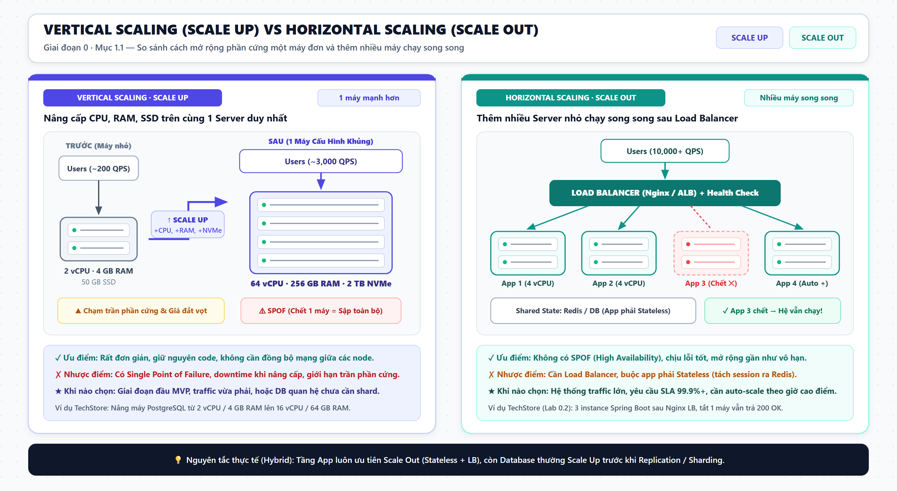
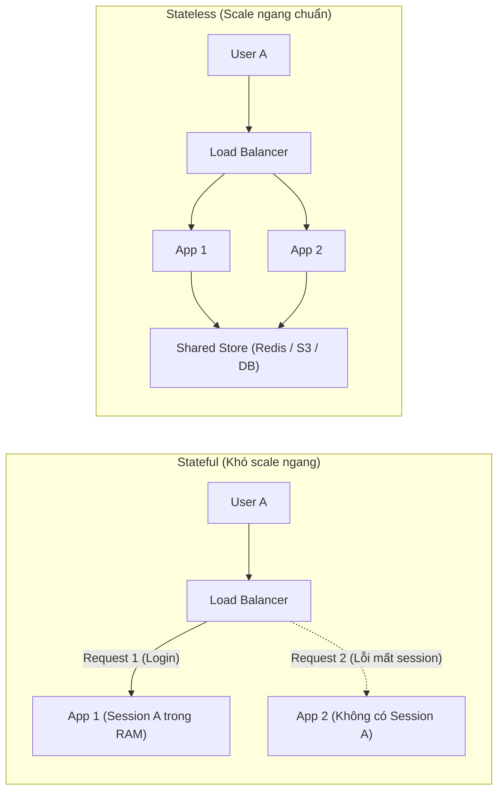
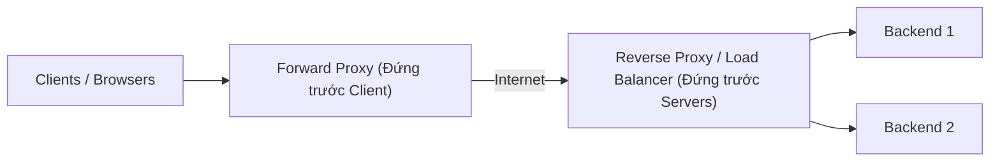
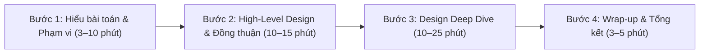

# Bài học Giai đoạn 0 — Phần 3: Concepts Nền Tảng & Ước Lượng

[← Quay lại GĐ 0 README](./README.md) · [Tiếp theo: Phần 4 — Thực hành TechStore →](./02-thuc-hanh-techstore.md)

> **Tài liệu đối chiếu:** `[P]` Xu Vol.1 ch.1–3, DDIA ch.1, `system-design-primer` · `[W]` `ByteByteGoHq/system-design-101`

---

## Mục lục
1. [Vertical vs Horizontal Scaling & Stateless vs Stateful](#1-vertical-vs-horizontal-scaling--stateless-vs-stateful)
2. [Load Balancer (L4/L7), Reverse Proxy & CDN](#2-load-balancer-l4l7-reverse-proxy--cdn)
3. [Latency, Throughput, Percentile (p50/p99), SLA/SLO & "Số 9"](#3-latency-throughput-percentile-p50p99-slaslo--số-9)
4. [CAP & PACELC (Mức khái niệm)](#4-cap--pacelc-mức-khái niệm)
5. [Ước lượng nhanh (Back-of-the-Envelope Estimation)](#5-ước-lượng-nhanh-back-of-the-envelope-estimation)
6. [Framework 4 bước trong System Design](#6-framework-4-bước-trong-system-design)

---

## 1. Vertical vs Horizontal Scaling & Stateless vs Stateful

### 1.1. Vertical Scaling (Scale Up) vs Horizontal Scaling (Scale Out)

#### Tại sao phải Scale?
Khi mới ra mắt (ví dụ **TechStore** phục vụ vài trăm khách/ngày), toàn bộ hệ thống có thể chạy gọn trên **1 server duy nhất** (`2 vCPU, 4 GB RAM`), xử lý ổn định khoảng `150–200 QPS`. Nhưng khi lượng người dùng tăng gấp 10–20 lần hoặc vào giờ cao điểm Flash Sale, các tài nguyên vật lý lần lượt chạm ngưỡng:
- **CPU đạt 100%:** Request mới phải xếp hàng chờ xử lý.
- **RAM đầy:** JVM dính Garbage Collection liên tục hoặc OS phải swap ra ổ đĩa (chậm đi hàng nghìn lần), dẫn tới `OutOfMemoryError`.
- **I/O & Network nghẽn:** Độ trễ `p99` vọt từ `30ms` lên `5–10s`, sau đó người dùng nhận lỗi `504 Gateway Timeout`.

Để nâng công suất chịu tải, kỹ sư hệ thống có hai chiến lược mở rộng cốt lõi: **Vertical Scaling (Scale Up)** và **Horizontal Scaling (Scale Out)**.

#### A. Vertical Scaling (Scale Up — Mở rộng theo chiều dọc)
**Vertical Scaling** là cách **nâng cấp sức mạnh phần cứng cho chính 1 máy chủ duy nhất** (thay máy nhỏ bằng máy to hơn): tăng số nhân CPU (`2 → 16 → 64 vCPU`), tăng dung lượng RAM (`4 GB → 64 GB → 256 GB`), nâng ổ đĩa lên SSD NVMe nhanh hơn hoặc tăng băng thông card mạng.

**Ưu điểm (Vì sao giai đoạn đầu cực kỳ hiệu quả?):**
1. **Không phải sửa kiến trúc hay code:** Toàn bộ ứng dụng vẫn chạy trên 1 máy, giao tiếp qua bộ nhớ chung (`~100 ns`), không cần cấu hình Load Balancer, không mất công serialize dữ liệu qua mạng giữa nhiều server.
2. **Độ trễ nội bộ thấp & Không lo đồng bộ phân tán:** Không có vấn đề đồng nhất dữ liệu giữa các node hay race condition xuyên mạng.
3. **Vận hành đơn giản:** Chỉ có 1 máy để deploy, 1 nơi chứa file log, 1 chỗ theo dõi và backup.

**4 giới hạn chí mạng khi hệ thống lớn dần:**
1. **Trần phần cứng (Hardware Ceiling):** Bạn không thể nâng cấp mãi mãi một chiếc máy đơn — phần cứng luôn có giới hạn tối đa về số khe RAM, socket CPU và băng thông bus.
2. **Chi phí tăng phi tuyến (Non-linear Cost):** Một máy chủ siêu mạnh gấp 8 lần thường có giá thuê/mua **đắt hơn nhiều** so với 8 máy phổ thông ghép lại (vì đòi hỏi linh kiện server đặc chủng).
3. **Single Point of Failure (SPOF):** Toàn bộ hệ thống phụ thuộc vào một máy duy nhất. Chỉ cần hỏng nguồn, lỗi ổ cứng hay treo kernel là **100% dịch vụ sập hoàn toàn**.
4. **Khó tránh Downtime khi nâng cấp:** Nhiều thao tác nâng phần cứng hoặc khởi động lại máy yêu cầu tắt server tạm thời, không đáp ứng được SLA `99.99%`.

#### B. Horizontal Scaling (Scale Out — Mở rộng theo chiều ngang)
**Horizontal Scaling** là cách **thêm nhiều máy chủ (hoặc container/pod) kích thước vừa phải chạy song song** thành một cụm (ví dụ từ `1` instance Spring Boot lên `4` hoặc `20` instances giống nhau). Phía trước cụm đặt một **Load Balancer** (như Nginx, HAProxy, AWS ALB) để tiếp nhận toàn bộ traffic và điều phối đều cho các máy bên dưới.

**Ưu điểm vượt trội ở quy mô lớn:**
1. **Chịu lỗi cao & Không còn SPOF (High Availability):** Load Balancer liên tục gửi **Health Check** tới từng node. Nếu `App 3` sập đột ngột, Load Balancer tự động ngừng đưa request vào `App 3` và chuyển hết sang `App 1, 2, 4` → người dùng không nhận ra sự cố!
2. **Mở rộng gần như tuyến tính & Auto-scaling theo tải thực:** Trong giờ cao điểm tối hoặc Flash Sale, hệ thống có thể tự động bật thêm máy (`scale out`); đến nửa đêm vắng khách thì tự tắt bớt (`scale in`) để tiết kiệm chi phí Cloud.
3. **Zero-downtime Deployment (Rolling Update):** Khi phát hành tính năng mới, bạn có thể nâng cấp từng máy một (`App 1` → `App 2` → ...) trong khi các máy khác vẫn tiếp tục phục vụ khách hàng.
4. **Chi phí tối ưu bằng máy phổ thông (Commodity Hardware):** Ghép nhiều máy cấu hình trung bình (vd `4 vCPU / 8 GB`) rẻ và linh hoạt hơn rất nhiều so với mua một siêu máy chủ.

**Những thách thức kỹ thuật mới phải đánh đổi:**
1. **Ứng dụng buộc phải Stateless:** Không được lưu phiên đăng nhập (`HttpSession`) trong RAM hoặc lưu ảnh upload tạm lên ổ đĩa riêng của từng máy (xem chi tiết ở mục **1.2** bên dưới).
2. **Phức tạp hơn về hạ tầng & vận hành:** Phải quản lý thêm Load Balancer (và chính Load Balancer cũng cần dự phòng cặp Active-Passive/Active-Active để không biến thành SPOF mới!), phải có hệ thống gom Log tập trung (ELK/Loki) và Monitoring tập trung (Prometheus/Grafana) thay vì SSH vào 1 máy xem log.
3. **Nút thắt cổ chai chuyển sang tầng Database:** Nếu bạn scale Web App ra **50 instances**, cả 50 instances đó cùng mở kết nối tới **1 PostgreSQL duy nhất** → Database sẽ sập vì cạn connection pool hoặc nghẽn ghi đĩa! Lúc đó bạn buộc phải học tiếp Replication và Sharding ở **Giai đoạn 1**.

#### C. Thực tế kết hợp cả hai như thế nào? (Hybrid Approach)
Trong thiết kế hệ thống thực tế, kỹ sư **không chọn cực đoan chỉ dùng 1 cách** mà áp dụng linh hoạt theo từng tầng:
- **Tầng Web / App Server (Stateless):** Ưu tiên **Scale Out (Horizontal)** — chạy tối thiểu 2–3 instances sau Load Balancer để vừa chịu tải cao, vừa tránh SPOF và deploy không downtime.
- **Tầng Database (Stateful):** Ở giai đoạn đầu, **Scale Up (Vertical)** là lựa chọn thông minh và kinh tế nhất (giữ nguyên tính nhất quán ACID trên 1 node, không dính Replication Lag hay Cross-shard JOIN). Chỉ khi 1 máy DB rất mạnh vẫn quá tải đọc mới thêm **Read Replicas**, và khi quá tải ghi/dung lượng mới phải **Sharding**.

> [!TIP]
> **Mẹo trả lời phỏng vấn:** Đừng bao giờ nói *"Em sẽ dùng Horizontal Scaling cho mọi thứ ngay từ đầu"*. Câu trả lời chuẩn Senior là: *"Ở quy mô nhỏ/MVP, em dùng Vertical Scaling cho đơn giản và rẻ; khi traffic tăng hoặc cần High Availability (loại bỏ SPOF), em chuyển tầng App sang Stateless để Horizontal Scaling sau Load Balancer, còn Database sẽ Scale Up trước khi áp dụng Replication/Sharding."*

#### Bảng so sánh tóm tắt

| Tiêu chí | Vertical Scaling (Scale Up) | Horizontal Scaling (Scale Out) |
| :--- | :--- | :--- |
| **Cách làm** | Nâng cấp phần cứng 1 máy (thêm CPU, RAM, SSD NVMe) | Thêm nhiều máy/instance chạy song song sau Load Balancer |
| **Độ phức tạp** | Rất thấp, không cần sửa kiến trúc app | Cao hơn: cần Load Balancer, app Stateless, gom log tập trung |
| **Giới hạn (Trần)** | Có giới hạn vật lý & chi phí tăng phi tuyến ở cấu hình cao | Gần như mở rộng tuyến tính nếu app stateless |
| **High Availability** | Có Single Point of Failure (SPOF) — máy chết là sập toàn bộ | Chịu lỗi tốt — 1 máy chết còn máy khác phục vụ |
| **Deploy / Nâng cấp** | Thường có downtime khi nâng phần cứng / reboot | Rolling update không gián đoạn (zero-downtime) |
| **Khi nào chọn?** | Giai đoạn đầu, traffic vừa phải, DB quan hệ chưa cần shard | Traffic lớn, cần HA, cần auto-scale theo giờ cao điểm |

---

### 1.2. Stateless vs Stateful Architecture

Để thực hiện được **Horizontal Scaling (Scale Out)** cho tầng Web/App, điều kiện tiên quyết là biến tầng App thành **Stateless**. Vậy *"State"* là gì và nó gây rắc rối ra sao?

#### "State" (Trạng thái) trong Web Application là gì?
Là những thông tin được giữ lại giữa các HTTP request của cùng một người dùng:
- **Session State:** Thông tin user đã đăng nhập (`userId`, `role`), giỏ hàng tạm, mã OTP vừa gửi.
- **Local File State:** Ảnh sản phẩm hoặc file PDF người dùng upload lên, tạm thời ghi vào thư mục `/tmp/uploads` trên ổ cứng của máy chủ.
- **In-memory Cache cục bộ:** Biến `HashMap` lưu giỏ hàng hoặc bộ đếm rate-limit trong RAM của tiến trình Java.

#### Stateful Server & Thảm họa khi Scale Out
Một server **Stateful** lưu các thông tin trên **ngay bên trong RAM hoặc ổ đĩa cục bộ** của chính instance đó.
- **Kịch bản lỗi:** User A gửi request `POST /login` → Load Balancer đưa vào `App 1` → `App 1` lưu `Session_A` vào RAM của `App 1`. Một giây sau, User A bấm `GET /cart` → Load Balancer chia tải sang `App 2` → `App 2` tìm trong RAM không thấy `Session_A` → **User A bị đá ra màn hình đăng nhập!**
- **Giải pháp chắp vá "Sticky Sessions" (Session Affinity):** Cấu hình Load Balancer luôn gắn `User A` vào đúng `App 1` dựa theo Cookie hoặc IP. Tuy nhiên cách này có **3 nhược điểm lớn**:
  1. **Lệch tải (Load Skew):** Một user hoặc 1 văn phòng công ty dùng chung IP NAT bắn hàng nghìn request sẽ dồn hết vào `App 1`, trong khi `App 2, 3` nhàn rỗi.
  2. **Mất dữ liệu khi restart/crash:** Nếu `App 1` sập hoặc bạn deploy bản code mới lên `App 1`, toàn bộ session/giỏ hàng trong RAM của `App 1` bốc hơi!
  3. **Cản trở Auto-scaling:** Khó thu hồi instance khi có user đang dính sticky trên đó.

#### Stateless Server — Cách làm chuẩn để Scale vô hạn
Một server **Stateless** **không giữ bất kỳ trạng thái riêng nào theo từng user trong RAM/Disk cục bộ**. Mọi instance đều giống hệt nhau (`App 1 == App 2 == App N`) nên request tiếp theo rơi vào máy nào cũng xử lý được như nhau!

**Có 2 cách lưu State khi App đã Stateless:**
1. **Đẩy State ra Kho dữ liệu dùng chung (External Shared Store):**
   - Session, giỏ hàng, OTP → lưu vào **Redis** (độ trễ đọc/ghi chỉ `~0.5–1ms`).
   - File ảnh, video, tài liệu upload → lưu thẳng lên **Object Storage (AWS S3 / MinIO)**.
   - Dữ liệu giao dịch lâu dài → lưu vào **PostgreSQL**.
2. **Đẩy State về phía Client (Stateless Token — JWT):**
   - Khi login, Server ký số một chuỗi **JWT (JSON Web Token)** chứa `{ userId, role, exp }` rồi trả cho Client. Các request sau Client tự đính kèm JWT vào Header `Authorization: Bearer ...` → Server nào cũng tự kiểm tra chữ ký và biết ngay user là ai mà không cần hỏi Redis!
   - *Lưu ý trade-off của JWT:* Rất nhẹ và nhanh vì không cần DB lookup, nhưng **khó thu hồi (revoke) ngay lập tức** trước khi token hết hạn (ví dụ khi user bấm "Đăng xuất khỏi mọi thiết bị" hoặc bị khóa tài khoản → thực tế hay dùng JWT ngắn hạn `15 phút` + Refresh Token lưu trong Redis/DB!).

---

## 2. Load Balancer (L4/L7), Reverse Proxy & CDN

### 2.1. Phân biệt Forward Proxy vs Reverse Proxy vs Load Balancer

Nhiều người mới hay nhầm lẫn 3 khái niệm này vì đều đứng "trung gian" trên đường truyền mạng. Cách nhớ đơn giản nhất là hỏi: **"Nó đứng về phe ai?"**

1. **Forward Proxy (Đứng phía Client):**
   - Đại diện cho **Client** đi gọi ra các server bên ngoài Internet. Server đích chỉ thấy IP của Proxy chứ không thấy IP thật của từng máy nhân viên/người dùng.
   - *Ứng dụng:* Mạng công ty chặn web đen/mạng xã hội, tường lửa kiểm soát nhân viên truy cập ra ngoài, hoặc cache chung các file tải về để tiết kiệm băng thông đường truyền công ty.
2. **Reverse Proxy (Đứng phía Server):**
   - Đại diện cho **Server** đón toàn bộ request từ Internet đi vào. Client tưởng mình đang nói chuyện trực tiếp với server chính, không hề biết IP nội bộ thật của các backend phía sau.
   - *5 công việc thực tế Reverse Proxy làm giúp Backend:*
     - **SSL/TLS Termination:** Giải mã HTTPS ngay tại Reverse Proxy để giải phóng CPU cho các instance Spring Boot phía sau (bên trong mạng nội bộ giao tiếp HTTP thuần cho nhanh).
     - **Che giấu kiến trúc nội bộ & Bảo mật:** Ngăn hacker quét thẳng port của database hay từng server riêng lẻ.
     - **Nén dữ liệu (Gzip / Brotli):** Nén JSON/HTML trước khi gửi qua Internet giúp giảm 60–80% dung lượng băng thông.
     - **Cache tài nguyên tĩnh nhẹ & Rate Limiting sơ bộ.**
3. **Load Balancer (LB):**
   - Thực chất là một **Reverse Proxy chuyên biệt** đứng trước **từ 2 backend server trở lên**, có nhiệm vụ: *(1) Phân chia lưu lượng hợp lý để không máy nào bị quá tải*, và *(2) Chạy **Health Check** để tự loại bỏ node chết*.
   - **Lưu ý tránh SPOF:** Bản thân Load Balancer không được phép là điểm chết duy nhất! Trong production luôn chạy **cặp Load Balancer (Active–Passive dùng Keepalived/VRRP, hoặc Active–Active qua DNS/Anycast)**.

### 2.2. Load Balancer Layer 4 (L4) vs Layer 7 (L7)

Theo mô hình mạng OSI 7 tầng, L4 hoạt động ở tầng **Transport (TCP/UDP)** còn L7 hoạt động ở tầng **Application (HTTP/HTTPS/gRPC/WebSocket)**.

| Tiêu chí | L4 Load Balancer (Transport Layer) | L7 Load Balancer (Application Layer) |
| :--- | :--- | :--- |
| **Thông tin đọc được** | Chỉ thấy **IP nguồn, IP đích và Port TCP/UDP** (4-tuple) | Đọc được toàn bộ **HTTP Method, URL Path, Headers, Cookie, Body** |
| **Cơ chế truyền gói tin** | Chuyển tiếp từng gói tin (**NAT** hoặc **DSR — Direct Server Return**); không cần giải mã TLS hay ghép lại thành HTTP message | **Terminate kết nối TCP & TLS** với Client, parse xong HTTP request mới mở kết nối riêng tới Backend |
| **Hiệu năng & Độ trễ** | **Cực nhanh**, tiêu tốn rất ít CPU/RAM, chịu tải hàng triệu kết nối/giây | Chậm hơn L4 một chút do chi phí giải mã TLS & parse chuỗi HTTP |
| **Khả năng định tuyến thông minh** | Không phân biệt được `/api/orders` với `/api/products` | Route theo URL (`/orders` → cụm Order, `/products` → cụm Product), A/B testing, Canary release theo Header/Cookie |
| **Ví dụ phổ biến** | AWS NLB, Linux IPVS, HAProxy (`mode tcp`), Nginx `stream` | Nginx HTTP, Envoy, AWS ALB, Traefik, Spring Cloud Gateway |

> **Kiến trúc chuẩn ở hệ thống lớn:** Kết hợp cả hai tầng! Đặt **L4 Load Balancer ở lớp ngoài cùng** (dùng kỹ thuật *Anycast / ECMP* để chịu hàng triệu packet/s mà không bị nghẽn), sau đó chuyển tiếp vào một **cụm nhiều L7 Load Balancer / API Gateway** (Nginx/Envoy) bên trong để định tuyến chi tiết tới từng Microservice.

### 2.3. Các thuật toán Load Balancing & Health Checks

1. **Round Robin (Xoay vòng):** Chia đều lần lượt `1 → 2 → 3 → 1`. *Hạn chế:* Giả định mọi server mạnh ngang nhau và mọi request tốn thời gian xử lý như nhau.
2. **Weighted Round Robin:** Gán trọng số theo sức mạnh máy (vd máy 16 vCPU nhận `weight=4`, máy 4 vCPU nhận `weight=1`), hoặc dùng cho **Canary Release** (95% traffic vào bản cũ, 5% vào bản mới).
3. **Least Connections (Ít kết nối nhất):** Gửi request mới tới server đang xử lý ít kết nối mở nhất. *Tại sao cần?* Nếu 1 API xuất báo cáo Excel tốn `10 giây` còn API xem sản phẩm tốn `10 ms`, Round Robin có thể vô tình dồn hết các request `10 giây` vào đúng 1 máy làm máy đó treo, trong khi Least Connections tự tránh máy đang bận!
4. **Least Response Time:** Kết hợp cả số lượng kết nối đang mở lẫn thời gian phản hồi trung bình gần nhất — chọn server vừa rảnh vừa phản hồi nhanh nhất.
5. **IP Hash / Consistent Hashing:** Tính `hash(Client_IP)` để cố định một user vào cùng 1 backend (hữu ích khi backend có local in-memory cache). *Bẫy cần biết:* Nếu 500 nhân viên trong 1 tòa nhà đi qua chung 1 IP NAT của công ty, cả 500 người sẽ bị dồn hết vào **cùng 1 backend server**!

**Cơ chế Health Check (Phát hiện node chết):**
- **Active Health Check:** Load Balancer chủ động gọi `GET /actuator/health` mỗi `5 giây`; nếu thất bại `3 lần` liên tiếp thì rút server khỏi danh sách chia tải.
- **Passive Health Check:** Load Balancer theo dõi traffic thật đi qua (`max_fails=2 fail_timeout=10s` như trong Nginx ở Lab 0.2); nếu thấy request trả về lỗi kết nối hoặc `502/503`, tự động thử lại sang node khác (`proxy_next_upstream`) và tạm cách ly node lỗi.

### 2.4. CDN (Content Delivery Network)

#### Tại sao phải dùng CDN dù Server đã nhanh?
Dù server Spring Boot đặt ở Singapore xử lý một ảnh mất chỉ `1 ms`, nhưng **tốc độ ánh sáng trong cáp quang là hữu hạn**. Một người dùng ở Mỹ hoặc Châu Âu tải 20 bức ảnh sản phẩm và file JS `3 MB` từ Singapore sẽ phải chịu độ trễ mạng (`RTT ~180–250 ms` nhân với số lần handshake TCP + TLS + tải dữ liệu) mất tới **3–5 giây**!

**CDN** là mạng lưới hàng trăm máy chủ đặt khắp thế giới (**Edge Servers / Edge PoPs** — ví dụ Cloudflare, CloudFront, Akamai) lưu bản sao các tài nguyên gần người dùng nhất về mặt địa lý (kéo RTT từ `200ms` xuống chỉ còn `10–20ms`!).

#### Push CDN vs Pull CDN

| Tiêu chí | Push CDN | Pull CDN *(Phổ biến nhất)* |
| :--- | :--- | :--- |
| **Cách hoạt động** | Bạn tự upload sẵn file mới lên các Edge CDN mỗi khi có dữ liệu mới | User đầu tiên ở Tokyo gọi `cdn.techstore.vn/a.jpg` → Edge chưa có (**Cache Miss**) → Edge tự kéo từ Origin Server (S3/App) về lưu lại theo header `Cache-Control: max-age=86400` → từ user thứ 2 trở đi nhận thẳng từ Edge (**Cache Hit**) |
| **Ưu điểm** | Luôn có sẵn bản mới ngay lượt truy cập đầu tiên; kiểm soát chặt thứ gì nằm trên CDN | Cực dễ tích hợp (chỉ trỏ domain qua CDN), chỉ lưu file thực sự có người xem |
| **Nhược điểm** | Tốn công viết logic upload/xóa thủ công; dễ tốn tiền lưu trữ file ít người xem | User đầu tiên tại mỗi khu vực PoP chịu chậm 1 lần (*cache miss*) |
| **Khi nào dùng?** | Site nhỏ, nội dung ít thay đổi, phát hành bản cài đặt/game lớn | Hầu hết web/e-commerce/streaming (TechStore, YouTube, Shopee) |

#### Chiến lược Cache Invalidation (Làm mới file trên CDN)
- **Đặt TTL (`Cache-Control: public, max-age=86400`):** File hết hạn sau 1 ngày mới hỏi lại Origin.
- **Cache Purge / Invalidation API:** Bấm lệnh xóa file trên CDN ngay khi sửa (tốn thời gian vài giây đến vài phút lan tỏa khắp toàn cầu, đôi khi tính phí theo lượt purge).
- **Content Hashing / Versioning (Cách tối ưu nhất):** Gắn mã băm nội dung vào tên file (ví dụ `main.8f3a1c.js`, `banner-v2.webp`) và đặt TTL **1 năm**. Khi sửa code/ảnh, tên file đổi thành `main.9b2e04.js` → trình duyệt và CDN tự động tải bản mới ngay lập tức mà không bao giờ cần Purge!

---

## 3. Latency, Throughput, Percentile (p50/p99), SLA/SLO & "Số 9"

### 3.1. Latency vs Response Time vs Throughput & Điểm bão hòa

- **Latency (Độ trễ):** Thời gian một request phải chờ để được phục vụ hoặc thời gian xử lý thuần túy bên trong hệ thống (không tính đường truyền khứ hồi của client, tùy ngữ cảnh).
- **Response Time (Thời gian phản hồi):** Tổng thời gian người dùng thực sự phải đợi từ lúc gửi request đến lúc nhận đủ byte cuối cùng:
  $$\text{Response Time} = \text{Network RTT} + \text{Queueing Time} + \text{Service Processing Time}$$
- **Throughput (Thông lượng):** Lượng công việc hệ thống hoàn thành trong 1 đơn vị thời gian: **QPS** (*Queries Per Second*), **RPS** (*Requests Per Second*), hoặc **MB/s**.

**Mối quan hệ sống còn khi tăng tải (Little's Law & Điểm bão hòa):**
- Khi số người dùng đồng thời (concurrency) còn thấp: tăng tải → **Throughput tăng đều** và **Latency giữ ổn định**.
- Khi chạm ngưỡng bão hòa tài nguyên (CPU 100%, DB connection pool đầy 100/100, hoặc khóa dòng dữ liệu): request mới bị kẹt trong hàng đợi chờ (**Queueing Time tăng vọt**), CPU tốn nhiều thời gian đảo ngữ cảnh (**Context Switching**) → **Throughput chững lại hoặc tụt xuống**, còn **Latency dựng đứng theo đường cong chữ J (Hockey-stick curve)**!

### 3.2. Tại sao phải nhìn Percentile (`p50`, `p95`, `p99`) thay vì Trung bình (`avg`)?

Độ trễ web **không phân bố đối xứng hình chuông** mà có **đuôi dài lệch phải (Right-skewed / Long-tail Distribution)**: đa số request rất nhanh, nhưng một tỷ lệ nhỏ cực kỳ chậm.

- **`p50` (Median):** 50% số request nhanh hơn giá trị này — đại diện cho trải nghiệm "thông thường".
- **`p95`:** 95% số request nhanh hơn mốc này (5% chậm nhất nằm phía trên).
- **`p99`:** 99% số request nhanh hơn mốc này — phản ánh trực diện nhóm **1% chậm nhất**.

**3 lý do thực tế buộc phải đo theo `p99` (DDIA Ch.1):**
1. **Trung bình (`avg`) che giấu thảm họa:** Giả sử 99 request mất **10 ms**, 1 request dính DB lock mất **2,010 ms** → `avg` = **30 ms** (nhìn báo cáo rất đẹp!), nhưng `p99` = **2,010 ms** (1% người dùng đang chờ hơn 2 giây!).
2. **Những khách hàng giá trị nhất hay rơi vào `p99`:** Khách VIP mua nhiều nhất ở TechStore có giỏ hàng nặng nhất, lịch sử đơn hàng dài nhất, nên các câu query của họ chính là những câu chậm nhất nằm ở `p99`!
3. **Hiệu ứng khuếch đại Tail Latency (*Tail at Scale*):** Một trang chi tiết sản phẩm thường gọi **song song 20 API/microservice con** (giá, tồn kho, khuyến mãi, đánh giá, gợi ý...). Trang web chỉ render xong khi **API chậm nhất** trong 20 lời gọi trả về! Nếu mỗi API con có `1%` xác suất chậm (`> p99`), thì xác suất người dùng bị dính chậm khi mở trang là:
   $$P(\text{ít nhất 1 call chậm}) = 1 - 0.99^{20} \approx \mathbf{18.2\%}$$
   *(Gần 1/5 lượt tải trang bị chậm — `p99` của từng service con bị khuếch đại thành `~p82` ở đầu người dùng! Để giảm hiệu ứng này, các hệ lớn dùng **Hedged Requests**: quá `p95` ms chưa thấy hồi âm thì gửi thêm bản sao sang replica khác).*

### 3.3. SLI, SLO, SLA, Error Budget & Bảng "Số 9"

- **SLI (Service Level Indicator):** Chỉ số kỹ thuật đo được thực tế (ví dụ: *Tỷ lệ HTTP 2xx trong 30 ngày là `99.94%`*, *`p99` API `/products` là `180ms`*).
- **SLO (Service Level Objective):** Ngưỡng mục tiêu **nội bộ** đội kỹ thuật tự cam kết (ví dụ: `uptime >= 99.9%` và `p99 < 250ms` mỗi tháng).
  - **Error Budget (Ngân sách lỗi):** Phần dư `100% - SLO`. Với `SLO = 99.9%` trong 30 ngày, bạn có `43.8 phút` downtime cho phép. Nếu cả tháng mới mất `5 phút`, team còn dư `38.8 phút` Error Budget để mạnh dạn deploy tính năng mới; nếu đã cháy hết Error Budget → **tạm dừng ra tính năng mới**, tập trung vá lỗi & tăng độ ổn định!
- **SLA (Service Level Agreement):** Hợp đồng **pháp lý / thương mại** ký với khách hàng (vi phạm phải đền tiền/hoàn cước). **SLO luôn phải đặt khắt khe hơn SLA** (ví dụ SLA `99.9%` thì SLO nội bộ đặt `99.95%`) để có vùng đệm cảnh báo trước khi vi phạm hợp đồng.

**Bảng quy đổi Availability "Số 9" (thuộc lòng khi làm Bước 1 phỏng vấn):**

| Availability | Downtime / Năm | Downtime / Tháng (30d) | Downtime / Ngày | Mức độ hệ thống |
| :--- | :--- | :--- | :--- | :--- |
| **99% (2 số 9)** | 3.65 ngày | 7.31 giờ | 14.4 phút | Hệ thống nội bộ, MVP |
| **99.9% (3 số 9)** | 8.77 giờ | 43.8 phút | 1.44 phút | Web app / e-commerce tiêu chuẩn |
| **99.95%** | 4.38 giờ | 21.9 phút | 43.2 giây | Dịch vụ B2B quan trọng |
| **99.99% (4 số 9)** | 52.6 phút | 4.38 phút | 8.64 giây | Hệ thống thanh toán, nền tảng lớn |
| **99.999% (5 số 9)** | 5.26 phút | 26.3 giây | 0.86 giây | Viễn thông, hạ tầng lõi ngân hàng |

**Công thức tính Availability tổng của hệ thống nhiều thành phần:**
- **Phụ thuộc nối tiếp** (Web App **VÀ** Database cùng phải sống):
  $$A_{\text{total}} = A_{\text{app}} \times A_{\text{db}}$$
  *(Ví dụ: App `99.9%` nối với 1 DB `99.9%` → tổng chỉ còn `0.999 × 0.999 = 99.8%` — tụt mất một bậc!)*
- **Dự phòng song song** (Chạy 2 instance App độc lập, chỉ cần 1 cái sống):
  $$A_{\text{parallel}} = 1 - (1 - A)^2$$
  *(Ví dụ: 2 máy `99.9%` chạy song song → xác suất cả 2 chết cùng lúc là `0.001 × 0.001 = 0.000001` → Availability vọt lên **`99.9999%`**!)*

---

## 4. CAP & PACELC (Mức khái niệm)

### 4.1. Định lý CAP (Phá vỡ hiểu lầm "Chọn 2 trong 3")
Định lý CAP nói về **một hệ thống dữ liệu phân tán** (nhiều node lưu cùng dữ liệu qua mạng) khi xảy ra **chia tách mạng (Network Partition — P)**:
- **C (Consistency — thực chất là Linearizability):** Mọi thao tác đọc ở bất kỳ node nào đều phải trả về giá trị ghi mới nhất (như thể chỉ có 1 bản sao duy nhất) hoặc báo lỗi — không bao giờ trả dữ liệu cũ.
- **A (Availability):** Mọi request gửi tới một node **còn sống** đều phải nhận được phản hồi thành công (không trả lỗi timeout/503), dù node đó có thể chưa cập nhật dữ liệu mới nhất.
- **P (Partition Tolerance):** Hệ thống vẫn tiếp tục hoạt động dù đường truyền mạng giữa các node bị đứt hoặc rớt gói tin.

> [!IMPORTANT]
> **Hiểu cho thật đúng (tránh sai lầm phỏng vấn kinh điển):**
> Nhiều bạn học vẹt nói *"CAP là chọn 2 trong 3: CA, CP, hoặc AP"*. **Điều này SAI trong hệ phân tán!**
> Trên mạng máy tính thực tế, đứt mạng (**P**) là sự cố vật lý **chắc chắn có lúc xảy ra** (đứt cáp quang, switch hỏng, GC pause làm mất kết nối) — bạn không thể "bỏ chọn P" để lấy "CA" (chỉ có 1 máy đơn không phân tán mới là CA!).
>
> **Vậy tình huống thật khi đứt mạng giữa `Node 1` và `Node 2` là gì?**
> Giả sử cáp mạng giữa `Node 1` và `Node 2` đứt. User A vừa ghi `stock = 9` vào `Node 1`, nhưng `Node 1` không thể gửi sang `Node 2`. Ngay sau đó User B hỏi `Node 2` xem `stock` còn mấy:
> - **Chọn CP (Ưu tiên Consistency):** `Node 2` biết mình bị mất liên lạc với `Node 1` nên **từ chối trả lời (trả lỗi)** để tuyệt đối không đưa nhầm `stock = 10` cũ! *(Ví dụ: Số dư ngân hàng, ZooKeeper, etcd, hệ thống trừ kho nghiêm ngặt).*
> - **Chọn AP (Ưu tiên Availability):** `Node 2` **vẫn trả lời `200 OK`** với giá trị cũ `stock = 10` để user không bị gián đoạn; khi mạng nối lại mới đồng bộ và giải quyết xung đột. *(Ví dụ: Giỏ hàng Amazon, DNS, số lượt view/like, Feed mạng xã hội).*

### 4.2. PACELC — Bổ sung cho trường hợp mạng bình thường
CAP chỉ mô tả hành xử **lúc mạng bị đứt (P)**. Nhưng 99.9% thời gian mạng chạy bình thường thì sao? Mô hình **PACELC** bổ sung thêm nửa sau cực kỳ thực tế:
- **P** (Nếu có **Partition**): chọn **A** (Availability) hay **C** (Consistency)?
- **E** (**Else** — lúc mạng **bình thường không đứt**): chọn **L** (Low Latency — độ trễ thấp) hay **C** (Consistency — nhất quán chặt)?

*Tại sao lúc bình thường lại phải chọn giữa Latency và Consistency?*
Vì nếu Leader ở Singapore muốn đảm bảo mọi Replica ở Mỹ/Tokyo luôn nhất quán 100% (**EC**) trước khi báo `OK`, nó bắt buộc phải chờ mạng xuyên lục địa phản hồi (`+100–150 ms`!). Còn nếu muốn phản hồi tức thì trong `1 ms` (**EL**), Leader ghi xong trả `OK` ngay và gửi bất đồng bộ sang Replica sau — cực nhanh nhưng tạo độ trễ đồng bộ!

| Phân loại | Lúc đứt mạng (P) | Lúc bình thường (E) | Hệ thống tiêu biểu |
| :--- | :--- | :--- | :--- |
| **PA / EL** | Chọn **Availability** | Chọn **Low Latency** (replicate bất đồng bộ) | DynamoDB (mặc định), Cassandra, Redis Replication |
| **PC / EC** | Chọn **Consistency** | Chọn **Consistency** (đồng bộ quorum/sync, chịu chậm hơn) | Google Spanner, PostgreSQL Sync Replication, HBase |
| **PA / EC** | Chọn **Availability** | Chọn **Consistency** (bình thường vẫn chờ đồng bộ) | MongoDB (khi bật writeConcern majority & readConcern majority) |

---

## 5. Ước lượng nhanh (Back-of-the-Envelope Estimation)

### 5.1. Tại sao cần ước lượng & Triết lý "Con số tròn"
Trong System Design, không ai bắt bạn tính chính xác từng megabyte như làm kế toán. Mục đích của ước lượng trong 3–5 phút đầu là **xác định bậc độ lớn (Order of Magnitude)** để ra quyết định kiến trúc:
- Hệ thống chịu `50 QPS` hay `50,000 QPS`? (1 con Postgres chịu nổi hay phải thêm Redis/Sharding?)
- Dữ liệu 5 năm nặng `50 GB` (1 ổ SSD dư sức) hay `50 TB` / `5 PB` (bắt buộc Shard hoặc dùng Object Storage S3)?
- Băng thông hết `10 Mbps` hay `10 Gbps` (cần CDN gấp)?

**Quy tắc vàng khi nhẩm:** Luôn làm tròn các con số về lũy thừa của 10 để chia nhẩm trong đầu không cần máy tính (ví dụ dùng $100,000 = 10^5$ giây thay cho $86,400$ giây/ngày — sai số ~15% hoàn toàn chấp nhận được, chỉ cần nói rõ giả định làm tròn!).

### 5.2. Bảng quy đổi lũy thừa của 2 (Powers of 2)

| Lũy thừa | Giá trị gần đúng | Tên gọi | Viết tắt | Ví dụ thực tế |
| :--- | :--- | :--- | :--- | :--- |
| $2^{10}$ | ~1 nghìn ($1,024$) | 1 Kilobyte | **1 KB** | 1 bản ghi user/order JSON |
| $2^{20}$ | ~1 triệu ($10^6$) | 1 Megabyte | **1 MB** | 1 ảnh sản phẩm chất lượng cao |
| $2^{30}$ | ~1 tỷ ($10^9$) | 1 Gigabyte | **1 GB** | 1 bộ phim HD ngắn / 1M bản ghi user |
| $2^{40}$ | ~1 nghìn tỷ ($10^{12}$) | 1 Terabyte | **1 TB** | Dung lượng 1 ổ cứng server vừa |
| $2^{50}$ | ~1 triệu tỷ ($10^{15}$) | 1 Petabyte | **1 PB** | Kho video/ảnh khổng lồ của YouTube/Google Drive |

### 5.3. Số liệu độ trễ kinh điển & Ý nghĩa kiến trúc
*(Từ bài chia sẻ kinh điển của Jeff Dean — Google; giúp bạn biết cái gì nhanh, cái gì chậm)*:
- **Đọc L1/L2 cache CPU:** `~1–4 ns`
- **Đọc RAM:** `~100 ns` *(cực nhanh!)*
- **Đọc 1 MB tuần tự từ RAM:** `~3–250 µs`
- **Đọc ngẫu nhiên SSD:** `~16–150 µs` (`~0.1 ms`)
- **Đọc 1 MB tuần tự từ SSD:** `~1 ms` *(trên NVMe hiện đại nhanh hơn nữa)*
- **Disk seek (HDD cơ học):** `~10 ms` *(chậm hơn truy cập RAM tới **100,000 lần**!)*
- **Gửi packet trong cùng Data Center (1 round-trip):** `~0.5 ms`
- **Mạng liên lục địa (Mỹ ↔ Châu Âu / Châu Á):** `~100–150 ms`

**3 bài học rút ra từ bảng số liệu trên:**
1. **RAM nhanh hơn đĩa cứng hàng trăm đến hàng trăm nghìn lần** → Dữ liệu nóng phải đưa lên **Redis Cache**; thuật toán DB phải ưu tiên ghi tuần tự (**WAL / LSM-Tree**) hoặc giữ B-Tree index vừa RAM!
2. **Tránh N+1 Network Call trong vòng lặp:** Một lời gọi mạng nội bộ mất `0.5ms`, nếu bạn viết vòng lặp gọi DB `1,000` lần cho 1 request thì riêng tiền mạng đã mất `500ms`! Hãy gộp thành 1 câu `WHERE id IN (...)` hoặc Pipeline!
3. **Mạng liên lục địa rất chậm (`~150ms`)** → Bắt buộc đặt **CDN** cho static assets và **Multi-region** nếu phục vụ toàn cầu.

### 5.4. Bộ 6 công thức vàng & Lưu ý bẫy đơn vị

**Làm tròn thời gian:**
- $1\text{ ngày} = 86,400\text{ s} \approx \mathbf{10^5\text{ s}}$
- $1\text{ tháng} \approx 30 \times 10^5 = \mathbf{3 \times 10^6\text{ s}}$ (chính xác `~2.59M`)
- $1\text{ năm} \approx 365 \times 10^5 \approx \mathbf{3.15 \times 10^7\text{ s}}$

**6 công thức chuẩn:**
1. **Average QPS:**
   $$\text{Avg QPS} = \frac{\text{DAU} \times \text{Số request trung bình / user / ngày}}{10^5 \text{ (hoặc } 86,400\text{)}}$$
2. **Peak QPS:**
   $$\text{Peak QPS} \approx \text{Avg QPS} \times (2 \text{ đến } 3)$$
   *(Nếu đề có tính chất đột biến mạnh như Flash Sale 11.11 TechStore hoặc tin nóng Breaking News, chọn hệ số peak **5x–10x**).*
3. **Storage:**
   $$\text{Storage} = \text{Số bản ghi mới/ngày} \times \text{Kích thước 1 bản ghi} \times 365 \times \text{Số năm}$$
   *(Đừng quên nhân thêm hệ số Replication $\times 3$ nếu muốn tính tổng dung lượng ổ đĩa thực tế trên cụm 1 Primary + 2 Replica!)*
4. **Bandwidth (Băng thông):**
   $$\text{Bandwidth (MB/s)} = \text{QPS} \times \text{Kích thước payload trung bình (MB)}$$
   *(**Cảnh báo bẫy đơn vị:** Dung lượng file đo bằng **Byte (MB/s)**, còn tốc độ đường mạng nhà mạng/Cloud đo bằng **bit (Mbps)** → luôn nhớ **$1\text{ MB/s} = 8\text{ Mbps}$**!)*
5. **Cache Size (Quy tắc 80/20):**
   Trong đa số hệ thống đọc nhiều, **20% dữ liệu nóng chiếm 80% lượng truy cập** → ước lượng RAM Cache bằng `20% × Tổng dữ liệu truy cập trong ngày` (hoặc `20% × Hot Catalog`).
6. **Số lượng Server:**
   $$\text{Số server} = \left\lceil \frac{\text{Peak QPS}}{\text{Throughput 1 instance}} \right\rceil + \text{Dự phòng HA (N+1 hoặc N+2)}$$

> **Mẹo kiểm tra tự nhiên:** Sau khi tính xong, luôn dừng lại tự hỏi 3 câu: *Con số Storage này 1 DB gánh nổi không? Read QPS cao gấp bao nhiêu lần Write QPS để quyết định cần Cache/Replica không? Bandwidth lớn thế có cần CDN không?* (Xem bài giải mẫu chi tiết từng bước cho **TechStore 1M user** ở [Lab 0.1](./02-thuc-hanh-techstore.md)).

---

## 6. Framework 4 bước trong System Design

Đây là khung sườn chuẩn 45 phút từ sách **Alex Xu Vol.1 (Ch.3)** giúp buổi phỏng vấn có cấu trúc rõ ràng, biến bạn từ người "trả lời đề thi" thành **người đồng nghiệp đang cùng thảo luận thiết kế kiến trúc**.

### Bước 1: Hiểu bài toán & Làm rõ phạm vi (3–10 phút)
**Mục tiêu:** Tuyệt đối **không** lao vào vẽ ngay khi vừa nghe đề (*"Thiết kế YouTube"*, *"Thiết kế TechStore"*), vì đề bài System Design cố tình rất mơ hồ!
- **Hỏi làm rõ Functional Requirements:** Tập trung vào 3–4 tính năng cốt lõi nhất trong 45 phút (vd với URL Shortener: chỉ làm *rút gọn link* và *chuyển hướng + đếm click*, bỏ qua phần quản lý team/thanh toán gói VIP nếu interviewer không yêu cầu).
- **Hỏi làm rõ Non-Functional Requirements:** Quy mô DAU? Tỷ lệ Read:Write? Độ trễ `p99` kỳ vọng? Ưu tiên Strong Consistency (như thanh toán) hay Availability/Eventual Consistency (như News Feed)? Thời gian lưu trữ (retention)?
- **Thực hiện Back-of-the-envelope Estimation:** Nhẩm nhanh QPS, Peak QPS, Storage 5 năm, Bandwidth để lấy căn cứ chọn công nghệ ở Bước 2 & 3.

### Bước 2: Đề xuất High-Level Design & Đạt đồng thuận (10–15 phút)
**Mục tiêu:** Dựng được "khung xương" toàn bộ hệ thống chạy thông từ đầu đến cuối và thống nhất hướng đi với interviewer trước khi đào sâu.
- **Định nghĩa API Contract chính:** Nêu ngắn gọn method, endpoint, input/output (vd `POST /api/v1/urls`, `GET /{shortCode}`).
- **Vẽ sơ đồ kiến trúc tổng quan & luồng dữ liệu chính:** Client → DNS/CDN → Load Balancer → App Services → Cache / DB / Message Queue. Chạy thử bằng miệng 1 luồng ghi và 1 luồng đọc xuyên qua sơ đồ.
- **Đề xuất Data Model / Schema sơ bộ:** Nêu tên các bảng chính, kiểu DB (RDBMS vs NoSQL vs Object Storage) và lý do sơ bộ.
- **Check-in với interviewer:** *"Khung kiến trúc tổng thể như vậy ổn chưa ạ, em xin phép đi sâu vào phần X và Y nhé?"* — giúp tránh đi lệch hướng kỳ vọng của người hỏi!

### Bước 3: Design Deep Dive (10–25 phút)
**Mục tiêu:** Đây là phần phân loại trình độ Junior vs Mid/Senior. Tập trung giải quyết **2–3 điểm khó nhất hoặc nút thắt cổ chai** của riêng bài toán đó (thay vì nói dàn trải những thứ cơ bản như login!).
- Ví dụ theo từng bài:
  - *URL Shortener:* Cách sinh mã không trùng (Base62 + Snowflake vs Hash), `301` vs `302`, Cache link viral.
  - *TechStore Flash Sale:* Tồn kho chống bán âm (Atomic update / Redis Lua), chống Cache Stampede, tách gửi mail/cập nhật thống kê sang Kafka.
  - *News Feed:* Xử lý **Celebrity Problem** bằng Hybrid Fan-out.
- **Quy tắc vàng khi Deep Dive:** Đừng chỉ gọi tên công nghệ (*"Em dùng Kafka", "Em dùng Cassandra"*). Luôn trình bày theo mẫu: **Vấn đề → 2 Phương án (A vs B) → Chọn A vì lý do gì → Trade-off (mất gì) & Cách giảm thiểu**.

### Bước 4: Wrap-up & Tổng kết (3–5 phút)
**Mục tiêu:** Tự chủ động đánh giá lại thiết kế của chính mình thay vì đợi bị bắt lỗi.
- **Chỉ ra Bottleneck còn sót & Cách xử lý nếu Scale tiếp 10x:** Ví dụ hiện tại DB Primary chưa shard, nếu traffic ghi tăng gấp 10 lần thì sẽ shard theo `user_id`.
- **Xử lý lỗi (Failure Modes):** Nếu 1 server chết, 1 Datacenter mất điện, hoặc Cache sập thì hệ thống xuống cấp êm dịu (Graceful Degradation) như thế nào?
- **Observability (Vận hành thực tế):** Theo dõi những metric nào (`p99` latency, error rate `5xx`, cache hit ratio, Kafka consumer lag, DB connection pool) và đặt cảnh báo (Alerting) ra sao.

| Bước | Thời gian | Việc cần làm | Sai lầm hay mắc |
| :--- | :---: | :--- | :--- |
| **1. Làm rõ yêu cầu** | 3–10p | Chốt MVP, Non-functional, ước lượng QPS/Storage | Im lặng cắm đầu vẽ ngay; ôm đồm quá nhiều tính năng phụ |
| **2. High-Level Design** | 10–15p | API chính, Schema DB sơ bộ, Sơ đồ tổng & luồng Read/Write | Chưa thống nhất khung đã sa đà vào thuật toán chi tiết |
| **3. Design Deep Dive** | 10–25p | Đào sâu 2–3 nút thắt khó nhất, nêu rõ **Trade-offs** | Kể tên buzzword (*Kafka, Redis*) mà không giải thích *vì sao* |
| **4. Wrap-up** | 3–5p | Phản biện bottleneck còn lại, Failure cases, Monitoring, Scale 10x | Kết thúc cụt ngủn ngay khi vừa vẽ xong |
