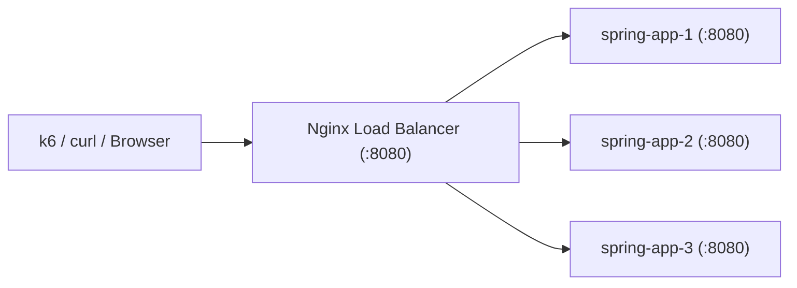

# Bài học Giai đoạn 0 — Phần 4: Thực Hành TechStore (1M Users · Nginx LB · k6)

[← Phần 3: Concepts](./01-concepts.md) · [Quay lại GĐ 0 README](./README.md) · [Tiếp theo: Phần 5 — Mục tiêu & Kiến trúc →](./03-muc-tieu-va-kien-truc.md)

---

## Tổng quan 3 bài thực hành

| Lab | Mục tiêu | Công cụ | Đầu ra cần lưu lại |
| :--- | :--- | :--- | :--- |
| **Lab 0.1** | Ước lượng QPS, Storage 5 năm & số instance Spring Boot cho **TechStore** (1M user) | Giấy / Markdown | Bảng giả định + công thức + kết quả có đơn vị |
| **Lab 0.2** | Dựng **Nginx LB** trước 3 instance Spring Boot & test tắt 1 instance | Docker Compose, Nginx | Hệ thống vẫn trả `200 OK` khi dừng 1 container |
| **Lab 0.3** | Đo `p50`/`p95`/`p99` dưới tải đồng thời | **k6** (hoặc JMeter) | Bảng so sánh latency trước/sau scale & khi failover |

---

## Lab 0.1 — Back-of-the-Envelope Estimation cho TechStore (1 triệu user)

### Bước 1: Chốt giả định (Assumptions) — *Luôn ghi rõ trước khi tính*

| Hạng mục | Giả định cho TechStore | Ghi chú lý do |
| :--- | :--- | :--- |
| **Tổng user đăng ký** | `1,000,000 users` ($10^6$) | Theo đề bài |
| **DAU (Daily Active Users)** | `20%` tổng user = `200,000 DAU` | Tỷ lệ thường gặp cho e-commerce |
| **Lượt xem / tìm kiếm mỗi DAU** | `25 requests / user / ngày` | Xem trang chủ, list sản phẩm, chi tiết SP, giỏ hàng |
| **Đơn hàng / ngày** | `5%` DAU mua hàng = `10,000 orders / ngày` | Tỷ lệ chuyển đổi thực tế (~3–5%) |
| **Số item trung bình / đơn** | `3 items / order` | Ảnh hưởng số dòng bảng `order_items` |
| **Tổng số SKU sản phẩm** | `100,000 sản phẩm` | Catalog tăng thêm ~20% mỗi năm |
| **Hệ số Peak (giờ cao điểm)** | `3x` bình thường (Flash Sale: `10x`) | Buổi tối 20h–22h hoặc ngày đôi |
| **Số giây trong 1 ngày** | Làm tròn `100,000 s` ($10^5$) *(chính xác: `86,400 s`)* | Nhẩm nhanh theo chuẩn phỏng vấn |

---

### Bước 2: Tính QPS (Read QPS, Write QPS, Peak QPS)

1. **Read Requests / ngày:**
   $$\text{Read/ngày} = 200,000 \times 25 = 5,000,000 \text{ requests/ngày}$$
   $$\text{Avg Read QPS} = \frac{5,000,000}{100,000} = \mathbf{50 \text{ QPS}} \quad \left(\text{hoặc } \frac{5,000,000}{86,400} \approx \mathbf{58 \text{ QPS}}\right)$$

2. **Write Requests / ngày** (tạo đơn + cập nhật giỏ hàng + đăng ký/review, ước tính ~`10x` số đơn):
   $$\text{Write/ngày} = 10,000 \text{ orders} + 90,000 \text{ cart/profile writes} = 100,000 \text{ writes/ngày}$$
   $$\text{Avg Write QPS} = \frac{100,000}{100,000} = \mathbf{1 \text{ QPS}}$$
   *(Tỷ lệ Read : Write khoảng **50 : 1** — hệ thống thiên hẳn về đọc!)*

3. **Peak QPS (giờ cao điểm 3x & Flash Sale 10x):**
   - **Peak ngày thường (3x):** $\text{Peak Read QPS} \approx 58 \times 3 \approx \mathbf{175 \text{ QPS}}$ (~`200 QPS` tính tròn).
   - **Peak Flash Sale (10x):** $\text{Flash Sale QPS} \approx 58 \times 10 \approx \mathbf{580 \text{ QPS}}$ (~`600 QPS`).

---

### Bước 3: Tính Storage 5 năm (Database + Media Ảnh Sản Phẩm)

#### A. Dữ liệu có cấu trúc (PostgreSQL)

| Bảng | Số dòng phát sinh | Kích thước / dòng | Dung lượng 5 năm |
| :--- | :--- | :---: | :--- |
| **`users`** | `1,000,000` (tăng lên ~`2M` sau 5 năm) | `1 KB` | $2 \times 10^6 \times 1\text{ KB} = \mathbf{2 \text{ GB}}$ |
| **`products`** | `100,000` (tăng lên ~`200K` sau 5 năm) | `2 KB` | $2 \times 10^5 \times 2\text{ KB} = \mathbf{0.4 \text{ GB}}$ |
| **`orders`** | `10,000/ngày × 365 × 5 ≈ 18.25M` (~`20M`) | `500 bytes` | $2 \times 10^7 \times 500\text{ B} = \mathbf{10 \text{ GB}}$ |
| **`order_items`** | `20M × 3 = 60M dòng` | `200 bytes` | $6 \times 10^7 \times 200\text{ B} = \mathbf{12 \text{ GB}}$ |
| **Index + Audit/Logs DB** | ~`100%` dung lượng bảng chính | — | **~`25 GB`** |
| **Tổng DB thô (5 năm)** | — | — | **~`50 GB`** |

- Nếu bật **Replication 1 Primary + 2 Replica** (và backup snapshots): $50\text{ GB} \times 3 \approx \mathbf{150 \text{ GB}}$ → **1 ổ SSD 500 GB hoàn toàn dư cho 5 năm ở quy mô 1M user** (chưa cần sharding ở mức dung lượng này, nhưng cần index & tối ưu query ở GĐ 1!).

#### B. Media (Ảnh sản phẩm trong Object Storage S3 / MinIO + CDN)
- Giả sử mỗi sản phẩm có **5 ảnh** (gồm bản gốc + thumbnail), trung bình **300 KB / ảnh** (`1.5 MB / sản phẩm`):
  $$\text{Media 5 năm} = 200,000 \text{ sản phẩm} \times 1.5\text{ MB} = 300,000\text{ MB} = \mathbf{300 \text{ GB}}$$

---

### Bước 4: Tính Bandwidth & Cache Size

- **Bandwidth (Egress):** Mỗi request trả HTML/JSON trung bình `20 KB` (chưa tính ảnh đã đẩy ra CDN):
  $$\text{Avg Bandwidth} = 58\text{ req/s} \times 20\text{ KB} \approx \mathbf{1.16 \text{ MB/s}} \approx \mathbf{9.3 \text{ Mbps}}$$
  $$\text{Peak Flash Sale (600 QPS)} = 600 \times 20\text{ KB} = \mathbf{12 \text{ MB/s}} \approx \mathbf{96 \text{ Mbps}}$$
- **Cache Size (Redis cho Catalog nóng — quy tắc 80/20):**
  20% sản phẩm hot nhất trên `100,000` sản phẩm = `20,000` sản phẩm × `2 KB` (JSON detail) = **~`40 MB`** (thêm session/cart cho 200K DAU × `2 KB` = `400 MB`) → **Redis `2 GB – 4 GB` RAM** là quá thoải mái!

---

### Bước 5: Tính số lượng instance Spring Boot

Giả sử 1 instance Spring Boot (2 vCPU, 2–4 GB RAM, Tomcat + HikariCP kết nối Postgres):
- Với API đọc sản phẩm có truy vấn DB đơn giản: throughput ổn định khoảng **`300–500 QPS / instance`** (giữ CPU ở mức an toàn ~60–70%, chưa có Redis cache).
- **Tính cho Peak ngày thường (`200 QPS`):**
  - Về mặt toán học: $\lceil 200 / 400 \rceil = 1$ instance.
  - **Để đảm bảo High Availability (N+1) và zero-downtime deploy:** Chạy tối thiểu **2–3 instance** sau Load Balancer.
- **Tính cho Peak Flash Sale (`600 QPS`):**
  - $\lceil 600 / 350 \rceil = 2$ instance chịu tải + `1` instance dự phòng = **3–4 instance Spring Boot**.

> [!NOTE]
> **Bài tập của bạn:** Hãy thử đổi giả định (ví dụ mỗi user gọi `50` request/ngày hoặc mỗi JSON payload `100 KB` chưa phân trang) và tính lại xem số instance và bandwidth thay đổi thế nào!

---

## Lab 0.2 — Đặt Nginx làm Load Balancer trước 2–3 instance Spring Boot

### Kiến trúc Lab



### Bước 1: Chuẩn bị endpoint test trong Spring Boot

Trong ứng dụng Spring Boot (TechStore hoặc một project demo nhỏ), thêm một endpoint `/api/health` hoặc `/api/ping` trả về hostname của container để nhìn thấy Nginx đang chia tải vào instance nào:

```java
package com.techstore.controller;

import org.springframework.web.bind.annotation.GetMapping;
import org.springframework.web.bind.annotation.RestController;
import java.net.InetAddress;
import java.util.Map;

@RestController
public class PingController {

    @GetMapping("/api/ping")
    public Map<String, String> ping() throws Exception {
        String host = InetAddress.getLocalHost().getHostName();
        return Map.of(
            "status", "UP",
            "instance", host,
            "envInstance", System.getenv().getOrDefault("INSTANCE_NAME", host)
        );
    }
}
```

### Bước 2: Tạo `nginx.conf` (cấu hình Failover & Health Check thụ động)

```nginx
events {
    worker_connections 1024;
}

http {
    # Định nghĩa cụm 3 backend Spring Boot
    upstream techstore_backend {
        # Mặc định dùng Round Robin; có thể đổi sang least_conn;
        server app-1:8080 max_fails=2 fail_timeout=10s;
        server app-2:8080 max_fails=2 fail_timeout=10s;
        server app-3:8080 max_fails=2 fail_timeout=10s;
    }

    server {
        listen 80;

        location / {
            proxy_pass http://techstore_backend;
            proxy_set_header Host $host;
            proxy_set_header X-Real-IP $remote_addr;
            proxy_set_header X-Forwarded-For $proxy_add_x_forwarded_for;

            # Timeout ngắn để phát hiện nhanh node chết
            proxy_connect_timeout 2s;
            proxy_read_timeout 5s;

            # Tự động thử lại sang instance khác nếu instance hiện tại lỗi kết nối/timeout/502/503
            proxy_next_upstream error timeout http_502 http_503 http_504;
            proxy_next_upstream_tries 3;
        }
    }
}
```

> **Giải thích thông số quan trọng trong `nginx.conf`:**
> - `max_fails=2 fail_timeout=10s`: Nếu một instance fail 2 lần liên tiếp trong 10s, Nginx tạm đánh dấu nó down trong 10s và không gửi request vào đó nữa.
> - `proxy_next_upstream`: Khi đang gửi request mà `app-2` vừa tắt đột ngột, Nginx tự retry request đó sang `app-3` trước khi trả lỗi về client!

### Bước 3: Tạo `docker-compose.yml`

> Thay `image: techstore-app:latest` (hoặc `build: ./path-to-spring-boot`) bằng image/Dockerfile TechStore của bạn. Nếu muốn test nhanh cơ chế LB của Nginx trước khi build JAR, bạn có thể tạm test bằng `hashicorp/http-echo` (comment mẫu bên dưới).

```yaml
services:
  nginx-lb:
    image: nginx:1.27-alpine
    container_name: techstore-nginx-lb
    ports:
      - "8080:80"
    volumes:
      - ./nginx.conf:/etc/nginx/nginx.conf:ro
    depends_on:
      - app-1
      - app-2
      - app-3

  app-1:
    image: techstore-app:latest
    environment:
      - INSTANCE_NAME=spring-app-1
      - SERVER_PORT=8080

  app-2:
    image: techstore-app:latest
    environment:
      - INSTANCE_NAME=spring-app-2
      - SERVER_PORT=8080

  app-3:
    image: techstore-app:latest
    environment:
      - INSTANCE_NAME=spring-app-3
      - SERVER_PORT=8080
```

*(Mẹo test nhanh nếu chưa có file JAR Spring Boot: thay 3 service `app-1..3` bằng `image: hashicorp/http-echo:1.0` với `command: ["-listen=:8080", "-text=hello from app-1"]` để kiểm chứng Nginx round-robin và failover ngay lập tức).*

### Bước 4: Kịch bản chạy & kiểm chứng Failover

1. **Khởi động cụm:**
   ```powershell
   docker compose up -d
   ```
2. **Gửi request liên tục (Terminal 1) để xem Round Robin:**
   ```powershell
   while ($true) {
     $res = Invoke-RestMethod -Uri "http://localhost:8080/api/ping"
     Write-Host "$(Get-Date -Format 'HH:mm:ss') -> $($res.envInstance) ($($res.status))"
     Start-Sleep -Milliseconds 300
   }
   ```
   *Kết quả kỳ vọng:* Output luân phiên `spring-app-1` → `spring-app-2` → `spring-app-3`.
3. **Tắt đột ngột `app-2` (Terminal 2):**
   ```powershell
   docker compose stop app-2
   ```
   *Quan sát Terminal 1:* Hệ thống **không bị gián đoạn**, Nginx tự loại `app-2` (sau `max_fails`) và chỉ còn luân phiên `spring-app-1` ↔ `spring-app-3`.
4. **Bật lại `app-2`:**
   ```powershell
   docker compose start app-2
   ```
   *Quan sát Terminal 1:* Sau hết `fail_timeout=10s`, `spring-app-2` tự động quay lại vòng chia tải.

---

## Lab 0.3 — Đo `p50` / `p99` bằng k6 (hoặc JMeter)

### Cách 1: Dùng **k6** (Khuyến nghị — nhẹ, CLI rõ ràng, viết script JS)

> [!TIP]
> **Mẹo quan trọng với `k6`:** Mặc định `k6` chỉ in `avg`, `min`, `med` (`p50`), `max`, `p(90)`, `p(95)` — **không in `p(99)`**! Bạn cần thêm `--summary-trend-stats="avg,min,med,p(90),p(95),p(99),max"` (hoặc khai báo `summaryTrendStats` trong `options`) để thấy `p(99)`.

Tạo file `load-test.js`:

```javascript
import http from 'k6/http';
import { check, sleep } from 'k6';

export const options = {
  summaryTrendStats: ['avg', 'min', 'med', 'p(90)', 'p(95)', 'p(99)', 'max'],
  stages: [
    { duration: '15s', target: 50 },   // Ramp-up lên 50 Virtual Users (VUs)
    { duration: '30s', target: 150 },  // Giữ tải cao ở 150 VUs
    { duration: '15s', target: 0 },    // Ramp-down về 0
  ],
  thresholds: {
    http_req_failed: ['rate<0.01'],       // Tỷ lệ lỗi < 1%
    http_req_duration: ['p(99)<500'],     // Mục tiêu SLO: p99 < 500ms
  },
};

export default function () {
  // Đổi endpoint sang /api/products nếu test API thật của TechStore
  const res = http.get('http://localhost:8080/api/ping');

  check(res, {
    'status is 200': (r) => r.status === 200,
  });

  sleep(0.1);
}
```

**Chạy k6 (cài sẵn trên máy hoặc chạy bằng Docker nếu chưa cài k6):**
```powershell
# Nếu đã cài k6 local:
k6 run load-test.js

# Hoặc chạy qua Docker (trỏ tới host.docker.internal):
# (Đổi localhost -> host.docker.internal trong load-test.js nếu chạy k6 bên trong Docker)
docker run --rm -i grafana/k6 run - < load-test.js
```

### Cách thực hiện 3 phép đo so sánh để ghi vào báo cáo

1. **Lượt đo A — 1 instance Spring Boot trực tiếp** (tắt `app-2`, `app-3` hoặc gọi thẳng 1 instance).
2. **Lượt đo B — 3 instance Spring Boot sau Nginx LB** (đầy đủ 3 container).
3. **Lượt đo C — Failover dưới tải:** Đang chạy k6 ở mức `150 VUs`, gõ `docker compose stop app-2` ở giây thứ 25 để đo xem `http_req_failed` có bằng `0%` không và `p99` nhảy lên bao nhiêu ms khi Nginx retry!

**Mẫu bảng ghi kết quả của bạn:**

| Kịch bản đo | Throughput (req/s) | Tỷ lệ lỗi (`http_req_failed`) | `avg` (ms) | `p50 / med` (ms) | `p95` (ms) | `p99` (ms) | `max` (ms) |
| :--- | :---: | :---: | :---: | :---: | :---: | :---: | :---: |
| **A. 1 instance** | | | | | | | |
| **B. 3 instances + Nginx** | | | | | | | |
| **C. Tắt 1 instance giữa tải** | | | | | | | |

### Cách 2: Nếu dùng **Apache JMeter**
1. Tạo `Thread Group`: `Number of Threads = 100`, `Ramp-Up Period = 10s`, `Loop Count = Forever` (bật `Scheduler Duration = 60s`).
2. Thêm `HTTP Request`: `Server Name = localhost`, `Port = 8080`, `Path = /api/ping`.
3. Thêm Listener **`Aggregate Report`** (cột `Median` là `p50`, `90% Line`, `95% Line`, `99% Line` là `p99`, `Throughput` là req/s).
4. **Lưu ý:** Khi chạy benchmark thật, luôn chạy ở chế độ Non-GUI để kết quả không bị nghẽn do giao diện JMeter:
   ```powershell
   jmeter -n -t techstore-test.jmx -l results.jtl -e -o report-html
   ```
