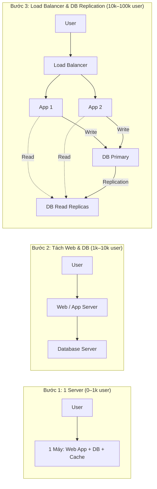
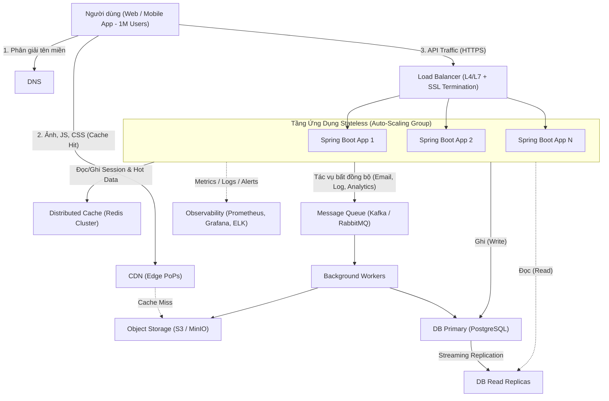

# Bài học Giai đoạn 0 — Phần 5: Mục Tiêu Đạt Được & Kiến Trúc Scale 1 → 1M User

[← Phần 4: Thực hành TechStore](./02-thuc-hanh-techstore.md) · [Quay lại GĐ 0 README](./README.md)

---

## Mục tiêu 1 — Giải thích vì sao nhìn `p99` chứ không nhìn trung bình (`avg`)

### Câu trả lời mẫu 60 giây (dùng cho phỏng vấn / review hệ thống)
> "Trung bình (`avg`) che giấu các điểm nghẽn ở phần đuôi (**long-tail latency**). Trong thực tế, 99% request có thể chạy trong 15ms, nhưng 1% request còn lại chậm 2–3 giây do cache miss, GC pause, lock contention hoặc query nặng — kéo trải nghiệm của những user tích cực nhất (giỏ hàng lớn, nhiều dữ liệu) xuống rất tệ, trong khi `avg` vẫn đẹp (~35ms). Hơn nữa, trong kiến trúc microservice, một trang web thường gọi nhiều API con song song; chỉ cần một API con dính `p99`, cả trang của user sẽ bị chậm theo (**tail latency amplification**). Vì vậy, các hệ thống production đặt **SLO dựa trên `p95`/`p99`**, chứ không đặt theo `avg`."

### 3 lý do cốt lõi cần nhớ
1. **Phân phối latency bị lệch phải (Right-skewed):** Phần lớn request nhanh, nhưng phần đuôi rất dài. Chỉ cần 1 outlier 5,000ms cũng đủ làm user bỏ giỏ hàng, dù `avg` nhìn vẫn ổn.
2. **User quan trọng nhất hay rơi vào `p99`:** Khách hàng VIP có lịch sử đơn hàng dày, giỏ hàng nhiều sản phẩm hoặc tìm kiếm bộ lọc phức tạp chính là nhóm hay gặp latency cao nhất.
3. **Khuếch đại khi fan-out:** Nếu trang chi tiết TechStore gọi song song 10 service nội bộ (Product, Price, Stock, Promo, Review, Recommendation…) và mỗi service có `p99` là `1%` bị chậm, xác suất ít nhất 1 service bị chậm khi render 1 trang là:
   $$1 - 0.99^{10} \approx 9.6\% \quad (\text{gần 1/10 lượt tải trang bị chậm!})$$

---

## Mục tiêu 2 — Tự ước lượng một bài toán bất kỳ trong 5 phút với số liệu tròn

### Playbook ước lượng 5 phút (5 bước theo đồng hồ)

| Phút | Việc cần làm | Quy tắc số tròn áp dụng |
| :---: | :--- | :--- |
| **0:00 – 1:00** | Chốt DAU, tỷ lệ đọc/ghi, số action/user/ngày | Dùng số tròn lũy thừa 10: `100K`, `1M`, `10M` |
| **1:00 – 2:00** | Tính **Avg QPS** và **Peak QPS** | `1 ngày = 10^5 giây`; `Peak = 2x–3x Avg` |
| **2:00 – 3:00** | Tính **Storage 5 năm** (DB + Media) | `1 năm ≈ 365 ngày ≈ 3.6 × 10^2 ngày`; `1KB / 1MB / 1GB` |
| **3:00 – 4:00** | Tính **Bandwidth** & **Cache Size (20%)** | `Bandwidth = QPS × Payload`; `Cache = 20% lượng đọc ngày` |
| **4:00 – 5:00** | Chốt **Số Server** & rút ra **Kết luận kiến trúc** | Trả lời: *1 DB đủ chưa? Cần CDN/Cache không? Nghẽn ở đâu?* |

### 2 bài tập tự luyện bấm giờ (5 phút/bài)

#### Bài tập A: Hệ thống Rút gọn URL (URL Shortener — chuẩn bị cho GĐ 4)
- **Đề bài:** `100 triệu` link mới tạo mỗi tháng. Tỷ lệ đọc : ghi = `100 : 1`. Lưu trữ trong `5 năm`. Mỗi bản ghi URL dài ~`500 bytes`.
- **Tự tính trong 5 phút rồi đối chiếu:**
  

  
Xem lời giải số tròn tham khảo

  1. **Write QPS:** $100\text{M} / (30 \times 10^5\text{s}) \approx 10^8 / (3 \times 10^6) \approx \mathbf{33 \text{ Write QPS}}$ (~`38 QPS` nếu chia `2.59M`s).
  2. **Read QPS:** $33 \times 100 = \mathbf{3,300 \text{ Read QPS}}$ → **Peak Read QPS (3x):** **~`10,000 QPS`**.
  3. **Storage 5 năm:** $100\text{M/tháng} \times 12 \times 5 = 6\text{ tỷ bản ghi} \times 500\text{ B} = \mathbf{3 \text{ TB}}$.
  4. **Cache (20% hot links/ngày):** Đọc/ngày $\approx 3,300 \times 10^5 = 330\text{M}$ lượt → 20% $\approx 66\text{M} \times 500\text{ B} \approx \mathbf{33 \text{ GB RAM}}$ (1 cụm Redis vừa đủ!).
  5. **Kết luận:** Hệ thống **read-heavy cực mạnh**, cần Redis cache trước DB và Read Replicas.

  

#### Bài tập B: Hệ thống Chat 1-1 cho công ty / cộng đồng
- **Đề bài:** `5 triệu DAU`. Trung bình mỗi người gửi `20 tin nhắn/ngày`, mỗi tin dài `100 bytes`. Lưu lịch sử `5 năm`.
- **Tự tính trong 5 phút rồi đối chiếu:**
  

  
Xem lời giải số tròn tham khảo

  1. **Số tin nhắn/ngày:** $5\text{M} \times 20 = 100\text{M tin/ngày}$.
  2. **Avg Write QPS:** $100\text{M} / 10^5 = \mathbf{1,000 \text{ QPS}}$ → **Peak QPS (3x):** **~`3,000 QPS`**.
  3. **Storage 1 ngày:** $100\text{M} \times 100\text{ B} = \mathbf{10 \text{ GB/ngày}}$.
  4. **Storage 5 năm:** $10\text{ GB} \times 365 \times 5 \approx \mathbf{18.25 \text{ TB}}$ (cần tính đến partitioning/archiving và NoSQL/Wide-column hoặc sharded DB!).
  5. **Bandwidth:** $1,000 \times 100\text{ B} = 100\text{ KB/s}$ (nhẹ về text, nhưng rất nặng về **số lượng kết nối WebSocket đồng thời** — nếu 5M user online cùng lúc sẽ cần nhiều Chat Server chuyên giữ connection!).

  

---

## Mục tiêu 3 — Thuộc 4 bước của Framework & biết mỗi bước làm gì

1. **Bước 1 — Hiểu bài toán & Làm rõ yêu cầu (3–10 phút):**
   - *Hỏi làm rõ:* Ai dùng? Tính năng cốt lõi (MVP 3–4 gạch đầu dòng)? Quy mô DAU/QPS? Yêu cầu Latency `p99`, Consistency hay Availability?
   - *Chốt số:* Back-of-the-envelope QPS, Peak, Storage, Bandwidth.
2. **Bước 2 — High-Level Design & Đạt đồng thuận (10–15 phút):**
   - *Vẽ luồng chính:* Client → DNS/CDN → LB/API Gateway → App Services → Cache/DB/Queue.
   - *Nêu rõ:* API Contract chính (`POST /orders`, `GET /products/{id}`) và Data Schema cơ bản.
   - *Hỏi interviewer:* "Khung tổng thể như vậy ổn chưa, mình đi sâu vào phần X nhé?"
3. **Bước 3 — Design Deep Dive (10–25 phút):**
   - *Tập trung điểm nóng:* Tách đọc/ghi DB, chiến lược cache & invalidation, xử lý điểm nghẽn Peak QPS, tránh Single Point of Failure, giải quyết trade-off giữa các phương án.
4. **Bước 4 — Wrap-up (3–5 phút):**
   - *Nhìn lại toàn cục:* Còn bottleneck nào chưa xử lý? Monitoring/Alerting (Metrics, Logs, Tracing)? Xử lý khi 1 datacenter/service chết? Hướng scale tiếp từ 1M lên 10M–100M user.

---

## Mục tiêu 4 — Bản vẽ kiến trúc "Scale từ 1 Server đến 1 Triệu User"

*(Tổng hợp theo tiến trình từ **Alex Xu Vol.1 — Ch.1**, áp dụng trực tiếp vào bài toán web/e-commerce như **TechStore**).*

### Giai đoạn tiến hóa A → B → C (Từ 1 Server đến Multi-Instance + DB Replication)

### Kiến trúc hoàn chỉnh ở mức 1 Triệu User (Scale Out + Cache + CDN + Queue)

### Bảng giải thích từng bước nâng cấp (Mỗi thành phần giải quyết vấn đề gì?)

| Bước nâng cấp | Bottleneck giải quyết được | Thành phần mới & Lưu ý |
| :--- | :--- | :--- |
| **1 → 2. Tách App & DB** | Web và DB không còn tranh giành CPU/RAM trên cùng 1 máy | Dễ scale riêng từng tầng; nhưng mỗi tầng vẫn là Single Point of Failure (SPOF). |
| **2 → 3. Thêm Load Balancer + Multiple App** | Hết nghẽn CPU tầng Web; loại bỏ SPOF ở App tier | App buộc phải **Stateless** (không lưu session trong RAM). |
| **3 → 4. DB Primary + Read Replicas** | Giảm tải đọc cho DB (thường 80–90% traffic là đọc) | Phát sinh **Replication Lag** (sẽ xử lý sâu ở GĐ 1). |
| **4 → 5. Thêm Redis Cache + CDN** | Giảm latency xuống vài ms; giảm mạnh tải lên DB và Origin | Cần xử lý **TTL, Cache Invalidation, Cache Stampede** (học ở GĐ 2). |
| **5 → 6. Tách Session ra Redis + Multi-AZ** | Chịu lỗi cả 1 server hoặc 1 vùng (Availability Zone) | Đảm bảo High Availability (`99.9%–99.99%`). |
| **6 → 7. Thêm Message Queue + Workers** | Không bắt user chờ gửi mail, xử lý ảnh, xuất báo cáo | Giảm `p99` latency cho API chính; tăng khả năng chịu tải đột biến (**buffering**). |
| **7 → 8. Observability (Metrics + Logs)** | Trước khi có sự cố không biết hệ thống nghẽn ở đâu | Theo dõi `p50`/`p95`/`p99`, QPS, error rate, CPU, DB connections. |
| **Giai đoạn sau (10M+ user)** | Khi 1 DB Primary không chịu nổi lượng **Write** hoặc dung lượng quá lớn | Chuyển sang **Database Sharding / Partitioning** (trọng tâm **GĐ 1**) và tách **Microservices** (**GĐ 3**). |

---

## Checklist hoàn thành Giai đoạn 0

- [ ] Đọc xong [01-concepts.md](./01-concepts.md) và tự vẽ lại được sự khác nhau giữa L4 vs L7, CAP vs PACELC.
- [ ] Hoàn thành đủ 3 bài thực hành trong [02-thuc-hanh-techstore.md](./02-thuc-hanh-techstore.md) và điền số liệu đo `p50`/`p99` vào bảng.
- [ ] Tự kiểm tra đạt đủ 4 mục tiêu ở trên (đặc biệt: tự nhẩm bài toán mới trong 5 phút và giải thích được sơ đồ Scale 1 → 1M user không cần nhìn tài liệu).
