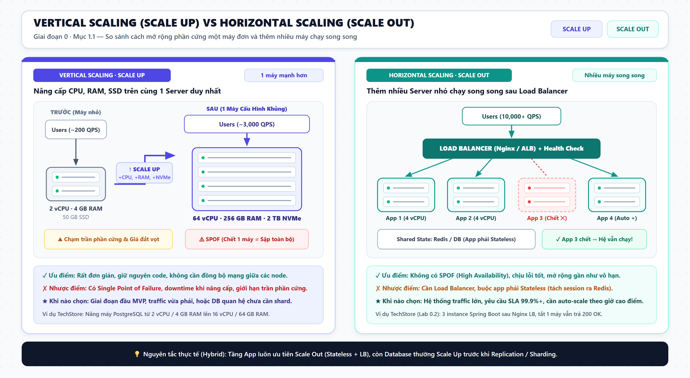
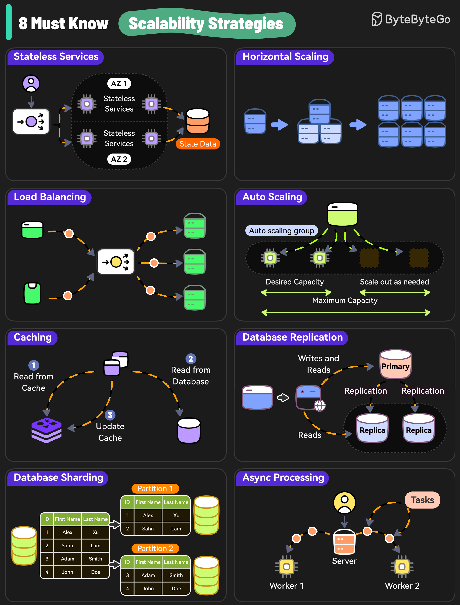
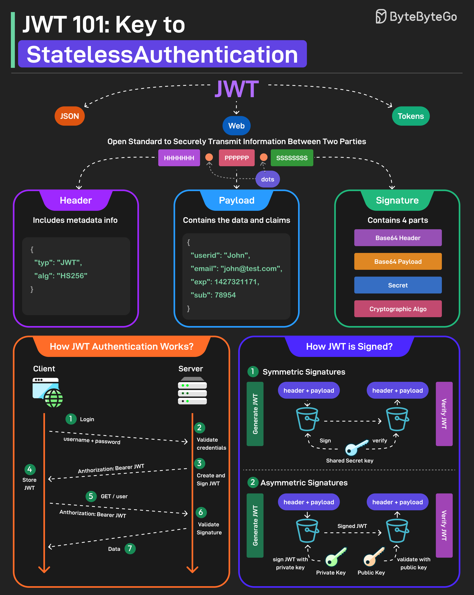
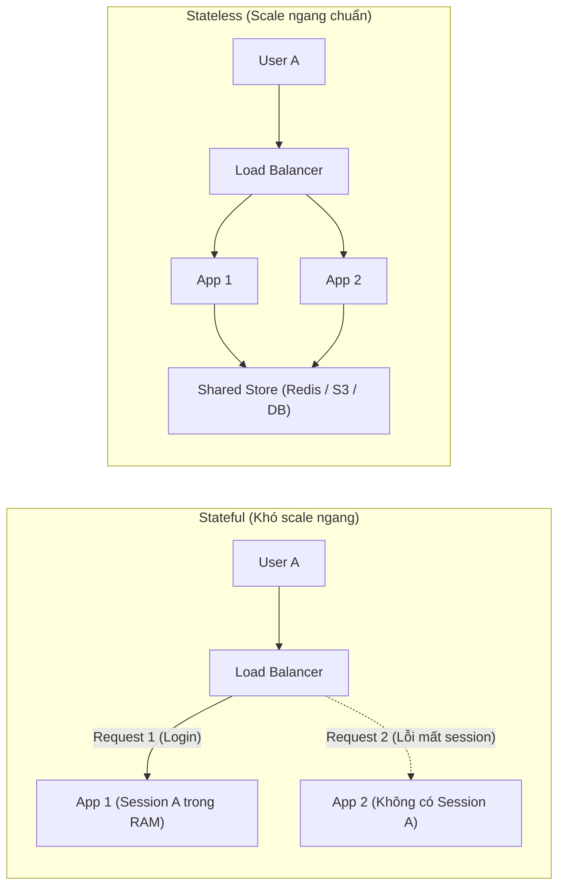

# Bài 1: Vertical vs Horizontal Scaling & Stateless vs Stateful

[← Mục lục Concepts](./README.md) · [Quay lại GĐ 0 README](../README.md) · [Bài 2: Load Balancer, Proxy & CDN →](./02-load-balancer-proxy-cdn.md)

---

## 1.1. Vertical Scaling (Scale Up) vs Horizontal Scaling (Scale Out)

*Nguồn: [karanpratapsingh/system-design](https://github.com/karanpratapsingh/system-design) (CC BY-NC-ND 4.0)*

*Nguồn: [ByteByteGoHq/system-design-101](https://github.com/ByteByteGoHq/system-design-101) (CC BY-NC-ND 4.0)*

### Tại sao phải Scale?
Khi mới ra mắt (ví dụ **TechStore** phục vụ vài trăm khách/ngày), toàn bộ hệ thống có thể chạy gọn trên **1 server duy nhất** (`2 vCPU, 4 GB RAM`), xử lý ổn định khoảng `150–200 QPS`. Nhưng khi lượng người dùng tăng gấp 10–20 lần hoặc vào giờ cao điểm Flash Sale, các tài nguyên vật lý lần lượt chạm ngưỡng:
- **CPU đạt 100%:** Request mới phải xếp hàng chờ xử lý.
- **RAM đầy:** JVM dính Garbage Collection liên tục hoặc OS phải swap ra ổ đĩa (chậm đi hàng nghìn lần), dẫn tới `OutOfMemoryError`.
- **I/O & Network nghẽn:** Độ trễ `p99` vọt từ `30ms` lên `5–10s`, sau đó người dùng nhận lỗi `504 Gateway Timeout`.

Để nâng công suất chịu tải, kỹ sư hệ thống có hai chiến lược mở rộng cốt lõi: **Vertical Scaling (Scale Up)** và **Horizontal Scaling (Scale Out)**.

### A. Vertical Scaling (Scale Up — Mở rộng theo chiều dọc)
**Vertical Scaling** là cách **nâng cấp sức mạnh phần cứng cho chính 1 máy chủ duy nhất** (thay máy nhỏ bằng máy to hơn): tăng số nhân CPU (`2 → 16 → 64 vCPU`), tăng dung lượng RAM (`4 GB → 64 GB → 256 GB`), nâng ổ đĩa lên SSD NVMe nhanh hơn hoặc tăng băng thông card mạng.

**Ưu điểm (Vì sao giai đoạn đầu cực kỳ hiệu quả?):**
1. **Không phải sửa kiến trúc hay code:** Toàn bộ ứng dụng vẫn chạy trên 1 máy, giao tiếp qua bộ nhớ chung (`~100 ns`), không cần cấu hình Load Balancer, không mất công serialize dữ liệu qua mạng giữa nhiều server.
2. **Độ trễ nội bộ thấp & Không lo đồng bộ phân tán:** Không có vấn đề đồng nhất dữ liệu giữa các node hay race condition xuyên mạng.
3. **Vận hành đơn giản:** Chỉ có 1 máy để deploy, 1 nơi chứa file log, 1 chỗ theo dõi và backup.

**4 giới hạn chí mạng khi hệ thống lớn dần:**
1. **Trần phần cứng (Hardware Ceiling):** Bạn không thể nâng cấp mãi mãi một chiếc máy đơn — phần cứng luôn có giới hạn tối đa về số khe RAM, socket CPU và băng thông bus.
2. **Chi phí tăng phi tuyến (Non-linear Cost):** Một máy chủ siêu mạnh gấp 8 lần thường có giá thuê/mua **đắt hơn nhiều** so với 8 máy phổ thông ghép lại (vì đòi hỏi linh kiện server đặc chủng).
3. **Single Point of Failure (SPOF):** Toàn bộ hệ thống phụ thuộc vào một máy duy nhất. Chỉ cần hỏng nguồn, lỗi ổ cứng hay treo kernel là **100% dịch vụ sập hoàn toàn**.
4. **Khó tránh Downtime khi nâng cấp:** Nhiều thao tác nâng phần cứng hoặc khởi động lại máy yêu cầu tắt server tạm thời, không đáp ứng được SLA `99.99%`.

### B. Horizontal Scaling (Scale Out — Mở rộng theo chiều ngang)
**Horizontal Scaling** là cách **thêm nhiều máy chủ (hoặc container/pod) kích thước vừa phải chạy song song** thành một cụm (ví dụ từ `1` instance Spring Boot lên `4` hoặc `20` instances giống nhau). Phía trước cụm đặt một **Load Balancer** (như Nginx, HAProxy, AWS ALB) để tiếp nhận toàn bộ traffic và điều phối đều cho các máy bên dưới.

**Ưu điểm vượt trội ở quy mô lớn:**
1. **Chịu lỗi cao & Không còn SPOF (High Availability):** Load Balancer liên tục gửi **Health Check** tới từng node. Nếu `App 3` sập đột ngột, Load Balancer tự động ngừng đưa request vào `App 3` và chuyển hết sang `App 1, 2, 4` → người dùng không nhận ra sự cố!
2. **Mở rộng gần như tuyến tính & Auto-scaling theo tải thực:** Trong giờ cao điểm tối hoặc Flash Sale, hệ thống có thể tự động bật thêm máy (`scale out`); đến nửa đêm vắng khách thì tự tắt bớt (`scale in`) để tiết kiệm chi phí Cloud.
3. **Zero-downtime Deployment (Rolling Update):** Khi phát hành tính năng mới, bạn có thể nâng cấp từng máy một (`App 1` → `App 2` → ...) trong khi các máy khác vẫn tiếp tục phục vụ khách hàng.
4. **Chi phí tối ưu bằng máy phổ thông (Commodity Hardware):** Ghép nhiều máy cấu hình trung bình (vd `4 vCPU / 8 GB`) rẻ và linh hoạt hơn rất nhiều so với mua một siêu máy chủ.

**Những thách thức kỹ thuật mới phải đánh đổi:**
1. **Ứng dụng buộc phải Stateless:** Không được lưu phiên đăng nhập (`HttpSession`) trong RAM hoặc lưu ảnh upload tạm lên ổ đĩa riêng của từng máy (xem chi tiết ở mục **1.2** bên dưới).
2. **Phức tạp hơn về hạ tầng & vận hành:** Phải quản lý thêm Load Balancer (và chính Load Balancer cũng cần dự phòng cặp Active-Passive/Active-Active để không biến thành SPOF mới!), phải có hệ thống gom Log tập trung (ELK/Loki) và Monitoring tập trung (Prometheus/Grafana) thay vì SSH vào 1 máy xem log.
3. **Nút thắt cổ chai chuyển sang tầng Database:** Nếu bạn scale Web App ra **50 instances**, cả 50 instances đó cùng mở kết nối tới **1 PostgreSQL duy nhất** → Database sẽ sập vì cạn connection pool hoặc nghẽn ghi đĩa! Lúc đó bạn buộc phải học tiếp Replication và Sharding ở **Giai đoạn 1**.

### C. Thực tế kết hợp cả hai như thế nào? (Hybrid Approach)
Trong thiết kế hệ thống thực tế, kỹ sư **không chọn cực đoan chỉ dùng 1 cách** mà áp dụng linh hoạt theo từng tầng:
- **Tầng Web / App Server (Stateless):** Ưu tiên **Scale Out (Horizontal)** — chạy tối thiểu 2–3 instances sau Load Balancer để vừa chịu tải cao, vừa tránh SPOF và deploy không downtime.
- **Tầng Database (Stateful):** Ở giai đoạn đầu, **Scale Up (Vertical)** là lựa chọn thông minh và kinh tế nhất (giữ nguyên tính nhất quán ACID trên 1 node, không dính Replication Lag hay Cross-shard JOIN). Chỉ khi 1 máy DB rất mạnh vẫn quá tải đọc mới thêm **Read Replicas**, và khi quá tải ghi/dung lượng mới phải **Sharding**.

> [!TIP]
> **Mẹo trả lời phỏng vấn:** Đừng bao giờ nói *"Em sẽ dùng Horizontal Scaling cho mọi thứ ngay từ đầu"*. Câu trả lời chuẩn Senior là: *"Ở quy mô nhỏ/MVP, em dùng Vertical Scaling cho đơn giản và rẻ; khi traffic tăng hoặc cần High Availability (loại bỏ SPOF), em chuyển tầng App sang Stateless để Horizontal Scaling sau Load Balancer, còn Database sẽ Scale Up trước khi áp dụng Replication/Sharding."*

### Bảng so sánh tóm tắt

| Tiêu chí | Vertical Scaling (Scale Up) | Horizontal Scaling (Scale Out) |
| :--- | :--- | :--- |
| **Cách làm** | Nâng cấp phần cứng 1 máy (thêm CPU, RAM, SSD NVMe) | Thêm nhiều máy/instance chạy song song sau Load Balancer |
| **Độ phức tạp** | Rất thấp, không cần sửa kiến trúc app | Cao hơn: cần Load Balancer, app Stateless, gom log tập trung |
| **Giới hạn (Trần)** | Có giới hạn vật lý & chi phí tăng phi tuyến ở cấu hình cao | Gần như mở rộng tuyến tính nếu app stateless |
| **High Availability** | Có Single Point of Failure (SPOF) — máy chết là sập toàn bộ | Chịu lỗi tốt — 1 máy chết còn máy khác phục vụ |
| **Deploy / Nâng cấp** | Thường có downtime khi nâng phần cứng / reboot | Rolling update không gián đoạn (zero-downtime) |
| **Khi nào chọn?** | Giai đoạn đầu, traffic vừa phải, DB quan hệ chưa cần shard | Traffic lớn, cần HA, cần auto-scale theo giờ cao điểm |

---

## 1.2. Stateless vs Stateful Architecture

Để thực hiện được **Horizontal Scaling (Scale Out)** cho tầng Web/App, điều kiện tiên quyết là biến tầng App thành **Stateless**. Vậy *"State"* là gì và nó gây rắc rối ra sao?

### "State" (Trạng thái) trong Web Application là gì?
Là những thông tin được giữ lại giữa các HTTP request của cùng một người dùng:
- **Session State:** Thông tin user đã đăng nhập (`userId`, `role`), giỏ hàng tạm, mã OTP vừa gửi.
- **Local File State:** Ảnh sản phẩm hoặc file PDF người dùng upload lên, tạm thời ghi vào thư mục `/tmp/uploads` trên ổ cứng của máy chủ.
- **In-memory Cache cục bộ:** Biến `HashMap` lưu giỏ hàng hoặc bộ đếm rate-limit trong RAM của tiến trình Java.

### Stateful Server & Thảm họa khi Scale Out
Một server **Stateful** lưu các thông tin trên **ngay bên trong RAM hoặc ổ đĩa cục bộ** của chính instance đó.
- **Kịch bản lỗi:** User A gửi request `POST /login` → Load Balancer đưa vào `App 1` → `App 1` lưu `Session_A` vào RAM của `App 1`. Một giây sau, User A bấm `GET /cart` → Load Balancer chia tải sang `App 2` → `App 2` tìm trong RAM không thấy `Session_A` → **User A bị đá ra màn hình đăng nhập!**
- **Giải pháp chắp vá "Sticky Sessions" (Session Affinity):** Cấu hình Load Balancer luôn gắn `User A` vào đúng `App 1` dựa theo Cookie hoặc IP. Tuy nhiên cách này có **3 nhược điểm lớn**:
  1. **Lệch tải (Load Skew):** Một user hoặc 1 văn phòng công ty dùng chung IP NAT bắn hàng nghìn request sẽ dồn hết vào `App 1`, trong khi `App 2, 3` nhàn rỗi.
  2. **Mất dữ liệu khi restart/crash:** Nếu `App 1` sập hoặc bạn deploy bản code mới lên `App 1`, toàn bộ session/giỏ hàng trong RAM của `App 1` bốc hơi!
  3. **Cản trở Auto-scaling:** Khó thu hồi instance khi có user đang dính sticky trên đó.

### Stateless Server — Cách làm chuẩn để Scale vô hạn
Một server **Stateless** **không giữ bất kỳ trạng thái riêng nào theo từng user trong RAM/Disk cục bộ**. Mọi instance đều giống hệt nhau (`App 1 == App 2 == App N`) nên request tiếp theo rơi vào máy nào cũng xử lý được như nhau!

**Có 2 cách lưu State khi App đã Stateless:**
1. **Đẩy State ra Kho dữ liệu dùng chung (External Shared Store):**
   - Session, giỏ hàng, OTP → lưu vào **Redis** (độ trễ đọc/ghi chỉ `~0.5–1ms`).
   - File ảnh, video, tài liệu upload → lưu thẳng lên **Object Storage (AWS S3 / MinIO)**.
   - Dữ liệu giao dịch lâu dài → lưu vào **PostgreSQL**.
2. **Đẩy State về phía Client (Stateless Token — JWT):**
   - Khi login, Server ký số một chuỗi **JWT (JSON Web Token)** chứa `{ userId, role, exp }` rồi trả cho Client. Các request sau Client tự đính kèm JWT vào Header `Authorization: Bearer ...` → Server nào cũng tự kiểm tra chữ ký và biết ngay user là ai mà không cần hỏi Redis!
   - *Lưu ý trade-off của JWT:* Rất nhẹ và nhanh vì không cần DB lookup, nhưng **khó thu hồi (revoke) ngay lập tức** trước khi token hết hạn (ví dụ khi user bấm "Đăng xuất khỏi mọi thiết bị" hoặc bị khóa tài khoản → thực tế hay dùng JWT ngắn hạn `15 phút` + Refresh Token lưu trong Redis/DB!).

*Nguồn: [ByteByteGoHq/system-design-101](https://github.com/ByteByteGoHq/system-design-101) (CC BY-NC-ND 4.0)*

