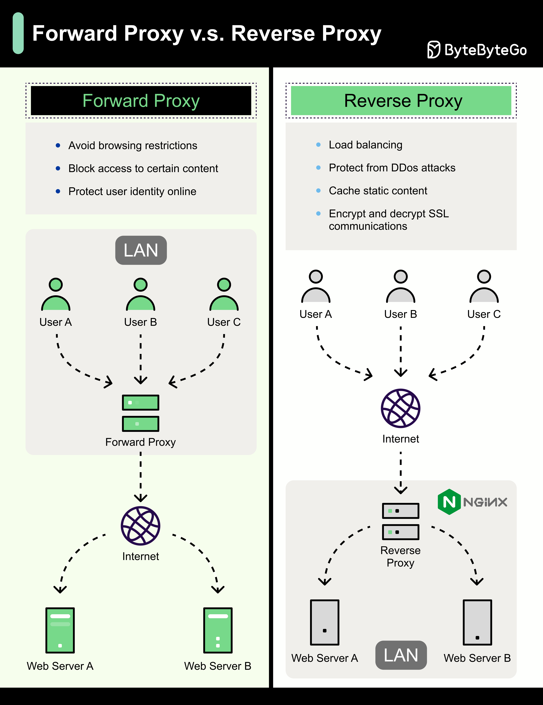
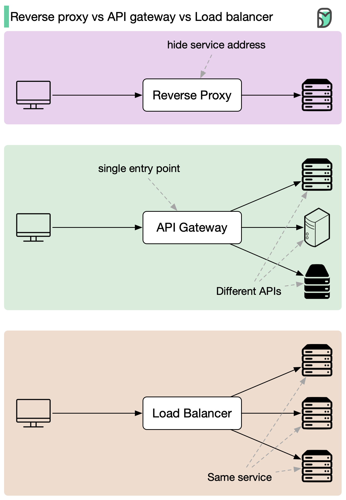
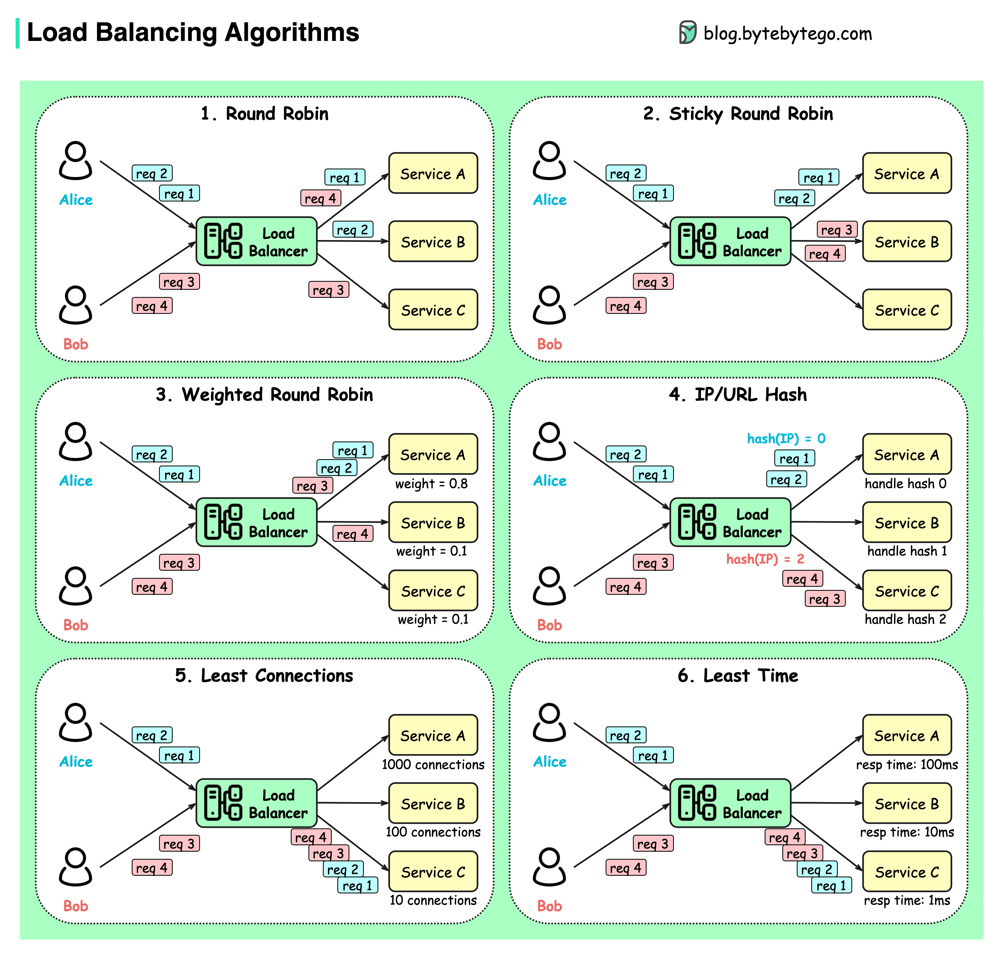
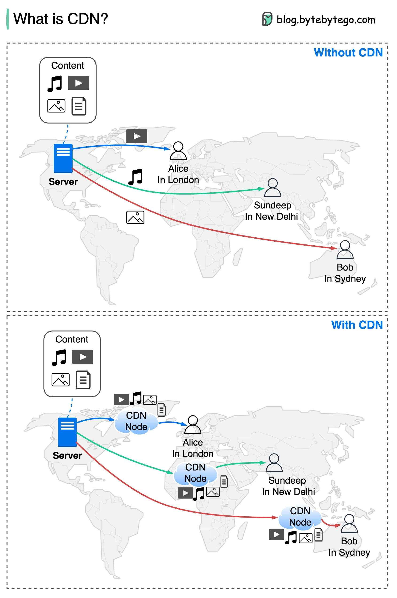

# Bài 2: Load Balancer (L4/L7), Reverse Proxy & CDN

[← Bài 1: Scaling & Stateless](./01-scaling-va-stateless.md) · [Mục lục Concepts](./README.md) · [Bài 3: Latency, Throughput & Số 9 →](./03-latency-throughput-sla.md)

---

## 2.1. Phân biệt Forward Proxy vs Reverse Proxy vs Load Balancer

Nhiều người mới hay nhầm lẫn 3 khái niệm này vì đều đứng "trung gian" trên đường truyền mạng. Cách nhớ đơn giản nhất là hỏi: **"Nó đứng về phe ai?"**

*Nguồn: [ByteByteGoHq/system-design-101](https://github.com/ByteByteGoHq/system-design-101) (CC BY-NC-ND 4.0)*

*Nguồn: [ByteByteGoHq/system-design-101](https://github.com/ByteByteGoHq/system-design-101) (CC BY-NC-ND 4.0)*

1. **Forward Proxy (Đứng phía Client):**
   - Đại diện cho **Client** đi gọi ra các server bên ngoài Internet. Server đích chỉ thấy IP của Proxy chứ không thấy IP thật của từng máy nhân viên/người dùng.
   - *Ứng dụng:* Mạng công ty chặn web đen/mạng xã hội, tường lửa kiểm soát nhân viên truy cập ra ngoài, hoặc cache chung các file tải về để tiết kiệm băng thông đường truyền công ty.
2. **Reverse Proxy (Đứng phía Server):**
   - Đại diện cho **Server** đón toàn bộ request từ Internet đi vào. Client tưởng mình đang nói chuyện trực tiếp với server chính, không hề biết IP nội bộ thật của các backend phía sau.
   - *5 công việc thực tế Reverse Proxy làm giúp Backend:*
     - **SSL/TLS Termination:** Giải mã HTTPS ngay tại Reverse Proxy để giải phóng CPU cho các instance Spring Boot phía sau (bên trong mạng nội bộ giao tiếp HTTP thuần cho nhanh).
     - **Che giấu kiến trúc nội bộ & Bảo mật:** Ngăn hacker quét thẳng port của database hay từng server riêng lẻ.
     - **Nén dữ liệu (Gzip / Brotli):** Nén JSON/HTML trước khi gửi qua Internet giúp giảm 60–80% dung lượng băng thông.
     - **Cache tài nguyên tĩnh nhẹ & Rate Limiting sơ bộ.**
3. **Load Balancer (LB):**
   - Thực chất là một **Reverse Proxy chuyên biệt** đứng trước **từ 2 backend server trở lên**, có nhiệm vụ: *(1) Phân chia lưu lượng hợp lý để không máy nào bị quá tải*, và *(2) Chạy **Health Check** để tự loại bỏ node chết*.
   - **Lưu ý tránh SPOF:** Bản thân Load Balancer không được phép là điểm chết duy nhất! Trong production luôn chạy **cặp Load Balancer (Active–Passive dùng Keepalived/VRRP, hoặc Active–Active qua DNS/Anycast)**.

---

## 2.2. Load Balancer Layer 4 (L4) vs Layer 7 (L7)

Theo mô hình mạng OSI 7 tầng, L4 hoạt động ở tầng **Transport (TCP/UDP)** còn L7 hoạt động ở tầng **Application (HTTP/HTTPS/gRPC/WebSocket)**.

| Tiêu chí | L4 Load Balancer (Transport Layer) | L7 Load Balancer (Application Layer) |
| :--- | :--- | :--- |
| **Thông tin đọc được** | Chỉ thấy **IP nguồn, IP đích và Port TCP/UDP** (4-tuple) | Đọc được toàn bộ **HTTP Method, URL Path, Headers, Cookie, Body** |
| **Cơ chế truyền gói tin** | Chuyển tiếp từng gói tin (**NAT** hoặc **DSR — Direct Server Return**); không cần giải mã TLS hay ghép lại thành HTTP message | **Terminate kết nối TCP & TLS** với Client, parse xong HTTP request mới mở kết nối riêng tới Backend |
| **Hiệu năng & Độ trễ** | **Cực nhanh**, tiêu tốn rất ít CPU/RAM, chịu tải hàng triệu kết nối/giây | Chậm hơn L4 một chút do chi phí giải mã TLS & parse chuỗi HTTP |
| **Khả năng định tuyến thông minh** | Không phân biệt được `/api/orders` với `/api/products` | Route theo URL (`/orders` → cụm Order, `/products` → cụm Product), A/B testing, Canary release theo Header/Cookie |
| **Ví dụ phổ biến** | AWS NLB, Linux IPVS, HAProxy (`mode tcp`), Nginx `stream` | Nginx HTTP, Envoy, AWS ALB, Traefik, Spring Cloud Gateway |

> **Kiến trúc chuẩn ở hệ thống lớn:** Kết hợp cả hai tầng! Đặt **L4 Load Balancer ở lớp ngoài cùng** (dùng kỹ thuật *Anycast / ECMP* để chịu hàng triệu packet/s mà không bị nghẽn), sau đó chuyển tiếp vào một **cụm nhiều L7 Load Balancer / API Gateway** (Nginx/Envoy) bên trong để định tuyến chi tiết tới từng Microservice.

---

## 2.3. Các thuật toán Load Balancing & Health Checks

*Nguồn: [ByteByteGoHq/system-design-101](https://github.com/ByteByteGoHq/system-design-101) (CC BY-NC-ND 4.0)*

1. **Round Robin (Xoay vòng):** Chia đều lần lượt `1 → 2 → 3 → 1`. *Hạn chế:* Giả định mọi server mạnh ngang nhau và mọi request tốn thời gian xử lý như nhau.
2. **Weighted Round Robin:** Gán trọng số theo sức mạnh máy (vd máy 16 vCPU nhận `weight=4`, máy 4 vCPU nhận `weight=1`), hoặc dùng cho **Canary Release** (95% traffic vào bản cũ, 5% vào bản mới).
3. **Least Connections (Ít kết nối nhất):** Gửi request mới tới server đang xử lý ít kết nối mở nhất. *Tại sao cần?* Nếu 1 API xuất báo cáo Excel tốn `10 giây` còn API xem sản phẩm tốn `10 ms`, Round Robin có thể vô tình dồn hết các request `10 giây` vào đúng 1 máy làm máy đó treo, trong khi Least Connections tự tránh máy đang bận!
4. **Least Response Time:** Kết hợp cả số lượng kết nối đang mở lẫn thời gian phản hồi trung bình gần nhất — chọn server vừa rảnh vừa phản hồi nhanh nhất.
5. **IP Hash / Consistent Hashing:** Tính `hash(Client_IP)` để cố định một user vào cùng 1 backend (hữu ích khi backend có local in-memory cache). *Bẫy cần biết:* Nếu 500 nhân viên trong 1 tòa nhà đi qua chung 1 IP NAT của công ty, cả 500 người sẽ bị dồn hết vào **cùng 1 backend server**!

**Cơ chế Health Check (Phát hiện node chết):**
- **Active Health Check:** Load Balancer chủ động gọi `GET /actuator/health` mỗi `5 giây`; nếu thất bại `3 lần` liên tiếp thì rút server khỏi danh sách chia tải.
- **Passive Health Check:** Load Balancer theo dõi traffic thật đi qua (`max_fails=2 fail_timeout=10s` như trong Nginx ở [Lab 0.2](../02-thuc-hanh-techstore.md)); nếu thấy request trả về lỗi kết nối hoặc `502/503`, tự động thử lại sang node khác (`proxy_next_upstream`) và tạm cách ly node lỗi.

---

## 2.4. CDN (Content Delivery Network)

### Tại sao phải dùng CDN dù Server đã nhanh?
Dù server Spring Boot đặt ở Singapore xử lý một ảnh mất chỉ `1 ms`, nhưng **tốc độ ánh sáng trong cáp quang là hữu hạn**. Một người dùng ở Mỹ hoặc Châu Âu tải 20 bức ảnh sản phẩm và file JS `3 MB` từ Singapore sẽ phải chịu độ trễ mạng (`RTT ~180–250 ms` nhân với số lần handshake TCP + TLS + tải dữ liệu) mất tới **3–5 giây**!

**CDN** là mạng lưới hàng trăm máy chủ đặt khắp thế giới (**Edge Servers / Edge PoPs** — ví dụ Cloudflare, CloudFront, Akamai) lưu bản sao các tài nguyên gần người dùng nhất về mặt địa lý (kéo RTT từ `200ms` xuống chỉ còn `10–20ms`!).

*Nguồn: [ByteByteGoHq/system-design-101](https://github.com/ByteByteGoHq/system-design-101) (CC BY-NC-ND 4.0)*

### Push CDN vs Pull CDN

| Tiêu chí | Push CDN | Pull CDN *(Phổ biến nhất)* |
| :--- | :--- | :--- |
| **Cách hoạt động** | Bạn tự upload sẵn file mới lên các Edge CDN mỗi khi có dữ liệu mới | User đầu tiên ở Tokyo gọi `cdn.techstore.vn/a.jpg` → Edge chưa có (**Cache Miss**) → Edge tự kéo từ Origin Server (S3/App) về lưu lại theo header `Cache-Control: max-age=86400` → từ user thứ 2 trở đi nhận thẳng từ Edge (**Cache Hit**) |
| **Ưu điểm** | Luôn có sẵn bản mới ngay lượt truy cập đầu tiên; kiểm soát chặt thứ gì nằm trên CDN | Cực dễ tích hợp (chỉ trỏ domain qua CDN), chỉ lưu file thực sự có người xem |
| **Nhược điểm** | Tốn công viết logic upload/xóa thủ công; dễ tốn tiền lưu trữ file ít người xem | User đầu tiên tại mỗi khu vực PoP chịu chậm 1 lần (*cache miss*) |
| **Khi nào dùng?** | Site nhỏ, nội dung ít thay đổi, phát hành bản cài đặt/game lớn | Hầu hết web/e-commerce/streaming (TechStore, YouTube, Shopee) |

### Chiến lược Cache Invalidation (Làm mới file trên CDN)
- **Đặt TTL (`Cache-Control: public, max-age=86400`):** File hết hạn sau 1 ngày mới hỏi lại Origin.
- **Cache Purge / Invalidation API:** Bấm lệnh xóa file trên CDN ngay khi sửa (tốn thời gian vài giây đến vài phút lan tỏa khắp toàn cầu, đôi khi tính phí theo lượt purge).
- **Content Hashing / Versioning (Cách tối ưu nhất):** Gắn mã băm nội dung vào tên file (ví dụ `main.8f3a1c.js`, `banner-v2.webp`) và đặt TTL **1 năm**. Khi sửa code/ảnh, tên file đổi thành `main.9b2e04.js` → trình duyệt và CDN tự động tải bản mới ngay lập tức mà không bao giờ cần Purge!
