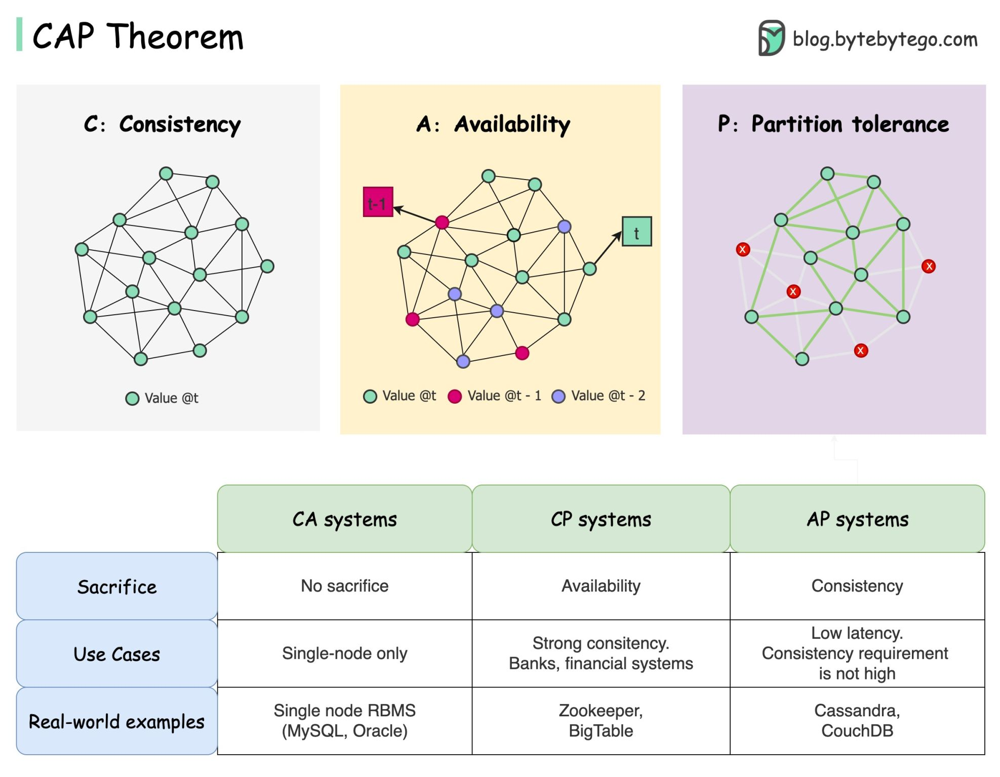
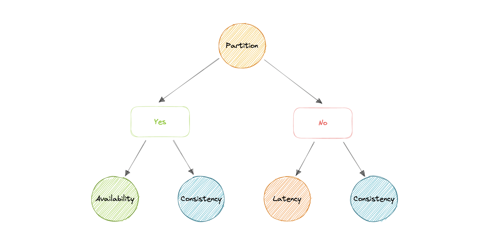

# Bài 4: Định Lý CAP & Mô Hình PACELC (Mức Khái Niệm)

[← Bài 3: Latency, Throughput & Số 9](./03-latency-throughput-sla.md) · [Mục lục Concepts](./README.md) · [Bài 5: Ước lượng nhanh →](./05-uoc-luong-nhanh.md)

---

## 4.1. Định lý CAP (Phá vỡ hiểu lầm "Chọn 2 trong 3")

*Nguồn: [ByteByteGoHq/system-design-101](https://github.com/ByteByteGoHq/system-design-101) (CC BY-NC-ND 4.0)*

Định lý CAP nói về **một hệ thống dữ liệu phân tán** (nhiều node lưu cùng dữ liệu qua mạng) khi xảy ra **chia tách mạng (Network Partition — P)**:
- **C (Consistency — thực chất là Linearizability):** Mọi thao tác đọc ở bất kỳ node nào đều phải trả về giá trị ghi mới nhất (như thể chỉ có 1 bản sao duy nhất) hoặc báo lỗi — không bao giờ trả dữ liệu cũ.
- **A (Availability):** Mọi request gửi tới một node **còn sống** đều phải nhận được phản hồi thành công (không trả lỗi timeout/503), dù node đó có thể chưa cập nhật dữ liệu mới nhất.
- **P (Partition Tolerance):** Hệ thống vẫn tiếp tục hoạt động dù đường truyền mạng giữa các node bị đứt hoặc rớt gói tin.

> [!IMPORTANT]
> **Hiểu cho thật đúng (tránh sai lầm phỏng vấn kinh điển):**
> Nhiều bạn học vẹt nói *"CAP là chọn 2 trong 3: CA, CP, hoặc AP"*. **Điều này SAI trong hệ phân tán!**
> Trên mạng máy tính thực tế, đứt mạng (**P**) là sự cố vật lý **chắc chắn có lúc xảy ra** (đứt cáp quang, switch hỏng, GC pause làm mất kết nối) — bạn không thể "bỏ chọn P" để lấy "CA" (chỉ có 1 máy đơn không phân tán mới là CA!).
>
> **Vậy tình huống thật khi đứt mạng giữa `Node 1` và `Node 2` là gì?**
> Giả sử cáp mạng giữa `Node 1` và `Node 2` đứt. User A vừa ghi `stock = 9` vào `Node 1`, nhưng `Node 1` không thể gửi sang `Node 2`. Ngay sau đó User B hỏi `Node 2` xem `stock` còn mấy:
> - **Chọn CP (Ưu tiên Consistency):** `Node 2` biết mình bị mất liên lạc với `Node 1` nên **từ chối trả lời (trả lỗi)** để tuyệt đối không đưa nhầm `stock = 10` cũ! *(Ví dụ: Số dư ngân hàng, ZooKeeper, etcd, hệ thống trừ kho nghiêm ngặt).*
> - **Chọn AP (Ưu tiên Availability):** `Node 2` **vẫn trả lời `200 OK`** với giá trị cũ `stock = 10` để user không bị gián đoạn; khi mạng nối lại mới đồng bộ và giải quyết xung đột. *(Ví dụ: Giỏ hàng Amazon, DNS, số lượt view/like, Feed mạng xã hội).*

---

## 4.2. PACELC — Bổ sung cho trường hợp mạng bình thường

*Nguồn: [karanpratapsingh/system-design](https://github.com/karanpratapsingh/system-design) (CC BY-NC-ND 4.0)*

CAP chỉ mô tả hành xử **lúc mạng bị đứt (P)**. Nhưng 99.9% thời gian mạng chạy bình thường thì sao? Mô hình **PACELC** bổ sung thêm nửa sau cực kỳ thực tế:
- **P** (Nếu có **Partition**): chọn **A** (Availability) hay **C** (Consistency)?
- **E** (**Else** — lúc mạng **bình thường không đứt**): chọn **L** (Low Latency — độ trễ thấp) hay **C** (Consistency — nhất quán chặt)?

*Tại sao lúc bình thường lại phải chọn giữa Latency và Consistency?*
Vì nếu Leader ở Singapore muốn đảm bảo mọi Replica ở Mỹ/Tokyo luôn nhất quán 100% (**EC**) trước khi báo `OK`, nó bắt buộc phải chờ mạng xuyên lục địa phản hồi (`+100–150 ms`!). Còn nếu muốn phản hồi tức thì trong `1 ms` (**EL**), Leader ghi xong trả `OK` ngay và gửi bất đồng bộ sang Replica sau — cực nhanh nhưng tạo độ trễ đồng bộ!

| Phân loại | Lúc đứt mạng (P) | Lúc bình thường (E) | Hệ thống tiêu biểu |
| :--- | :--- | :--- | :--- |
| **PA / EL** | Chọn **Availability** | Chọn **Low Latency** (replicate bất đồng bộ) | DynamoDB (mặc định), Cassandra, Redis Replication |
| **PC / EC** | Chọn **Consistency** | Chọn **Consistency** (đồng bộ quorum/sync, chịu chậm hơn) | Google Spanner, PostgreSQL Sync Replication, HBase |
| **PA / EC** | Chọn **Availability** | Chọn **Consistency** (bình thường vẫn chờ đồng bộ) | MongoDB (khi bật writeConcern majority & readConcern majority) |
