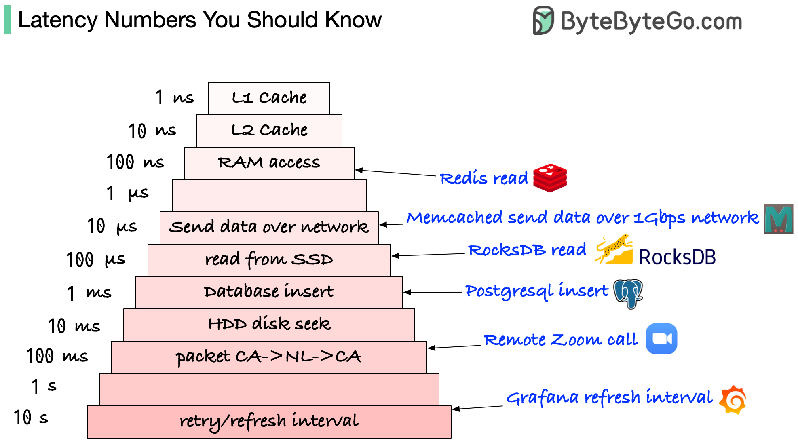

# Bài 5: Ước Lượng Nhanh (Back-of-the-Envelope Estimation)

[← Bài 4: CAP & PACELC](./04-cap-va-pacelc.md) · [Mục lục Concepts](./README.md) · [Bài 6: Framework 4 bước →](./06-framework-4-buoc.md)

---

## 5.1. Tại sao cần ước lượng & Triết lý "Con số tròn"

Trong System Design, không ai bắt bạn tính chính xác từng megabyte như làm kế toán. Mục đích của ước lượng trong 3–5 phút đầu là **xác định bậc độ lớn (Order of Magnitude)** để ra quyết định kiến trúc:
- Hệ thống chịu `50 QPS` hay `50,000 QPS`? (1 con Postgres chịu nổi hay phải thêm Redis/Sharding?)
- Dữ liệu 5 năm nặng `50 GB` (1 ổ SSD dư sức) hay `50 TB` / `5 PB` (bắt buộc Shard hoặc dùng Object Storage S3)?
- Băng thông hết `10 Mbps` hay `10 Gbps` (cần CDN gấp)?

**Quy tắc vàng khi nhẩm:** Luôn làm tròn các con số về lũy thừa của 10 để chia nhẩm trong đầu không cần máy tính (ví dụ dùng $100,000 = 10^5$ giây thay cho $86,400$ giây/ngày — sai số ~15% hoàn toàn chấp nhận được, chỉ cần nói rõ giả định làm tròn!).

---

## 5.2. Bảng quy đổi lũy thừa của 2 (Powers of 2)

| Lũy thừa | Giá trị gần đúng | Tên gọi | Viết tắt | Ví dụ thực tế |
| :--- | :--- | :--- | :--- | :--- |
| $2^{10}$ | ~1 nghìn ($1,024$) | 1 Kilobyte | **1 KB** | 1 bản ghi user/order JSON |
| $2^{20}$ | ~1 triệu ($10^6$) | 1 Megabyte | **1 MB** | 1 ảnh sản phẩm chất lượng cao |
| $2^{30}$ | ~1 tỷ ($10^9$) | 1 Gigabyte | **1 GB** | 1 bộ phim HD ngắn / 1M bản ghi user |
| $2^{40}$ | ~1 nghìn tỷ ($10^{12}$) | 1 Terabyte | **1 TB** | Dung lượng 1 ổ cứng server vừa |
| $2^{50}$ | ~1 triệu tỷ ($10^{15}$) | 1 Petabyte | **1 PB** | Kho video/ảnh khổng lồ của YouTube/Google Drive |

---

## 5.3. Số liệu độ trễ kinh điển & Ý nghĩa kiến trúc

*(Từ bài chia sẻ kinh điển của Jeff Dean — Google; giúp bạn biết cái gì nhanh, cái gì chậm)*:

*Nguồn: [ByteByteGoHq/system-design-101](https://github.com/ByteByteGoHq/system-design-101) (CC BY-NC-ND 4.0)*

- **Đọc L1/L2 cache CPU:** `~1–4 ns`
- **Đọc RAM:** `~100 ns` *(cực nhanh!)*
- **Đọc 1 MB tuần tự từ RAM:** `~3–250 µs`
- **Đọc ngẫu nhiên SSD:** `~16–150 µs` (`~0.1 ms`)
- **Đọc 1 MB tuần tự từ SSD:** `~1 ms` *(trên NVMe hiện đại nhanh hơn nữa)*
- **Disk seek (HDD cơ học):** `~10 ms` *(chậm hơn truy cập RAM tới **100,000 lần**!)*
- **Gửi packet trong cùng Data Center (1 round-trip):** `~0.5 ms`
- **Mạng liên lục địa (Mỹ ↔ Châu Âu / Châu Á):** `~100–150 ms`

**3 bài học rút ra từ bảng số liệu trên:**
1. **RAM nhanh hơn đĩa cứng hàng trăm đến hàng trăm nghìn lần** → Dữ liệu nóng phải đưa lên **Redis Cache**; thuật toán DB phải ưu tiên ghi tuần tự (**WAL / LSM-Tree**) hoặc giữ B-Tree index vừa RAM!
2. **Tránh N+1 Network Call trong vòng lặp:** Một lời gọi mạng nội bộ mất `0.5ms`, nếu bạn viết vòng lặp gọi DB `1,000` lần cho 1 request thì riêng tiền mạng đã mất `500ms`! Hãy gộp thành 1 câu `WHERE id IN (...)` hoặc Pipeline!
3. **Mạng liên lục địa rất chậm (`~150ms`)** → Bắt buộc đặt **CDN** cho static assets và **Multi-region** nếu phục vụ toàn cầu.

---

## 5.4. Bộ 6 công thức vàng & Lưu ý bẫy đơn vị

**Làm tròn thời gian:**
- $1\text{ ngày} = 86,400\text{ s} \approx \mathbf{10^5\text{ s}}$
- $1\text{ tháng} \approx 30 \times 10^5 = \mathbf{3 \times 10^6\text{ s}}$ (chính xác `~2.59M`)
- $1\text{ năm} \approx 365 \times 10^5 \approx \mathbf{3.15 \times 10^7\text{ s}}$

**6 công thức chuẩn:**
1. **Average QPS:**
   $$\text{Avg QPS} = \frac{\text{DAU} \times \text{Số request trung bình / user / ngày}}{10^5 \text{ (hoặc } 86,400\text{)}}$$
2. **Peak QPS:**
   $$\text{Peak QPS} \approx \text{Avg QPS} \times (2 \text{ đến } 3)$$
   *(Nếu đề có tính chất đột biến mạnh như Flash Sale 11.11 TechStore hoặc tin nóng Breaking News, chọn hệ số peak **5x–10x**).*
3. **Storage:**
   $$\text{Storage} = \text{Số bản ghi mới/ngày} \times \text{Kích thước 1 bản ghi} \times 365 \times \text{Số năm}$$
   *(Đừng quên nhân thêm hệ số Replication $\times 3$ nếu muốn tính tổng dung lượng ổ đĩa thực tế trên cụm 1 Primary + 2 Replica!)*
4. **Bandwidth (Băng thông):**
   $$\text{Bandwidth (MB/s)} = \text{QPS} \times \text{Kích thước payload trung bình (MB)}$$
   *(**Cảnh báo bẫy đơn vị:** Dung lượng file đo bằng **Byte (MB/s)**, còn tốc độ đường mạng nhà mạng/Cloud đo bằng **bit (Mbps)** → luôn nhớ **$1\text{ MB/s} = 8\text{ Mbps}$**!)*
5. **Cache Size (Quy tắc 80/20):**
   Trong đa số hệ thống đọc nhiều, **20% dữ liệu nóng chiếm 80% lượng truy cập** → ước lượng RAM Cache bằng `20% × Tổng dữ liệu truy cập trong ngày` (hoặc `20% × Hot Catalog`).
6. **Số lượng Server:**
   $$\text{Số server} = \left\lceil \frac{\text{Peak QPS}}{\text{Throughput 1 instance}} \right\rceil + \text{Dự phòng HA (N+1 hoặc N+2)}$$

> **Mẹo kiểm tra tự nhiên:** Sau khi tính xong, luôn dừng lại tự hỏi 3 câu: *Con số Storage này 1 DB gánh nổi không? Read QPS cao gấp bao nhiêu lần Write QPS để quyết định cần Cache/Replica không? Bandwidth lớn thế có cần CDN không?* (Xem bài giải mẫu chi tiết từng bước cho **TechStore 1M user** ở [Lab 0.1](../02-thuc-hanh-techstore.md)).
