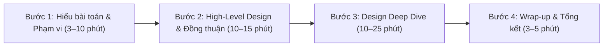

# Bài 6: Framework 4 Bước Trong System Design (Alex Xu Ch.3)

[← Bài 5: Ước lượng nhanh](./05-uoc-luong-nhanh.md) · [Mục lục Concepts](./README.md) · [Tiếp theo: Phần 4 — Thực hành TechStore →](../02-thuc-hanh-techstore.md)

---

Đây là khung sườn chuẩn 45 phút từ sách **Alex Xu Vol.1 (Ch.3)** giúp buổi phỏng vấn có cấu trúc rõ ràng, biến bạn từ người "trả lời đề thi" thành **người đồng nghiệp đang cùng thảo luận thiết kế kiến trúc**.

## Bước 1: Hiểu bài toán & Làm rõ phạm vi (3–10 phút)
**Mục tiêu:** Tuyệt đối **không** lao vào vẽ ngay khi vừa nghe đề (*"Thiết kế YouTube"*, *"Thiết kế TechStore"*), vì đề bài System Design cố tình rất mơ hồ!
- **Hỏi làm rõ Functional Requirements:** Tập trung vào 3–4 tính năng cốt lõi nhất trong 45 phút (vd với URL Shortener: chỉ làm *rút gọn link* và *chuyển hướng + đếm click*, bỏ qua phần quản lý team/thanh toán gói VIP nếu interviewer không yêu cầu).
- **Hỏi làm rõ Non-Functional Requirements:** Quy mô DAU? Tỷ lệ Read:Write? Độ trễ `p99` kỳ vọng? Ưu tiên Strong Consistency (như thanh toán) hay Availability/Eventual Consistency (như News Feed)? Thời gian lưu trữ (retention)?
- **Thực hiện Back-of-the-envelope Estimation:** Nhẩm nhanh QPS, Peak QPS, Storage 5 năm, Bandwidth để lấy căn cứ chọn công nghệ ở Bước 2 & 3.

## Bước 2: Đề xuất High-Level Design & Đạt đồng thuận (10–15 phút)
**Mục tiêu:** Dựng được "khung xương" toàn bộ hệ thống chạy thông từ đầu đến cuối và thống nhất hướng đi với interviewer trước khi đào sâu.
- **Định nghĩa API Contract chính:** Nêu ngắn gọn method, endpoint, input/output (vd `POST /api/v1/urls`, `GET /{shortCode}`).
- **Vẽ sơ đồ kiến trúc tổng quan & luồng dữ liệu chính:** Client → DNS/CDN → Load Balancer → App Services → Cache / DB / Message Queue. Chạy thử bằng miệng 1 luồng ghi và 1 luồng đọc xuyên qua sơ đồ.
- **Đề xuất Data Model / Schema sơ bộ:** Nêu tên các bảng chính, kiểu DB (RDBMS vs NoSQL vs Object Storage) và lý do sơ bộ.
- **Check-in với interviewer:** *"Khung kiến trúc tổng thể như vậy ổn chưa ạ, em xin phép đi sâu vào phần X và Y nhé?"* — giúp tránh đi lệch hướng kỳ vọng của người hỏi!

## Bước 3: Design Deep Dive (10–25 phút)
**Mục tiêu:** Đây là phần phân loại trình độ Junior vs Mid/Senior. Tập trung giải quyết **2–3 điểm khó nhất hoặc nút thắt cổ chai** của riêng bài toán đó (thay vì nói dàn trải những thứ cơ bản như login!).
- Ví dụ theo từng bài:
  - *URL Shortener:* Cách sinh mã không trùng (Base62 + Snowflake vs Hash), `301` vs `302`, Cache link viral.
  - *TechStore Flash Sale:* Tồn kho chống bán âm (Atomic update / Redis Lua), chống Cache Stampede, tách gửi mail/cập nhật thống kê sang Kafka.
  - *News Feed:* Xử lý **Celebrity Problem** bằng Hybrid Fan-out.
- **Quy tắc vàng khi Deep Dive:** Đừng chỉ gọi tên công nghệ (*"Em dùng Kafka", "Em dùng Cassandra"*). Luôn trình bày theo mẫu: **Vấn đề → 2 Phương án (A vs B) → Chọn A vì lý do gì → Trade-off (mất gì) & Cách giảm thiểu**.

## Bước 4: Wrap-up & Tổng kết (3–5 phút)
**Mục tiêu:** Tự chủ động đánh giá lại thiết kế của chính mình thay vì đợi bị bắt lỗi.
- **Chỉ ra Bottleneck còn sót & Cách xử lý nếu Scale tiếp 10x:** Ví dụ hiện tại DB Primary chưa shard, nếu traffic ghi tăng gấp 10 lần thì sẽ shard theo `user_id`.
- **Xử lý lỗi (Failure Modes):** Nếu 1 server chết, 1 Datacenter mất điện, hoặc Cache sập thì hệ thống xuống cấp êm dịu (Graceful Degradation) như thế nào?
- **Observability (Vận hành thực tế):** Theo dõi những metric nào (`p99` latency, error rate `5xx`, cache hit ratio, Kafka consumer lag, DB connection pool) và đặt cảnh báo (Alerting) ra sao.

## Bảng tóm tắt nhanh

| Bước | Thời gian | Việc cần làm | Sai lầm hay mắc |
| :--- | :---: | :--- | :--- |
| **1. Làm rõ yêu cầu** | 3–10p | Chốt MVP, Non-functional, ước lượng QPS/Storage | Im lặng cắm đầu vẽ ngay; ôm đồm quá nhiều tính năng phụ |
| **2. High-Level Design** | 10–15p | API chính, Schema DB sơ bộ, Sơ đồ tổng & luồng Read/Write | Chưa thống nhất khung đã sa đà vào thuật toán chi tiết |
| **3. Design Deep Dive** | 10–25p | Đào sâu 2–3 nút thắt khó nhất, nêu rõ **Trade-offs** | Kể tên buzzword (*Kafka, Redis*) mà không giải thích *vì sao* |
| **4. Wrap-up** | 3–5p | Phản biện bottleneck còn lại, Failure cases, Monitoring, Scale 10x | Kết thúc cụt ngủn ngay khi vừa vẽ xong |
