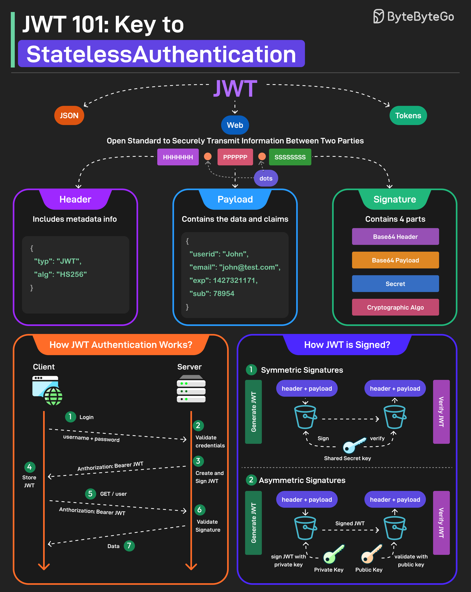
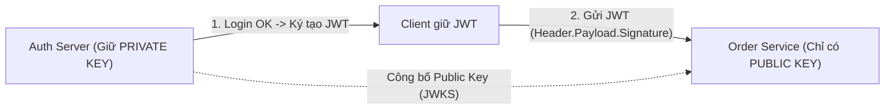

# Bài 7: JWT (JSON Web Token) — Cơ Chế Ký Số, Trade-offs & Bảo Mật

[← Bài 6: Framework 4 bước](./06-framework-4-buoc.md) · [Mục lục Concepts](./README.md) · [Quay lại Bài 1: Scaling & Stateless](./01-scaling-va-stateless.md)

---


*Nguồn: [ByteByteGoHq/system-design-101](https://github.com/ByteByteGoHq/system-design-101) (CC BY-NC-ND 4.0)*

## 7.1. Bản chất: "State" đang nằm ở đâu?

So sánh trực diện giữa **Session truyền thống** và **Stateless Token (JWT)**:

- **Session truyền thống (State nằm ở Server / Redis):**
  1. User đăng nhập thành công → Server tạo một mã ngẫu nhiên vô nghĩa `sess_9a8f1` và **lưu toàn bộ thông tin `{ userId: 42, role: "USER" }` vào Redis**.
  2. Server trả cho trình duyệt đúng chuỗi `sess_9a8f1`.
  3. Mỗi request sau, khi nhận `sess_9a8f1`, Server **bắt buộc phải tra Redis** mới biết `sess_9a8f1` là ai.
- **JWT — Stateless Token (Đẩy State về phía Client):**
  - Server **không lưu phiên đăng nhập nào trong RAM hay Redis cả**.
  - Server ghi thẳng thông tin `{ userId: 42, role: "USER", exp: ... }` vào chuỗi JWT, **ký niêm phong** bằng khóa mật mã rồi trả thẳng cho Client giữ!
  - Các request sau, Client gửi kèm `Authorization: Bearer <JWT>` → bất kỳ instance nào nhận request đều tự kiểm tra chữ ký và biết ngay `userId` là ai chỉ bằng CPU, **không cần hỏi Redis/DB**.

---

## 7.2. Cấu trúc 3 phần của JWT (`Header.Payload.Signature`)

Một JWT chuẩn **JWS (*JSON Web Signature*)** luôn gồm 3 chuỗi **Base64Url** *(biến thể Base64 thay `+` → `-`, `/` → `_`, bỏ `=` đệm cho an toàn URL/Header)* nối bằng dấu chấm `.`:

1. **`Header`:** Khai báo loại token và thuật toán ký (`{"alg": "RS256", "typ": "JWT"}`).
2. **`Payload` (Claims):** Chứa dữ liệu định danh (`{"sub": "42", "role": "USER", "iat": 1764096000, "exp": 1764100000}`).
   > [!WARNING]
   > **`Payload` KHÔNG hề được mã hóa bảo mật!** Bất kỳ ai cầm được chuỗi JWT (kể cả không có Key nào) đều giải mã Base64Url đọc được nguyên văn JSON bên trong. Tuyệt đối **không** đặt mật khẩu, số CCCD, thẻ tín dụng hay bí mật khách hàng vào Payload.
3. **`Signature` (Chữ ký số chống sửa đổi):** Dấu vân tay mật mã tính từ `Header` + `Payload`.

---

## 7.3. JWT được ký như thế nào? (2 cơ chế chuẩn JWS)

### Cách 1: Ký đối xứng — `HS256` (HMAC + SHA-256)
Chỉ dùng **1 khóa bí mật chung** (`SECRET_KEY`, độ dài tối thiểu 256-bit / 32 bytes).

```text
signingInput = Base64Url(Header) + "." + Base64Url(Payload)
signature    = Base64Url( HMAC_SHA256(signingInput, SECRET_KEY) )
jwt          = signingInput + "." + signature
```

- **Lúc kiểm tra (Verify):** Server nhận JWT, tự chạy lại `HMAC_SHA256(signingInput, SECRET_KEY)` rồi so sánh với `signature` nhận được. Nếu hacker sửa `"role":"USER"` thành `"role":"ADMIN"`, kết quả băm sẽ lệch hoàn toàn → bị từ chối `401 Unauthorized`.
- **Ví dụ minh họa Java thuần (`HS256`):**
  ```java
  Mac mac = Mac.getInstance("HmacSHA256");
  mac.init(new SecretKeySpec(secretKey.getBytes(StandardCharsets.UTF_8), "HmacSHA256"));
  String signature = Base64.getUrlEncoder().withoutPadding()
          .encodeToString(mac.doFinal(signingInput.getBytes(StandardCharsets.UTF_8)));
  ```
- **Trade-off:** Cực nhanh, đơn giản; nhưng mọi service muốn verify đều phải giữ cùng `SECRET_KEY` (service nào cũng có khả năng tự ký giả token nếu bị lộ key).

---

### Cách 2: Ký bất đối xứng — `RS256` (RSA + SHA-256) / `ES256` (ECDSA)

Auth Server tạo ra **1 cặp khóa toán học đi đôi với nhau**:
- **`Private Key` (Khóa bí mật):** Chỉ duy nhất **Auth Server** giữ để **KÝ (Sign)** lúc cấp token.
- **`Public Key` (Khóa công khai):** Phát tự do cho mọi service (`OrderService`, `PaymentService`, `API Gateway`, hoặc đối tác ngoài qua `/.well-known/jwks.json`) để **KIỂM TRA (Verify)**.



**Quy trình Ký & Kiểm tra từng bước (Ví dụ trên TechStore):**
1. **Lúc Auth Server KÝ:**
   - Băm `signingInput` qua **SHA-256** (hàm băm 1 chiều) ra mã tóm tắt 32 bytes **`Hash_Gốc`**.
   - Dùng **`Private Key`** ký lên **`Hash_Gốc`** (với RSA là phép toán $S = \text{Hash\_Gốc}^d \bmod n$) → tạo ra `Signature`.
2. **Lúc `Order Service` KIỂM TRA (chỉ có `Public Key`):**
   - Giải mã Base64Url phần `Payload` *(không cần key)* để đọc `sub = 42, role = USER`.
   - **Phép tính A:** Tự lấy `Header.Payload` nhận được băm SHA-256 → ra **`Hash_Tính_Lại`**.
   - **Phép tính B:** Lấy `Signature` + **`Public Key`** chạy hàm kiểm tra ngược ($S^e \bmod n$) → trích ra **`Hash_Trong_Chữ_Ký`**.
   - **So sánh `A == B`:** Khớp thì chắc chắn 100% chữ ký do đúng **Private Key** của Auth Server tạo và chưa bị sửa một ký tự nào!

#### Giải đáp thắc mắc hay gặp: *"Ai cũng có Public Key vậy có giải mã đọc trộm được thông tin khách hàng không?"*
**KHÔNG**, vì 2 lý do:
1. `Payload` không được mã hóa bằng RSA (ai cũng Base64 decode đọc được mà chẳng cần Public Key — nên không chứa thông tin nhạy cảm, còn trên đường truyền đã có **HTTPS/TLS** bảo vệ toàn bộ HTTP header).
2. Trong mật mã bất đối xứng, **Mã hóa** và **Ký số** chạy theo 2 chiều ngược nhau:

| Mục đích | Dùng khóa nào để khóa / ký? | Dùng khóa nào để mở / kiểm tra? | Ví dụ đời thực |
| :--- | :--- | :--- | :--- |
| **Mã hóa để GIẤU bí mật** *(HTTPS, JWE)* | Dùng **Public Key** của bên nhận để **Encrypt** | Chỉ **Private Key** của bên nhận mới **Decrypt** được | Hòm thư: ai cũng bỏ thư vào được, chỉ chủ nhà có chìa mới mở đọc được |
| **Ký số để CHỐNG giả mạo** *(JWT `RS256`)* | Auth Server dùng **Private Key** để **Sign** | Mọi service dùng **Public Key** để **Verify** | **Bằng tốt nghiệp:** Ai cũng đọc được tên (Payload) và soi được con dấu thật/giả (Public Key), nhưng chỉ nhà trường (Private Key) mới đóng dấu được |

> **So sánh nhanh `HS256` vs `RS256` vs `ES256`:**
> - `HS256`: Dùng 1 Secret chung — hợp hệ thống nhỏ/monolith.
> - `RS256`: RSA 2048-bit — chuẩn phổ biến cho Microservices & OAuth2/OIDC (chỉ Auth giữ Private Key).
> - `ES256`: ECDSA trên đường cong P-256 — độ an toàn tương đương RSA 3072-bit nhưng **chữ ký ngắn gọn hơn và ký nhanh hơn `RS256`**.

---

## 7.4. Trade-off "Khó thu hồi (Revoke)" & Mô hình Access Token + Refresh Token

- **Vấn đề:** JWT giống như **tấm vé in sẵn hạn đến 18:00**. Nếu lúc `14:00` tài khoản bị hack (hoặc user bấm *"Đăng xuất mọi thiết bị"*), Server không có danh sách token đang sống trong RAM nên từ `14:00 → 18:00` kẻ xấu cầm JWT cũ gửi lên vẫn vượt qua bước Verify chữ ký!
- **Giải pháp chuẩn Production — Tách làm 2 loại Token:**

| Loại Token | Bản chất & Nơi lưu | Thời hạn | Vai trò |
| :--- | :--- | :---: | :--- |
| **Access Token** | **JWT** (không lưu server) | **Ngắn (`5–15 phút`)** | Gửi kèm mọi API request. Verify bằng CPU cực nhanh; kể cả bị lộ thì rủi ro tối đa chỉ vài phút. |
| **Refresh Token** | Chuỗi ngẫu nhiên **lưu trong Redis / DB** | **Dài (`7–30 ngày`)** | Chỉ dùng gọi `/auth/refresh` khi Access Token hết hạn để xin Access Token mới. |

Khi cần khóa tài khoản hoặc logout mọi thiết bị → **xóa Refresh Token trong Redis/DB** (1 thao tác). Access Token cũ hết hạn sau ít phút sẽ không xin cấp mới được nữa. *(Với API cực nhạy cảm như thanh toán/đổi mật khẩu, có thể kiểm tra thêm cờ `token_version` hoặc Blacklist trong Redis).*

---

## 7.5. 3 Bẫy bảo mật hay gặp khi cài JWT
1. **Lỗ hổng `alg: "none"` hoặc algorithm confusion:** Khi verify, server **bắt buộc phải ghim cố định thuật toán kỳ vọng** (vd chỉ cho phép `RS256`), tuyệt đối không tin vào field `"alg"` trong Header do client gửi lên!
2. **Dùng `SECRET_KEY` quá ngắn/dễ đoán ở `HS256`:** Hacker có thể brute-force offline chính chuỗi JWT để tìm ra key rồi tự ký token `ADMIN`.
3. **Nhầm JWS với JWE:** Nếu bài toán thật sự yêu cầu giấu kín nội dung ngay cả với chính Client cầm token, phải dùng **JWE (*JSON Web Encryption*, 5 phần)** — nơi Payload được mã hóa bằng Public Key của Server nhận và chỉ Private Key của Server nhận mới giải mã ra được.
