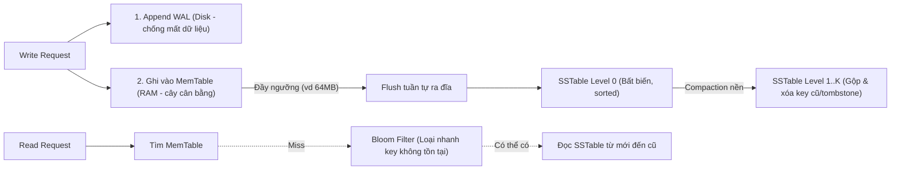
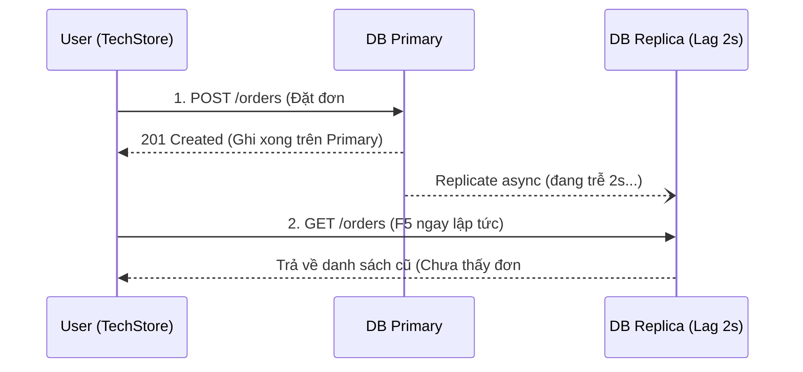

# Bài học Giai đoạn 1 — Phần 3: Concepts Data Layer (Tuần 3–6)

[← Quay lại GĐ 1 README](./README.md) · [Tiếp theo: Phần 4 — Thực hành Database →](./02-thuc-hanh-database.md)

> **Tài liệu đối chiếu:** `[P]` DDIA ch.3, ch.5, ch.6, ch.7; `system-design-primer` · `[W]` Spring Data JPA (`@Version`, `@Transactional`), PostgreSQL docs (`EXPLAIN`, Streaming Replication)

---

## Mục lục
- [Tuần 3: Storage Engines, Indexing & OLTP vs OLAP](#tuần-3-storage-engines-indexing--oltp-vs-olap)
- [Tuần 4: Replication & Consistency Models](#tuần-4-replication--consistency-models)
- [Tuần 5: Partitioning (Sharding) & Request Routing](#tuần-5-partitioning-sharding--request-routing)
- [Tuần 6: Transactions, Concurrency Anomalies & Isolation Levels](#tuần-6-transactions-concurrency-anomalies--isolation-levels)

---

## Tuần 3: Storage Engines, Indexing & OLTP vs OLAP

### 3.1. Hash Index (Log-Structured cơ bản — mô hình Bitcask)
- **Cách hoạt động:** Dữ liệu ghi mới luôn được nối vào cuối file (**append-only log**). Trong RAM giữ một bảng băm (Hash Map) lưu `key -> byte_offset` trên file đĩa.
- **Đọc:** Tra offset trong RAM ($O(1)$) → đọc đúng 1 lần trên đĩa tại offset đó.
- **Ghi:** Nối vào cuối file (sequential write — cực nhanh!) và cập nhật Hash Map.
- **Compaction & Merging:** Vì file chỉ append nên dung lượng tăng mãi. Định kỳ chạy background thread gộp các segment cũ, chỉ giữ giá trị mới nhất của mỗi key (xóa bản ghi cũ và **tombstone**).
- **Hạn chế chí mạng:**
  1. **Toàn bộ key phải nằm vừa trong RAM** (không phù hợp khi số lượng key khổng lồ vượt RAM).
  2. **Không hỗ trợ Range Query hiệu quả** (ví dụ `WHERE id BETWEEN 1000 AND 2000` phải dò từng key rời rạc).

### 3.2. SSTable & LSM-Tree (Log-Structured Merge-Tree)

**SSTable (Sorted String Table)** khắc phục nhược điểm của Hash Index bằng cách **sắp xếp các cặp key-value theo thứ tự key** trong từng segment file.
- Khi đã sắp xếp: chỉ cần lưu **Sparse Index** trong RAM (ví dụ mỗi vài KB lưu 1 key mốc) thay vì lưu mọi key, và hỗ trợ **Range Query** rất tốt!

**Cơ chế hoạt động của LSM-Tree (RocksDB, LevelDB, Cassandra, ScyllaDB):**

- **Tối ưu đọc bằng Bloom Filter:** Nếu query tìm một `key` không tồn tại, LSM-Tree sẽ phải quét qua hàng loạt SSTable từ mới đến cũ rất chậm. **Bloom Filter** (cấu trúc bit gọn nhẹ trong RAM) trả lời chắc chắn *"key CHẮC CHẮN không có"* với độ chính xác 100% (chỉ có dương tính giả nhỏ, không bao giờ âm tính giả) → bỏ qua đĩa ngay lập tức!
- **Chiến lược Compaction:**
  - *Size-Tiered Compaction:* Gộp các SSTable kích thước tương đương thành 1 bảng to hơn (Cassandra hay dùng; tốn không gian tạm lớn).
  - *Leveled Compaction:* Chia thành các tầng L0, L1, L2... mỗi tầng giới hạn dung lượng gấp 10 lần tầng trước, key không chồng lấn từ L1 trở đi (RocksDB/LevelDB hay dùng; giảm space amplification).

### 3.3. B-Tree (Page-Oriented Storage — PostgreSQL, MySQL InnoDB)

- **Cách hoạt động:** Chia không gian đĩa thành các **page kích thước cố định** (thường `4 KB – 16 KB`; PostgreSQL dùng `8 KB`). Mỗi node của cây là 1 page chứa các key đã sắp xếp và con trỏ tới page con.
- **Branching Factor cao (vài trăm nhánh/page):** Một cây B-Tree bậc 500 cao chỉ **4 tầng** có thể trỏ tới khoảng $500^3 \times 8\text{ KB} \approx \mathbf{256 \text{ TB}}$ dữ liệu! Tìm kiếm bất kỳ bản ghi nào chỉ tốn 3–4 bước đọc page (thường các tầng trên đã nằm sẵn trong OS page cache / DB buffer pool).
- **Cơ chế ghi (Update-in-place):** Ghi đè trực tiếp lên page cũ trên đĩa. Nếu page bị đầy khi insert → tách làm 2 page (**page split**) và cập nhật page cha. Để chống mất/hỏng cây nếu mất điện giữa chừng, B-Tree ghi **WAL (Write-Ahead Log)** trước khi sửa page và dùng **latch** (khóa nhẹ trên page) khi đọc/ghi đồng thời.

### 3.4. So sánh B-Tree vs LSM-Tree

| Tiêu chí | B-Tree (PostgreSQL, MySQL) | LSM-Tree (RocksDB, Cassandra) |
| :--- | :--- | :--- |
| **Cơ chế ghi** | Update-in-place (random I/O lên pages) | Append-only vào WAL + MemTable (sequential I/O) |
| **Tốc độ Write** | Trung bình (chậm hơn khi index phân mảnh) | **Rất cao** (tối ưu cho write-heavy workloads) |
| **Tốc độ Read** | **Rất nhanh & ổn định** (mỗi key nằm tại đúng 1 chỗ) | Chậm hơn một chút (có thể phải kiểm tra nhiều SSTable) |
| **Write Amplification** | Cao khi ghi random sửa cả page 8KB + WAL | Có write amplification từ **compaction** nền |
| **Space Amplification / Nén** | Dễ bị phân mảnh page (trống 30–50% page) | Nén dữ liệu rất tốt, ít mảnh trống hơn |
| **Tail Latency (`p99`)** | Ổn định | Có thể bị **spike `p99`** khi compaction chạy nặng |
| **Transaction / Locking** | Dễ gắn khóa trực tiếp lên key/page (ACID mạnh) | Phức tạp hơn cho giao dịch phức tạp |

### 3.5. Row Store vs Column Store & OLTP vs OLAP

| Đặc điểm | OLTP (Transactional) | OLAP (Analytical) |
| :--- | :--- | :--- |
| **Mục đích** | Phục vụ user app (tạo đơn TechStore, tra thông tin user) | Báo cáo kinh doanh, BI, phân tích xu hướng nhiều năm |
| **Đặc trưng truy vấn** | Đọc/ghi **vài dòng** theo `id` / index; rất nhiều QPS | Đọc **hàng triệu – tỷ dòng**, nhưng chỉ lấy **2–5 cột** (`SUM`, `GROUP BY`) |
| **Độ trễ kỳ vọng** | Milliseconds (`p99 < 50–100ms`) | Giây đến phút |
| **Lưu trữ tối ưu** | **Row-oriented Store** (PostgreSQL, MySQL): lưu toàn bộ các cột của 1 dòng liền kề trên đĩa | **Column-oriented Store** (ClickHouse, Parquet, BigQuery): lưu toàn bộ giá trị của 1 cột liền kề nhau |
| **Lợi thế nén** | Kém hơn vì kiểu dữ liệu hỗn hợp trong 1 dòng | **Nén cực cao** (Dictionary encoding, Run-Length Encoding, Bitmap index) do cùng kiểu dữ liệu lặp lại |

---

## Tuần 4: Replication & Consistency Models

### 4.1. Single-Leader (Leader–Follower) Replication
- Mọi câu lệnh **Write** (`INSERT/UPDATE/DELETE`) bắt buộc đi qua **Leader (Primary)**.
- Leader ghi thay đổi vào replication log (WAL ở PostgreSQL) và đẩy xuống các **Follower (Replica)**. Client có thể đọc từ cả Leader và các Follower.

**Synchronous vs Asynchronous Replication:**
- **Synchronous:** Leader chờ Follower xác nhận đã ghi xong rồi mới báo `OK` cho client.
  - *Ưu:* Follower luôn có dữ liệu mới nhất; Leader chết không mất dữ liệu.
  - *Nhược:* Nếu 1 Follower chậm hoặc rớt mạng → **toàn bộ thao tác Write bị treo**.
- **Asynchronous (Phổ biến nhất):** Leader commit xong trả `OK` ngay, đẩy log sang Follower sau.
  - *Ưu:* Write nhanh, không chết chùm khi Follower sập.
  - *Nhược:* Phát sinh **Replication Lag**; nếu Leader hỏng ổ đĩa trước khi kịp gửi WAL thì các write vừa commit có thể bị mất.
- **Semi-synchronous (Thực tế hay dùng):** Đặt **1** Follower ở chế độ sync, các Follower còn lại async (đảm bảo luôn có ít nhất 2 bản sao đầy đủ).

### 4.2. 3 Vấn đề kinh điển do Replication Lag & Cách khắc phục

1. **Read-Your-Writes Consistency (Đọc lại được cái mình vừa ghi):**
   - *Hiện tượng:* User vừa sửa profile hoặc vừa đặt hàng → F5 lại thấy biến mất do đọc trúng Replica chưa kịp cập nhật.
   - *Cách xử lý:*
     - Đọc những dữ liệu mà chính user đó vừa thay đổi từ **Primary** (ví dụ: trong `30–60 giây` kể từ lần write gần nhất của user, mọi request đọc của user đó route vào Primary).
     - Hoặc client gửi kèm timestamp/LSN của lần ghi cuối; Replica chỉ phục vụ nếu đã sync tới mốc đó (nếu chưa tới thì đợi hoặc chuyển về Primary).
2. **Monotonic Reads (Không đọc ngược thời gian):**
   - *Hiện tượng:* Request 1 đọc ở Replica A (lag `0.1s` → thấy đơn mới). Request 2 Load Balancer ném sang Replica B (lag `5s` → đơn mới lại biến mất!).
   - *Cách xử lý:* Gắn cố định (sticky routing) mỗi `user_id` đọc từ **cùng 1 Replica** (ví dụ `hash(user_id) % num_replicas`), trừ khi Replica đó chết.
3. **Consistent Prefix Reads (Đúng thứ tự nhân quả):**
   - *Hiện tượng:* Khi DB bị shard/multi-partition độc lập, người xem có thể đọc được câu trả lời trước khi thấy câu hỏi!
   - *Cách xử lý:* Đảm bảo các ghi có liên quan nhân quả nằm trên cùng 1 partition, hoặc dùng thuật toán theo dõi thứ tự nhân quả (causal metadata).

### 4.3. Multi-Leader Replication
- Cho phép **nhiều node nhận Write** (ví dụ mỗi Datacenter tại Mỹ, Châu Âu, Châu Á có 1 Leader riêng).
- **Ưu điểm:** Ghi cực nhanh ở vùng địa lý gần user; chịu lỗi tốt khi mất 1 Datacenter.
- **Cơn ác mộng lớn nhất — Write Conflicts:** 2 user ở 2 châu lục sửa cùng 1 bản ghi cùng lúc!
  - *Cách xử lý:* Tránh xung đột ngay từ đầu (route mọi write của 1 user vào cùng 1 DC), **Last Write Wins (LWW)** theo timestamp (rủi ro âm thầm mất dữ liệu do đồng hồ lệch!), hoặc **CRDTs** (Conflict-free Replicated Data Types) / cho user tự merge khi đọc.

### 4.4. Leaderless Replication & Quorum ($W + R > N$)
*(Mô hình Amazon Dynamo, Cassandra, Riak)*
- Không có Leader. Client (hoặc coordinator node) gửi **Write** song song đến tất cả $N$ replica và coi là thành công nếu ít nhất **$W$** node xác nhận. Khi **Read**, đọc song song từ **$R$** node và chọn giá trị có version mới nhất.
- **Điều kiện Quorum:**
  $$W + R > N$$
  Ví dụ $N = 3, W = 2, R = 2 \Rightarrow 2 + 2 = 4 > 3$: Tập $W$ node đã ghi và tập $R$ node được đọc **bắt buộc giao nhau tại ít nhất 1 node có bản ghi mới nhất**!
- **Cơ chế tự chữa lành:**
  - **Read Repair:** Khi đọc từ $R$ node phát hiện node C có version cũ, client/coordinator gửi ghi đè giá trị mới lên C.
  - **Anti-Entropy:** Tiến trình nền so sánh **Merkle Tree** giữa các node để đồng bộ phần dữ liệu bị thiếu.
- **Lưu ý bẫy Quorum:** Nếu dùng *Sloppy Quorum* (ghi tạm sang node dự phòng khi mạng đứt), hoặc có 2 write đồng thời (LWW theo clock lệch), hoặc node mất dữ liệu khi chưa kịp sync, thì $W + R > N$ **vẫn có thể đọc phải dữ liệu cũ (stale data)**!

---

## Tuần 5: Partitioning (Sharding) & Request Routing

> **Phân biệt nhanh:** *Replication* là sao chép **cùng 1 bộ dữ liệu** ra nhiều máy (tăng Read & HA). *Partitioning / Sharding* là **chia nhỏ dữ liệu** thành nhiều phần khác nhau (tăng dung lượng lưu trữ & Write throughput). Thực tế thường kết hợp cả hai!

### 5.1. Hai chiến lược Partitioning

| Tiêu chí | Key Range Partitioning | Hash Partitioning |
| :--- | :--- | :--- |
| **Cách chia** | Chia theo khoảng liên tục của key (vd `A–F`, `G–M` hoặc theo `tháng/năm`) | Tính `hash(shard_key)` rồi chia miền giá trị hash cho các shard |
| **Range Query** | **Rất tốt** (dữ liệu gần nhau nằm chung shard) | **Kém** (range query phải gửi tới **tất cả các shard**) |
| **Nguy cơ Hot Spot** | **Cao** nếu key tăng đều theo thời gian (mọi đơn hàng mới hôm nay rơi vào đúng shard cuối cùng!) | **Thấp** vì hash dàn đều các key |
| **Hot Key cực đoan** | Vẫn nghẽn nếu 1 user/celebrity có quá nhiều traffic | Vẫn nghẽn nếu cùng 1 `shard_key` nhận triệu request (cách sửa: thêm số ngẫu nhiên `key_00..99` vào sau key!) |

### 5.2. Secondary Index khi đã Shard
Dữ liệu bảng `orders` đã chia shard theo `user_id`, nhưng nay cần tìm kiếm theo `status = 'PENDING'` hoặc `product_id = 555` (không có `user_id` trong câu query!). Có 2 cách:

1. **Local Secondary Index (Document-partitioned):**
   - Mỗi shard tự tạo index cho các dòng dữ liệu nằm trên chính shard đó.
   - *Write:* Nhanh, chỉ ghi vào đúng 1 shard.
   - *Read theo cột phụ:* Phải thực hiện **Scatter-Gather** (hỏi toàn bộ $N$ shard rồi gộp kết quả) → chậm theo shard chậm nhất (`tail latency`) và tốn CPU toàn cụm.
2. **Global Secondary Index (Term-partitioned):**
   - Tách index thành một hệ partition riêng chia theo cột phụ (`product_id`), trỏ tới danh sách `order_id` ở các shard gốc.
   - *Read:* Nhanh, chỉ hỏi đúng 1 index partition.
   - *Write:* Rất phức tạp vì 1 lệnh `INSERT order` phải ghi sang nhiều shard khác nhau (thường phải cập nhật **bất đồng bộ** chứ không thể lock đồng bộ mọi shard).

### 5.3. Rebalancing & Request Routing

**Tại sao KHÔNG được dùng `hash(key) % N` cố định để shard trực tiếp lên node vật lý?**
Nếu có `N = 3` node và tăng lên `N = 4` node, công thức `hash(key) % 4` làm **gần 75% dữ liệu đổi chỗ**, gây bão I/O và nghẽn mạng khi migrate!

**Các chiến lược Rebalancing chuẩn:**
1. **Fixed Number of Partitions (Phổ biến nhất — Elasticsearch, Riak, Couchbase):**
   - Ngay từ đầu tạo sẵn số lượng partition logic **nhiều hơn hẳn** số node vật lý (ví dụ **1,000 logical partitions** cho 10 máy, mỗi máy giữ 100 partition).
   - Khi thêm máy mới thứ 11, chỉ cần bốc nguyên ~90 partition từ các máy cũ chuyển sang máy mới — **hàm băm `hash(key) % 1000` không đổi**!
2. **Dynamic Partitioning:** Tự động **split** partition khi vượt ngưỡng kích thước (vd `10 GB`) và **merge** khi nhỏ lại (HBase, MongoDB).
3. **Consistent Hashing (nhiều virtual nodes):** Học sâu ở GĐ 2; giảm tỷ lệ di chuyển xuống $1/N$.

**3 cách định tuyến Request Routing:**
1. Client hỏi **bất kỳ node nào** → node đó tự forward sang node chứa shard đích (Cassandra, Riak).
2. Qua một **Routing Tier / Proxy** ở giữa (Vitess cho MySQL, Citus cho Postgres, Mongos).
3. **Client tự biết** danh sách shard và gọi thẳng (Kafka client, Redis Cluster client).
*(Cả 3 thường dựa vào một Coordination Service như **ZooKeeper / etcd** làm nguồn chân lý quản lý bản đồ shard).*

---

## Tuần 6: Transactions, Concurrency Anomalies & Isolation Levels

### 6.1. Ý nghĩa thực sự của ACID (theo DDIA Ch.7)
- **A — Atomicity:** Không phải nói về đa luồng! Atomicity là khả năng **Abort / Rollback** an toàn khi lỗi giữa chừng (All-or-nothing), tránh trạng thái nửa vời.
- **C — Consistency:** Thuộc về **tính đúng đắn nghiệp vụ của ứng dụng** (ví dụ: tổng tiền ghi nợ = tổng tiền ghi có), DB chỉ hỗ trợ phần nào (foreign key, unique constraint).
- **I — Isolation:** Cô lập giữa các transaction chạy **đồng thời** — đây mới là phần khó nhất và dễ phát sinh bug ngầm nhất!
- **D — Durability:** Dữ liệu đã commit không bị mất khi crash/mất điện (nhờ `fsync` vào WAL hoặc replicate).

### 6.2. Các loại Concurrency Anomalies (Từ nhẹ đến hiểm hóc)

1. **Dirty Read:** Transaction B đọc được dữ liệu mà Transaction A **chưa commit** (sau đó A rollback → B cầm dữ liệu ma!).
2. **Dirty Write:** Transaction B ghi đè dữ liệu chưa commit của Transaction A (làm hỏng rollback hoặc trộn lẫn 2 nghiệp vụ).
3. **Non-Repeatable Read / Read Skew:** Trong 1 transaction, đọc cùng 1 dữ liệu 2 lần ra 2 kết quả khác nhau (hoặc đọc tài khoản A trước lúc chuyển tiền `500$`, đọc tài khoản B sau lúc chuyển tiền `600$` → thấy tổng tăng thêm bất thường!).
4. **Lost Update:**
   - Tx 1 và Tx 2 cùng đọc `stock = 10`.
   - Tx 1 tính `10 - 1 = 9`, ghi `9`.
   - Tx 2 tính `10 - 1 = 9`, ghi đè `9`.
   - **Hậu quả:** Bán 2 sản phẩm nhưng kho chỉ trừ 1!
5. **Write Skew (Lỗi tinh vi nhất):**
   - Quy định: *Phải có ít nhất 1 bác sĩ trực ca* (hiện Alice và Bob đều đang trực).
   - Tx 1 (Alice) đọc: đếm số người trực = `2 >= 2` → hợp lệ → `UPDATE doctors SET on_call = false WHERE id = 'Alice'`.
   - Tx 2 (Bob) đọc (trên cùng Snapshot): đếm số người trực = `2 >= 2` → hợp lệ → `UPDATE doctors SET on_call = false WHERE id = 'Bob'`.
   - Cả 2 cùng commit thành công vì chúng sửa **2 dòng hoàn toàn khác nhau**! Kết quả: **0 bác sĩ trực!**
6. **Phantom Read:** Một transaction kiểm tra điều kiện (ví dụ `SELECT COUNT(*) FROM bookings WHERE room = 1 AND time = '10:00'` ra `0`), không thấy dòng nào để khóa, nên cả 2 transaction cùng `INSERT` 2 dòng mới trùng lịch!

### 6.3. Isolation Levels & Cơ chế cài đặt

| Isolation Level | Dirty Read / Write | Read Skew | Lost Update | Write Skew / Phantom | Cơ chế điển hình |
| :--- | :---: | :---: | :---: | :---: | :--- |
| **Read Uncommitted** | Dính | Dính | Dính | Dính | Không khóa đọc |
| **Read Committed** *(Default Postgres)* | Chặn được | Dính | Dính | Dính | Row write lock + đọc snapshot đã commit mới nhất theo từng câu lệnh |
| **Snapshot Isolation / Repeatable Read** | Chặn được | **Chặn được** | Postgres: **Chặn** MySQL: Dính* | **Dính** | **MVCC** (mỗi tx thấy nhất quán tại thời điểm bắt đầu tx) |
| **Serializable** | Chặn được | Chặn được | Chặn được | **Chặn được** | Actual Serial / **2PL** / **SSI** |

*\*Lưu ý cực kỳ quan trọng về **PostgreSQL vs MySQL InnoDB** ở `REPEATABLE READ`:*
- PostgreSQL `REPEATABLE READ` (thực chất là Snapshot Isolation) **tự phát hiện Lost Update** và ném lỗi `ERROR: could not serialize access due to concurrent update` (bắt buộc app retry), nhưng **vẫn dính Write Skew**!
- MySQL InnoDB ở `REPEATABLE READ` dùng Next-Key Locking cho locking reads, nhưng với plain `SELECT` + `UPDATE` thông thường thì Snapshot Read + Current Read vẫn có thể bị Lost Update nếu không dùng `FOR UPDATE` hoặc atomic update.

### 6.4. 3 cách cài đặt `Serializable` thực tế

1. **Actual Serial Execution (Thực thi tuần tự 1 luồng):**
   - Chạy mọi transaction trên **1 CPU thread duy nhất** (Redis, VoltDB). Nhanh nếu dữ liệu nằm hoàn toàn trong RAM và mỗi tx xử lý cực ngắn (`< 1ms`), không gọi I/O bên ngoài.
2. **2PL (Two-Phase Locking — Pessimistic):**
   - Dùng **Shared Lock (S-lock)** cho đọc, **Exclusive Lock (X-lock)** cho ghi: *Đọc chặn Ghi, Ghi chặn cả Đọc lẫn Ghi*.
   - Dùng thêm **Predicate Lock / Index-Range Lock** để chặn Phantom & Write Skew.
   - *Nhược:* Throughput giảm mạnh vì đọc-ghi chặn nhau, và rất dễ xảy ra **Deadlock** (DB phải detect và abort 1 tx).
3. **SSI (Serializable Snapshot Isolation — PostgreSQL `SERIALIZABLE`):**
   - Cách tiếp cận **Optimistic**: vẫn cho đọc-ghi chạy thoải mái trên nền **MVCC** (đọc không chặn ghi, ghi không chặn đọc!).
   - PostgreSQL đặt `SIREAD` locks nhẹ (không block ai) để theo dõi: *"Nếu Tx A đọc một dữ liệu mà Tx B sửa trước khi A commit, liệu có tạo thành vòng phụ thuộc nguy hiểm gây Write Skew không?"*
   - Nếu phát hiện nguy cơ cycle → PostgreSQL **abort 1 transaction** với SQLState `40001` (*serialization_failure*). Ứng dụng **phải có logic retry** (ví dụ `@Retryable` trong Spring)!

### 6.5. Bảng chọn cách chống Concurrency Bug trong Spring Boot / JPA

| Kịch bản | Giải pháp tốt nhất | Chi tiết cài đặt |
| :--- | :--- | :--- |
| Trừ tồn kho / tăng counter đơn giản | **Atomic SQL Update** | `@Modifying @Query("UPDATE Product p SET p.stock = p.stock - :qty WHERE p.id = :id AND p.stock >= :qty")` |
| Sửa record ít xung đột (profile, đơn hàng) | **Optimistic Lock (`@Version`)** | Thêm field `@Version Long version` vào JPA Entity → tự sinh `WHERE id=? AND version=?`; bắt `ObjectOptimisticLockingFailureException` để retry |
| Tranh chấp cao trên 1 dòng nóng (ví dụ ví tiền, vé hot) | **Pessimistic Lock (`FOR UPDATE`)** | `@Lock(LockModeType.PESSIMISTIC_WRITE)` sinh `SELECT ... FOR UPDATE`; giảm retry thất bại nhưng giữ connection lâu hơn |
| Ràng buộc liên quan nhiều dòng / phòng tránh Write Skew | **`SERIALIZABLE` + Retry** (hoặc khóa dòng cha `FOR UPDATE`) | `@Transactional(isolation = Isolation.SERIALIZABLE)` kèm vòng lặp retry khi gặp SQLState `40001` |
