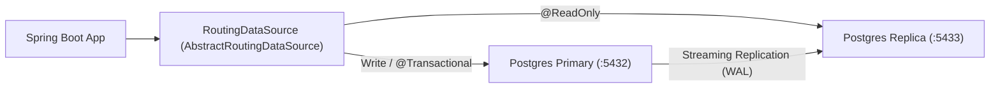

# Bài học Giai đoạn 1 — Phần 4: Thực Hành Data Layer (4 Labs)

[← Phần 3: Concepts](./01-concepts.md) · [Quay lại GĐ 1 README](./README.md) · [Tiếp theo: Phần 5 — Mục tiêu & Check Tuần 4 →](./03-muc-tieu-va-check-tuan4.md)

---

## Tổng quan 4 bài thực hành

| Lab | Nội dung | Công cụ | Kết quả cần ghi nhận |
| :--- | :--- | :--- | :--- |
| **Lab 1.1** | Tạo bảng **5 triệu dòng**, so sánh có/không có index | PostgreSQL, `EXPLAIN (ANALYZE, BUFFERS)` | Thời gian query & số page buffers trước/sau index |
| **Lab 1.2** | Dựng **PostgreSQL Primary + Replica**, `AbstractRoutingDataSource`, tái hiện **lag** | Docker Compose, Spring Boot AOP | Bắt được hiện tượng đọc lệch & cách route Read-Your-Writes |
| **Lab 1.3** | Mô phỏng Sharding `hash(user_id) % N` và thêm 1 shard | Java (chương trình console nhỏ) | Tỷ lệ bản ghi phải di chuyển (~75% vs Consistent Hashing ~25%) |
| **Lab 1.4** | Tự gây **Lost Update** & **Write Skew** (2 threads), rồi sửa | Spring Data JPA, `@Version`, `FOR UPDATE`, `SERIALIZABLE` | Chứng minh anomaly xảy ra và hết hẳn sau khi sửa |

---

## Lab 1.1 — Bảng 5 triệu dòng & `EXPLAIN ANALYZE` trong PostgreSQL

### Bước 1: Khởi chạy PostgreSQL bằng Docker
```powershell
docker run --name pg-lab1 -e POSTGRES_PASSWORD=postgres -e POSTGRES_DB=techstore -p 5432:5432 -d postgres:16-alpine
docker exec -it pg-lab1 psql -U postgres -d techstore
```

### Bước 2: Tạo bảng `orders` và sinh 5,000,000 dòng bằng `generate_series`
*(Cách này chạy thuần trong PostgreSQL, chỉ mất khoảng 15–30 giây thay vì chạy script insert từng dòng).*

```sql
CREATE TABLE orders (
    id          BIGSERIAL PRIMARY KEY,
    user_id     BIGINT NOT NULL,
    status      VARCHAR(20) NOT NULL,
    total_amount INT NOT NULL,
    created_at  TIMESTAMP NOT NULL
);

INSERT INTO orders (user_id, status, total_amount, created_at)
SELECT
    (random() * 500000)::BIGINT + 1 AS user_id,
    (ARRAY['PENDING', 'PAID', 'SHIPPED', 'CANCELLED'])[floor(random() * 4 + 1)::INT] AS status,
    (random() * 5000000 + 50000)::INT AS total_amount,
    NOW() - (random() * INTERVAL '365 days') AS created_at
FROM generate_series(1, 5000000);

-- Cập nhật thống kê cho Query Planner của Postgres
ANALYZE orders;
```

### Bước 3: Đo khi **CHƯA CÓ INDEX**
```sql
EXPLAIN (ANALYZE, BUFFERS)
SELECT id, status, total_amount, created_at
FROM orders
WHERE user_id = 12345
ORDER BY created_at DESC
LIMIT 20;
```
*Quan sát kỳ vọng:*
- `Parallel Seq Scan on orders` (quét tuần tự cả 5 triệu dòng!).
- `Buffers: shared hit=... read=...` (đọc hàng chục nghìn page 8KB).
- `Execution Time`: thường từ **150 ms – 600 ms** (hoặc hơn trên ổ đĩa chậm).

### Bước 4: Tạo Index & Đo lại
```sql
-- Thử Composite Index đúng thứ tự (Equality trước, Range/Sort sau):
CREATE INDEX idx_orders_user_created ON orders (user_id, created_at DESC);
ANALYZE orders;

EXPLAIN (ANALYZE, BUFFERS)
SELECT id, status, total_amount, created_at
FROM orders
WHERE user_id = 12345
ORDER BY created_at DESC
LIMIT 20;
```
*Quan sát kỳ vọng:*
- `Index Scan Backward` hoặc `Index Scan using idx_orders_user_created` — **không còn bước Sort** riêng vì index đã sắp sẵn `created_at DESC` theo từng `user_id`!
- `Execution Time`: giảm xuống còn **~0.05 ms – 0.5 ms** (nhanh hơn **hàng trăm đến hàng nghìn lần**!).

### Bước 5: Thử 2 bẫy hay gặp làm vô hiệu hóa Index
1. **Bọc hàm quanh cột có index (Non-Sargable):**
   ```sql
   -- XẤU: Không dùng được index trên created_at
   EXPLAIN ANALYZE SELECT COUNT(*) FROM orders WHERE DATE(created_at) = '2026-01-15';

   -- TỐT: Dùng range query trên cột gốc
   EXPLAIN ANALYZE SELECT COUNT(*) FROM orders
   WHERE created_at >= '2026-01-15 00:00:00' AND created_at < '2026-01-16 00:00:00';
   ```
2. **Covering Index (`INCLUDE`) để đạt `Index Only Scan`:**
   ```sql
   CREATE INDEX idx_orders_covering ON orders (user_id, created_at DESC) INCLUDE (status, total_amount);
   VACUUM ANALYZE orders;
   -- Chạy lại query ở Bước 4: planner chuyển sang "Index Only Scan" (Heap Fetches: 0)!
   ```

---

## Lab 1.2 — PostgreSQL Primary + Replica & `AbstractRoutingDataSource` + Lag

### Kiến trúc Lab



### Bước 1: Dựng Primary + Replica bằng Docker Compose

Tạo thư mục riêng cho lab (ví dụ `lab-pg-replication/`), tạo 2 file `init-primary.sh` và `docker-compose.yml`:

**File `init-primary.sh`** (chạy trên Primary lúc khởi tạo lần đầu để tạo user replication & cho phép Replica kết nối):
```bash
#!/bin/bash
set -e
psql -v ON_ERROR_STOP=1 --username "$POSTGRES_USER" --dbname "$POSTGRES_DB" <<-EOSQL
    CREATE USER replicator WITH REPLICATION ENCRYPTED PASSWORD 'replicator_pass';
EOSQL
echo "host replication replicator 0.0.0.0/0 scram-sha-256" >> "$PGDATA/pg_hba.conf"
```

**File `docker-compose.yml`:**
```yaml
services:
  pg-primary:
    image: postgres:16-alpine
    container_name: pg-primary
    ports:
      - "5432:5432"
    environment:
      POSTGRES_USER: postgres
      POSTGRES_PASSWORD: postgres
      POSTGRES_DB: techstore
    command: >
      postgres
      -c wal_level=replica
      -c max_wal_senders=5
      -c max_replication_slots=5
      -c hot_standby=on
    volumes:
      - ./init-primary.sh:/docker-entrypoint-initdb.d/init-primary.sh:ro
      - pg_primary_data:/var/lib/postgresql/data
    healthcheck:
      test: ["CMD-SHELL", "pg_isready -U postgres -d techstore"]
      interval: 5s
      timeout: 5s
      retries: 5

  pg-replica:
    image: postgres:16-alpine
    container_name: pg-replica
    ports:
      - "5433:5432"
    environment:
      PGPASSWORD: replicator_pass
    depends_on:
      pg-primary:
        condition: service_healthy
    entrypoint: >
      sh -c "
        if [ ! -s /var/lib/postgresql/data/PG_VERSION ]; then
          rm -rf /var/lib/postgresql/data/* &&
          pg_basebackup -h pg-primary -p 5432 -U replicator -D /var/lib/postgresql/data -Fp -Xs -R -P;
        fi &&
        chown -R postgres:postgres /var/lib/postgresql/data &&
        chmod 700 /var/lib/postgresql/data &&
        exec docker-entrypoint.sh postgres -c hot_standby=on
      "
    volumes:
      - pg_replica_data:/var/lib/postgresql/data

volumes:
  pg_primary_data:
  pg_replica_data:
```

**Kiểm tra Replication hoạt động:**
```powershell
docker compose up -d
# Kiểm tra từ Primary xem Replica đã kết nối chưa:
docker exec -it pg-primary psql -U postgres -c "SELECT client_addr, state, sync_state FROM pg_stat_replication;"
# Kiểm tra trên Replica: phải trả về 't' (true = đang chạy standby mode)
docker exec -it pg-replica psql -U postgres -c "SELECT pg_is_in_recovery();"
```

---

### Bước 2: Cấu hình `AbstractRoutingDataSource` trong Spring Boot

1. **Enum & ThreadLocal Context Holder:**
```java
public enum DataSourceType { PRIMARY, REPLICA }

public class DbContextHolder {
    private static final ThreadLocal<DataSourceType> CONTEXT = new ThreadLocal<>();

    public static void set(DataSourceType type) { CONTEXT.set(type); }
    public static DataSourceType get() {
        return CONTEXT.get() == null ? DataSourceType.PRIMARY : CONTEXT.get();
    }
    public static void clear() { CONTEXT.remove(); }
}
```

2. **RoutingDataSource & Cấu hình 2 HikariDataSource:**
```java
public class RoutingDataSource extends AbstractRoutingDataSource {
    @Override
    protected Object determineCurrentLookupKey() {
        return DbContextHolder.get();
    }
}

@Configuration
public class DataSourceConfig {

    @Bean
    @ConfigurationProperties("spring.datasource.primary")
    public DataSourceProperties primaryProperties() { return new DataSourceProperties(); }

    @Bean
    @ConfigurationProperties("spring.datasource.replica")
    public DataSourceProperties replicaProperties() { return new DataSourceProperties(); }

    @Bean
    public DataSource primaryDataSource() {
        return primaryProperties().initializeDataSourceBuilder().build();
    }

    @Bean
    public DataSource replicaDataSource() {
        return replicaProperties().initializeDataSourceBuilder().build();
    }

    @Bean
    @Primary
    public DataSource routingDataSource() {
        RoutingDataSource routing = new RoutingDataSource();
        Map<Object, Object> targets = Map.of(
            DataSourceType.PRIMARY, primaryDataSource(),
            DataSourceType.REPLICA, replicaDataSource()
        );
        routing.setTargetDataSources(targets);
        routing.setDefaultTargetDataSource(primaryDataSource());
        return routing;
    }
}
```

3. **Annotation `@ReadOnly` và AOP Aspect:**
> [!IMPORTANT]
> **Bẫy cực kỳ phổ biến:** Aspect chuyển datasource **BẮT BUỘC phải chạy TRƯỚC `@Transactional`** (`@Order(Ordered.HIGHEST_PRECEDENCE)`). Nếu chạy sau, Spring đã mượn connection từ Primary trước khi bạn kịp chuyển `DbContextHolder` sang `REPLICA`!

```java
@Target(ElementType.METHOD)
@Retention(RetentionPolicy.RUNTIME)
public @interface ReadOnly {}

@Aspect
@Component
@Order(Ordered.HIGHEST_PRECEDENCE)
public class ReadOnlyRoutingAspect {

    @Around("@annotation(ReadOnly)")
    public Object routeToReplica(ProceedingJoinPoint pjp) throws Throwable {
        try {
            DbContextHolder.set(DataSourceType.REPLICA);
            return pjp.proceed();
        } finally {
            DbContextHolder.clear();
        }
    }
}
```
*(Gợi ý cấu hình `application.yml`: `spring.datasource.primary.url=jdbc:postgresql://localhost:5432/techstore` và `spring.datasource.replica.url=jdbc:postgresql://localhost:5433/techstore`. Khuyến nghị bọc `routingDataSource` bằng `LazyConnectionDataSourceProxy` để Spring không mở kết nối quá sớm trước khi cần SQL thực sự).*

---

### Bước 3: Tái hiện tình huống Replication Lag & Sửa lỗi Read-Your-Writes

PostgreSQL có sẵn hàm built-in để **tạm dừng áp dụng WAL trên Replica** — giúp bạn tái hiện lag chính xác mà không cần bóp băng thông mạng:

1. **Tạm dừng đồng bộ trên Replica:**
   ```sql
   -- Chạy trên pg-replica (:5433)
   SELECT pg_wal_replay_pause();
   ```
2. **Ghi đơn hàng mới qua API ghi (vào Primary `:5432`):**
   - `POST /orders` trả về `201 Created` (`id = 101`).
3. **Đọc ngay lập tức qua API `@ReadOnly` (vào Replica `:5433`):**
   - `GET /orders/101` → **404 Not Found!** (Đúng hiện tượng Replication Lag / vi phạm Read-Your-Writes!).
4. **Thử xử lý Read-Your-Writes:**
   - Khi user tạo đơn thành công, lưu cờ ngắn hạn (ví dụ Redis key `recent_write:user:{id}` TTL `10s`, hoặc cookie/header `X-Read-Primary=true`), trong `ReadOnlyRoutingAspect` nếu phát hiện user vừa ghi thì giữ `PRIMARY` thay vì chuyển sang `REPLICA`.
5. **Khôi phục đồng bộ Replica:**
   ```sql
   -- Chạy trên pg-replica (:5433)
   SELECT pg_wal_replay_resume();
   ```
   Gọi lại `GET /orders/101` → thấy ngay đơn hàng `101` xuất hiện trên Replica!

---

## Lab 1.3 — Mô phỏng Sharding theo `user_id` (`hash mod N` khi thêm 1 Shard)

Tạo file `ShardingSimulation.java` và chạy trực tiếp (Java 17+ có thể chạy thẳng `java ShardingSimulation.java` không cần compile thủ công):

```java
import java.nio.charset.StandardCharsets;
import java.security.MessageDigest;
import java.util.*;

public class ShardingSimulation {

    static int hashModN(long userId, int numShards) {
        // Dùng hash ổn định (tránh hashCode đơn giản lệch phân bố)
        int h = Long.hashCode(userId * 0x9e3779b97f4a7c15L);
        return Math.floorMod(h, numShards);
    }

    static int consistentHash(long userId, TreeMap<Long, Integer> ring) throws Exception {
        MessageDigest md = MessageDigest.getInstance("MD5");
        byte[] digest = md.digest(("user:" + userId).getBytes(StandardCharsets.UTF_8));
        long keyHash = ((long) (digest[0] & 0xFF) << 24)
                     | ((long) (digest[1] & 0xFF) << 16)
                     | ((long) (digest[2] & 0xFF) << 8)
                     | (digest[3] & 0xFF);
        Map.Entry<Long, Integer> entry = ring.ceilingEntry(keyHash);
        return (entry != null) ? entry.getValue() : ring.firstEntry().getValue();
    }

    static TreeMap<Long, Integer> buildRing(int numShards, int vnodesPerShard) throws Exception {
        TreeMap<Long, Integer> ring = new TreeMap<>();
        MessageDigest md = MessageDigest.getInstance("MD5");
        for (int shard = 0; shard < numShards; shard++) {
            for (int v = 0; v < vnodesPerShard; v++) {
                byte[] d = md.digest(("shard-" + shard + "-vnode-" + v).getBytes(StandardCharsets.UTF_8));
                long h = ((long) (d[0] & 0xFF) << 24) | ((long) (d[1] & 0xFF) << 16)
                       | ((long) (d[2] & 0xFF) << 8) | (d[3] & 0xFF);
                ring.put(h, shard);
            }
        }
        return ring;
    }

    public static void main(String[] args) throws Exception {
        int totalUsers = 100_000;

        // 1. Thử hash(user_id) % N: tăng từ 3 shard lên 4 shard
        int movedMod = 0;
        for (long uid = 1; uid <= totalUsers; uid++) {
            if (hashModN(uid, 3) != hashModN(uid, 4)) {
                movedMod++;
            }
        }
        System.out.printf("[hash mod N] 3 -> 4 shards: %d / %d users phải di chuyển (%.2f%%)%n",
                movedMod, totalUsers, (movedMod * 100.0) / totalUsers);

        // 2. So sánh với Consistent Hashing (200 virtual nodes / shard)
        TreeMap<Long, Integer> ring3 = buildRing(3, 200);
        TreeMap<Long, Integer> ring4 = buildRing(4, 200);
        int movedCH = 0;
        for (long uid = 1; uid <= totalUsers; uid++) {
            if (consistentHash(uid, ring3) != consistentHash(uid, ring4)) {
                movedCH++;
            }
        }
        System.out.printf("[Consistent Hashing] 3 -> 4 shards: %d / %d users phải di chuyển (%.2f%%)%n",
                movedCH, totalUsers, (movedCH * 100.0) / totalUsers);
    }
}
```

*Kết quả lý thuyết bạn sẽ quan sát:*
- `hash(user_id) % N` (từ 3 lên 4 shard): **~75%** dữ liệu phải chuyển sang shard khác!
- **Consistent Hashing**: chỉ **~25%** ($\approx 1/4$) dữ liệu di chuyển vào shard mới thứ 4!

---

## Lab 1.4 — Tự gây & Sửa Lost Update + Write Skew

### Phần A: Lost Update (Trừ tồn kho sản phẩm TechStore)

**1. Bảng SQL:**
```sql
CREATE TABLE products (
    id      BIGINT PRIMARY KEY,
    name    VARCHAR(100) NOT NULL,
    stock   INT NOT NULL,
    version BIGINT NOT NULL DEFAULT 0
);
INSERT INTO products (id, name, stock, version) VALUES (1, 'Bàn phím cơ', 100, 0);
```

**2. Code gây lỗi Lost Update (chạy ở `READ COMMITTED`, đọc rồi trừ rồi save):**
```java
// CÁCH SAI: 20 thread cùng trừ 1 -> stock cuối cùng KHÔNG về 80 (thường còn ~90-98!)
@Transactional
public void decreaseStockBuggy(Long productId) {
    Product p = productRepo.findById(productId).orElseThrow();
    // Giả lập chút xử lý nghiệp vụ để 2 thread đè nhau rõ rệt:
    try { Thread.sleep(20); } catch (InterruptedException ignored) {}
    p.setStock(p.getStock() - 1);
    productRepo.save(p);
}
```
*(Chạy test với `ExecutorService` 20 threads + `CountDownLatch` để cả 20 thread xuất phát cùng lúc → kiểm tra `stock` trong DB sẽ lớn hơn `80`!).*

**3. 3 cách sửa Lost Update:**

- **Cách 1 — Optimistic Locking (`@Version`):**
  ```java
  @Entity
  public class Product {
      @Id private Long id;
      private String name;
      private int stock;
      @Version
      private Long version;
  }
  ```
  Hibernate tự sinh câu lệnh `UPDATE products SET stock = ?, version = ? WHERE id = ? AND version = ?`. Nếu 2 thread cùng đọc `version = 0`, thread thứ 2 cập nhật 0 dòng → ném `ObjectOptimisticLockingFailureException` (dùng `@Retryable` để thử lại!).

- **Cách 2 — Pessimistic Locking (`SELECT ... FOR UPDATE`):**
  ```java
  public interface ProductRepository extends JpaRepository<Product, Long> {
      @Lock(LockModeType.PESSIMISTIC_WRITE)
      @Query("SELECT p FROM Product p WHERE p.id = :id")
      Optional<Product> findByIdForUpdate(@Param("id") Long id);
  }
  ```
  Thread 2 buộc phải chờ Thread 1 `COMMIT` xong mới đọc được dòng `products` → không bao giờ ghi đè giá trị cũ.

- **Cách 3 — Atomic Update (Gọn & hiệu năng cao nhất cho cộng/trừ tồn kho):**
  ```java
  @Modifying
  @Query("UPDATE Product p SET p.stock = p.stock - 1 WHERE p.id = :id AND p.stock >= 1")
  int decrementStockAtomic(@Param("id") Long id);
  ```

---

### Phần B: Write Skew (Bác sĩ trực ca / Ràng buộc chéo nhiều dòng)

**1. Chuẩn bị dữ liệu (bài toán kinh điển DDIA Ch.7):**
Quy định bệnh viện: *Luôn phải có ít nhất **1** bác sĩ trực (`on_call = true`).*
```sql
CREATE TABLE doctors (
    id      BIGINT PRIMARY KEY,
    name    VARCHAR(50) NOT NULL,
    on_call BOOLEAN NOT NULL
);
INSERT INTO doctors VALUES (1, 'Alice', true), (2, 'Bob', true);
```

**2. Tự gây Write Skew với PostgreSQL `REPEATABLE READ` (Snapshot Isolation):**
Mở **2 cửa sổ `psql`** song song (Terminal A và Terminal B) và chạy xen kẽ từng bước:

| Bước | Terminal A (Alice xin nghỉ) | Terminal B (Bob xin nghỉ) |
| :---: | :--- | :--- |
| **1** | `BEGIN ISOLATION LEVEL REPEATABLE READ;` | `BEGIN ISOLATION LEVEL REPEATABLE READ;` |
| **2** | `SELECT COUNT(*) FROM doctors WHERE on_call = true;` *(ra 2)* | `SELECT COUNT(*) FROM doctors WHERE on_call = true;` *(ra 2)* |
| **3** | `UPDATE doctors SET on_call = false WHERE id = 1;` | `UPDATE doctors SET on_call = false WHERE id = 2;` |
| **4** | `COMMIT;` *(Thành công!)* | `COMMIT;` *(Vẫn thành công dù đã mất hết người trực!!)* |

*Kiểm tra kết quả:* `SELECT * FROM doctors;` → **Cả Alice và Bob đều `on_call = false` (0 người trực)!**
Lý do: 2 transaction sửa **2 dòng khác nhau** (`id = 1` vs `id = 2`), nên Snapshot Isolation / `REPEATABLE READ` không phát hiện xung đột!

**3. Hai cách sửa Write Skew:**

- **Cách 1 — Nâng lên `SERIALIZABLE` (PostgreSQL SSI):**
  Reset lại `on_call = true` cho cả 2 bác sĩ, rồi làm lại 4 bước trên với:
  ```sql
  BEGIN ISOLATION LEVEL SERIALIZABLE;
  ```
  *Kết quả:* Khi Terminal A `COMMIT` thành công, Terminal B bấm `COMMIT` sẽ bị PostgreSQL chặn ngay lập tức với lỗi:
  `ERROR: could not serialize access due to read/write dependencies among transactions (SQLSTATE 40001)`!
  Trong Spring Boot: dùng `@Transactional(isolation = Isolation.SERIALIZABLE)` kèm retry khi gặp `CannotAcquireLockException` / `SQLState 40001`.

- **Cách 2 — Khóa các dòng liên quan bằng `SELECT ... FOR UPDATE` (hoặc khóa dòng cha):**
  Nếu dùng ở mức `READ COMMITTED` mặc định mà vẫn muốn chặn Write Skew, câu `SELECT` ở Bước 2 phải khóa luôn tập dòng đang xét:
  ```sql
  SELECT id FROM doctors WHERE on_call = true FOR UPDATE;
  ```
  *(Lưu ý: Nếu bài toán có thể phát sinh **Insert dòng mới** — Phantom — như đặt phòng họp, `FOR UPDATE` trên các dòng hiện có chưa đủ, cần dùng `SERIALIZABLE` hoặc khóa 1 dòng cha như `room_id` / `user_id` trong bảng `rooms` / `users`, hoặc tạo `UNIQUE INDEX`!).*
