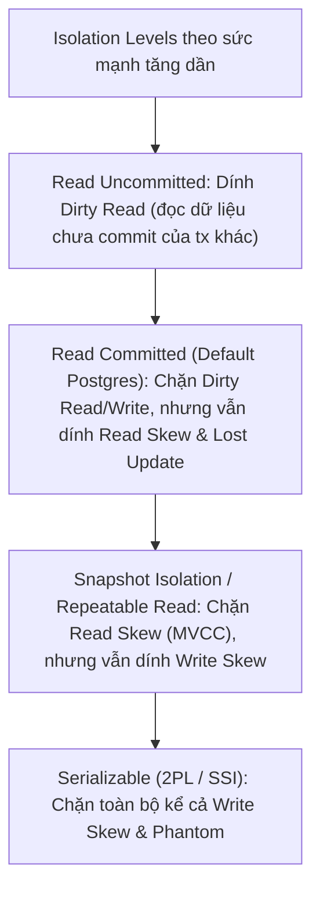

# Bài học Giai đoạn 1 — Phần 5: Mục Tiêu Đạt Được & Chuẩn Bị Mốc Tuần 4

[← Phần 4: Thực hành Database](./02-thuc-hanh-database.md) · [Quay lại GĐ 1 README](./README.md)

---

## Mục tiêu 1 — Giải thích được khi nào chọn LSM-Tree, khi nào chọn B-Tree

### Câu trả lời mẫu 60 giây
> "Tôi chọn **LSM-Tree** khi bài toán thiên về **ghi rất nhiều (write-heavy)** — ví dụ ghi log, time-series, lịch sử chat, metrics — vì LSM biến các lệnh ghi rải rác thành ghi tuần tự (WAL + MemTable → flush SSTable), cho write throughput rất cao và nén dung lượng tốt. Đổi lại, đọc có thể chậm hơn chút (cần Bloom Filter để lọc SSTable) và có thể gặp spike `p99` khi compaction chạy nền. Ngược lại, tôi chọn **B-Tree** (PostgreSQL, MySQL) cho hệ thống **OLTP đọc nhiều hoặc cần giao dịch ACID phức tạp** như đơn hàng/thanh toán ở TechStore, vì mỗi key nằm tại đúng 1 page nên đọc cực kỳ ổn định, dễ khóa dòng (row/page latch) và không bị compaction làm giật `p99`."

### Bảng ra quyết định nhanh

| Nếu hệ thống của bạn có... | Chọn | Lý do cốt lõi |
| :--- | :--- | :--- |
| E-commerce (TechStore), ngân hàng, giao dịch cần ACID & JOIN nhiều | **B-Tree** (PostgreSQL, MySQL) | Đọc ổn định, `p99` ít dao động, locking & transaction chín muồi |
| Ghi log, clickstream, IoT sensor, lịch sử tin nhắn chat | **LSM-Tree** (Cassandra, RocksDB, ScyllaDB) | Append-only sequential I/O chịu tải write cực lớn, tỉ lệ nén cao |
| Tỷ lệ đọc rất cao + ít ghi + range query nhanh | **B-Tree** | Một đường đi từ root xuống leaf, không phải gộp nhiều tầng SSTable |
| Workload ghi liên tục làm phân mảnh ổ đĩa trên B-Tree | **LSM-Tree** | SSTable bất biến ghi tuần tự không làm phân mảnh random page |

---

## Mục tiêu 2 — Giải thích & tái hiện được Replication Lag cùng cách xử lý

### 1. Replication Lag là gì và tái hiện thế nào?
- **Bản chất:** Trong mô hình **Async Leader–Follower**, Primary commit xong và trả `200 OK` cho client trước khi Replica kịp áp dụng WAL log → tạo ra khoảng trễ thời gian (vài ms đến vài giây, hoặc vài phút khi Replica quá tải).
- **Cách tái hiện trong Lab 1.2:** Chạy `SELECT pg_wal_replay_pause();` trên `pg-replica`, thực hiện `INSERT` vào `pg-primary` rồi đọc ngay từ `pg-replica` → dữ liệu chưa thấy xuất hiện dù vừa ghi thành công.

### 2. 3 tình huống người dùng gặp phải & cách xử lý tương ứng

| Anomaly do Lag | Ví dụ ở TechStore | Giải pháp thực tế |
| :--- | :--- | :--- |
| **Read-Your-Writes** | User vừa sửa địa chỉ giao hàng hoặc tạo đơn mới, F5 lại thấy biến mất | • Đọc dữ liệu user vừa tự sửa từ **Primary** (hoặc set cờ `recent_write` TTL 10–30s trên Redis để route các GET tiếp theo của user đó về Primary). • Hoặc so sánh WAL **LSN** giữa response ghi và Replica. |
| **Monotonic Reads** | User F5 lần 1 thấy đơn hàng (Replica A đã sync), F5 lần 2 đơn biến mất (Replica B lag hơn) | Pin cố định mỗi `user_id` đọc ở **cùng 1 Replica** (`hash(user_id) % num_replicas`), chỉ fallback khi Replica đó chết. |
| **Consistent Prefix Reads** | Bình luận trả lời hiển thị trước câu hỏi gốc do shard/replica sync lệch tốc độ | Giữ các event có quan hệ nhân quả trong cùng 1 partition/shard hoặc gắn causal sequence/timestamp. |

---

## Mục tiêu 3 — Phân biệt các Isolation Level qua Anomaly cụ thể

> Không trả lời kiểu học vẹt *"Repeatable Read chống được Non-repeatable Read"*, hãy **dùng đúng ví dụ anomaly** để phân biệt ranh giới giữa các level:

### Kịch bản kiểm tra ranh giới (Interview Cheat Sheet)

1. **Ranh giới `Read Uncommitted` → `Read Committed`:**
   - *Bài test:* Tx A chuyển `500K` (chưa `COMMIT`), Tx B đọc số dư thấy `500K`, sau đó Tx A `ROLLBACK`.
   - `Read Uncommitted` đọc nhầm số dư ma (**Dirty Read**); `Read Committed` chỉ cho đọc dữ liệu đã commit.
2. **Ranh giới `Read Committed` → `Snapshot Isolation (Repeatable Read)`:**
   - *Bài test (**Read Skew**):* Alice có 2 tài khoản A (`500K`) và B (`500K`). Tx 1 đọc A (`500K`), đúng lúc đó Tx 2 chuyển `100K` từ A sang B và `COMMIT`, rồi Tx 1 đọc tiếp B (`600K`) → Tx 1 cộng lại ra tổng **`1,100K`** (bị dư 100K!).
   - `Read Committed` **dính Read Skew** (vì mỗi câu `SELECT` lấy snapshot mới nhất). `Snapshot Isolation / Repeatable Read` **chặn được** nhờ giữ cố định 1 snapshot từ đầu transaction!
   - *(Lưu ý bổ sung: `Read Committed` cũng dính **Lost Update**; PostgreSQL `REPEATABLE READ` tự phát hiện và abort Lost Update).*
3. **Ranh giới `Snapshot Isolation (Repeatable Read)` → `Serializable`:**
   - *Bài test (**Write Skew / Phantom**):* Phải có ít nhất 1 bác sĩ trực ca (Alice & Bob đang trực). Cả hai cùng vào DB đếm `COUNT(*) = 2`, thấy ổn rồi Alice sửa dòng `id=1`, Bob sửa dòng `id=2`.
   - `Snapshot Isolation` **vẫn dính Write Skew** vì 2 transaction sửa **2 dòng khác nhau**! Chỉ `Serializable` (nhờ PostgreSQL **SSI** hoặc **2PL + Predicate Lock**) mới phát hiện xung đột đọc-ghi chéo này và chặn được.

---

## Mục tiêu 4 — Chọn chiến lược Sharding cho một đề bài & nêu hậu quả

### Quy trình 3 bước chọn Shard Key trong phỏng vấn
1. **Xác định Query Pattern chính (80% traffic):** Hệ thống tra cứu chủ yếu theo cột nào (`user_id`, `tenant_id`, `conversation_id`, `short_code`)? Tránh để query phổ biến nhất phải **scatter-gather** khắp mọi shard.
2. **Kiểm tra độ phân bố & Hot Spot:** Có bị dồn toàn bộ Write vào 1 shard không (ví dụ shard theo `created_at` hoặc 1 celebrity user)?
3. **Nêu rõ Hậu quả (Trade-offs) sau khi chọn:** *Mất gì? Cái gì trở nên chậm hoặc phức tạp?*

### 4 Case mẫu & Trade-off tương ứng

| Bài toán | Chiến lược Sharding đề xuất | Lý do chọn | Hậu quả & Cách giảm thiểu |
| :--- | :--- | :--- | :--- |
| **1. TechStore `orders`** | **Hash theo `user_id`** (dùng fixed partitions / consistent hashing) | Toàn bộ đơn hàng của 1 user nằm cùng 1 shard → tra lịch sử đơn hàng & giỏ hàng chỉ chạm 1 shard | • **Hậu quả 1:** Query admin lọc tất cả đơn `PENDING` toàn sàn sẽ phải **scatter-gather** (xử lý bằng Elasticsearch/OLAP riêng). • **Hậu quả 2:** Không `JOIN` được trực tiếp với bảng không cùng shard key (`products` → dùng cache hoặc replica bảng catalog nhỏ). |
| **2. Tin nhắn Chat (Discord/Messenger)** | **Hash theo `channel_id` / `conversation_id`** | Mọi tin nhắn trong cùng cuộc hội thoại nằm chung shard → lấy 50 tin gần nhất cực nhanh, giữ đúng thứ tự | • **Hậu quả:** Một kênh cộng đồng cực lớn (1 triệu thành viên chat cùng lúc) có thể thành **Hot Shard** → cân nhắc tách thêm theo time bucket `(channel_id, month)` hoặc rate limit. |
| **3. URL Shortener** | **Hash theo `short_code`** | Redirect `GET /{short_code}` phân tán đều, mỗi lookup chạm đúng 1 shard | • **Hậu quả:** Thống kê *"tất cả link do User A tạo"* bị rải khắp các shard → cần thêm Global Index hoặc lưu bảng mapping `user_id -> short_codes` riêng. |
| **4. Logs / Metrics / IoT** | **Composite: `(tenant_id, time_bucket)`** | Tránh dồn toàn bộ log mới của cả hệ thống vào 1 shard cuối (hot spot nếu chỉ shard theo `time`) và hỗ trợ xóa log cũ bằng `DROP PARTITION` | • **Hậu quả:** Tenant lớn vẫn to hơn tenant nhỏ nhiều lần → cần theo dõi độ lệch dung lượng (skew) và sub-shard tenant VIP. |

---

## Chuẩn bị Mốc kiểm tra Tuần 4

> **Mốc Tuần 4:** Mock 45 phút *(đề dạng DB / Scale)* · **Sản phẩm:** *Repo replica + sharding demo*

### Checklist trước khi làm Mock Tuần 4
- [ ] Đã đẩy code **Lab 1.2** (Docker Compose `pg-primary` + `pg-replica` + Spring Boot `AbstractRoutingDataSource` + demo lag) và **Lab 1.3** (`ShardingSimulation` + **Lab 1.4** concurrency tests) lên GitHub repo.
- [ ] Tự giải thích trôi chảy trong 3 phút các chủ đề hay bị hỏi xoáy trong đề DB/Scale:
  - *Khi nào chỉ cần Read Replica, khi nào bắt buộc phải Sharding?*
  - *Tại sao `hash(key) % N` cố định lại nguy hiểm khi thêm node?*
  - *Làm sao xử lý 100 người cùng mua 1 món hàng cuối cùng trong kho mà không bán âm (`stock < 0`)?*
  - *Nếu Replica bị lag 3 giây sau khi user vừa đặt đơn, bạn sửa thế nào?*
