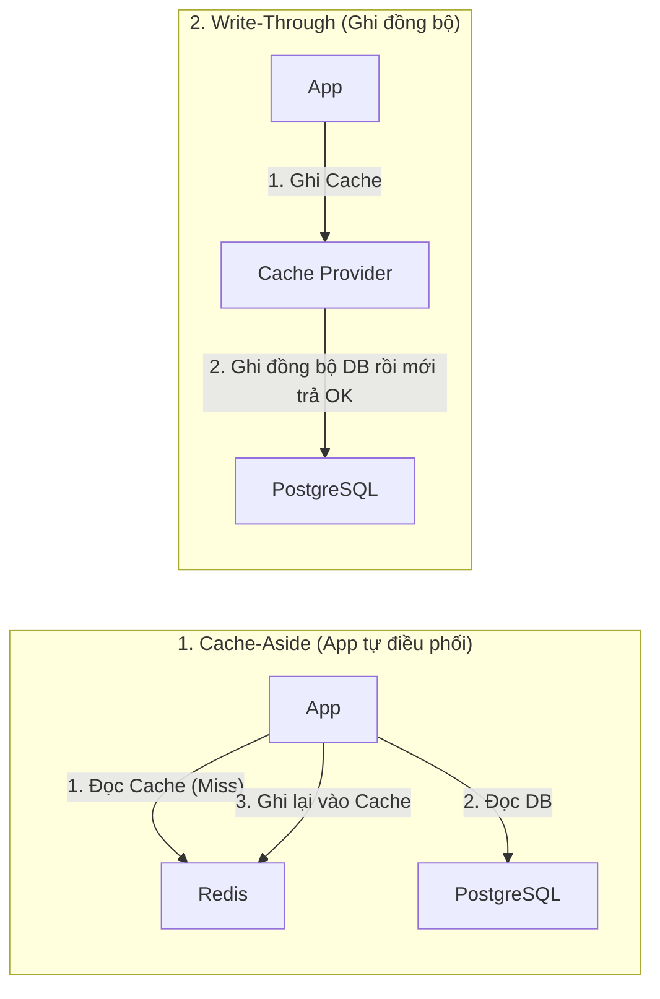
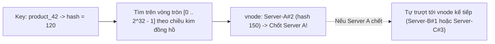

# Bài học Giai đoạn 2 — Phần 3: Concepts Building Blocks (Tuần 7–9)

[← Quay lại GĐ 2 README](./README.md) · [Tiếp theo: Phần 4 — Thực hành TechStore →](./02-thuc-hanh-techstore.md)

> **Tài liệu đối chiếu:** `[P]` Xu Vol.1 ch.4–7, DDIA ch.4 & ch.11, `system-design-primer` · `[W]` Redis docs, Kafka docs, Spring Kafka, Resilience4j RateLimiter

---

## Mục lục
1. [Cache: Patterns, TTL/Eviction, 3 Vấn đề kinh điển & Invalidation](#1-cache-patterns-ttleviction-3-vấn-đề-kinh-điển--invalidation)
2. [Rate Limiting: Token Bucket, Leaky Bucket & Sliding Window](#2-rate-limiting-token-bucket-leaky-bucket--sliding-window)
3. [Consistent Hashing & Virtual Nodes](#3-consistent-hashing--virtual-nodes)
4. [Distributed Unique ID Generator (UUID, Ticket Server, Snowflake)](#4-distributed-unique-id-generator)
5. [Queue vs Log (RabbitMQ vs Kafka), Semantics, Idempotency & DLQ](#5-queue-vs-log-rabbitmq-vs-kafka-semantics-idempotency--dlq)
6. [Serialization & Schema Evolution (JSON, Protobuf, Avro)](#6-serialization--schema-evolution-json-protobuf-avro)

---

## 1. Cache: Patterns, TTL/Eviction, 3 Vấn đề kinh điển & Invalidation

### 1.1. 4 chiến lược đọc/ghi Cache

| Chiến lược | Cơ chế hoạt động | Ưu điểm | Nhược điểm / Khi nào dùng |
| :--- | :--- | :--- | :--- |
| **Cache-Aside** *(Lazy Loading)* | App tự đọc Redis; nếu miss thì đọc DB rồi ghi lại vào Redis | Phổ biến nhất; Redis chết app vẫn fallback sang DB; chỉ cache dữ liệu thực sự được đọc | Miss lần đầu chậm; có thể lệch dữ liệu tạm thời giữa DB và Cache |
| **Read-Through** | App chỉ gọi Cache Provider; nếu miss, chính Cache tự kéo từ DB | Code app rất gọn, tách biệt logic cache | Cần thư viện/cache hỗ trợ plugin DB (ít phổ biến với Redis thuần) |
| **Write-Through** | Mọi ghi đi qua Cache → Cache ghi **đồng bộ** xuống DB rồi mới trả OK | Cache và DB luôn nhất quán | Write chậm hơn (tốn 2 lần ghi); hay lưu thừa dữ liệu ghi vào nhưng ít đọc |
| **Write-Behind** *(Write-Back)* | App ghi vào Cache và nhận OK ngay; Cache gom batch flush bất đồng bộ xuống DB | **Write cực nhanh** (gom nhiều update thành 1 batch DB) | **Rủi ro mất dữ liệu** nếu Cache sập trước khi kịp flush xuống DB |

### 1.2. TTL & Eviction Policies (Khi Redis đầy RAM)
Khi bộ nhớ `maxmemory` của Redis đầy, Redis cần chính sách **Eviction** để đẩy key cũ ra:
- **`allkeys-lru` (Least Recently Used):** Xóa key **lâu nhất chưa được truy cập**. Phổ biến mặc định cho cache chung.
- **`allkeys-lfu` (Least Frequently Used):** Xóa key **ít được truy cập nhất theo tần suất**. Cực hợp cho e-commerce (TechStore): nếu có 1 đợt crawler quét 1 lần hàng nghìn sản phẩm cũ, LRU sẽ đẩy mất sản phẩm hot, còn **LFU giữ lại sản phẩm có tần suất truy cập cao**!
- **`volatile-lru` / `volatile-ttl`:** Chỉ xóa trong nhóm các key **có đặt TTL** (an toàn nếu Redis dùng chung cho dữ liệu không được phép mất).
- **`noeviction`:** Không xóa gì, trả lỗi ghi khi đầy RAM (chỉ dùng khi Redis đóng vai trò DB/Queue không được mất data).

### 1.3. 3 vấn đề kinh điển của Cache & Cách xử lý

| Vấn đề | Hiện tượng & Nguyên nhân | Cách xử lý chuẩn |
| :--- | :--- | :--- |
| **1. Cache Stampede** *(Thundering Herd)* | 1 key cực hot (vd trang chủ / flash sale) hết hạn TTL → hàng nghìn request cùng lúc thấy **cache miss** và đấm thẳng vào DB làm DB sập | • **Distributed Lock / Mutex:** Chỉ cho 1 thread lấy lock đọc DB và nạp lại cache; các thread khác đợi ngắn rồi đọc từ cache. • **TTL Jitter:** Cộng thêm thời gian ngẫu nhiên vào TTL (`baseTTL + random(0..60s)`). • **Early Refresh:** Làm mới trước khi TTL hết hạn. |
| **2. Cache Penetration** | Client/hacker liên tục query key **không tồn tại** trong DB (`id = -1`, `id = 99999999`) → luôn miss cache, đâm xuyên qua Redis xuống thẳng DB | • **Cache Null Value:** Lưu kết quả rỗng (`"__NULL__"`) vào Redis với TTL ngắn (`30–60s`). • **Bloom Filter:** Đặt trước Cache; nếu Bloom Filter báo *"chắc chắn không tồn tại"* thì trả `404` ngay, không chạm cả Redis lẫn DB! |
| **3. Cache Avalanche** | **Hàng loạt** key cùng hết hạn một thời điểm (vd nạp cache hàng loạt lúc 00:00 với cùng TTL 1 tiếng) hoặc cả cụm Redis crash | • **Random Jitter** cho TTL để phân tán thời điểm hết hạn. • **Redis Cluster / Sentinel HA**. • **Circuit Breaker / Rate Limiter** bảo vệ DB khi Redis gặp sự cố. |

### 1.4. Cache Invalidation: Vì sao "Update DB trước → Delete Cache sau"?
Khi cập nhật giá sản phẩm TechStore, **không nên cập nhật thẳng giá trị mới vào Cache** (*Update Cache*) mà nên **Xóa Cache** (*Delete Cache*):
1. Nếu dùng *Update Cache*: 2 request đồng thời (Req A ghi giá `100K`, Req B ghi giá `120K`) cập nhật DB theo thứ tự `A → B` (`120K`), nhưng cập nhật Redis ngược thứ tự `B → A` → **Redis lưu nhầm giá cũ `100K` cho đến khi hết TTL**!
2. Nếu dùng **Update DB → Delete Cache**: chỉ xóa key để lần đọc tiếp theo tự nạp giá mới.
3. Để chắc chắn hơn nữa trước race condition đọc-xóa cực hiếm: dùng **Delayed Double Delete** (xóa cache, cập nhật DB, đợi ~`200ms` xóa lại lần nữa) hoặc dùng **CDC (Debezium đọc WAL PostgreSQL → Kafka → Delete/Update Redis)** để tách hẳn việc đồng bộ cache khỏi luồng nghiệp vụ chính.

---

## 2. Rate Limiting: Token Bucket, Leaky Bucket & Sliding Window

### 2.1. Đặt Rate Limiter ở đâu?
Client (không tin cậy, dễ giả mạo) → **API Gateway / Reverse Proxy** (Nginx, Envoy, Spring Cloud Gateway — chỗ chuẩn nhất!) → **Middleware Filter trong App** (Spring Filter + Redis) → **Resilience4j cục bộ** (bảo vệ từng service gọi downstream).

### 2.2. So sánh 4 thuật toán Rate Limiting

| Thuật toán | Nguyên lý | Xử lý Burst | Bộ nhớ / Chi phí | Phù hợp khi nào |
| :--- | :--- | :--- | :--- | :--- |
| **Token Bucket** *(Phổ biến nhất)* | Có xô chứa tối đa $C$ token, nạp đều $r$ token/giây. Mỗi request tốn 1 token; hết token thì từ chối (`429`) | **Cho phép burst** ngắn hạn lên tới $C$ requests cùng lúc | **Rất nhẹ:** chỉ 2 giá trị mỗi user (`tokens`, `last_refill_ts`) | API Gateway nói chung (AWS, Stripe, TechStore API) |
| **Leaky Bucket** | Request đi vào hàng đợi dung lượng cố định $C$ và được rút ra xử lý ở **tốc độ đều tuyệt đối** $r$ req/s | Không đẩy burst xuống downstream (tràn xô thì drop) | Nhẹ (hàng đợi FIFO hoặc meter timestamp) | Cần bảo vệ hệ thống downstream yếu, đòi hỏi lưu lượng đều đặn |
| **Fixed Window Counter** | Chia thời gian thành các ô cố định (`12:00`, `12:01`), mỗi ô đếm tối đa $N$ | **Lỗ hổng 2x:** User gửi $N$ req ở giây `:59` và $N$ req ở giây `:01` → `2N` req trong 2 giây! | Cực nhẹ (`1` counter/window) | Chấp nhận sai số biên, ưu tiên đơn giản |
| **Sliding Window Log** | Lưu timestamp của mọi request trong một Sorted Set (`ZSET`), xóa các timestamp cũ hơn `now - window` | Chính xác tuyệt đối 100% | **Tốn RAM lớn** nếu giới hạn cao (vd 10,000 req/phút/user) | Endpoint cực nhạy cảm (login, OTP, thanh toán) |
| **Sliding Window Counter** | Kết hợp counter cửa sổ hiện tại + phần trăm giao nhau của cửa sổ trước | Rất mượt, gần như triệt tiêu lỗi 2x burst | Rất nhẹ (`2` counter mỗi user) | Cần độ chính xác cao mà vẫn tiết kiệm RAM ở quy mô lớn |

> [!IMPORTANT]
> **Atomic Execution trong Redis:** Tuyệt đối **không** làm `GET tokens` trong Java → tính toán trong Java → `SET tokens` lên Redis! Dưới tải đồng thời, 2 request cùng đọc được `tokens = 1` và đều cho qua (**Race Condition**). Phải gom logic đọc-tính-ghi vào một **Redis Lua Script** vì Redis thực thi mỗi Lua script nguyên tử (atomic) trên single thread!

**Chuẩn HTTP Response khi bị giới hạn:**
- Status Code: **`429 Too Many Requests`**
- Headers hữu ích cho client: `X-RateLimit-Limit`, `X-RateLimit-Remaining`, `Retry-After` (số giây cần chờ).

---

## 3. Consistent Hashing & Virtual Nodes

### 3.1. Tại sao `hash(key) % N` lại vỡ trận khi Scale?
Khi bạn có `N = 3` node cache/shard và dùng `hash(key) % 3`, nếu tăng lên `N = 4` (hoặc 1 node chết còn `N = 2`), **~75% key thay đổi kết quả modulo** → gây bão **cache miss đồng loạt** đánh sập DB, hoặc phải di chuyển ~75% dữ liệu giữa các shard!

### 3.2. Cách hoạt động của Hash Ring & Virtual Nodes

1. **Tạo Hash Ring:** Ánh xạ không gian số nguyên từ $0$ đến $2^{32} - 1$ thành một vòng tròn khép kín (dùng MD5/SHA-1/MurmurHash).
2. **Đặt Server & Key lên vòng:** Dùng cùng hàm băm để đặt các node lên vòng. Với mỗi key, tính `hash(key)` rồi đi **theo chiều kim đồng hồ** tìm server đầu tiên gặp phải.
3. **Khi thêm/xóa 1 server vật lý:** Chỉ các key nằm trong khoảng giữa node mới và node đứng ngay trước nó bị ảnh hưởng (~$1/N$ tổng số key) — các key còn lại giữ nguyên vị trí!
4. **Virtual Nodes (Vnodes) — Thành phần bắt buộc trong thực tế:**
   - Nếu chỉ đặt 3 điểm thật lên vòng tròn rộng $2^{32}$, khoảng cách giữa chúng có thể lệch rất lớn (1 server gánh 60% tải, server khác 10%), và khi 1 server chết toàn bộ tải của nó đổ ập lên **duy nhất 1 server kế tiếp** (**domino cascading failure**)!
   - **Giải pháp:** Mỗi server vật lý được tạo thành **100–200 virtual nodes** (`Server-A#0`, `Server-A#1`, ..., `Server-A#199`) rải xen kẽ khắp vòng tròn → độ lệch tải giảm dưới 5%, và khi 1 node chết, tải của nó được **chia đều cho tất cả các node còn lại**.

---

## 4. Distributed Unique ID Generator

### 4.1. Yêu cầu của hệ thống sinh ID phân tán (TechStore Orders, Tweets, Messages)
1. **Unique toàn cục** (không bao giờ trùng giữa nhiều service/datacenter).
2. **Kiểu số 64-bit (`long` / `BIGINT`)**: gọn hơn chuỗi UUID 36 ký tự, đánh B-Tree index nhanh và ít tốn RAM hơn hẳn.
3. **Sắp xếp gần đúng theo thời gian (Roughly Time-Sorted):** ID sinh sau lớn hơn ID sinh trước để khi chèn vào B-Tree (PostgreSQL/MySQL InnoDB Clustered Index) luôn nối vào **cuối cây**, tránh **random page split**!
4. **Hiệu năng cao & Không SPOF:** Sinh được hàng chục nghìn đến hàng triệu ID/giây, không phụ thuộc 1 node trung tâm.

### 4.2. So sánh các giải pháp

| Giải pháp | Kích thước | Time-sorted? | Hạn chế & Ghi chú |
| :--- | :---: | :---: | :--- |
| **UUID v4** | 128-bit (36 char) | **Không** (ngẫu nhiên) | Làm phân mảnh B-Tree index cực nặng khi bảng to (`> 10M` dòng) |
| **UUID v7** *(chuẩn mới)* | 128-bit | **Có** (48-bit ms prefix) | Tốt cho B-Tree nhưng vẫn tốn gấp đôi dung lượng so với 64-bit `BIGINT` |
| **DB Auto-Increment phân tán** (`k` DB, bước nhảy `k`) | 64-bit | Tương đối | Khó thêm/bớt số lượng DB; có thể không đồng đều giữa các DC |
| **Ticket Server (Flickr)** | 64-bit | Có | Vẫn có điểm nghẽn mạng về 1–2 DB trung tâm sinh số |
| **Snowflake (Twitter)** | **64-bit** | **Có** | **Chuẩn vàng** cho hệ phân tán; cần xử lý **Clock Skew** |

### 4.3. Cấu trúc 64-bit của Twitter Snowflake

| Bit | Độ dài | Ý nghĩa | Giới hạn tối đa |
| :---: | :---: | :--- | :--- |
| `0` | **1 bit** | Bit dấu (luôn bằng `0` để ID luôn là số dương) | — |
| `1..41` | **41 bits** | Timestamp (milliseconds) tính từ Custom Epoch (vd `2026-01-01`) | $2^{41} \text{ ms} \approx \mathbf{69.7 \text{ năm}}$ |
| `42..46` | **5 bits** | Datacenter ID | $2^5 = \mathbf{32 \text{ datacenters}}$ |
| `47..51` | **5 bits** | Worker / Machine ID | $2^5 = \mathbf{32 \text{ workers / DC}}$ (tổng 1,024 nodes) |
| `52..63` | **12 bits** | Sequence number trong cùng 1 millisecond | $2^{12} = \mathbf{4,096 \text{ IDs / ms / node}}$ ($\approx 4.09\text{M ID/s}$) |

*(Cảnh báo **Clock Skew**: Nếu NTP đồng bộ kéo đồng hồ hệ thống lùi về quá khứ, timestamp bị lặp → nguy cơ sinh trùng ID! Phải kiểm tra `currentTs < lastTs` và chờ/ném exception hoặc đổi sang worker ID dự phòng).*

---

## 5. Queue vs Log (RabbitMQ vs Kafka), Semantics, Idempotency & DLQ

### 5.1. Queue truyền thống (RabbitMQ / SQS) vs Log-based Broker (Kafka)

| Tiêu chí | Traditional Message Queue (RabbitMQ) | Log-based Message Broker (Apache Kafka) |
| :--- | :--- | :--- |
| **Mô hình lưu trữ** | Message bị **xóa khỏi hàng đợi** ngay khi consumer `ack` | **Append-only immutable log**, giữ theo `retention` (vd 7 ngày) dù đã đọc |
| **Thứ tự (Ordering)** | Khó giữ thứ tự tuyệt đối khi có nhiều consumer song song trên 1 queue | **Giữ thứ tự tuyệt đối bên trong 1 Partition** (cùng `key`, vd `order_id`, vào cùng 1 partition) |
| **Mô hình đọc** | Broker chủ động **Push**; nhiều worker cạnh tranh 1 message | Consumer tự **Pull** theo **Offset**; nhiều **Consumer Group** độc lập đọc cùng 1 stream |
| **Replay lại dữ liệu** | Không (đã `ack` là mất) | **Có** (reset offset về quá khứ để chạy lại analytics / sửa bug consumer) |
| **Khi nào chọn?** | Task queue phức tạp routing (gửi mail, PDF job, delayed retry linh hoạt) | Event streaming throughput cực cao, CDC, Activity Tracking, Log aggregation, Event-driven microservices |

> **Quy tắc song song trong Kafka:** Trong **1 Consumer Group**, mỗi Partition chỉ được gán cho **tối đa 1 Consumer** tại một thời điểm. Nếu topic có `3 partitions` mà bạn bật `5 consumer` cùng group → **2 consumer sẽ ngồi chơi không**!

### 5.2. Delivery Semantics (3 mức đảm bảo giao nhận)
1. **At-most-once:** Consumer commit offset **trước** khi xử lý (hoặc producer fire-and-forget) → có thể **mất** message nếu consumer crash giữa chừng, không bao giờ trùng. *(Dùng cho log/metrics chấp nhận rớt).*
2. **At-least-once (Phổ biến nhất):** Consumer xử lý xong mới commit offset → **không mất** message, nhưng có thể **xử lý trùng** nếu consumer crash ngay trước bước commit offset hoặc bị timeout rebalance!
3. **Exactly-once:** Khái niệm dễ bị hiểu lầm! Kafka hỗ trợ *Exactly-Once Semantics (EOS)* chỉ gói gọn trong phạm vi nội bộ **Kafka → Kafka Streams → Kafka**. Khi tương tác với thế giới bên ngoài (DB, Payment, Email), không thể có "exactly-once" mạng thuần túy → chuẩn công nghiệp là:
   $$\text{At-least-once Delivery} + \text{Idempotent Consumer}$$

### 5.3. Idempotency, Dead-Letter Queue (DLQ) & Back Pressure
- **Idempotent Operations:** Thực hiện cùng 1 message 1 lần hay $N$ lần đều cho đúng 1 trạng thái cuối. Cách làm chuẩn: producer gắn `event_id` (UUID/Snowflake) vào mỗi event; consumer lưu `event_id` vào bảng `processed_events(event_id PRIMARY KEY)` trong **cùng DB transaction** với nghiệp vụ, hoặc dùng Redis `SETNX`.
- **Dead-Letter Queue / Topic (DLQ / DLT):** Nếu một message bị lỗi vĩnh viễn (*poison pill* — JSON lỗi format, thiếu field bắt buộc), consumer không nên retry vô tận làm nghẽn toàn bộ các message phía sau trên partition đó. Sau $K$ lần retry với **Exponential Backoff**, đẩy message sang `topic.DLT` để kỹ sư kiểm tra và replay sau.
- **Back Pressure:** Cơ chế ngăn producer làm ngập lụt consumer chậm (trong Kafka dùng `pull` theo tốc độ consumer `max.poll.records`, trong queue dùng giới hạn kích thước queue + trả `429`/`503`).

---

## 6. Serialization & Schema Evolution (DDIA Ch.4)

Không dùng serialization mặc định theo ngôn ngữ (như `Java Serializable`, Python `pickle`) vì: khóa chặt vào 1 ngôn ngữ, payload rất nặng, hiệu năng kém và dễ dính lỗ hổng Remote Code Execution (RCE).

### So sánh JSON vs Protobuf vs Apache Avro

| Tiêu chí | JSON | Protocol Buffers (Protobuf) | Apache Avro |
| :--- | :--- | :--- | :--- |
| **Định dạng** | Text (dễ đọc cho người) | Binary (nhỏ gọn, nhanh) | Binary (cực kỳ nhỏ gọn) |
| **Cách nhận diện field** | Tên field lặp lại trong mỗi message | Dùng **Field Tag Number** (`1, 2, 3...`) | Không ghi tag trong payload; dùng **Writer & Reader Schema** |
| **Schema bắt buộc** | Không (hoặc JSON Schema rời) | Bắt buộc file `.proto` | Bắt buộc file `.avsc` + **Schema Registry** |
| **Phù hợp nhất** | Public REST API (Web/Mobile ↔ Backend) | gRPC, giao tiếp nội bộ giữa các microservice | Kafka Event Streaming, Data Lake / Spark / Hadoop |

### Quy tắc vàng về Schema Evolution (Rolling Upgrade an toàn)
Trong hệ thống thực tế, server cũ và server mới chạy **song song** khi deploy rolling update:
- **Backward Compatibility:** Code mới đọc được dữ liệu do code cũ ghi → mọi field mới thêm vào phải là **`optional`** hoặc có **giá trị `default`**.
- **Forward Compatibility:** Code cũ đọc được dữ liệu do code mới ghi → chỉ được phép xóa các field vốn là `optional` (không xóa `required`), và trong Protobuf **TUYỆT ĐỐI KHÔNG BAO GIỜ tái sử dụng lại Field Tag Number đã xóa**!
