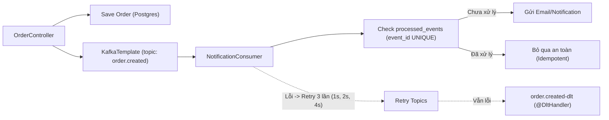

# Bài học Giai đoạn 2 — Phần 4: Thực Hành TechStore (Redis · Rate Limiter · Kafka · Snowflake)

[← Phần 3: Concepts](./01-concepts.md) · [Quay lại GĐ 2 README](./README.md) · [Tiếp theo: Phần 5 — Mục tiêu & Check Tuần 8 →](./03-muc-tieu-va-check-tuan8.md)

---

## Hạ tầng chung cho Lab 2.1 – 2.3 (`docker-compose.yml`)

Tạo file `docker-compose.yml` để khởi chạy cùng lúc **PostgreSQL 16**, **Redis 7**, **Kafka (KRaft mode — không cần Zookeeper)** và **Kafka UI**:

```yaml
services:
  postgres:
    image: postgres:16-alpine
    container_name: techstore-pg
    ports:
      - "5432:5432"
    environment:
      POSTGRES_USER: postgres
      POSTGRES_PASSWORD: postgres
      POSTGRES_DB: techstore

  redis:
    image: redis:7-alpine
    container_name: techstore-redis
    ports:
      - "6379:6379"
    command: ["redis-server", "--maxmemory", "256mb", "--maxmemory-policy", "allkeys-lfu"]

  kafka:
    image: apache/kafka:3.8.0
    container_name: techstore-kafka
    ports:
      - "9092:9092"
    environment:
      KAFKA_NODE_ID: 1
      KAFKA_PROCESS_ROLES: broker,controller
      KAFKA_LISTENERS: PLAINTEXT://:9092,CONTROLLER://:9093
      KAFKA_ADVERTISED_LISTENERS: PLAINTEXT://localhost:9092
      KAFKA_CONTROLLER_LISTENER_NAMES: CONTROLLER
      KAFKA_LISTENER_SECURITY_PROTOCOL_MAP: CONTROLLER:PLAINTEXT,PLAINTEXT:PLAINTEXT
      KAFKA_CONTROLLER_QUORUM_VOTERS: 1@localhost:9093
      KAFKA_OFFSETS_TOPIC_REPLICATION_FACTOR: 1
      KAFKA_TRANSACTION_STATE_LOG_REPLICATION_FACTOR: 1
      KAFKA_TRANSACTION_STATE_LOG_MIN_ISR: 1

  kafka-ui:
    image: provectuslabs/kafka-ui:latest
    container_name: techstore-kafka-ui
    ports:
      - "8090:8080"
    environment:
      KAFKA_CLUSTERS_0_NAME: local
      KAFKA_CLUSTERS_0_BOOTSTRAPSERVERS: kafka:9092
    depends_on:
      - kafka
```

```powershell
docker compose up -d
```

---

## Lab 2.1 — Redis Cache-Aside cho API sản phẩm TechStore & Xử lý Cache Stampede

### 1. Cài đặt Cache-Aside + TTL Jitter + Mutex Lock chống Stampede & Null Cache

Dependencies Spring Boot: `spring-boot-starter-data-redis`, `spring-boot-starter-web`, `spring-boot-starter-data-jpa`.

```java
package com.techstore.service;

import com.fasterxml.jackson.databind.ObjectMapper;
import org.springframework.data.redis.core.StringRedisTemplate;
import org.springframework.stereotype.Service;

import java.time.Duration;
import java.util.Optional;
import java.util.UUID;
import java.util.concurrent.ThreadLocalRandom;
import java.util.concurrent.atomic.AtomicLong;

@Service
public class ProductCacheService {

    private static final String KEY_PREFIX = "product:";
    private static final String LOCK_PREFIX = "lock:product:";
    private static final String NULL_MARKER = "__NULL__";

    private final StringRedisTemplate redis;
    private final ProductRepository productRepo;
    private final ObjectMapper objectMapper;

    // Bộ đếm để quan sát số lần query thực sự chạm xuống DB khi test Stampede
    public final AtomicLong dbHitCounter = new AtomicLong(0);

    public ProductCacheService(StringRedisTemplate redis, ProductRepository productRepo, ObjectMapper objectMapper) {
        this.redis = redis;
        this.productRepo = productRepo;
        this.objectMapper = objectMapper;
    }

    /**
     * Phiên bản 1 (Naive Cache-Aside): Dễ dính Cache Stampede khi key hot vừa hết hạn
     */
    public Optional<ProductDto> getProductNaive(Long id) throws Exception {
        String key = KEY_PREFIX + id;
        String cached = redis.opsForValue().get(key);
        if (cached != null) {
            return NULL_MARKER.equals(cached) ? Optional.empty() : Optional.of(objectMapper.readValue(cached, ProductDto.class));
        }

        dbHitCounter.incrementAndGet();
        Optional<ProductDto> dbVal = productRepo.findById(id).map(ProductDto::from);

        if (dbVal.isPresent()) {
            redis.opsForValue().set(key, objectMapper.writeValueAsString(dbVal.get()), Duration.ofMinutes(5));
        } else {
            // Chống Cache Penetration bằng cách cache marker rỗng ngắn hạn
            redis.opsForValue().set(key, NULL_MARKER, Duration.ofSeconds(30));
        }
        return dbVal;
    }

    /**
     * Phiên bản 2 (Production-ready): Mutex Lock chống Stampede + TTL Jitter + Cache Null
     */
    public Optional<ProductDto> getProductSafe(Long id) throws Exception {
        String key = KEY_PREFIX + id;
        String cached = redis.opsForValue().get(key);
        if (cached != null) {
            return NULL_MARKER.equals(cached) ? Optional.empty() : Optional.of(objectMapper.readValue(cached, ProductDto.class));
        }

        String lockKey = LOCK_PREFIX + id;
        String lockToken = UUID.randomUUID().toString();
        Boolean acquired = redis.opsForValue().setIfAbsent(lockKey, lockToken, Duration.ofSeconds(5));

        if (Boolean.TRUE.equals(acquired)) {
            try {
                // Double-check cache phòng trường hợp thread trước vừa nạp xong
                cached = redis.opsForValue().get(key);
                if (cached != null) {
                    return NULL_MARKER.equals(cached) ? Optional.empty() : Optional.of(objectMapper.readValue(cached, ProductDto.class));
                }

                dbHitCounter.incrementAndGet();
                Optional<ProductDto> dbVal = productRepo.findById(id).map(ProductDto::from);

                if (dbVal.isPresent()) {
                    // TTL Jitter: 300s + ngẫu nhiên 0..60s để tránh hết hạn đồng loạt
                    long ttlSeconds = 300 + ThreadLocalRandom.current().nextLong(0, 61);
                    redis.opsForValue().set(key, objectMapper.writeValueAsString(dbVal.get()), Duration.ofSeconds(ttlSeconds));
                } else {
                    redis.opsForValue().set(key, NULL_MARKER, Duration.ofSeconds(30));
                }
                return dbVal;
            } finally {
                // Chỉ xóa lock nếu đúng là token của mình (tránh xóa nhầm lock của thread khác khi quá TTL)
                if (lockToken.equals(redis.opsForValue().get(lockKey))) {
                    redis.delete(lockKey);
                }
            }
        } else {
            // Thread không lấy được lock: ngủ ngắn rồi đọc lại cache (tối đa vài lần)
            Thread.sleep(30);
            return getProductSafe(id);
        }
    }

    // Khi cập nhật sản phẩm: Update DB trước -> Delete Cache sau
    public void evictProductCache(Long id) {
        redis.delete(KEY_PREFIX + id);
    }
}
```

### 2. Kịch bản đo `p99` trước/sau & Tạo Cache Stampede bằng `k6`

1. **Đo trước khi bật Cache** (gọi trực tiếp DB qua `/api/products/1?mode=db`) với `100 VUs` trong `30s`.
2. **Đo sau khi bật Cache** (`/api/products/1?mode=safe`) với `100 VUs` trong `30s` → ghi lại `p50`, `p95`, `p99`, `Throughput` và `dbHitCounter`.
3. **Tái hiện Cache Stampede:**
   - Chạy `k6` liên tục 100 VUs vào `/api/products/1?mode=naive`, đồng thời trong PowerShell gõ `docker exec techstore-redis redis-cli DEL product:1` → quan sát `dbHitCounter` tăng vọt hàng chục lần cùng một khoảnh khắc và `p99` nhảy vọt!
   - Đổi sang `?mode=safe` rồi lặp lại `DEL product:1` → `dbHitCounter` **chỉ tăng đúng `1` lần**, các request còn lại chờ 30ms rồi đọc từ Redis!

---

## Lab 2.2 — Rate Limiter Token Bucket bằng Redis Lua Script (Spring Filter)

### 1. Lua Script (`src/main/resources/scripts/token_bucket.lua`)

```lua
-- KEYS[1] = key của user/IP (vd "rl:ip:127.0.0.1")
-- ARGV[1] = capacity (sức chứa tối đa của xô, vd 10)
-- ARGV[2] = refill_rate_per_sec (tốc độ nạp token/giây, vd 2)
-- ARGV[3] = now_ms (thời gian hiện tại tính bằng milliseconds)
-- ARGV[4] = requested (số token cần lấy, thường là 1)

local key = KEYS[1]
local capacity = tonumber(ARGV[1])
local refill_rate = tonumber(ARGV[2])
local now_ms = tonumber(ARGV[3])
local requested = tonumber(ARGV[4])

local data = redis.call("HMGET", key, "tokens", "last_refill_ms")
local tokens = tonumber(data[1])
local last_refill_ms = tonumber(data[2])

if tokens == nil then
    tokens = capacity
    last_refill_ms = now_ms
else
    local elapsed_sec = math.max(0, (now_ms - last_refill_ms) / 1000.0)
    local filled = tokens + (elapsed_sec * refill_rate)
    tokens = math.min(capacity, filled)
    last_refill_ms = now_ms
end

local allowed = 0
if tokens >= requested then
    tokens = tokens - requested
    allowed = 1
end

redis.call("HSET", key, "tokens", tostring(tokens), "last_refill_ms", tostring(last_refill_ms))
-- Tự xóa key sau thời gian đủ đầy lại xô (x2 để an toàn)
local ttl_ms = math.ceil((capacity / refill_rate) * 2000)
redis.call("PEXPIRE", key, ttl_ms)

-- Trả về { allowed (1/0), số token còn lại (làm tròn xuống) }
return { allowed, math.floor(tokens) }
```

### 2. Spring `OncePerRequestFilter`

```java
package com.techstore.filter;

import jakarta.servlet.FilterChain;
import jakarta.servlet.ServletException;
import jakarta.servlet.http.HttpServletRequest;
import jakarta.servlet.http.HttpServletResponse;
import org.springframework.core.io.ClassPathResource;
import org.springframework.data.redis.core.StringRedisTemplate;
import org.springframework.data.redis.core.script.DefaultRedisScript;
import org.springframework.http.HttpStatus;
import org.springframework.stereotype.Component;
import org.springframework.web.filter.OncePerRequestFilter;

import java.io.IOException;
import java.util.List;

@Component
public class RateLimitFilter extends OncePerRequestFilter {

    private static final int CAPACITY = 10;       // Burst tối đa 10 req
    private static final int REFILL_RATE = 2;     // Hồi 2 req/giây

    private final StringRedisTemplate redis;
    private final DefaultRedisScript<List> tokenBucketScript;

    public RateLimitFilter(StringRedisTemplate redis) {
        this.redis = redis;
        this.tokenBucketScript = new DefaultRedisScript<>();
        this.tokenBucketScript.setLocation(new ClassPathResource("scripts/token_bucket.lua"));
        this.tokenBucketScript.setResultType(List.class);
    }

    @Override
    protected void doFilterInternal(HttpServletRequest req, HttpServletResponse res, FilterChain chain)
            throws ServletException, IOException {
        // Chỉ giới hạn các API /api/**
        if (!req.getRequestURI().startsWith("/api/")) {
            chain.doFilter(req, res);
            return;
        }

        String clientKey = "rl:ip:" + req.getRemoteAddr();
        @SuppressWarnings("unchecked")
        List<Long> result = redis.execute(
                tokenBucketScript,
                List.of(clientKey),
                String.valueOf(CAPACITY),
                String.valueOf(REFILL_RATE),
                String.valueOf(System.currentTimeMillis()),
                "1"
        );

        long allowed = result != null && !result.isEmpty() ? result.get(0) : 1L;
        long remaining = result != null && result.size() > 1 ? result.get(1) : 0L;

        res.setHeader("X-RateLimit-Limit", String.valueOf(CAPACITY));
        res.setHeader("X-RateLimit-Remaining", String.valueOf(remaining));

        if (allowed == 0L) {
            res.setStatus(HttpStatus.TOO_MANY_REQUESTS.value());
            res.setHeader("Retry-After", "1");
            res.setContentType("application/json");
            res.getWriter().write("{\"error\":\"Too Many Requests\"}");
            return;
        }

        chain.doFilter(req, res);
    }
}
```

**Kiểm chứng nhanh bằng PowerShell:**
```powershell
1..15 | ForEach-Object {
  try {
    $r = Invoke-WebRequest "http://localhost:8080/api/products/1" -UseBasicParsing
    Write-Host "Req $_ -> $($r.StatusCode) (Remaining: $($r.Headers['X-RateLimit-Remaining']))"
  } catch {
    Write-Host "Req $_ -> 429 Too Many Requests"
  }
}
```
*Kỳ vọng:* 10 request đầu trả `200`, từ request thứ 11 trả `429`; chờ 2 giây sẽ có lại 4 token để đi tiếp!

---

## Lab 2.3 — Tách luồng `"đặt hàng → gửi mail/thông báo"` qua Kafka (Idempotent + Retry + DLT)

### Kiến trúc luồng Event



### 1. Cấu hình `application.yml`

```yaml
spring:
  kafka:
    bootstrap-servers: localhost:9092
    producer:
      key-serializer: org.apache.kafka.common.serialization.StringSerializer
      value-serializer: org.springframework.kafka.support.serializer.JsonSerializer
      acks: all
      properties:
        enable.idempotence: true
    consumer:
      group-id: notification-service
      auto-offset-reset: earliest
      key-deserializer: org.apache.kafka.common.serialization.StringDeserializer
      value-deserializer: org.springframework.kafka.support.serializer.JsonDeserializer
      properties:
        spring.json.trusted.packages: "com.techstore.event"
```

### 2. Event DTO & Producer

```java
public record OrderCreatedEvent(String eventId, Long orderId, Long userId, String email, long totalAmount) {}
```

```java
@Service
public class OrderEventProducer {
    private final KafkaTemplate<String, OrderCreatedEvent> kafkaTemplate;

    public OrderEventProducer(KafkaTemplate<String, OrderCreatedEvent> kafkaTemplate) {
        this.kafkaTemplate = kafkaTemplate;
    }

    public void publishOrderCreated(OrderCreatedEvent event) {
        // Dùng orderId làm key để các event của cùng 1 đơn hàng luôn vào đúng 1 partition (giữ thứ tự)
        kafkaTemplate.send("order.created", String.valueOf(event.orderId()), event);
    }
}
```

### 3. Idempotent Consumer + Non-blocking Retry & Dead-Letter Topic

Tạo bảng chống trùng lặp trong PostgreSQL:
```sql
CREATE TABLE processed_events (
    event_id     VARCHAR(64) PRIMARY KEY,
    processed_at TIMESTAMP NOT NULL DEFAULT NOW()
);
```

Code Consumer (`spring-kafka` hỗ trợ `@RetryableTopic` rất gọn):
```java
package com.techstore.consumer;

import com.techstore.event.OrderCreatedEvent;
import org.slf4j.Logger;
import org.slf4j.LoggerFactory;
import org.springframework.dao.DataIntegrityViolationException;
import org.springframework.jdbc.core.JdbcTemplate;
import org.springframework.kafka.annotation.DltHandler;
import org.springframework.kafka.annotation.KafkaListener;
import org.springframework.kafka.annotation.RetryableTopic;
import org.springframework.retry.annotation.Backoff;
import org.springframework.stereotype.Component;
import org.springframework.transaction.annotation.Transactional;

@Component
public class NotificationConsumer {

    private static final Logger log = LoggerFactory.getLogger(NotificationConsumer.class);
    private final JdbcTemplate jdbc;

    public NotificationConsumer(JdbcTemplate jdbc) {
        this.jdbc = jdbc;
    }

    @RetryableTopic(
        attempts = "4", // 1 lần đầu + 3 lần retry
        backoff = @Backoff(delay = 1000, multiplier = 2.0), // 1s -> 2s -> 4s
        dltTopicSuffix = "-dlt"
    )
    @KafkaListener(topics = "order.created", groupId = "notification-service")
    @Transactional
    public void handleOrderCreated(OrderCreatedEvent event) {
        // 1. Giả lập lỗi để test luồng Retry -> DLT nếu email chứa "fail"
        if (event.email() != null && event.email().contains("fail")) {
            throw new IllegalStateException("SMTP server unavailable for " + event.email());
        }

        // 2. Idempotency check bằng PRIMARY KEY constraint (atomic, không sợ race condition)
        try {
            jdbc.update("INSERT INTO processed_events(event_id) VALUES (?)", event.eventId());
        } catch (DataIntegrityViolationException dup) {
            log.warn("Duplicate event ignored: eventId={}, orderId={}", event.eventId(), event.orderId());
            return;
        }

        // 3. Gửi email / thông báo (chỉ chạy đúng 1 lần cho mỗi eventId)
        log.info("Sent order confirmation email to {} for orderId={}", event.email(), event.orderId());
    }

    @DltHandler
    public void handleDlt(OrderCreatedEvent event) {
        log.error("Moved to DLT! Manual check required for eventId={}, email={}", event.eventId(), event.email());
    }
}
```

**Kịch bản kiểm chứng trên Kafka UI (`http://localhost:8090`):**
1. Publish 2 lần **cùng một `eventId`**: lần 1 gửi mail thành công, lần 2 log `"Duplicate event ignored"` → Idempotent!
2. Publish event có `email = "test-fail@techstore.vn"`: xem log retry 3 lần (`1s → 2s → 4s`) qua các topic `-retry-0`, `-retry-1`, `-retry-2` rồi rơi vào `order.created-dlt` và trigger `@DltHandler`!

---

## Lab 2.4 — Cài đặt Snowflake ID Generator bằng Java

Tạo file `SnowflakeIdGenerator.java` và chạy trực tiếp (`java SnowflakeIdGenerator.java`):

```java
import java.util.Set;
import java.util.concurrent.*;

public class SnowflakeIdGenerator {

    // Custom Epoch: 2026-01-01T00:00:00Z (UTC)
    private static final long CUSTOM_EPOCH = 1767225600000L;

    private static final long DATACENTER_ID_BITS = 5L;
    private static final long WORKER_ID_BITS = 5L;
    private static final long SEQUENCE_BITS = 12L;

    private static final long MAX_DATACENTER_ID = ~(-1L << DATACENTER_ID_BITS); // 31
    private static final long MAX_WORKER_ID = ~(-1L << WORKER_ID_BITS);         // 31
    private static final long SEQUENCE_MASK = ~(-1L << SEQUENCE_BITS);         // 4095

    private static final long WORKER_ID_SHIFT = SEQUENCE_BITS;                                   // 12
    private static final long DATACENTER_ID_SHIFT = SEQUENCE_BITS + WORKER_ID_BITS;              // 17
    private static final long TIMESTAMP_SHIFT = SEQUENCE_BITS + WORKER_ID_BITS + DATACENTER_ID_BITS; // 22

    private final long datacenterId;
    private final long workerId;
    private long lastTimestamp = -1L;
    private long sequence = 0L;

    public SnowflakeIdGenerator(long datacenterId, long workerId) {
        if (datacenterId < 0 || datacenterId > MAX_DATACENTER_ID) {
            throw new IllegalArgumentException("datacenterId phải nằm trong [0..31]");
        }
        if (workerId < 0 || workerId > MAX_WORKER_ID) {
            throw new IllegalArgumentException("workerId phải nằm trong [0..31]");
        }
        this.datacenterId = datacenterId;
        this.workerId = workerId;
    }

    public synchronized long nextId() {
        long currentTs = currentTimeMillis();

        // Chống Clock Skew: nếu đồng hồ bị lùi lại so với lần sinh trước
        if (currentTs < lastTimestamp) {
            long offset = lastTimestamp - currentTs;
            if (offset <= 5) {
                // Nếu lệch rất nhỏ (<= 5ms), đợi đồng hồ bắt kịp
                currentTs = waitUntil(lastTimestamp);
            } else {
                throw new IllegalStateException("Clock moved backwards by " + offset + " ms");
            }
        }

        if (currentTs == lastTimestamp) {
            sequence = (sequence + 1) & SEQUENCE_MASK;
            if (sequence == 0) {
                // Tràn 4096 ID trong cùng 1 ms -> đợi sang ms tiếp theo
                currentTs = waitNextMillis(lastTimestamp);
            }
        } else {
            sequence = 0L;
        }

        lastTimestamp = currentTs;

        return ((currentTs - CUSTOM_EPOCH) << TIMESTAMP_SHIFT)
                | (datacenterId << DATACENTER_ID_SHIFT)
                | (workerId << WORKER_ID_SHIFT)
                | sequence;
    }

    private long waitNextMillis(long lastTs) {
        long ts = currentTimeMillis();
        while (ts <= lastTs) {
            ts = currentTimeMillis();
        }
        return ts;
    }

    private long waitUntil(long targetTs) {
        long ts = currentTimeMillis();
        while (ts < targetTs) {
            ts = currentTimeMillis();
        }
        return ts;
    }

    protected long currentTimeMillis() {
        return System.currentTimeMillis();
    }

    public static String decode(long id) {
        long ts = (id >> TIMESTAMP_SHIFT) + CUSTOM_EPOCH;
        long dc = (id >> DATACENTER_ID_SHIFT) & MAX_DATACENTER_ID;
        long worker = (id >> WORKER_ID_SHIFT) & MAX_WORKER_ID;
        long seq = id & SEQUENCE_MASK;
        return String.format("ID=%d -> ts=%d, dc=%d, worker=%d, seq=%d", id, ts, dc, worker, seq);
    }

    public static void main(String[] args) throws Exception {
        SnowflakeIdGenerator gen = new SnowflakeIdGenerator(1, 3);

        // In thử 5 ID đầu và giải mã ngược từng thành phần bit
        for (int i = 0; i < 5; i++) {
            System.out.println(decode(gen.nextId()));
        }

        // Benchmark đa luồng: 8 threads x 20,000 = 160,000 IDs
        int threads = 8;
        int perThread = 20_000;
        Set<Long> uniqueIds = ConcurrentHashMap.newKeySet();
        ExecutorService pool = Executors.newFixedThreadPool(threads);
        CountDownLatch latch = new CountDownLatch(threads);

        long start = System.nanoTime();
        for (int t = 0; t < threads; t++) {
            pool.submit(() -> {
                try {
                    for (int i = 0; i < perThread; i++) {
                        uniqueIds.add(gen.nextId());
                    }
                } finally {
                    latch.countDown();
                }
            });
        }
        latch.await();
        long elapsedMs = (System.nanoTime() - start) / 1_000_000;
        pool.shutdown();

        System.out.printf("Generated %d unique IDs (expected %d) in %d ms%n",
                uniqueIds.size(), threads * perThread, elapsedMs);
    }
}
```
