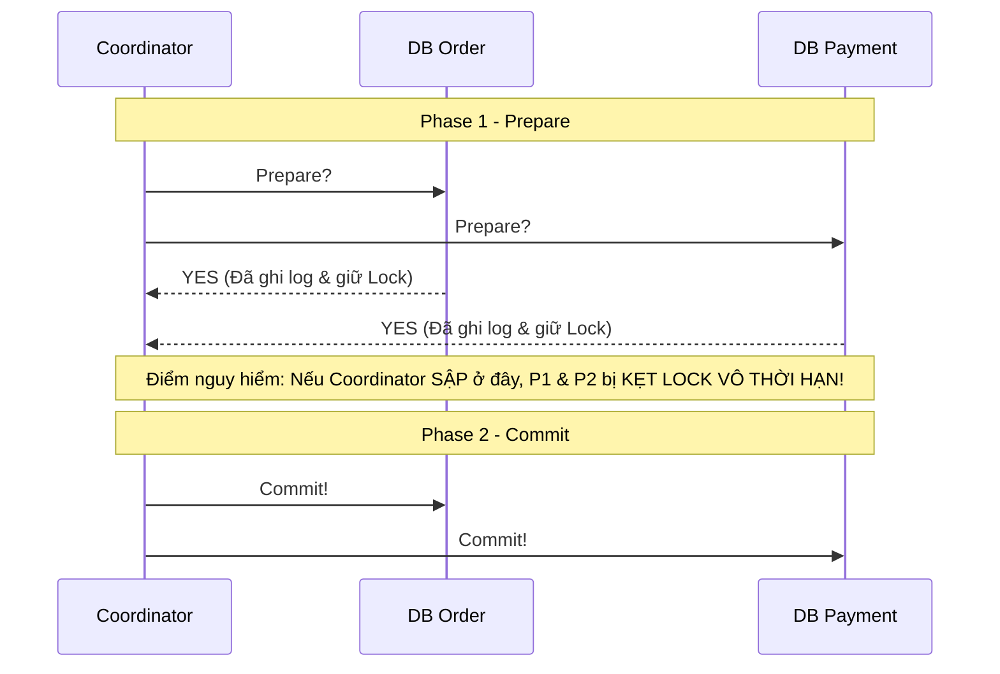
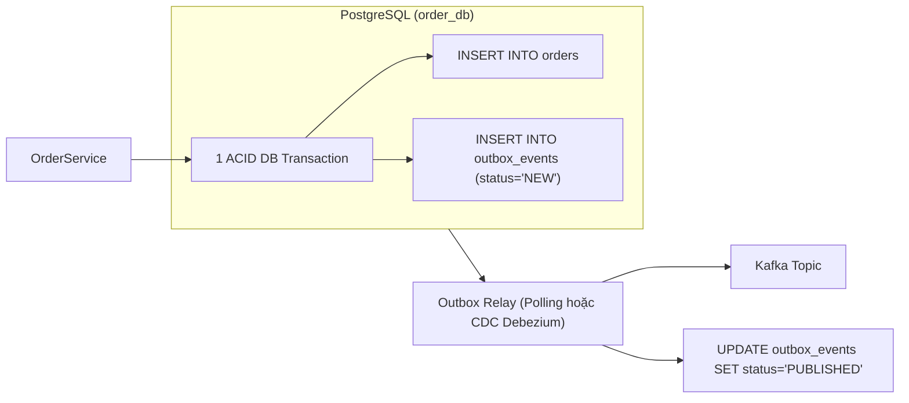
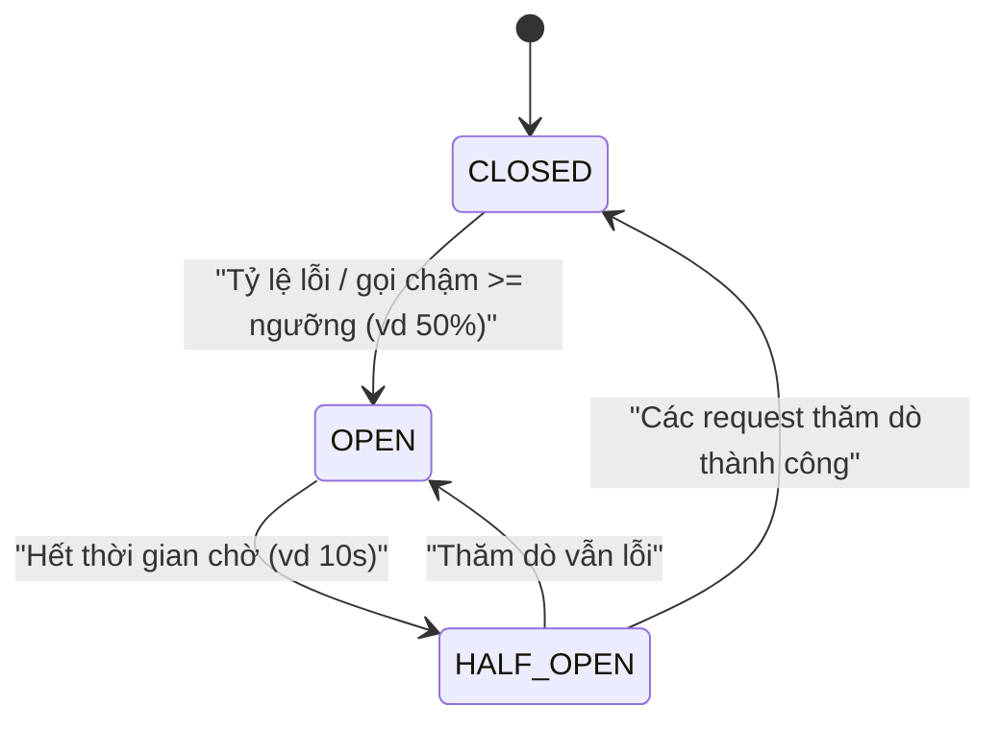

# Bài học Giai đoạn 3 — Phần 3: Concepts Distributed Systems (Tuần 10–12)

[← Quay lại GĐ 3 README](./README.md) · [Tiếp theo: Phần 4 — Thực hành Microservices, Saga & Outbox →](./02-thuc-hanh-microservices.md)

> **Tài liệu đối chiếu:** `[P]` DDIA ch.8, ch.9; `system-design-primer` · `[W]` Paper Raft & visualization, MIT 6.5840 (tùy chọn), Spring Cloud & Resilience4j

> [!NOTE]
> Giai đoạn này có phần lý thuyết khó (DDIA Ch.8–9). Hãy ưu tiên **hiểu bản chất vấn đề và ý tưởng giải pháp** qua ví dụ cụ thể hơn là học vẹt chứng minh toán học.

---

## Mục lục
1. [Những rắc rối trong Hệ phân tán (Partial Failure, Network, Clocks, Process Pause)](#1-những-rắc-rối-trong-hệ-phân-tán-ddia-ch8)
2. [Consistency Models & Thứ tự sự kiện (Linearizability, Causal, Total Order)](#2-consistency-models--thứ-tự-sự-kiện-ddia-ch9)
3. [2PC, Consensus (Paxos / Raft), Leader Election & Quorum](#3-2pc-consensus-paxos--raft-leader-election--quorum)
4. [Microservices: Service Boundary, API Gateway & Service Discovery](#4-microservices-service-boundary-api-gateway--service-discovery)
5. [Saga Pattern, Outbox Pattern & Idempotency Key](#5-saga-pattern-outbox-pattern--idempotency-key)
6. [Resilience Patterns: Timeout, Retry, Circuit Breaker & Bulkhead](#6-resilience-patterns-timeout-retry-circuit-breaker--bulkhead)

---

## 1. Những rắc rối trong Hệ phân tán (DDIA Ch.8)

### 1.1. Partial Failure (Lỗi cục bộ)
- Trên **1 máy đơn**, chương trình mang tính xác định: hoặc chạy đúng, hoặc crash toàn bộ.
- Trong **hệ phân tán**, một phần hệ thống hỏng trong khi phần còn lại vẫn chạy (**Partial Failure**), và tệ hơn là **không xác định được (non-deterministic)**: khi gửi request qua mạng mà không nhận được phản hồi, bạn không biết điều gì đã xảy ra!

### 1.2. Unreliable Network & Timeout
Khi Service A gửi request tới Service B và không thấy trả lời, có ít nhất **6 khả năng**:
1. Request bị mất trên đường truyền.
2. Request đang xếp hàng trong queue mạng hoặc chờ thread bên B.
3. Service B đã chết hoặc chưa khởi động.
4. Service B xử lý **xong rồi** nhưng sập trước khi gửi response.
5. Response bị mất trên đường quay về.
6. Response đang kẹt trên đường về vì tắc nghẽn mạng.

> **Nghịch lý của Timeout:**
> - Đặt Timeout **quá ngắn**: Đánh nhầm các node đang hơi chậm là đã chết (**false positive**), kích hoạt retry dồn dập làm node đó quá tải thật sự (**cascading failure**).
> - Đặt Timeout **quá dài**: User chờ lâu, và các thread đang chờ giữ tài nguyên làm cạn kiệt thread pool của caller.

### 1.3. Clocks: Time-of-Day vs Monotonic Clock
Mỗi máy tính có **2 loại đồng hồ** hoàn toàn khác nhau:

| Loại đồng hồ | API ví dụ (Java) | Đặc điểm & Hành vi khi NTP đồng bộ | Dùng để làm gì? |
| :--- | :--- | :--- | :--- |
| **Time-of-Day Clock** *(Wall clock)* | `System.currentTimeMillis()`, `Instant.now()` | Trả về ngày/giờ dương lịch hiện tại. Khi đồng bộ **NTP**, đồng hồ có thể **nhảy vọt hoặc nhảy lùi về quá khứ**! | Chỉ dùng để hiển thị timestamp, log. **KHÔNG dùng để đo timeout** và **KHÔNG tin tuyệt đối để xếp thứ tự (LWW)** giữa 2 máy! |
| **Monotonic Clock** | `System.nanoTime()` | Luôn tiến về phía trước đều đặn trên **cùng 1 máy**, không bị NTP kéo lùi; không có ý nghĩa khi so sánh giữa 2 máy khác nhau. | Dùng để **đo thời gian trôi qua (duration, timeout, latency)**. |

*(Mở rộng: Google Spanner dùng API **TrueTime** kết hợp đồng hồ nguyên tử + GPS tại mỗi datacenter để biết khoảng sai số $[t - \epsilon, t + \epsilon]$ với $\epsilon \approx 1–7\text{ ms}$, rồi chờ hết $\epsilon$ trước khi commit để đảm bảo thứ tự toàn cục).*

### 1.4. Process Pauses & Fencing Tokens
Một tiến trình đang chạy bình thường có thể bị "đóng băng" đột ngột hàng chục giây mà chính nó không hề hay biết:
- **Garbage Collection (GC) *Stop-the-World* pause** trong JVM.
- Máy ảo bị **VM Live Migration** hoặc **CPU steal / OS swap disk**.

**Thảm họa với Distributed Lock:**
1. Node A xin được Lock/Lease từ ZooKeeper/Redis (hết hạn sau 10s).
2. Node A dính **GC Pause 15 giây** ngay trước lệnh ghi vào Storage!
3. Quá 10s, Lock Service thu hồi lock của A và cấp cho Node B. Node B ghi dữ liệu mới vào Storage.
4. Node A tỉnh dậy, **vẫn tưởng mình đang giữ lock** → ghi đè lên Storage làm hỏng dữ liệu của B!

**Cách giải quyết — Fencing Token:**
Lock Service cấp kèm một **số thứ tự tăng đơn điệu (Fencing Token)**:
- Node A nhận `token = 33`, bị GC pause.
- Node B nhận `token = 34`, ghi vào Storage thành công (`lastToken = 34`).
- Node A tỉnh dậy gửi `Write(token = 33)` → **Storage kiểm tra `33 < 34` và từ chối thẳng tay!**

---

## 2. Consistency Models & Thứ tự sự kiện (DDIA Ch.9)

### 2.1. Phân biệt 3 mức Consistency quan trọng

| Mức độ | Ý nghĩa trực quan | Trade-off | Ví dụ áp dụng |
| :--- | :--- | :--- | :--- |
| **Eventual Consistency** | Nếu ngừng ghi đủ lâu, mọi replica cuối cùng sẽ giống nhau (nhưng trong lúc đang chạy, mỗi nơi có thể thấy một kiểu). | Độ trễ cực thấp, Availability cao nhất, nhưng khó lập trình đúng. | Lượt xem YouTube, số follower, DNS. |
| **Causal Consistency** | Đảm bảo đúng thứ tự **nguyên nhân → kết quả** (nếu A gây ra B, mọi người đều thấy A trước B); các sự kiện độc lập không liên quan có thể thấy theo thứ tự khác nhau. | Là mô hình **mạnh nhất vẫn đạt được Availability khi đứt mạng** (không cần thỏa hiệp như Linearizability). | Bình luận trả lời bài viết, chuỗi tin nhắn phụ thuộc nhau. |
| **Linearizability** *(Strong Consistency)* | Tạo ảo giác **chỉ có 1 bản sao dữ liệu duy nhất**: ngay khi một thao tác ghi thành công (hoặc có ai đó đọc thấy giá trị mới), mọi thao tác đọc sau đó theo thời gian thực **bắt buộc** thấy giá trị mới. | **Rất đắt:** theo CAP, khi đứt mạng buộc phải từ chối phục vụ (CP); lúc bình thường cũng chậm vì phải sync/quorum qua Leader/Consensus. | Leader election, Distributed Lock, đăng ký username duy nhất, số dư ví tiền. |

### 2.2. Total Order Broadcast & Lamport Timestamps
- **Lamport Timestamp:** Mỗi node giữ 1 cặp `(counter, nodeId)`. Mỗi khi gửi message kèm `counter`, node nhận cập nhật `counter = max(local, received) + 1` → xếp thứ tự toàn phần hợp lý nhân quả mà không cần đồng hồ vật lý chính xác! *(Nhược điểm: chỉ biết thứ tự **sau khi đã thu thập đủ các sự kiện**, không dùng được cho kiểm tra unique ngay tại thời điểm đăng ký!).*
- **Total Order Broadcast:** Giao thức gửi tin nhắn đảm bảo 2 tính chất: *(1) Tin cậy — không mất tin* và *(2) Mọi node nhận các tin nhắn theo đúng CÙNG MỘT THỨ TỰ*. Đây chính là trái tim của **Replication Log** và tương đương với bài toán **Consensus**.

---

## 3. 2PC, Consensus (Paxos / Raft), Leader Election & Quorum

### 3.1. Two-Phase Commit (2PC) & Lý do nó bị né tránh ở Microservices

- **Tại sao 2PC là Blocking Protocol?** Sau khi Participant trả lời `YES` ở Phase 1, nó **mất quyền tự quyết**: nó phải giữ chặt **Database Lock** và không thể tự commit hay tự rollback cho đến khi nhận được lệnh Phase 2 từ Coordinator. Nếu Coordinator chết hoặc đứt mạng vĩnh viễn → cả hệ thống DB treo cứng!
- Hơn nữa, trong microservice, các service giao tiếp qua REST/Kafka hoặc gọi cổng thanh toán ngoài (Stripe/VNPay) **không hỗ trợ giao thức XA/2PC**.

### 3.2. Consensus & Thuật toán Raft (Mức ý tưởng)
Bài toán **Consensus**: Làm sao để một cụm $N$ máy tính thống nhất cùng 1 giá trị (hoặc cùng 1 chuỗi log) và **chịu lỗi** khi có tối đa $f$ máy sập?
- Điều kiện chịu lỗi: $N = 2f + 1$ (cụm **3 node** chịu được **1 node chết**; cụm **5 node** chịu được **2 node chết**; cụm số chẵn như 4 node chỉ chịu được 1 node chết như 3 node nên luôn chọn **số lẻ**!).
- **Quorum trong Raft:** Đa số tuyệt đối $\lfloor N/2 \rfloor + 1$ (ví dụ `2/3` hoặc `3/5`). Nhờ nguyên tắc 2 tập đa số luôn giao nhau ít nhất 1 node, không bao giờ tồn tại 2 Leader hợp lệ cùng một nhiệm kỳ (**chống Split-Brain**!).

**Cách Raft hoạt động qua 2 cơ chế chính:**
1. **Leader Election (Bầu chọn Leader):**
   - Mỗi node ở một trong 3 trạng thái: `Leader`, `Follower`, `Candidate`. Thời gian chia thành các **Term** tăng dần.
   - Leader gửi `Heartbeat` định kỳ cho Follower. Nếu Follower không thấy heartbeat sau một **Randomized Election Timeout** (`150–300ms` ngẫu nhiên để tránh tất cả cùng ứng cử gây *split vote*), nó tự chuyển sang `Candidate`, tăng `term + 1`, tự bầu cho mình và gửi `RequestVote` tới các node khác.
   - Đạt đủ phiếu Quorum → trở thành **Leader** mới.
2. **Log Replication (Sao chép Log):**
   - Client gửi lệnh ghi tới **Leader** → Leader ghi vào log của mình (chưa commit) và gửi `AppendEntries` cho Follower.
   - Khi nhận được xác nhận từ **Quorum** ($\ge \lfloor N/2 \rfloor + 1$ node, gồm cả chính nó) → Leader **commit** entry đó, trả `OK` cho client, và thông báo cho Follower áp dụng vào state machine.
   - *(Mẹo nhớ độ an toàn Raft: Ứng viên nào có log **lạc hậu hơn** đa số node thì không bao giờ thắng phiếu bầu cử Leader!).*

---

## 4. Microservices: Service Boundary, API Gateway & Service Discovery

### 4.1. Chia Service Boundary & Nguyên tắc Database-per-Service
- Chia theo **Nghiệp vụ (Domain / Bounded Context)** thay vì chia theo tầng kỹ thuật: ví dụ `order-service`, `payment-service`, `inventory-service`.
- **Database per Service:** Mỗi service sở hữu schema/database riêng. Tuyệt đối **không đọc/ghi thẳng vào bảng của service khác**; phải giao tiếp qua API hoặc Event.
- **Chống bẫy Distributed Monolith:** Nếu 1 request từ user khiến Service A gọi đồng bộ B → C → D → E nối đuôi nhau và 5 service phải deploy cùng phiên bản một lúc → bạn đang mang hết nhược điểm của cả Monolith lẫn Microservices!

### 4.2. API Gateway & Service Discovery
- **API Gateway** (`Spring Cloud Gateway`, `Kong`, `Envoy`): Cửa ngõ duy nhất tiếp nhận traffic từ client; thực hiện **Routing**, **JWT Authentication**, **Rate Limiting**, **SSL Termination**, **Logging/Tracing**.
- **Service Discovery:** Khi auto-scale bật tắt container/pod liên tục, IP thay đổi liên tục:
  - *Client-side Discovery:* Service tự đăng ký vào Registry (`Eureka`, `Consul`); phía gọi (`Spring Cloud LoadBalancer` + `OpenFeign`) tải danh sách IP về và tự cân bằng tải.
  - *Server-side Discovery (Chuẩn Kubernetes hiện đại):* Client chỉ gọi tên DNS nội bộ (vd `http://payment-service:8082`), nền tảng (`Kubernetes Service / kube-proxy` hoặc Load Balancer nội bộ) tự định tuyến tới các Pod đang pass Readiness Probe.

---

## 5. Saga Pattern, Outbox Pattern & Idempotency Key

### 5.1. Saga Pattern (Thay thế 2PC)
Một **Saga** là chuỗi các **Local Transaction** chạy lần lượt ở nhiều service. Nếu một bước thất bại, hệ thống chạy các **Compensating Transaction (giao dịch bù trừ)** theo chiều ngược lại để hoàn tác trạng thái nghiệp vụ.

| Kiểu Saga | Cách phối hợp | Ưu điểm | Nhược điểm | Khi nào chọn |
| :--- | :--- | :--- | :--- | :--- |
| **Choreography** *(Event-driven)* | Mỗi service làm xong tự phát Event lên Kafka; service khác lắng nghe để chạy bước kế tiếp hoặc bù trừ | Rất lỏng lẻo (loose coupling), không có điểm nghẽn điều phối trung tâm | Khi quy trình > 4 bước rất khó hình dung toàn cảnh, dễ tạo vòng lặp sự kiện | Quy trình đơn giản (2–3 bước) |
| **Orchestration** *(Nhạc trưởng)* | Có một **Orchestrator** (ví dụ `OrderService`) điều khiển từng bước: gọi `Payment` → gọi `Inventory`; nếu lỗi tự gọi lệnh bù trừ | Dễ đọc luồng state machine, dễ debug & audit, tránh phụ thuộc vòng | Thêm thành phần orchestrator (cẩn thận không nhồi hết logic nghiệp vụ của service khác vào đây) | Quy trình nhiều bước, nghiệp vụ phức tạp (TechStore checkout) |

> [!WARNING]
> **Trade-off lớn nhất của Saga (Mất Isolation):** Khác với ACID DB transaction, giữa lúc Saga đang chạy bước 1 (`Payment` đã trừ tiền) và chưa xong bước 2 (`Inventory`), một request khác **có thể nhìn thấy trạng thái trung gian**! Cách giảm thiểu: dùng **Semantic Lock** (đánh trạng thái `PENDING` / `RESERVED` cho đơn hàng & tồn kho trước khi chốt `CONFIRMED`).

### 5.2. Transactional Outbox Pattern (Giải bài toán Dual Write)
**Vấn đề Dual Write:** Khi `OrderService` cần **vừa lưu Order vào Postgres vừa gửi Event lên Kafka**:
- Nếu lưu DB trước rồi gửi Kafka sau → DB commit xong nhưng app crash trước khi gửi Kafka → **mất event mãi mãi!**
- Nếu gửi Kafka trước rồi lưu DB sau → gửi Kafka xong nhưng DB rollback → **consumer nhận event ma của đơn hàng không tồn tại!**

**Giải pháp Outbox:**

Nhờ bảng `orders` và `outbox_events` nằm trong **cùng 1 PostgreSQL**, 1 transaction ACID duy nhất đảm bảo **cả 2 cùng thành công hoặc cùng rollback**. Sau đó `Outbox Relay` đẩy tin sang Kafka ít nhất 1 lần (**At-least-once**) kết hợp với **Idempotent Consumer** phía nhận!

### 5.3. Idempotency Key (Ở tầng HTTP API)
Khi mạng chập chờn khiến client gửi lại `POST /api/payments` 2 lần cho 1 đơn hàng:
1. Client sinh `Idempotency-Key: <UUID>` gửi trong HTTP Header.
2. `PaymentService` bắt đầu transaction: thử chèn hoặc khóa dòng theo `idempotency_key` (hoặc `SETNX` trong Redis + bảng DB).
3. Nếu key chưa từng xử lý → thực hiện trừ tiền, lưu `response_status + response_body` vào bảng `idempotency_records`, trả về client.
4. Nếu key **đã tồn tại** → không trừ tiền nữa, trả về đúng `response_body` đã lưu từ lần đầu!

---

## 6. Resilience Patterns: Timeout, Retry, Circuit Breaker & Bulkhead

Trong hệ microservice, khi Service B chậm hoặc chết, nếu Service A không tự bảo vệ mình thì thread của A sẽ treo theo → **lỗi dây chuyền làm sập toàn bộ hệ thống**.

1. **Timeout (TimeLimiter):** Mọi lời gọi mạng đều phải giới hạn thời gian tối đa (vd `connectTimeout = 1s`, `readTimeout = 3s`).
2. **Retry với Exponential Backoff + Jitter:**
   - Khoảng nghỉ tăng theo hàm mũ kèm nhiễu ngẫu nhiên: `delay = min(maxDelay, base * 2^attempt) + randomJitter`.
   - **Quy tắc sống còn:** Chỉ retry với lỗi tạm thời (`502/503/504/Timeout`) và **chỉ retry khi API hỗ trợ Idempotent**. Dùng Jitter để các client không đồng loạt đánh tiếp vào cùng một giây (**Retry Storm**).
3. **Circuit Breaker (Resilience4j):**
   - `CLOSED` → theo dõi trong sliding window (vd 10 call gần nhất); nếu >= 50% lỗi hoặc chậm → bật sang `OPEN`.
   - `OPEN` → **Fail-fast** ngay lập tức (trả **Fallback** trong `1ms` thay vì chờ timeout `3s`), giúp giải phóng thread cho `OrderService` và cho `PaymentService` thời gian hồi phục.
   - `HALF_OPEN` → mở hé cho thử `3–5` request; nếu ổn thì đóng lại `CLOSED`.
4. **Bulkhead (Vách ngăn):** Giới hạn số luồng hoặc số concurrent calls tối đa được phép gọi tới `PaymentService` (vd tối đa `20` slots). Dù `PaymentService` bị treo hoàn toàn, các API khác trên `OrderService` (như xem danh sách đơn, hủy đơn) vẫn còn thread để phục vụ bình thường!
