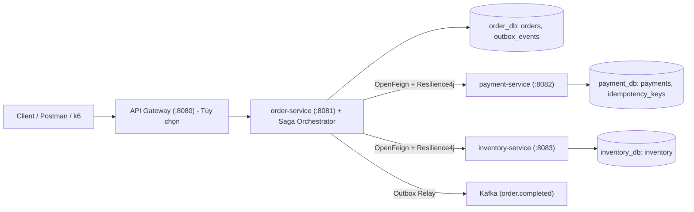
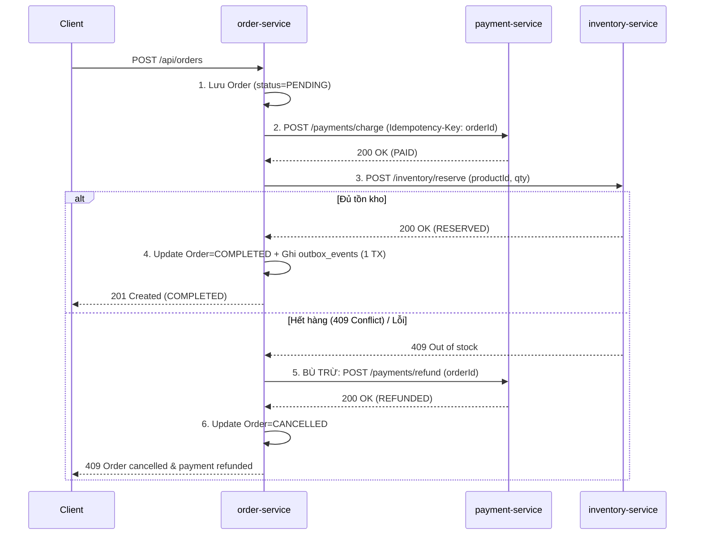

# Bài học Giai đoạn 3 — Phần 4: Thực Hành 3 Microservices, Saga, Resilience4j & Outbox

[← Phần 3: Concepts](./01-concepts.md) · [Quay lại GĐ 3 README](./README.md) · [Tiếp theo: Phần 5 — Mục tiêu & Check Tuần 12 →](./03-muc-tieu-va-check-tuan12.md)

---

## Kiến trúc tổng thể bản Demo 3 Service



| Service | Port | Database riêng | Trách nhiệm chính |
| :--- | :---: | :--- | :--- |
| **`order-service`** | `8081` | `order_db` | Tạo đơn (`PENDING`), điều phối Saga (`Payment → Inventory`), ghi `outbox_events` & đẩy sang Kafka |
| **`payment-service`** | `8082` | `payment_db` | Trừ tiền (`POST /api/payments/charge`) hỗ trợ `Idempotency-Key`; hoàn tiền (`POST /api/payments/refund`) khi Saga bù trừ |
| **`inventory-service`** | `8083` | `inventory_db` | Kiểm tra & trừ kho (`POST /api/inventory/reserve`) atomic; báo lỗi `409 Conflict` nếu hết hàng |

---

## Bước 1: Hạ tầng Docker Compose (3 DB tách biệt + Kafka)

Tạo `docker-compose.yml` dùng chung 1 container Postgres có 3 database (`order_db`, `payment_db`, `inventory_db`) hoặc 3 DB tách rời, kèm Kafka KRaft:

```yaml
services:
  postgres:
    image: postgres:16-alpine
    container_name: ms-postgres
    ports:
      - "5432:5432"
    environment:
      POSTGRES_USER: postgres
      POSTGRES_PASSWORD: postgres
    volumes:
      - ./init-dbs.sql:/docker-entrypoint-initdb.d/init-dbs.sql:ro

  kafka:
    image: apache/kafka:3.8.0
    container_name: ms-kafka
    ports:
      - "9092:9092"
    environment:
      KAFKA_NODE_ID: 1
      KAFKA_PROCESS_ROLES: broker,controller
      KAFKA_LISTENERS: PLAINTEXT://:9092,CONTROLLER://:9093
      KAFKA_ADVERTISED_LISTENERS: PLAINTEXT://localhost:9092
      KAFKA_CONTROLLER_LISTENER_NAMES: CONTROLLER
      KAFKA_LISTENER_SECURITY_PROTOCOL_MAP: CONTROLLER:PLAINTEXT,PLAINTEXT:PLAINTEXT
      KAFKA_CONTROLLER_QUORUM_VOTERS: 1@localhost:9093
      KAFKA_OFFSETS_TOPIC_REPLICATION_FACTOR: 1
      KAFKA_TRANSACTION_STATE_LOG_REPLICATION_FACTOR: 1
      KAFKA_TRANSACTION_STATE_LOG_MIN_ISR: 1
```

**File `init-dbs.sql`:**
```sql
CREATE DATABASE order_db;
CREATE DATABASE payment_db;
CREATE DATABASE inventory_db;
```

---

## Bước 2: Thiết kế Saga Orchestration + Bù trừ (Compensation)

### Luồng thành công & Luồng bù trừ khi Inventory lỗi



### Code `OrderSagaService` trong `order-service`

```java
package com.techstore.order.service;

import org.springframework.stereotype.Service;
import org.springframework.transaction.support.TransactionTemplate;

@Service
public class OrderSagaService {

    private final OrderRepository orderRepo;
    private final OutboxRepository outboxRepo;
    private final PaymentGatewayClient paymentClient; // Bọc Resilience4j bên trong
    private final InventoryClient inventoryClient;
    private final TransactionTemplate txTemplate;

    public OrderSagaService(
            OrderRepository orderRepo,
            OutboxRepository outboxRepo,
            PaymentGatewayClient paymentClient,
            InventoryClient inventoryClient,
            TransactionTemplate txTemplate) {
        this.orderRepo = orderRepo;
        this.outboxRepo = outboxRepo;
        this.paymentClient = paymentClient;
        this.inventoryClient = inventoryClient;
        this.txTemplate = txTemplate;
    }

    /**
     * LƯU Ý QUAN TRỌNG:
     * KHÔNG đặt @Transactional bao trùm lên cả hàm Saga gọi HTTP ra ngoài!
     * Lý do: Giữ DB connection trong lúc chờ HTTP payment/inventory sẽ làm cạn HikariCP pool rất nhanh.
     * Thay vào đó, tách các bước ghi DB thành từng Local Transaction ngắn bằng TransactionTemplate.
     */
    public OrderResponse placeOrder(CreateOrderRequest req) {
        // Bước 1: Local TX tạo đơn ở trạng thái PENDING
        OrderEntity order = txTemplate.execute(status -> {
            OrderEntity o = new OrderEntity(req.userId(), req.productId(), req.qty(), req.amount(), "PENDING");
            return orderRepo.save(o);
        });

        // Bước 2: Gọi payment-service (có Idempotency-Key = "pay-" + order.getId())
        PaymentResult payRes = paymentClient.charge(order.getId(), req.amount(), "pay-" + order.getId());
        if (!payRes.success()) {
            txTemplate.executeWithoutResult(s -> orderRepo.updateStatus(order.getId(), "PAYMENT_DEFERRED"));
            return new OrderResponse(order.getId(), "PAYMENT_DEFERRED", payRes.message());
        }

        // Bước 3: Gọi inventory-service để trừ kho
        try {
            inventoryClient.reserve(order.getId(), req.productId(), req.qty());
        } catch (Exception ex) {
            // BÙ TRỪ (COMPENSATION): Trừ kho thất bại -> hoàn tiền ở payment-service
            try {
                paymentClient.refund(order.getId(), "refund-" + order.getId());
                txTemplate.executeWithoutResult(s -> orderRepo.updateStatus(order.getId(), "CANCELLED_REFUNDED"));
                return new OrderResponse(order.getId(), "CANCELLED_REFUNDED", "Hết hàng, đã hoàn tiền");
            } catch (Exception refundEx) {
                // Nếu bù trừ cũng lỗi -> đánh dấu cần đối soát / retry bất đồng bộ
                txTemplate.executeWithoutResult(s -> orderRepo.updateStatus(order.getId(), "REFUND_PENDING"));
                return new OrderResponse(order.getId(), "REFUND_PENDING", "Chờ hoàn tiền tự động");
            }
        }

        // Bước 4: Local TX chốt COMPLETED + ghi Outbox Event trong CÙNG 1 ACID transaction
        txTemplate.executeWithoutResult(status -> {
            orderRepo.updateStatus(order.getId(), "COMPLETED");
            outboxRepo.save(OutboxEvent.orderCompleted(order));
        });

        return new OrderResponse(order.getId(), "COMPLETED", "Đặt hàng thành công");
    }
}
```

### Bảo vệ `payment-service` với `Idempotency-Key` & `inventory-service` Atomic Update

- Trong **`payment-service`**, bảng `payments` đặt cột `idempotency_key VARCHAR(64) UNIQUE`. Khi nhận request `POST /payments/charge`, nếu `idempotency_key` đã tồn tại → trả lại ngay kết quả thanh toán cũ (chống trừ tiền 2 lần khi Resilience4j thực hiện **Retry**!).
- Trong **`inventory-service`**, trừ kho bằng câu lệnh atomic:
  ```sql
  UPDATE inventory SET available_qty = available_qty - :qty
  WHERE product_id = :productId AND available_qty >= :qty;
  ```
  Nếu số dòng cập nhật `== 0` → trả `409 Conflict` để `order-service` kích hoạt **Compensation (`refund`)**.

---

## Bước 3: Thêm Timeout, Retry, Bulkhead & Circuit Breaker (Resilience4j)

### 1. Dependencies (`pom.xml` của `order-service`)
- `org.springframework.cloud:spring-cloud-starter-openfeign`
- `io.github.resilience4j:resilience4j-spring-boot3`
- `org.springframework.boot:spring-boot-starter-aop`
- `org.springframework.boot:spring-boot-starter-actuator` *(để xem trạng thái Circuit Breaker qua `/actuator/circuitbreakers`)*

### 2. Cấu hình `application.yml` (trong `order-service`)

```yaml
spring:
  cloud:
    openfeign:
      client:
        config:
          default:
            connectTimeout: 1000   # 1s kết nối
            readTimeout: 2500      # 2.5s chờ phản hồi

resilience4j:
  circuitbreaker:
    instances:
      paymentService:
        slidingWindowType: COUNT_BASED
        slidingWindowSize: 10               # Theo dõi 10 request gần nhất
        minimumNumberOfCalls: 5             # Ít nhất 5 call mới bắt đầu tính %
        failureRateThreshold: 50            # >= 50% lỗi -> chuyển sang OPEN
        waitDurationInOpenState: 15s        # Ngắt mạch 15 giây trước khi thử HALF_OPEN
        permittedNumberOfCallsInHalfOpenState: 3
        registerHealthIndicator: true

  retry:
    instances:
      paymentService:
        maxAttempts: 3                      # 1 lần đầu + 2 lần retry
        waitDuration: 300ms
        enableExponentialBackoff: true
        exponentialBackoffMultiplier: 2     # 300ms -> 600ms
        enableRandomizedWait: true          # Thêm Jitter tránh Retry Storm
        ignoreExceptions:
          - io.github.resilience4j.circuitbreaker.CallNotPermittedException

  bulkhead:
    instances:
      paymentService:
        maxConcurrentCalls: 20              # Tối đa 20 request đồng thời tới Payment
        maxWaitDuration: 100ms

management:
  endpoints:
    web:
      exposure:
        include: health,circuitbreakers,metrics
  health:
    circuitbreakers:
      enabled: true
```

### 3. Bọc `PaymentGatewayClient` bằng Annotation Resilience4j

> [!TIP]
> **Thứ tự thực thi mặc định trong Spring Boot Resilience4j:**
> `Retry (ngoài cùng) -> CircuitBreaker -> RateLimiter -> TimeLimiter -> Bulkhead (trong cùng)`.
> Vì `Retry` bọc ngoài `CircuitBreaker`, hãy thêm `CallNotPermittedException` vào `ignoreExceptions` của `Retry` để khi mạch đang **`OPEN`**, `Retry` **không thử lại vô ích** mà nhảy thẳng vào `fallbackMethod` trong `< 5 ms`!

```java
package com.techstore.order.client;

import io.github.resilience4j.bulkhead.annotation.Bulkhead;
import io.github.resilience4j.circuitbreaker.annotation.CircuitBreaker;
import io.github.resilience4j.retry.annotation.Retry;
import org.slf4j.Logger;
import org.slf4j.LoggerFactory;
import org.springframework.stereotype.Component;

@Component
public class PaymentGatewayClient {

    private static final Logger log = LoggerFactory.getLogger(PaymentGatewayClient.class);
    private final PaymentFeignClient feign;

    public PaymentGatewayClient(PaymentFeignClient feign) {
        this.feign = feign;
    }

    @Retry(name = "paymentService")
    @CircuitBreaker(name = "paymentService", fallbackMethod = "paymentFallback")
    @Bulkhead(name = "paymentService")
    public PaymentResult charge(Long orderId, long amount, String idempotencyKey) {
        return feign.charge(idempotencyKey, new ChargeRequest(orderId, amount));
    }

    public void refund(Long orderId, String idempotencyKey) {
        feign.refund(idempotencyKey, orderId);
    }

    // Fallback cùng chữ ký + Throwable ở cuối
    public PaymentResult paymentFallback(Long orderId, long amount, String idempotencyKey, Throwable t) {
        log.warn("Payment fallback triggered for orderId={}, reason={}", orderId, t.getMessage());
        // Trả về trạng thái Graceful Degradation thay vì sập 500 Internal Server Error
        return new PaymentResult(false, "Hệ thống thanh toán đang bận, đơn hàng được ghi nhận chờ xử lý");
    }
}
```

### 4. Kịch bản kiểm chứng: Tắt `payment-service` giữa chừng

1. Chạy cả 3 service (`8081`, `8082`, `8083`) → gửi `POST /api/orders` → nhận `201 COMPLETED`.
2. Kiểm tra `GET http://localhost:8081/actuator/circuitbreakers` → `state: "CLOSED"`.
3. **Tắt hẳn `payment-service` (`:8082`)**!
4. Gửi liên tiếp `6` request `POST /api/orders`:
   - 5 request đầu: Retry (`300ms -> 600ms`) rồi kích hoạt Fallback → đơn lưu trạng thái `PAYMENT_DEFERRED` (`200/202` lịch sự thay vì crash 500!).
   - Kiểm tra `/actuator/circuitbreakers`: `state` chuyển thành **`OPEN`**!
5. Gửi tiếp request thứ `7..10`: quan sát response thời gian **`< 5 ms`** (Fail-fast: `order-service` **không gọi TCP tới `:8082` nữa** và vẫn phục vụ API khác như `GET /api/orders` bình thường!).
6. **Bật lại `payment-service` (`:8082`)** → đợi `15s` → gửi 3 request → thấy state chuyển `OPEN → HALF_OPEN → CLOSED` và đơn hàng `COMPLETED` trở lại!

---

## Bước 4: Cài Transactional Outbox Pattern (Ghi DB & Gửi Kafka nhất quán)

### 1. Bảng `outbox_events` trong `order_db`

```sql
CREATE TABLE outbox_events (
    id             UUID PRIMARY KEY,
    aggregate_type VARCHAR(50) NOT NULL,  -- "ORDER"
    aggregate_id   VARCHAR(64) NOT NULL,  -- orderId
    event_type     VARCHAR(80) NOT NULL,  -- "OrderCompleted"
    payload        TEXT NOT NULL,         -- JSON event
    status         VARCHAR(20) NOT NULL DEFAULT 'NEW', -- NEW | PUBLISHED
    created_at     TIMESTAMP NOT NULL DEFAULT NOW(),
    published_at   TIMESTAMP
);

CREATE INDEX idx_outbox_pending ON outbox_events (status, created_at) WHERE status = 'NEW';
```

### 2. Outbox Relay dùng `FOR UPDATE SKIP LOCKED`

> [!TIP]
> **Mẹo thực chiến PostgreSQL:** Dùng `FOR UPDATE SKIP LOCKED` khi query `outbox_events` để nếu chạy 2–3 instance `order-service` song song, mỗi instance chỉ bốc những dòng chưa bị instance khác khóa — **không trùng lặp, không chặn nhau**!

```java
package com.techstore.order.outbox;

import org.springframework.kafka.core.KafkaTemplate;
import org.springframework.scheduling.annotation.Scheduled;
import org.springframework.stereotype.Component;
import org.springframework.transaction.annotation.Transactional;
import java.time.Instant;
import java.util.List;

@Component
public class OutboxRelayScheduler {

    private final OutboxRepository outboxRepo;
    private final KafkaTemplate<String, String> kafkaTemplate;

    public OutboxRelayScheduler(OutboxRepository outboxRepo, KafkaTemplate<String, String> kafkaTemplate) {
        this.outboxRepo = outboxRepo;
        this.kafkaTemplate = kafkaTemplate;
    }

    @Scheduled(fixedDelay = 1000)
    @Transactional
    public void publishPendingEvents() {
        // Native query: SELECT * FROM outbox_events WHERE status = 'NEW' ORDER BY created_at LIMIT 50 FOR UPDATE SKIP LOCKED
        List<OutboxEvent> batch = outboxRepo.findNextBatchForUpdateSkipLocked(50);

        for (OutboxEvent ev : batch) {
            try {
                // Gửi đồng bộ .get() để chắc chắn Kafka broker đã ACK trước khi đánh dấu PUBLISHED
                kafkaTemplate.send("order.completed", ev.getAggregateId(), ev.getPayload()).get();
                ev.setStatus("PUBLISHED");
                ev.setPublishedAt(Instant.now());
            } catch (Exception ex) {
                // Kafka đang sập: dừng batch, giữ nguyên status='NEW' để lần poll sau gửi lại!
                break;
            }
        }
    }
}
```

### 3. Kịch bản kiểm chứng Outbox khi Kafka chết
1. Tắt container Kafka: `docker compose stop kafka`.
2. Gửi `POST /api/orders` (với `payment` và `inventory` đang chạy): đơn hàng vẫn **`COMPLETED`**, trong bảng `outbox_events` có dòng mới với `status = 'NEW'`.
3. Bật lại Kafka: `docker compose start kafka`.
4. Sau ~1–2 giây, `OutboxRelayScheduler` tự đẩy event lên topic `order.completed` và cập nhật `status = 'PUBLISHED'` — **0% mất event!**
