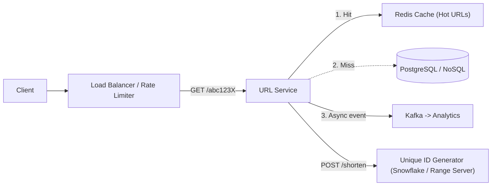
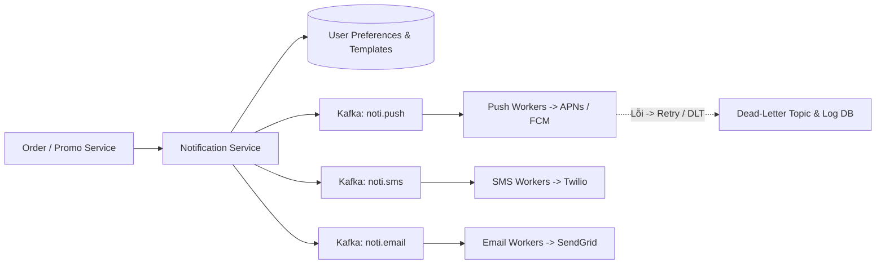
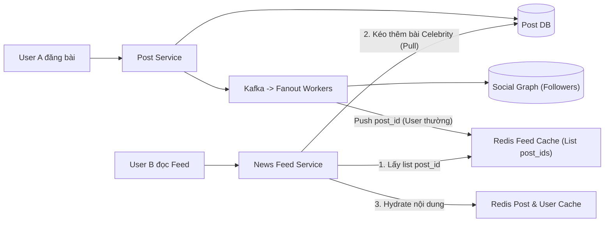
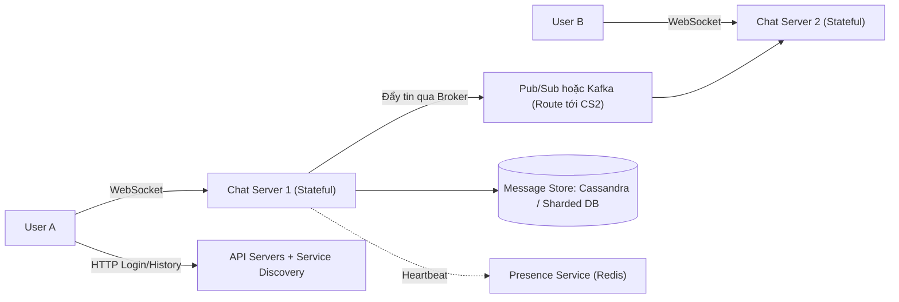
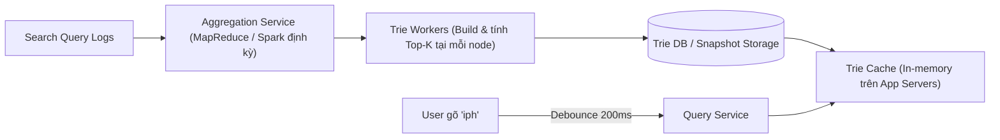
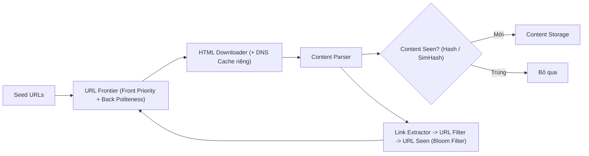
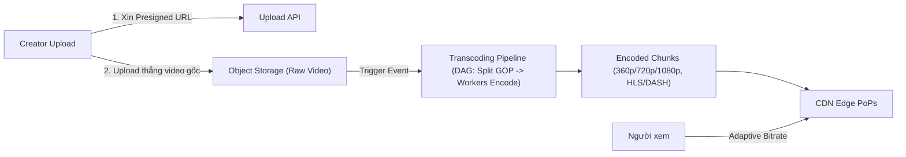
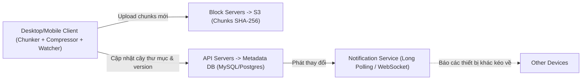

# Bài học Giai đoạn 4 — Phần 3: Concepts 8 Case Study Cơ Bản (Xu Vol.1 Ch.8–15)

[← Quay lại GĐ 4 README](./README.md) · [Tiếp theo: Phần 4 — Quy trình 45p, Sổ Trade-off & Mini App →](./02-thuc-hanh-va-so-tradeoff.md)

> **Tài liệu đối chiếu:** `[P]` Xu Vol.1 ch.8–15; `system-design-primer` · `[W]` Engineering blogs (Uber, Netflix, Discord, Shopify), Gaurav Sen, Hello Interview

> [!TIP]
> **Cách học hiệu quả:** Đừng đọc tài liệu này trước khi tự làm! Hãy tự bấm giờ **45 phút** giải từng bài trước, rồi mới mở phần tóm tắt ý chính & trade-offs bên dưới để đối chiếu.

---

## Mục lục 8 Case Studies (Tuần 13–16)
- **Tuần 13:** [1. URL Shortener](#1-url-shortener-xu-ch8) · [2. Notification System](#2-notification-system-xu-ch10)
- **Tuần 14:** [3. News Feed](#3-news-feed-xu-ch11) · [4. Chat System](#4-chat-system-xu-ch12)
- **Tuần 15:** [5. Search Autocomplete](#5-search-autocomplete-xu-ch13) · [6. Web Crawler](#6-web-crawler-xu-ch9)
- **Tuần 16:** [7. YouTube (Video Streaming)](#7-youtube---video-streaming-xu-ch14) · [8. Google Drive (Cloud Storage & Sync)](#8-google-drive---file-sync-xu-ch15)

---

## 1. URL Shortener (Xu Ch.8)

### Yêu cầu & Ước lượng nhanh
- `100M` URL mới/tháng (~`38–40` Write QPS), tỷ lệ Read : Write = `100 : 1` → **~`4,000` Read QPS** (Peak ~`10,000 QPS`).
- Lưu 5 năm: $100\text{M} \times 12 \times 5 = 6\text{ tỷ URLs} \approx 3\text{ TB}$.
- Độ dài `short_code` tối ưu với Base62 (`[0-9a-zA-Z]`): $62^7 \approx \mathbf{3.5 \text{ nghìn tỷ}}$ mã → **7 ký tự** là quá đủ cho hàng trăm năm!

### Kiến trúc cốt lõi

### Ý chính & Trade-offs
1. **Cách sinh `short_code` (2 hướng chính):**
   - **Hash (MD5/SHA-256) + cắt 7 ký tự đầu:** Không cần dịch vụ sinh ID trung tâm, nhưng có nguy cơ **trùng mã (collision)** → phải check DB (hoặc Bloom Filter) và nối thêm salt nếu trùng.
   - **Unique ID Generator (Snowflake / DB Ticket Range) + Encode Base62:** **Không bao giờ trùng**, không cần đọc DB kiểm tra collision trước khi ghi! *(Đánh đổi: ID hơi tuần tự có thể đoán được link tiếp theo nếu chỉ dùng auto-increment tuần tự → có thể trộn bit hoặc dùng Snowflake).*
2. **`301 Moved Permanently` vs `302 Found`:**
   - **`301`:** Browser & CDN cache lại kết quả chuyển hướng, các lần click sau đi thẳng tới `long_url` không qua server của bạn → **giảm mạnh tải server**, nhưng **MẤT dữ liệu thống kê lượt click** và không đổi đích được!
   - **`302`:** Browser luôn gọi lại server bạn mỗi lần click → **đếm được analytics chính xác** và đổi đích được, nhưng **tốn tải server** (cần Redis cache cực tốt).
3. **Điểm nghẽn (Bottleneck):** Đọc nóng vào một link viral (`Celebrity link` có triệu click/giây) → giải quyết bằng **Redis Cache + Local In-memory Cache** ngắn hạn (1–5s) + **CDN** nếu dùng `301`.

---

## 2. Notification System (Xu Ch.10)

### Yêu cầu & Kiến trúc tổng thể
- Hỗ trợ đa kênh: **Push Notification (iOS APNs, Android FCM)**, **SMS (Twilio)**, **Email (SendGrid/SES)**.
- Quy mô hàng triệu thông báo/ngày (cảnh báo giao dịch, OTP, khuyến mãi).

### Ý chính & Trade-offs
1. **Cô lập Queue theo từng kênh (`noti.push`, `noti.sms`, `noti.email`):** Nếu nhà cung cấp SMS (Twilio) bị chậm hoặc nghẽn, không làm nghẽn hàng đợi gửi Push OTP hay Email xác nhận đơn hàng!
2. **Độ tin cậy (Chống mất & Chống gửi trùng):**
   - **Retry + Exponential Backoff + Dead-Letter Queue:** Khi bên thứ 3 (APNs/SendGrid) trả `503` hoặc timeout → thử lại có giãn cách; vượt quá số lần thì đẩy sang DLT để kiểm tra.
   - **Deduplication:** Gắn `notification_id` (lưu cache/DB đã gửi) để tránh cùng 1 event gửi 2 tin nhắn SMS tốn tiền và làm phiền user.
3. **User Preferences & Rate Limiting:** Kiểm tra cài đặt *Opt-in/Opt-out* trước khi gửi (trừ thông báo bảo mật/giao dịch bắt buộc), và giới hạn tần suất (không gửi 10 tin marketing trong 1 giờ).
4. **Điểm nghẽn:** Chiến dịch Flash Sale đẩy hàng triệu notification cùng lúc làm cạn connection tới SendGrid/FCM hoặc DB `user_preferences` → cần **Cache `user_preferences` trong Redis**, dùng **Rate Limiter/Throttling** ở Worker theo quota của 3rd-party, và chia **Priority Queue** (OTP/Giao dịch đi luồng ưu tiên cao hơn Marketing!).

---

## 3. News Feed (Xu Ch.11)

### Yêu cầu cốt lõi
- User đăng bài (`POST /feed`) gồm text/ảnh/video.
- User kéo bảng tin (`GET /feed`) xem bài mới nhất của những người mình đang follow.

### Ý chính & Trade-offs
1. **Fan-out on Write (Push Model) vs Fan-out on Read (Pull Model):**
   - **Push (Fan-out on Write):** Khi A đăng bài, đẩy ngay `post_id` vào Redis Feed Cache của toàn bộ follower của A.
     - *Ưu:* Đọc feed cực nhanh (`O(1)` từ Redis).
     - *Nhược (**Celebrity Problem**):* Nếu A có `50 triệu` followers (ca sĩ, cầu thủ), 1 bài đăng tạo ra 50 triệu thao tác ghi Redis gây **hotkey / lag cực nặng**, và lãng phí RAM cho những follower lâu rồi không mở app!
   - **Pull (Fan-out on Read):** Lúc B mở app mới query bài mới nhất của những người B đang follow rồi trộn lại.
     - *Ưu:* Đăng bài cực nhanh, không tốn công push cho user ít online.
     - *Nhược:* Đọc feed rất chậm nếu B follow `1,000` người!
   - **Giải pháp chuẩn — Hybrid Approach:** Áp dụng **Push** cho user bình thường (`< 10k` followers), và **Pull** cho Celebrity (`>= 10k` followers) rồi merge ngay lúc đọc!
2. **Tối ưu RAM Cache:** Trong `Feed Cache` chỉ lưu mảng `(post_id, timestamp)` (~vài trăm ID gần nhất), không lưu nguyên văn nội dung/ảnh; khi đọc mới **Hydrate** nội dung từ `Post Cache` & `User Cache`.

---

## 4. Chat System (Xu Ch.12)

### Yêu cầu & Kiến trúc
- Chat **1-1** và **Group nhỏ/vừa** (~100–500 thành viên), độ trễ thấp, hiển thị trạng thái **Online/Offline (Presence)**, lưu lịch sử lâu dài và đồng bộ đa thiết bị.

### Ý chính & Trade-offs
1. **Giao thức kết nối:**
   - Gửi/nhận tin real-time bắt buộc dùng kết nối 2 chiều dai dẳng (**WebSocket** — thay cho Polling tốn băng thông hay SSE chỉ 1 chiều). Các thao tác login, lấy danh sách nhóm dùng HTTP bình thường.
   - **Chat Server là Stateful** (giữ socket TCP mở trong RAM) → khi scale, dùng **Service Discovery** để cấp phát Chat Server phù hợp cho client, và phải xử lý **Graceful Shutdown** khi deploy mới (chuyển kết nối dần sang server khác để tránh bão reconnect).
2. **Thứ tự tin nhắn (Message Ordering):** Không bao giờ tin đồng hồ client! Sinh **`message_id`** theo **Snowflake / Local Sequence ID** tăng dần trong phạm vi `conversation_id` / `channel_id`.
3. **Lưu trữ lịch sử (Storage):** Chat là **write-heavy + đọc gần đây theo chuỗi thời gian** → chọn Wide-Column / LSM-Tree (**Cassandra / HBase**) với Partition Key là `channel_id` và Clustering Key là `message_id DESC` (đọc trang tin gần nhất chỉ 1 sequential read!).
4. **Presence Service (Trạng thái Online):** Client gửi **Heartbeat** mỗi 5s; nếu quá 30s không thấy → đánh dấu Offline. Với user có hàng nghìn bạn bè, **không push trạng thái** liên tục cho tất cả — chỉ fan-out cho những người đang mở khung chat với họ hoặc fetch theo batch!
5. **Điểm nghẽn:** Nhóm chat quá đông (nghìn người gửi liên tục) hoặc tất cả user mất mạng rồi kết nối lại cùng lúc (**Thundering Herd Reconnect**) → dùng **Exponential Backoff + Jitter** ngay ở Client SDK khi reconnect WebSocket.

---

## 5. Search Autocomplete / Typeahead (Xu Ch.13)

### Yêu cầu
- Gợi ý **Top-K (vd Top 5)** cụm từ tìm kiếm phổ biến nhất ngay khi user đang gõ từng ký tự (`p99 < 100ms`).

### Ý chính & Trade-offs
1. **Cấu trúc dữ liệu Trie (Prefix Tree) tối ưu:**
   - Nếu chỉ dùng Trie thường, khi user gõ chữ `"a"`, bạn phải duyệt toàn bộ nhánh con dưới `"a"` (hàng triệu từ!) rồi sort mới ra Top 5 → quá chậm!
   - **Tối ưu kinh điển:** **Cache sẵn danh sách Top-5 câu truy vấn ngay tại mỗi Node của Trie!** Khi đó thời gian tìm kiếm chỉ là **$O(p)$** với $p$ là độ dài chuỗi nhập (vd tối đa 50 ký tự → **`O(1)` thực tế!**).
2. **Cập nhật Trie bất đồng bộ (Offline Rebuild) thay vì Real-time Update:**
   - Nếu update tần suất trực tiếp vào Trie đang phục vụ đọc → gây tranh chấp lock và chậm $O(1)$ đọc!
   - **Trade-off:** Tách riêng luồng thu thập log (có thể **Data Sampling 1/100** nếu quá lớn) → chạy batch tổng hợp theo giờ/ngày → **build bản Trie mới offline** → tráo sang Trie Cache (hot swap). Đánh đổi độ tươi (chậm hơn vài giờ) lấy độ ổn định đọc tuyệt đối!
3. **Tối ưu Client & Lọc nội dung:** Client dùng **Debouncing** (đợi user ngừng gõ 150–200ms mới gọi API) + Browser Cache; Server có tầng **Filter** loại bỏ từ khóa phản cảm trước khi trả về.

---

## 6. Web Crawler (Xu Ch.9)

### Yêu cầu & Kiến trúc
- Thu thập hàng tỷ trang web để đánh chỉ mục tìm kiếm, xử lý được các lỗi HTML hỏng, vòng lặp vô hạn và không làm sập web server của người khác.

### Ý chính & Trade-offs
1. **BFS thay vì DFS:** Đồ thị web cực sâu, DFS sẽ bị kẹt mãi trong một tên miền hoặc vòng lặp vô tận; phải dùng **BFS**.
2. **URL Frontier (2 lớp queue giải quyết 2 bài toán đối nghịch):**
   - **Front Queues (Priority):** Ưu tiên crawl các trang quan trọng (PageRank cao, trang tin cập nhật nhanh) trước.
   - **Back Queues (Politeness — Cực quan trọng!):** Nếu cứ lấy từ Front Queue ra crawl song song, 100 worker có thể bắn đồng thời 100 request vào `vnexpress.net` → bị block IP vì DDoS! Giải pháp: **Mỗi Host/Domain đi vào đúng 1 Back Queue riêng**, và 1 Worker mỗi lần chỉ lấy 1 URL từ 1 Host, kèm quy định nghỉ tối thiểu vài giây giữa 2 request tới cùng domain đó!
3. **Hiệu năng & Chống trùng lặp:**
   - **DNS Cache nội bộ:** Lời gọi DNS mặc định của OS là synchronous và khóa chéo các thread → phải dùng DNS resolver cache riêng cho crawler.
   - **Content Deduplication:** Dùng MD5/SHA-256 (trùng y hệt) hoặc **SimHash** (phát hiện gần giống như các trang báo copy lại bài nhau); **URL Seen** dùng **Bloom Filter** + Disk DB kiểm tra URL đã crawl chưa.
   - **Spider Traps:** Tránh các URL tự sinh vô hạn (`example.com/a/a/a/...`) bằng cách giới hạn độ dài URL và độ sâu thư mục, đồng thời luôn tôn trọng `robots.txt`.

---

## 7. YouTube — Video Streaming (Xu Ch.14)

### Yêu cầu
- Upload video dung lượng lớn (GB) và phát mượt mà cho hàng triệu người xem toàn cầu với nhiều loại mạng (4G yếu lẫn Wi-Fi cáp quang).

### Ý chính & Trade-offs
1. **Presigned URL Upload:** Tuyệt đối **không** đẩy file video 2GB đi xuyên qua App Server (tốn băng thông gấp đôi và nghẽn thread)! App Server chỉ cấp **S3 Presigned URL** để client upload thẳng lên Object Storage (kèm Multipart/Resumable Upload).
2. **DAG Transcoding Pipeline & GOP Splitting:**
   - Video dài 2 tiếng mà chạy trên 1 máy sẽ mất cả buổi → tách video theo từng **GOP (Group of Pictures)** thành nhiều đoạn nhỏ, đẩy vào **Message Queue** để hàng chục **Transcoding Workers** encode song song ra các định dạng (MP4/HLS/DASH) và độ phân giải (`360p`, `720p`, `1080p`, `4K`) rồi ghép lại.
3. **Adaptive Bitrate Streaming (HLS / MPEG-DASH):** Chia video thành các đoạn nhỏ `2–6 giây` (`.ts` / `.m4s`) kèm file manifest `.m3u8`/`.mpd`. Player tự động chuyển đổi giữa `1080p` và `360p` theo tốc độ mạng thực tế mà **không bị đứng hình (buffering)**!
4. **CDN Tiering & Tối ưu chi phí:** CDN cực kỳ đắt! Chỉ đưa **Top 20% video phổ biến (Hot videos)** lên CDN Edge gần user; **80% video ít người xem (Long-tail)** chỉ lưu ở Origin Storage (S3) hoặc CDN tầng khu vực để tiết kiệm chi phí.

---

## 8. Google Drive — File Sync (Xu Ch.15)

### Yêu cầu
- Upload/download file, đồng bộ tự động nhanh chóng giữa nhiều thiết bị (PC, Mobile), tiết kiệm băng thông khi chỉnh sửa file lớn và xử lý được xung đột sửa đồng thời.

### Ý chính & Trade-offs
1. **Block-level Chunking + Delta Sync + Deduplication:**
   - Chia file lớn thành các **Block cố định (vd `4 MB`)**, nén (gzip/zstd) và băm **SHA-256**.
   - **Delta Sync:** Khi bạn sửa 1 trang trong file PowerPoint `100 MB`, client chỉ upload lại đúng **1 chunk `4 MB`** bị thay đổi thay vì upload lại cả `100 MB`!
   - **Deduplication:** Nếu 1,000 nhân viên upload cùng 1 file tài liệu công ty (cùng mã hash SHA-256 của chunk) → S3 chỉ lưu **duy nhất 1 bản sao**, tiết kiệm cực lớn dung lượng!
2. **Tách Metadata DB & Block Storage:** Metadata (tên file, thư mục, quyền, danh sách `chunk_hashes`, `version`) cần ACID chặt chẽ nên dùng **RDBMS (PostgreSQL/MySQL)**; còn nội dung chunk nhị phân bất biến lưu trên **Object Storage (S3)**.
3. **Cơ chế Sync Real-time (Long Polling vs WebSocket):**
   - Dùng **Long Polling** (như Dropbox/Drive bản cổ điển) hoặc **WebSocket** để Server đẩy thông báo *"file X có version mới"* tới các thiết bị đang mở. *(Long Polling hợp vì chỉ báo tín hiệu thay đổi nhẹ, tần suất vừa phải, dễ đi qua firewall doanh nghiệp).*
4. **Xử lý Conflict (2 người sửa cùng file lúc Offline):**
   - Dùng cơ chế **Version number** (Optimistic Lock trên Metadata DB): Thiết bị đồng bộ lên trước (**First-writer wins**) tăng `version = 2`. Thiết bị sau gửi `base_version = 1` lên sẽ bị báo conflict → tạo bản **`file (conflicted copy).docx`** để người dùng tự xem và gộp lại (không âm thầm ghi đè mất công sức của người khác!).
5. **Điểm nghẽn:** Sync liên tục hàng triệu thay đổi nhỏ khi user lưu file Word/code (mỗi lần `Ctrl+S` đổi 1 lần) → Client Watcher cần **Local Debounce / Batching** vài giây trước khi đẩy lên server và lưu **Cold Storage** (Glacier) cho các version lịch sử ít dùng!
