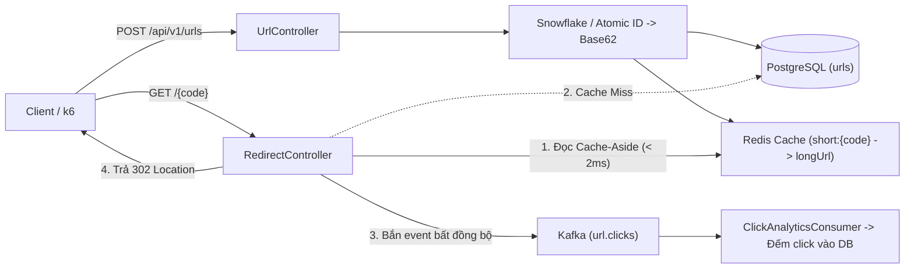

# Bài học Giai đoạn 4 — Phần 4: Quy Trình 45p, Sổ Trade-off & Bản Cài Mini

[← Phần 3: Concepts 8 Case Studies](./01-concepts-8-case-studies.md) · [Quay lại GĐ 4 README](./README.md) · [Tiếp theo: Phần 5 — Mục tiêu & Check Tuần 16 →](./03-muc-tieu-va-check-tuan16.md)

---

## 1. Quy trình luyện 8 bài (45–60 phút / bài)

Mỗi tuần làm **2 bài**, áp dụng đúng kỷ luật bấm giờ như đi phỏng vấn thật:

| Thời gian | Bước thực hiện | Quy tắc bắt buộc |
| :---: | :--- | :--- |
| **00:00 – 45:00** | **Tự giải bấm giờ (không nhìn đáp án)** | • Dùng giấy A4 hoặc Excalidraw/Draw.io.<br>• Tự đóng vai interviewer + candidate: **nói to thành tiếng** quá trình đặt câu hỏi làm rõ (5p), ước lượng QPS/Storage (3p), vẽ High-level (12p), Deep dive 2–3 điểm khó (20p), Wrap-up (5p). |
| **45:00 – 55:00** | **Đối chiếu lời giải Alex Xu & `system-design-primer`** | • Đánh dấu 3 thứ bằng bút đỏ: *(1) Chỗ mình bỏ sót yêu cầu, (2) Chỗ thiết kế khác với Xu và TẠI SAO, (3) Điểm nghẽn mình chưa nhận ra.* |
| **55:00 – 60:00** | **Ghi vào Sổ Trade-off** | • Viết tối thiểu **2 trade-off** theo đúng mẫu: *"Chọn A thay B vì…, đổi lại mất…"* và **1 bottleneck** chính. |

---

## 2. Sổ Trade-off (Mẫu cho đủ 8 bài — Tự điền sau khi tự giải!)

> Dưới đây là mẫu điền sẵn cho **URL Shortener**; 7 bài còn lại để trống để bạn tự viết sau mỗi buổi tự giải 45 phút.

| Tuần | Bài | Quyết định (Chọn A thay B) | Lý do chọn A | Đánh đổi / Mất gì & Cách khắc phục | Điểm nghẽn (Bottleneck) chính |
| :---: | :--- | :--- | :--- | :--- | :--- |
| **13** | **1. URL Shortener** | Chọn **Base62 từ Unique ID (Snowflake)** thay cho **MD5/SHA-256 cắt 7 ký tự** | Không bao giờ đụng độ (collision), không cần query DB kiểm tra trùng trước khi `INSERT` | Có thể đoán thứ tự ID nếu lộ pattern → khắc phục bằng trộn bit / dùng Snowflake hoặc thêm ký tự ngẫu nhiên | Link viral nhận hàng chục nghìn click/s → nghẽn kết nối Redis/DB |
| **13** | **1. URL Shortener** *(tiếp)* | Chọn **`302 Found`** thay cho **`301 Moved Permanently`** | Đếm được số lượt click (Analytics) chính xác và đổi được URL đích sau này | Mọi lượt click đều đi qua server → tốn tải băng thông & CPU (dùng Redis cache + CDN/LB để gánh) | *(như trên)* |
| **13** | **2. Notification System** | *Tự điền: (Gợi ý: Tách queue theo từng kênh vs 1 queue chung…)* | | | |
| **14** | **3. News Feed** | *Tự điền: (Gợi ý: Hybrid Fan-out vs Push thuần…)* | | | |
| **14** | **4. Chat System** | *Tự điền: (Gợi ý: WebSocket vs Long Polling / Wide-column vs RDBMS…)* | | | |
| **15** | **5. Search Autocomplete** | *Tự điền: (Gợi ý: Cache Top-K tại mỗi node Trie + Rebuild offline vs Update real-time…)* | | | |
| **15** | **6. Web Crawler** | *Tự điền: (Gợi ý: Back Queue tách theo domain + DNS Cache riêng vs Crawl tự do…)* | | | |
| **16** | **7. YouTube** | *Tự điền: (Gợi ý: Presigned URL + Split GOP + Top 20% CDN vs Upload qua App + 100% CDN…)* | | | |
| **16** | **8. Google Drive** | *Tự điền: (Gợi ý: Block 4MB SHA-256 + Conflict Copy vs Upload cả file + Last-Write-Wins…)* | | | |

---

## 3. Cài đặt Bản Mini: URL Shortener + Async Analytics (Spring Boot + Redis + Kafka + k6)

Bản mini này cực gọn để hoàn thành trong cuối tuần, nhưng hội tụ đủ các mảnh ăn điểm phỏng vấn: **Base62**, **Cache-Aside + Cache Null**, **302 Redirect**, **Kafka Async Click Analytics**, và **k6 Load Test**.

### Kiến trúc Mini App



### Bước 1: Schema PostgreSQL (`urls` & `url_click_stats`)

```sql
CREATE TABLE urls (
    id          BIGINT PRIMARY KEY,          -- Sinh từ SnowflakeIdGenerator (GĐ 2)
    short_code  VARCHAR(12) NOT NULL UNIQUE, -- Encode Base62
    long_url    TEXT NOT NULL,
    created_at  TIMESTAMP NOT NULL DEFAULT NOW(),
    expires_at  TIMESTAMP
);

CREATE TABLE url_click_stats (
    short_code  VARCHAR(12) PRIMARY KEY,
    click_count BIGINT NOT NULL DEFAULT 0,
    updated_at  TIMESTAMP NOT NULL DEFAULT NOW()
);
```

### Bước 2: `Base62Encoder.java`

```java
package com.techstore.shortener;

public final class Base62Encoder {
    private static final String ALPHABET = "0123456789abcdefghijklmnopqrstuvwxyzABCDEFGHIJKLMNOPQRSTUVWXYZ";
    private static final int BASE = ALPHABET.length(); // 62

    private Base62Encoder() {}

    public static String encode(long num) {
        if (num == 0) return "0";
        StringBuilder sb = new StringBuilder();
        while (num > 0) {
            sb.append(ALPHABET.charAt((int) (num % BASE)));
            num /= BASE;
        }
        return sb.reverse().toString();
    }
}
```

### Bước 3: `UrlShortenerService.java` (Tạo mã + Cache-Aside + Kafka Async Analytics)

```java
package com.techstore.shortener;

import org.springframework.data.redis.core.StringRedisTemplate;
import org.springframework.kafka.core.KafkaTemplate;
import org.springframework.stereotype.Service;

import java.time.Duration;
import java.util.Optional;

@Service
public class UrlShortenerService {

    private static final String CACHE_PREFIX = "short:";
    private static final String NULL_MARKER = "__NULL__";

    private final UrlRepository urlRepo;
    private final StringRedisTemplate redis;
    private final KafkaTemplate<String, String> kafka;
    private final SnowflakeIdGenerator idGenerator; // Tái sử dụng từ GĐ 2!

    public UrlShortenerService(
            UrlRepository urlRepo,
            StringRedisTemplate redis,
            KafkaTemplate<String, String> kafka,
            SnowflakeIdGenerator idGenerator) {
        this.urlRepo = urlRepo;
        this.redis = redis;
        this.kafka = kafka;
        this.idGenerator = idGenerator;
    }

    public String shorten(String longUrl) {
        long id = idGenerator.nextId();
        String shortCode = Base62Encoder.encode(id);

        urlRepo.save(new UrlEntity(id, shortCode, longUrl));
        // Warm cache ngay khi vừa tạo để cú click đầu tiên hit Redis luôn
        redis.opsForValue().set(CACHE_PREFIX + shortCode, longUrl, Duration.ofHours(24));
        return shortCode;
    }

    public Optional<String> resolveAndTrack(String shortCode) {
        String key = CACHE_PREFIX + shortCode;
        String cached = redis.opsForValue().get(key);

        String longUrl = null;
        if (NULL_MARKER.equals(cached)) {
            return Optional.empty();
        } else if (cached != null) {
            longUrl = cached;
        } else {
            Optional<UrlEntity> found = urlRepo.findByShortCode(shortCode);
            if (found.isEmpty()) {
                // Chống Cache Penetration
                redis.opsForValue().set(key, NULL_MARKER, Duration.ofMinutes(2));
                return Optional.empty();
            }
            longUrl = found.get().getLongUrl();
            redis.opsForValue().set(key, longUrl, Duration.ofHours(24));
        }

        // Gửi sự kiện click bất đồng bộ qua Kafka — KHÔNG bắt user chờ ghi DB analytics!
        kafka.send("url.clicks", shortCode, shortCode);
        return Optional.of(longUrl);
    }
}
```

### Bước 4: `RedirectController.java` & `ClickAnalyticsConsumer.java`

```java
@RestController
public class RedirectController {

    private final UrlShortenerService service;

    public RedirectController(UrlShortenerService service) {
        this.service = service;
    }

    @PostMapping("/api/v1/urls")
    public ResponseEntity<Map<String, String>> create(@RequestBody Map<String, String> body) {
        String code = service.shorten(body.get("longUrl"));
        return ResponseEntity.status(HttpStatus.CREATED)
                .body(Map.of("shortCode", code, "shortUrl", "http://localhost:8080/" + code));
    }

    @GetMapping("/{shortCode}")
    public ResponseEntity<Void> redirect(@PathVariable String shortCode) {
        return service.resolveAndTrack(shortCode)
                .map(url -> ResponseEntity.status(HttpStatus.FOUND) // 302 Found để giữ Analytics
                        .location(URI.create(url))
                        .<Void>build())
                .orElseGet(() -> ResponseEntity.notFound().build());
    }
}
```

```java
@Component
public class ClickAnalyticsConsumer {
    private final JdbcTemplate jdbc;

    public ClickAnalyticsConsumer(JdbcTemplate jdbc) {
        this.jdbc = jdbc;
    }

    @KafkaListener(topics = "url.clicks", groupId = "url-analytics")
    public void onUrlClicked(String shortCode) {
        // UPSERT cộng dồn lượt click trong PostgreSQL (trong thực tế có thể batch theo batch-listener)
        jdbc.update("""
            INSERT INTO url_click_stats (short_code, click_count, updated_at)
            VALUES (?, 1, NOW())
            ON CONFLICT (short_code)
            DO UPDATE SET click_count = url_click_stats.click_count + 1, updated_at = NOW()
            """, shortCode);
    }
}
```

### Bước 5: Load Test luồng Redirect bằng `k6` (`url-loadtest.js`)

```javascript
import http from 'k6/http';
import { check } from 'k6';

export const options = {
  summaryTrendStats: ['avg', 'min', 'med', 'p(90)', 'p(95)', 'p(99)', 'max'],
  stages: [
    { duration: '10s', target: 100 },
    { duration: '30s', target: 200 },
    { duration: '10s', target: 0 },
  ],
  thresholds: {
    http_req_failed: ['rate<0.01'],
    http_req_duration: ['p(99)<50'], // Redirect qua Redis nên p99 rất thấp!
  },
};

export default function () {
  // redirects: 0 để k6 chỉ đo tốc độ trả 302 của server mình, không kéo trang web đích bên ngoài!
  const res = http.get('http://localhost:8080/REPLACE_WITH_YOUR_CODE', { redirects: 0 });
  check(res, {
    'status is 302': (r) => r.status === 302,
  });
}
```
> **Lưu ý cực kỳ quan trọng khi test `k6` cho URL Shortener:** Phải truyền `{ redirects: 0 }`! Nếu không, `k6` sẽ tự động follow link `302` ra tận `google.com` hoặc `shopee.vn`, làm đo nhầm latency mạng Internet bên ngoài thay vì server của bạn!
