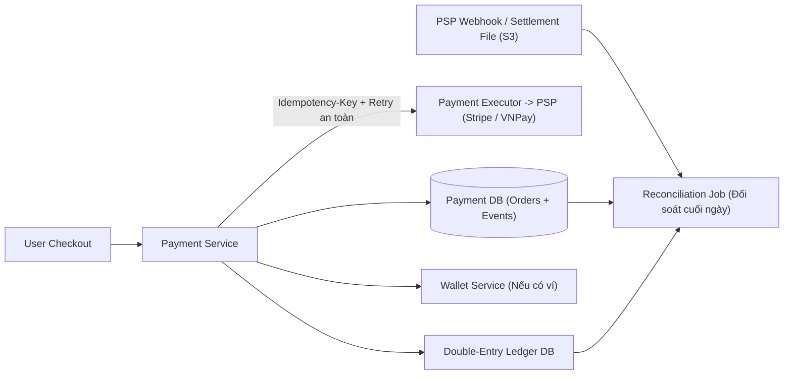

# Bài học Giai đoạn 5a — Phần 3: Concepts Nâng Cao (Xu Vol.2 — Chọn lọc theo ưu tiên)

[← Quay lại GĐ 5a README](./README.md) · [Tiếp theo: Phần 4 — Thiết kế lại Thanh toán TechStore →](./02-thuc-hanh-techstore-payment.md)

> **Tài liệu đối chiếu:** `[W]` Alex Xu Vol.2 (chương Payment, Distributed Message Queue, Proximity Service); Kafka internals docs; Stripe engineering blog về Idempotency

> [!NOTE]
> Không cần đọc hết 13 chương của Xu Vol.2. Tập trung theo đúng thứ tự ưu tiên: **1. Payment System** → **2. Distributed Message Queue** → **3. Proximity Service** *(bỏ qua Stock Exchange nếu không nhắm fintech/HFT)*.

---

## Mục lục
1. [Ưu tiên #1 — Payment System (Idempotency, Double-Entry Ledger, Reconciliation)](#1-ưu-tiên-1--payment-system)
2. [Ưu tiên #2 — Distributed Message Queue (Kafka Internals: Storage, ISR, Acks)](#2-ưu-tiên-2--distributed-message-queue-kafka-internals)
3. [Ưu tiên #3 — Proximity Service (Geohash & Quadtree)](#3-ưu-tiên-3--proximity-service-geohash--quadtree)

---

## 1. Ưu tiên #1 — Payment System

Một hệ thống thanh toán (như của **TechStore** tích hợp VNPay/Stripe/MoMo) có yêu cầu khắt khe nhất là **chính xác tuyệt đối về tiền (Zero data loss, không trừ 2 lần, luôn đối soát được)**.

### 1.1. Nguyên tắc lưu trữ tiền tệ & Sổ cái kép (Double-Entry Ledger)
- **KHÔNG BAO GIỜ dùng `FLOAT` hay `DOUBLE` cho tiền!** (Do lỗi làm tròn nhị phân IEEE 754: `0.1 + 0.2 = 0.30000000000000004`).
  - Dùng **`BIGINT` theo đơn vị nhỏ nhất** (VND: đồng; USD: cents `1050` = `$10.50`) hoặc **`NUMERIC / DECIMAL(19, 4)`** trong PostgreSQL kèm trường `currency` (`VND`, `USD`).
- **Double-Entry Bookkeeping (Sổ cái kép):** Thay vì chỉ `UPDATE balance = balance - 100`, mọi biến động tiền đều ghi thành **2 dòng bất biến (append-only)** đối ứng nhau:
  - Dòng 1: `Account = Buyer, Debit = -100,000 VND`
  - Dòng 2: `Account = TechStore_Escrow, Credit = +100,000 VND`
  - **Tổng của toàn bộ bảng Ledger luôn bằng `0`** → dễ dàng kiểm toán lịch sử ở bất kỳ thời điểm nào!

### 1.2. Idempotency Key (Chuẩn Stripe)
Trong thanh toán, mạng chập chờn có thể khiến User bấm nút "Thanh toán" 2 lần hoặc Network timeout làm Server retry gọi PSP:
1. Client tạo `idempotency_key` (UUID) gắn vào đơn thanh toán (`checkout_session_id` / `payment_order_id`).
2. **Tại Payment Service:** Lưu `idempotency_key` với `UNIQUE INDEX` trong DB (hoặc atomic lock) kèm **`request_hash`**.
   - Nếu key đã tồn tại **với payload khác** (`request_hash` lệch) → trả `422 Unprocessable Entity` (chống dùng nhầm key cũ cho số tiền mới!).
   - Nếu key đã tồn tại **với cùng payload** → trả nguyên response cũ, **không gọi sang PSP lần 2**.
3. **Từ Payment Service → PSP (Stripe/VNPay):** Cũng phải truyền kèm `idempotency_key` (hoặc `order_ref` duy nhất) để chính PSP đảm bảo không trừ tiền thẻ khách hàng 2 lần nếu gọi timeout và retry!

### 1.3. Retry an toàn & Giải quyết giao dịch treo (`UNKNOWN`)
- **Chỉ retry** khi lỗi là tạm thời (network timeout, `502/503/504`) và giao dịch đang ở trạng thái trung gian (`EXECUTING`/`UNKNOWN`).
- **KHÔNG retry** khi PSP trả lỗi nghiệp vụ rõ ràng (`INSUFFICIENT_FUNDS`, `CARD_EXPIRED`, `INVALID_SIGNATURE`).
- Nếu retry vẫn lỗi liên tục → đẩy vào **Retry Queue (Exponential Backoff)** rồi sang **DLQ**, hoặc chạy **Polling Status API** sang PSP để hỏi kết quả thực sự của giao dịch đang treo!

### 1.4. Reconciliation (Đối soát — Tuyến phòng thủ cuối cùng)
Dù hệ thống thiết kế kỹ đến đâu, giao tiếp bất đồng bộ với ngân hàng/PSP vẫn có thể lệch trạng thái (ví dụ webhook của PSP bị rớt khi server bạn bảo trì):
- Cuối mỗi ngày (`T+0` hoặc `T+1`), PSP đẩy **Settlement Report** (file CSV liệt kê mọi giao dịch đã chốt tiền thực tế).
- **Reconciliation Service** đọc file này và so khớp với bảng `payments` & `ledger` nội bộ, chia các sai lệch (mismatch) thành 3 loại:
  1. **Loại 1 (Đã biết & tự sửa được):** Ví dụ PSP báo đã trừ tiền (`SUCCESS`), nhưng DB nội bộ vẫn kẹt `EXECUTING` do rớt webhook → job tự cập nhật sang `SUCCESS` và ghi bổ sung Ledger.
  2. **Loại 2 (Lệch nghiệp vụ có quy tắc xử lý):** Ví dụ đã hoàn tiền nhưng ghi nhầm phí → tự động tạo giao dịch điều chỉnh.
  3. **Loại 3 (Không rõ nguyên nhân):** Ví dụ tiền trừ ở PSP nhưng không có bản ghi đơn hàng nào bên mình → đẩy vào hàng đợi **Manual Investigation** cho đội vận hành/kế toán xử lý.

---

## 2. Ưu tiên #2 — Distributed Message Queue (Kafka Internals)

Bổ trợ sâu hơn cho GĐ 2 về kiến trúc bên trong một hàng đợi phân tán hiệu năng cao:

### 2.1. Cách lưu trữ dữ liệu trên đĩa (Tại sao Kafka nhanh tới triệu msg/s?)
- Mỗi Partition thực chất là một thư mục gồm nhiều **Log Segment Files** (mỗi file tối đa vd `1 GB`).
- Mỗi segment có bộ 3 file:
  - `.log`: Chứa dữ liệu message thật nối tiếp nhau (**Sequential Disk I/O** — trên SSD/HDD hiện đại ghi tuần tự nhanh ngang hoặc gần RAM!).
  - `.index`: Sparse Index ánh xạ `offset -> vị trí byte vật lý` (cứ mỗi vài KB ghi 1 mốc, tra bằng Binary Search).
  - `.timeindex`: Ánh xạ `timestamp -> offset`.
- **Zero-Copy (`sendfile()` syscall) & OS Page Cache:** Kafka không tự cache nhiều trong JVM Heap (tránh GC pause nặng!), mà tận dụng thẳng **Linux OS Page Cache**. Khi Consumer đọc tin, dữ liệu đi thẳng từ Page Cache ra Network NIC bằng `sendfile()` **không cần copy vòng qua User Space (JVM)**!

### 2.2. Replication, ISR (In-Sync Replicas) & Producer `acks`
- Mỗi Partition có **1 Leader** và $(N-1)$ **Followers**. Cả Produce và Consume mặc định đều giao tiếp với **Leader**.
- **ISR (In-Sync Replicas):** Tập hợp gồm Leader và các Follower đang bắt kịp dữ liệu trong khoảng thời gian cho phép (`replica.lag.time.max.ms`). **High Watermark (HW)** là offset cao nhất đã được **toàn bộ ISR** sao chép thành công — Consumer chỉ được phép đọc tối đa tới HW (chống đọc dữ liệu chưa bền vững).

| Cấu hình Producer `acks` | Cơ chế xác nhận | Độ trễ | Rủi ro mất dữ liệu |
| :--- | :--- | :---: | :--- |
| **`acks = 0`** | Gửi đi không chờ Broker trả lời | Thấp nhất | **Cao nhất** (mạng rớt hoặc broker crash là mất) |
| **`acks = 1`** | Chờ **Leader** ghi xong vào log của Leader | Trung bình | **Có rủi ro** nếu Leader crash ngay trước khi Follower kịp kéo về |
| **`acks = all (-1)`** + **`min.insync.replicas = 2`** | Chờ Leader **VÀ toàn bộ ISR** (tối thiểu 2 bản sao) ghi xong mới ACK | Cao hơn | **Gần như bằng 0** — chuẩn bắt buộc cho dữ liệu tiền bạc / đơn hàng! |

---

## 3. Ưu tiên #3 — Proximity Service (Geohash & Quadtree)

Bài toán: Tìm các cửa hàng/quán ăn/tài xế trong bán kính `5 km` quanh tọa độ `(lat, lon)` của user (Yelp, Google Maps, Grab).

### 3.1. Tại sao không dùng SQL B-Tree thông thường?
Nếu đánh index riêng trên `latitude` và `longitude` rồi query `WHERE lat BETWEEN x1 AND x2 AND lon BETWEEN y1 AND y2`:
- DB tìm thấy hàng triệu điểm khớp vĩ độ `lat`, hàng triệu điểm khớp kinh độ `lon`, rồi mới giao 2 tập khổng lồ này lại → **rất chậm**! Ta cần kỹ thuật **ánh xạ không gian 2D → chỉ số 1D**!

### 3.2. Geohash (Biến 2D thành chuỗi 1D theo Prefix)
- **Ý tưởng:** Chia đôi bản đồ thế giới đệ quy theo chiều dọc (kinh độ) và chiều ngang (vĩ độ), gán bit `0` / `1` luân phiên, rồi mã hóa chuỗi bit thành ký tự **Base32** (ví dụ `wx4g0ec1`).
- **Tính chất vàng:** Hai điểm càng gần nhau thì chuỗi Geohash có **tiền tố (Prefix) chung càng dài** → chỉ cần lưu vào DB/Redis dưới dạng string có B-Tree index và query `WHERE geohash LIKE 'wx4g0%'`!
- **Bảng độ dài Prefix tham khảo:**
  - Length `4`: ô ~`39.1 km × 19.5 km`
  - Length `5`: ô ~`4.9 km × 4.9 km` (rất hợp bán kính tìm `5 km`!)
  - Length `6`: ô ~`1.2 km × 0.6 km`
- **Bẫy biên (Boundary Issue) bắt buộc phải nhớ:** Hai quán cách nhau chỉ `50 mét` nhưng nằm hai bên đường phân chia ô lưới có thể có mã Geohash **khác hẳn nhau ngay từ ký tự đầu tiên**! → **Cách khắc phục:** Luôn query đồng thời **9 ô** (`ô hiện tại + 8 ô hàng xóm xung quanh`) rồi lọc lại khoảng cách chính xác (Haversine)!

### 3.3. Quadtree (Chia lưới thích nghi trong RAM)
- **Ý tưởng:** Thay vì chia mọi nơi bằng nhau như Geohash, Quadtree bắt đầu bằng 1 hình vuông bao trùm thế giới. Nếu 1 ô chứa **nhiều hơn ngưỡng** (vd `> 100` cửa hàng), chia ô đó thành **4 ô con**.
- **Ưu điểm:** Tự thích nghi với mật độ dân cư — khu trung tâm thành phố dày đặc cửa hàng sẽ chia rất nhỏ (`500m`), còn vùng sa mạc/biển giữ nguyên 1 ô khổng lồ (tiết kiệm bộ nhớ!).
- **Đánh đổi:** Cây Quadtree nằm trong RAM Server (build mất vài phút lúc khởi động), **khó cập nhật vị trí di chuyển liên tục theo thời gian thực** (tài xế Grab đang chạy → dùng **Geohash trong Redis** hợp hơn; còn quán ăn cố định như Yelp → **Quadtree hoặc Geohash** đều rất tốt!).
