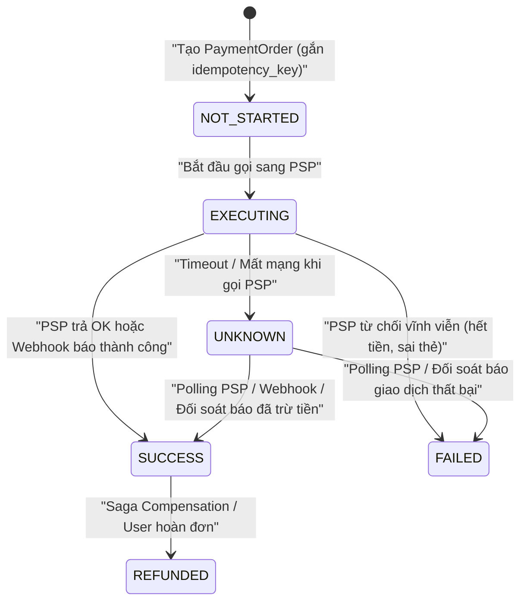

# Bài học Giai đoạn 5a — Phần 4: Thiết Kế Lại Luồng Thanh Toán TechStore

[← Phần 3: Concepts](./01-concepts.md) · [Quay lại GĐ 5a README](./README.md) · [Tiếp theo: Phần 5 — Mục tiêu đạt được →](./03-muc-tieu-va-check.md)

---

## Yêu cầu bài toán
Thiết kế lại module thanh toán của **TechStore** theo chuẩn **Payment System** (Xu Vol.2 + Stripe) để đảm bảo:
1. Không trừ tiền khách hàng **2 lần** dù user bấm đúp hay mạng timeout (`Idempotency Key`).
2. Quản lý chặt **trạng thái giao dịch (State Machine)** không cho chuyển trạng thái ngược/lậu.
3. Xử lý **Webhook/Callback trùng hoặc đến trước cả HTTP response** từ PSP (VNPay/Stripe/MoMo).
4. Có cơ chế **Đối soát (Reconciliation)** phát hiện & xử lý sai lệch cuối ngày.

---

## 1. Payment State Machine (Sơ đồ chuyển trạng thái)



> **Quy tắc bất biến trong code:** Luôn chuyển trạng thái bằng cập nhật có điều kiện (**Conditional Update / Optimistic Transition**):
> ```sql
> UPDATE payment_orders SET status = 'SUCCESS', psp_tx_id = :pspTxId, updated_at = NOW()
> WHERE id = :id AND status IN ('EXECUTING', 'UNKNOWN');
> ```
> Nếu trạng thái đã là `SUCCESS` hoặc `REFUNDED`, câu lệnh không chạm vào dòng nào → **miễn nhiễm trước callback trùng hoặc đến trễ!**

---

## 2. Database Schema (PostgreSQL — Không dùng Float!)

```sql
-- 1. Đơn thanh toán chính (mỗi checkout gắn 1 checkout_id, mỗi lần thử thanh toán gắn 1 idempotency_key)
CREATE TABLE payment_orders (
    id               BIGINT PRIMARY KEY,               -- Snowflake ID
    order_id         BIGINT NOT NULL,
    buyer_id         BIGINT NOT NULL,
    amount_minor     BIGINT NOT NULL CHECK (amount_minor > 0), -- Lưu VND (đồng) hoặc USD cents
    currency         CHAR(3) NOT NULL DEFAULT 'VND',
    idempotency_key  VARCHAR(64) NOT NULL UNIQUE,
    request_hash     VARCHAR(64) NOT NULL,             -- SHA-256 của (order_id + amount + currency)
    psp_provider     VARCHAR(30) NOT NULL,             -- VNPAY | STRIPE | MOMO
    psp_tx_id        VARCHAR(128) UNIQUE,              -- Mã giao dịch bên PSP trả về
    status           VARCHAR(20) NOT NULL,             -- NOT_STARTED | EXECUTING | SUCCESS | FAILED | UNKNOWN | REFUNDED
    response_snapshot TEXT,                            -- Lưu JSON trả về cho client nếu retry cùng idempotency_key
    created_at       TIMESTAMP NOT NULL DEFAULT NOW(),
    updated_at       TIMESTAMP NOT NULL DEFAULT NOW()
);

-- 2. Sổ cái kép (Double-entry Ledger) — Append-only, tuyệt đối không UPDATE/DELETE!
CREATE TABLE ledger_entries (
    id               BIGSERIAL PRIMARY KEY,
    payment_order_id BIGINT NOT NULL REFERENCES payment_orders(id),
    account_code     VARCHAR(64) NOT NULL,             -- vd: "USER:101" hoặc "TECHSTORE_ESCROW"
    amount_delta     BIGINT NOT NULL,                  -- Âm = Debit, Dương = Credit (Tổng cặp = 0!)
    currency         CHAR(3) NOT NULL DEFAULT 'VND',
    created_at       TIMESTAMP NOT NULL DEFAULT NOW()
);

-- 3. Nhật ký Webhook đã xử lý (Chống Callback trùng từ PSP)
CREATE TABLE psp_webhook_events (
    webhook_event_id VARCHAR(128) PRIMARY KEY,         -- Event ID duy nhất do PSP cấp
    psp_tx_id        VARCHAR(128) NOT NULL,
    event_type       VARCHAR(50) NOT NULL,
    raw_payload      TEXT NOT NULL,
    received_at      TIMESTAMP NOT NULL DEFAULT NOW()
);

-- 4. Bảng ghi nhận sai lệch đối soát (Reconciliation Mismatches)
CREATE TABLE reconciliation_mismatches (
    id               BIGSERIAL PRIMARY KEY,
    recon_date       DATE NOT NULL,
    payment_order_id BIGINT,
    psp_tx_id        VARCHAR(128),
    internal_status  VARCHAR(20),
    psp_status       VARCHAR(20),
    internal_amount  BIGINT,
    psp_amount       BIGINT,
    mismatch_type    VARCHAR(30) NOT NULL,             -- TYPE_1_AUTO_FIXED | TYPE_2_ADJUSTED | TYPE_3_MANUAL
    resolved         BOOLEAN NOT NULL DEFAULT FALSE,
    created_at       TIMESTAMP NOT NULL DEFAULT NOW()
);
```

---

## 3. Luồng xử lý Idempotency Key (`POST /api/v1/payments`)

```java
@Service
public class TechStorePaymentService {

    public PaymentResponse processPayment(String idempotencyKey, PaymentRequest req) {
        String reqHash = sha256(req.orderId() + ":" + req.amountMinor() + ":" + req.currency());

        // Bước 1: Kiểm tra hoặc tạo bản ghi Idempotency (Local TX 1)
        PaymentOrderEntity payment = txTemplate.execute(s -> {
            Optional<PaymentOrderEntity> existing = paymentRepo.findByIdempotencyKey(idempotencyKey);
            if (existing.isPresent()) {
                PaymentOrderEntity found = existing.get();
                if (!found.getRequestHash().equals(reqHash)) {
                    throw new ResponseStatusException(HttpStatus.UNPROCESSABLE_ENTITY,
                            "Idempotency-Key reused with different payload");
                }
                return found;
            }
            PaymentOrderEntity created = PaymentOrderEntity.notStarted(idempotencyKey, reqHash, req);
            created.setStatus("EXECUTING");
            return paymentRepo.save(created);
        });

        // Nếu đã xử lý xong từ lần gọi trước -> trả ngay snapshot, KHÔNG gọi PSP nữa!
        if (List.of("SUCCESS", "FAILED", "REFUNDED").contains(payment.getStatus())) {
            return deserialize(payment.getResponseSnapshot());
        }

        // Bước 2: Gọi PSP bên ngoài (KHÔNG giữ DB transaction!) và truyền kèm idempotencyKey
        PspResult pspRes;
        try {
            pspRes = pspClient.charge(idempotencyKey, req);
        } catch (TimeoutException | NetworkException netEx) {
            // Treo không rõ kết quả -> đánh dấu UNKNOWN để Polling Job / Webhook chốt sau!
            txTemplate.executeWithoutResult(s -> paymentRepo.transitionStatus(payment.getId(), "UNKNOWN", null));
            return new PaymentResponse(payment.getId(), "UNKNOWN", "Đang xác nhận giao dịch");
        }

        // Bước 3: Chốt kết quả & ghi Double-Entry Ledger trong 1 ACID Transaction (Local TX 2)
        String finalStatus = pspRes.isSuccess() ? "SUCCESS" : "FAILED";
        txTemplate.executeWithoutResult(s -> {
            int updated = paymentRepo.transitionToTerminal(payment.getId(), finalStatus, pspRes.pspTxId(), serialize(pspRes));
            if (updated == 1 && "SUCCESS".equals(finalStatus)) {
                // Ghi 2 dòng sổ cái đối ứng nhau (Tổng = 0)
                ledgerRepo.save(LedgerEntry.debit("USER:" + req.buyerId(), -req.amountMinor(), req.currency(), payment.getId()));
                ledgerRepo.save(LedgerEntry.credit("TECHSTORE_ESCROW", +req.amountMinor(), req.currency(), payment.getId()));
            }
        });

        return new PaymentResponse(payment.getId(), finalStatus, pspRes.message());
    }
}
```

---

## 4. Xử lý Callback / Webhook trùng & đến sớm (`POST /webhooks/psp`)

Khi tích hợp VNPay/Stripe/MoMo, webhook thường bị gửi lặp 2–5 lần nếu phía bạn phản hồi chậm, hoặc thậm chí **Webhook báo `SUCCESS` đến trước khi hàm `pspClient.charge()` kịp trả HTTP response về**!

**4 bước phòng thủ chuẩn:**
1. **Xác thực chữ ký (Signature Verification):** Kiểm tra HMAC-SHA256 / Ed25519 Header của PSP + timestamp chống Replay Attack; sai chữ ký từ chối `401` ngay.
2. **Trả `200 OK` thật nhanh:** Nếu xử lý nặng, xác thực chữ ký + lưu vào `psp_webhook_events` + đẩy Kafka rồi trả `200 OK` ngay (không để PSP tưởng timeout rồi bắn lại webhook liên tục!).
3. **Deduplicate bằng `psp_webhook_events` (`webhook_event_id PRIMARY KEY`):** Nếu `INSERT` trùng PK → bỏ qua êm đẹp, vẫn trả `200 OK`.
4. **Chuyển trạng thái có điều kiện + Ghi Ledger chống trùng:**
   - Dùng đúng hàm `transitionToTerminal(..., "SUCCESS", ...)` có `WHERE status IN ('EXECUTING', 'UNKNOWN')`.
   - Dù HTTP `pspClient.charge()` về sau Webhook vài trăm ms hay Webhook đến sau HTTP `charge()`, chỉ có **1 luồng duy nhất** có `updated == 1` và được phép ghi 2 dòng `ledger_entries` + phát sự kiện `PaymentSucceeded` cho `order-service`!

---

## 5. Quy trình Đối soát cuối ngày (Reconciliation Job)

Chạy định kỳ lúc `02:00 AM` hàng ngày trên file Settlement Report của PSP:

1. **Đọc file CSV từ PSP** (`psp_tx_id`, `payment_order_id`, `amount_minor`, `psp_status`).
2. **So khớp 2 chiều (Two-way Match)** với bảng `payment_orders` ngày `T-1`:
   - **Khớp hoàn toàn** (`status == SUCCESS` và `amount_minor` khớp) → Đạt (`OK`).
   - **Lệch Trạng thái (`UNKNOWN`/`EXECUTING` bên mình, nhưng PSP báo `SUCCESS`)** → *Type 1 Auto-fix*: Tự động chuyển `SUCCESS`, ghi bổ sung `ledger_entries`, phát event `OrderPaid` và ghi log vào `reconciliation_mismatches`.
   - **Lệch Trạng thái (`FAILED` bên mình, nhưng PSP báo `SUCCESS`) hoặc Lệch Số tiền** → *Type 3 Manual*: Đánh dấu `RESOLVED = FALSE`, bắn cảnh báo Slack/PagerDuty cho team Vận hành & Kế toán kiểm tra hoàn tiền!
   - **Có bên mình (`SUCCESS`) nhưng không có trong file PSP** → Kiểm tra có bị lùi sang kỳ đối soát ngày `T+1` không, nếu quá 48h đưa sang *Type 3 Manual*.
