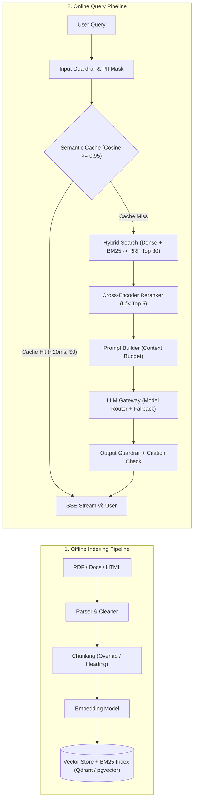

# Bài học Giai đoạn 5b — Phần 3: Concepts AI / LLM System Design (Tuần 19–20)

[← Quay lại GĐ 5b README](./README.md) · [Tiếp theo: Phần 4 — Thiết kế & Nâng cấp RAG Production →](./02-thuc-hanh-rag-production.md)

> **Tài liệu đối chiếu:** `[W]` KDNuggets (AI System Design), `dev.to/PracHub` (GenAI/LLM 2026), `bhaskarjha-com` (*System Design for AI Interviews*), LangChain, `pgvector` / `Qdrant`, Evaluation docs

---

## Mục lục
1. [Kiến trúc RAG (Chunking, Embedding, Vector Store, Hybrid Search, Reranking)](#1-kiến-trúc-rag)
2. [Serving LLM (Streaming, Batching, Semantic Cache, Token Rate Limit, Fallback)](#2-serving-llm)
3. [AI Agent (Orchestrator, Tool Calling, Sandbox, Policy & Guardrails)](#3-ai-agent--guardrails)
4. [Đánh giá & Observability (Retrieval Quality, Faithfulness, Tracing, Regression Test)](#4-đánh-giá--observability)
5. [Tối ưu Chi phí & Độ trễ (Model Routing, Cache, Context Budget)](#5-tối-ưu-chi-phí--độ-trễ)

---

## 1. Kiến trúc RAG

Khác với ứng dụng CRUD truyền thống (chính xác 100% hoặc báo lỗi), hệ thống LLM/RAG có tính **xác suất (non-deterministic)**, chi phí tính theo **Token** và độ trễ tính bằng **giây**. Một kiến trúc RAG hoàn chỉnh gồm **2 pipeline tách biệt**:

### 1.1. Chunking (Cắt tài liệu — Quyết định tới 50% chất lượng RAG)
- **Fixed-size + Overlap:** Cắt đoạn `400–600 tokens`, gối đầu (**overlap**) `10–15%` (`50–80 tokens`) để tránh cắt đứt ý giữa hai câu liền kề.
- **Structure-aware / Recursive Splitting:** Ưu tiên tách theo ranh giới tự nhiên (`Heading H1/H2/H3 → Đoạn văn → Câu`); với bảng biểu (PDF giá cả/bảng thông số), **giữ nguyên cả bảng hoặc chuyển thành Markdown/JSON** chứ không cắt vụn từng dòng!
- **Parent-Child Retrieval (Small-to-Big):** Lưu **chunk nhỏ (`~200 tokens`)** để tạo vector tìm kiếm thật chính xác, nhưng lưu kèm `parent_id` trỏ tới **chunk cha (`~800–1000 tokens`)** để nhồi đủ ngữ cảnh cho LLM khi sinh câu trả lời!

### 1.2. Embedding & Vector Store (`pgvector` vs `Qdrant`)
- **Embedding Model:** Biến văn bản thành vector dày đặc (vd `768–1536` chiều). **Lưu ý:** Phải dùng **cùng 1 model embedding** cho cả lúc index tài liệu và lúc query (nếu nâng cấp embedding model, phải **re-index** toàn bộ vector!).
- **Vector Index (ANN — Approximate Nearest Neighbor):**
  - **HNSW (Hierarchical Navigable Small World):** Tốc độ truy vấn cực nhanh, recall cao (`> 95%`), tốn RAM giữ đồ thị.
  - **IVF / DiskANN:** Tối ưu RAM khi dữ liệu lên hàng chục triệu – tỷ vector.
- **Chọn `pgvector` hay Vector DB chuyên dụng (`Qdrant` / `Milvus`)?**
  - **`pgvector`:** Tuyệt vời khi dưới vài triệu vector và cần `JOIN` chặt với bảng quyền hạn/nghiệp vụ SQL sẵn có (TechStore đang dùng Postgres!).
  - **`Qdrant` / `Milvus`:** Tốt hơn khi quy mô lớn (`10M+` vectors), cần **Hybrid Search (Dense + Sparse)** tích hợp sẵn, Payload Filtering cực nhanh và sharding độc lập.

### 1.3. Hybrid Search (Dense + BM25) & Reranking
- **Tại sao chỉ dùng Vector Search hay bị sai ngớ ngẩn?** Vector giỏi hiểu *ý nghĩa tương đồng* ("chính sách trả hàng" ↔ "đổi sản phẩm"), nhưng **rất yếu khi khớp chính xác từ khóa hiếm**: mã SKU (`TS-RX900`), mã lỗi (`ERR_40001`), tên riêng sản phẩm!
- **Hybrid Search:** Chạy song song **Dense Vector Search** (ngữ nghĩa) + **BM25 Sparse Search** (từ khóa chính xác), rồi trộn kết quả bằng **RRF (Reciprocal Rank Fusion)**:
  $$\text{RRF}(d) = \sum_{r \in \{\text{dense, bm25}\}} \frac{1}{k + \text{rank}_r(d)} \quad (k = 60)$$
- **Reranking (Two-Stage Retrieval):**
  - Vòng 1 (Hybrid Search) lấy nhanh **Top-30 đến Top-50** ứng viên (~15ms).
  - Vòng 2 đưa qua **Cross-Encoder Reranker** (như `bge-reranker-v2` hoặc Cohere Rerank) đọc đồng thời cả câu hỏi lẫn từng đoạn văn bản để chấm điểm chính xác nhất, rồi chỉ giữ lại **Top-5** đưa vào Prompt! *(Nhanh, chính xác hơn hẳn mà không cần chạy Cross-Encoder trên hàng triệu doc).*

---

## 2. Serving LLM

| Kỹ thuật | Vấn đề giải quyết | Cách hoạt động & Lưu ý |
| :--- | :--- | :--- |
| **Streaming (SSE)** | LLM mất 3–10s để sinh xong toàn bộ câu trả lời → user tưởng app treo | Trả từng token ngay khi sinh bằng **Server-Sent Events (`text/event-stream`)**, kéo **TTFT (Time To First Token)** xuống `< 500ms`. |
| **Continuous Batching** | Tự host GPU (vLLM/TGI) bị lãng phí GPU nếu xử lý từng request hoặc static batch | Gom động các request ở mức từng token iteration + **PagedAttention** quản lý KV Cache hiệu quả. |
| **Semantic Cache** | Nhiều user hỏi **cùng một ý bằng các câu chữ khác nhau** (*"Bảo hành mấy tháng?"* vs *"Thời gian bảo hành?"*) | Embed câu hỏi → tìm trong Redis/Qdrant cache với `cosine >= 0.95`. **Cấm dùng** cho câu hỏi chứa dữ liệu cá nhân/trạng thái đơn riêng! |
| **Token Rate Limiting (TPM)** | Giới hạn theo `RPM` (request/phút) không công bằng vì 1 req 50k tokens tốn gấp 100x req 500 tokens | Dùng Token Bucket đếm theo **`input_tokens + output_tokens` (TPM)** + giới hạn trần `max_output_tokens` + `user_quota`. |
| **Model Routing & Fallback** | LLM provider hay bị `429 Rate Limit` / `503` hoặc dùng model đắt cho câu hỏi quá dễ | Câu hỏi đơn giản/phân loại → model nhỏ nhanh (**Tier 1**); câu khó → model mạnh (**Tier 2**); nếu Provider A lỗi/timeout → tự chuyển sang **Model/Provider Fallback**! |

---

## 3. AI Agent & Guardrails

Khi hệ thống không chỉ đọc tài liệu tĩnh mà còn tự gọi API (`check_order`, `cancel_order`, `run_sql`):

1. **Orchestrator & ReAct Loop (`Thought → Action/Tool → Observation`):**
   - Luôn đặt giới hạn **`max_iterations` (vd 5–8 bước)** và **`max_execution_time`** để tránh Agent kẹt vòng lặp vô tận đốt tiền API!
2. **Tool Calling & Quyền hạn (Authorization):**
   - **Tuyệt đối không để LLM tự truyền `user_id` lấy từ prompt!** Tool backend phải lấy `user_id` từ **JWT/Session đã xác thực** của request để ngăn chặn lỗi leo thang đặc quyền qua Prompt Injection.
   - Các tool thay đổi dữ liệu nguy hiểm (hoàn tiền, hủy đơn, gửi email) cần **Human-in-the-loop** (hỏi xác nhận của user trước khi thực thi!).
3. **Sandboxing (Khi Agent viết & chạy code/SQL):**
   - Mọi code do LLM sinh ra phải chạy trong **Sandbox cô lập** (container ephemeral không có Internet, giới hạn CPU/RAM/timeout, user DB chỉ có quyền `SELECT`).
4. **Policy & Guardrails (2 đầu vào/ra):**
   - **Input Guardrails:** Phát hiện Prompt Injection / Jailbreak; **PII Masking** che SĐT, CCCD, email, số thẻ trước khi gửi lên LLM cloud.
   - **Output Guardrails:** Ép **Structured Output (JSON Schema)** cho các luồng tích hợp API; kiểm tra không để lộ System Prompt, không tư vấn sai quy định pháp lý/y tế/giá cả.

---

## 4. Đánh giá & Observability

> **Điểm phân biệt Prototype với Production (theo *bhaskarjha-com* & *PracHub 2026*):** Prototype chỉ test tay 5 câu thấy "chạy được"; hệ thống thật bắt buộc có **Evaluation Pipeline + Tracing + Regression Test**.

### 4.1. Bộ chỉ số đánh giá RAG (RAG Triad)
1. **Retrieval Quality (Đo tầng tìm kiếm — chưa cần gọi LLM sinh câu trả lời):**
   - **Context Recall@K:** Tài liệu chứa đáp án đúng có lọt vào Top-K (`K = 5`) không?
   - **Context Precision / MRR:** Tài liệu đúng có xếp ở vị trí đầu (`rank 1, 2`) thay vì chìm dưới đống rác không?
2. **Generation Quality (Dùng LLM-as-a-Judge hoặc chấm tay trên mẫu):**
   - **Faithfulness / Groundedness:** Từng nhận định trong câu trả lời có được chứng minh từ Context tìm được không (phát hiện **Hallucination**)?
   - **Answer Relevance:** Câu trả lời có đi thẳng vào câu hỏi của user không?

### 4.2. Tracing & Regression Test
- **Observability / Tracing (LangSmith, Langfuse, OpenTelemetry):** Mỗi request lưu lại full trace: `input_query` → `cache_hit?` → `retrieved_doc_ids & scores` → `rerank_scores` → `prompt_tokens`, `completion_tokens`, `cost_usd`, `TTFT`, `total_latency`.
- **Prompt & Pipeline Regression Test:** Duy trì bộ **Golden Dataset** (50–200 cặp `câu hỏi + doc_id kỳ vọng + câu trả lời chuẩn`). Mỗi khi đổi Prompt, đổi Chunk size, hay đổi Model → chạy CI kiểm tra **Recall@5** và **Faithfulness** không bị tụt trước khi deploy!

---

## 5. Tối ưu Chi phí & Độ trễ

| Đòn bẩy tối ưu | Tác động | Cách áp dụng thực tế |
| :--- | :--- | :--- |
| **Semantic Cache + Exact Cache** | Giảm **20–50%** chi phí & latency xuống `~20ms` | Cache các câu hỏi FAQ phổ biến (giống nhau về ngữ nghĩa). |
| **Prompt Caching (Prefix Caching)** | Giảm **50–90%** chi phí input tokens cho System Prompt/Examples dài | Đặt nội dung tĩnh (System Prompt, Tool Schema, Few-shot) ở **đầu** prompt để tận dụng KV prefix cache của nhà cung cấp LLM. |
| **Model Tiering (Router)** | Giảm **60–80%** chi phí LLM | Dùng model nhỏ/nhanh để phân loại intent, viết lại câu truy vấn (query rewrite), và trả lời câu hỏi FAQ dễ; chỉ đẩy câu suy luận phức tạp sang model lớn. |
| **Giới hạn Context Budget** | Giảm chi phí **VÀ tăng chất lượng** | Chỉ đưa **Top 3–5 chunks** sau Rerank (~1,500–2,500 tokens), nén lịch sử chat thành summary ngắn sau mỗi 5 lượt, tránh hiệu ứng **"Lost in the Middle"**. |
