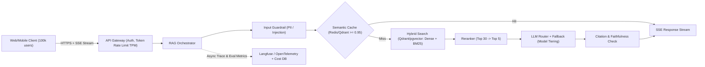
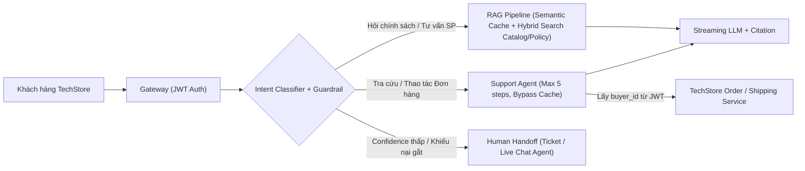

# Bài học Giai đoạn 5b — Phần 4: Thiết Kế Trên Giấy & Nâng Cấp RAG Lên Production

[← Phần 3: Concepts AI/LLM](./01-concepts.md) · [Quay lại GĐ 5b README](./README.md) · [Tiếp theo: Phần 5 — Mục tiêu & Check Tuần 20 →](./03-muc-tieu-va-check-tuan20.md)

---

## Bài 1 — Thiết kế trên giấy: *"Chatbot hỏi đáp tài liệu cho 100k người dùng"*

### Bước 1: Làm rõ yêu cầu & Ước lượng QPS + Token Cost
- **Giả định quy mô:**
  - Tổng user: `100,000` (tài liệu nội bộ doanh nghiệp / nền tảng học tập / SaaS).
  - **DAU:** `20%` = `20,000 users/ngày`; mỗi DAU hỏi `5 lượt/ngày` = **`100,000 queries/ngày`**.
  - **Avg QPS:** $100,000 / 86,400 \approx \mathbf{1.2 \text{ QPS}}$ → **Peak QPS (giờ hành chính 5x):** **~`6 QPS`**. *(Lưu ý: QPS trông nhỏ hơn web CRUD, nhưng mỗi request tốn **2–5 giây** GPU/LLM và tốn tiền theo token!).*
  - **Kho tài liệu:** `50,000` tài liệu (~`500,000` chunks $\times$ 1536 chiều float32 $\approx 3\text{ GB}$ vector thô → rất vừa với `pgvector` hoặc 1 node `Qdrant` 16GB RAM!).
- **Ước lượng Token & Chi phí / ngày (chưa có Cache):**
  - Input trung bình/câu: System prompt (`400`) + 5 chunks (`2,000`) + Lịch sử chat (`300`) + Câu hỏi (`100`) = **`2,800 input tokens`**.
  - Output trung bình/câu: **`350 output tokens`**.
  - Tổng 1 ngày (`100,000` câu): **`280M input tokens` + `35M output tokens`**.
  - *Ví dụ minh họa bài toán tối ưu chi phí (giả sử đơn giá tham khảo model tầm trung `~$0.30 / 1M input` và `~$1.20 / 1M output`):*
    - Gốc (không tối ưu): $280 \times 0.30 + 35 \times 1.20 = \$84 + \$42 \approx \mathbf{\$126/\text{ngày}}$ (`~$3,780/tháng`).
    - Sau khi thêm **Semantic Cache (hit 30%)** + **Prompt Prefix Caching (giảm phần system prompt tĩnh)**: chi phí giảm ~**40–50%** xuống còn `~$1,900–$2,200/tháng`!
    - *(Lưu ý: Nếu dùng hoàn toàn model Frontier đắt hơn 10x, hóa đơn nhảy lên `>$35,000/tháng` → bắt buộc phải dùng **Model Tiering**!)*.

### Bước 2: Sơ đồ kiến trúc tổng thể



### Bước 3: Deep Dive các quyết định then chốt
1. **Freshness (Khi tài liệu gốc thay đổi):** Dùng Change Detection (hash file) + Queue cập nhật incremental (xóa các chunk cũ của `doc_id`, re-embed và upsert chunk mới), đồng thời **invalidate Semantic Cache** liên quan tới `doc_id` đó!
2. **Access Control (RBAC trên tài liệu):** Phải gắn `allowed_roles` / `tenant_id` vào **Metadata Payload của mỗi Chunk** và lọc **ngay bên trong câu query Vector DB (Pre-filtering)** — tuyệt đối không tìm Top-5 xong mới lọc quyền ở ngoài (làm rớt xuống 0 kết quả!).

---

## Bài 2 — Thiết kế trên giấy: *"Hệ thống RAG hỗ trợ khách hàng (TechStore)"*

### Khác biệt cốt lõi so với Chatbot tài liệu thuần túy
Chatbot hỗ trợ khách hàng của TechStore có **2 loại câu hỏi hoàn toàn khác nhau**:
1. **Câu hỏi kiến thức tĩnh (FAQ / Policy):** *"Chính sách đổi trả bàn phím lỗi ra sao?"*, *"Ship về Cần Thơ mất mấy ngày?"* → Dùng **RAG + Semantic Cache**.
2. **Câu hỏi cá nhân hóa / Hành động (Dynamic Data & Tool Calling):** *"Đơn hàng #9821 của tui giao tới đâu rồi?"*, *"Tui muốn hủy đơn vừa đặt"* → **BẮT BUỘC bypass Semantic Cache**, gọi **Intent Router → Agent Tool Calling** (`getOrderStatus`, `cancelOrder`) với `buyer_id` lấy từ **JWT xác thực**, và có cơ chế **Human Handoff** chuyển sang nhân viên CSKH thật khi confidence thấp hoặc khách hàng yêu cầu gặp người thật!



**Ước lượng nhanh (TechStore 200k DAU):**
- Giả sử `10%` DAU nhắn bot hỗ trợ = `20,000` phiên/ngày, mỗi phiên `4` lượt = `80,000 turns/ngày` (~`1 QPS` avg, `5 QPS` peak).
- Input trung bình `2,000 tokens`, output `200 tokens` → `160M` input + `16M` output/ngày.
- **Mẹo tiết kiệm lớn:** Dùng **Intent Classifier nhỏ (hoặc Embedding classifier)** tách riêng luồng FAQ (~60% traffic, hit Semantic Cache tới 50%) ra khỏi luồng Agent Tool Calling (~40% traffic) giúp giảm gần nửa lượng token gọi LLM lớn!

---

## Bài 3 — Nâng cấp hệ thống RAG hiện có của bạn lên mức Production

Dưới đây là **4 hạng mục nâng cấp thực tế** áp thẳng vào codebase RAG/LangChain hiện tại của bạn (viết minh họa bằng Python / FastAPI / LangChain-style dễ đối chiếu; nếu bạn dùng Spring AI tư duy hoàn toàn giống hệt):

### 1. Thêm Semantic Cache (tránh gọi LLM lặp lại với câu hỏi đồng nghĩa)

```python
import numpy as np
from dataclasses import dataclass

@dataclass
class CacheEntry:
    question: str
    vector: list[float]
    answer: str
    doc_ids: list[str]

class SimpleSemanticCache:
    """Mẫu minh họa nguyên lý; trong production dùng Redis Vector Search hoặc Qdrant collection riêng."""
    def __init__(self, embed_fn, threshold: float = 0.95):
        self.embed_fn = embed_fn
        self.threshold = threshold
        self.entries: list[CacheEntry] = []  # Thực tế thay bằng Redis / Qdrant + TTL

    def lookup(self, query: str) -> tuple[str | None, list[float]]:
        q_vec = self.embed_fn(query)
        q_norm = np.linalg.norm(q_vec)
        best_score, best_answer = -1.0, None

        for entry in self.entries:
            sim = float(np.dot(q_vec, entry.vector) / (q_norm * np.linalg.norm(entry.vector) + 1e-9))
            if sim >= self.threshold and sim > best_score:
                best_score = sim
                best_answer = entry.answer

        return best_answer, q_vec

    def store(self, query: str, q_vec: list[float], answer: str, doc_ids: list[str]):
        self.entries.append(CacheEntry(query, q_vec, answer, doc_ids))
```
> **Lưu ý khi dùng Qdrant/Redis cho Semantic Cache:** Luôn đặt **TTL** (ví dụ 24h) và khi tài liệu gốc `doc_id` được cập nhật, xóa các cache entry có chứa `doc_id` đó. **Không cache** nếu câu hỏi có yếu tố thời gian ("hôm nay", "bây giờ") hoặc dữ liệu riêng tư của user!

### 2. Bật Streaming (SSE) & Đo Latency (`TTFT` + `Total`) + Chi phí mỗi Request

```python
import time
from fastapi import FastAPI
from fastapi.responses import StreamingResponse

app = FastAPI()

# Bảng giá tham khảo theo 1M tokens (cập nhật theo model bạn dùng)
PRICE_PER_1M_INPUT = 0.30
PRICE_PER_1M_OUTPUT = 1.20

@app.post("/api/rag/chat/stream")
async def chat_stream(req: dict):
    query = req["query"]
    t0 = time.perf_counter()

    # 1. Retrieval + Rerank
    docs = retrieve_and_rerank(query)
    t_retrieval_ms = (time.perf_counter() - t0) * 1000

    async def event_generator():
        first_token_ms = None
        prompt_tokens, completion_tokens = 0, 0

        async for chunk in llm_stream_call(query, docs):
            if chunk.text:
                if first_token_ms is None:
                    first_token_ms = (time.perf_counter() - t0) * 1000
                yield f"data: {chunk.text}\n\n"
            if chunk.usage:
                prompt_tokens = chunk.usage.input_tokens
                completion_tokens = chunk.usage.output_tokens

        total_ms = (time.perf_counter() - t0) * 1000
        cost_usd = (prompt_tokens * PRICE_PER_1M_INPUT + completion_tokens * PRICE_PER_1M_OUTPUT) / 1_000_000

        # Log observability / ghi DB metrics cho từng request
        log_rag_metrics(
            query=query,
            retrieval_ms=t_retrieval_ms,
            ttft_ms=first_token_ms,
            total_ms=total_ms,
            input_tokens=prompt_tokens,
            output_tokens=completion_tokens,
            cost_usd=cost_usd,
        )
        yield "event: done\ndata: [DONE]\n\n"

    return StreamingResponse(event_generator(), media_type="text/event-stream")
```

### 3. Xây bộ Test đánh giá Retrieval (`Recall@K` & `MRR`) trên Golden Dataset

Tạo file `eval_dataset.jsonl` chứa `30–50` câu hỏi thực tế gắn kèm ID tài liệu đúng (`expected_doc_ids`):
```json
{"id": "q1", "question": "Thời gian bảo hành bàn phím cơ là bao lâu?", "expected_doc_ids": ["policy_warranty_v2#chunk3"]}
{"id": "q2", "question": "Mã lỗi ERR_40001 xử lý thế nào?", "expected_doc_ids": ["troubleshooting_db#chunk12"]}
```

Script chạy đánh giá tự động trước mỗi lần đổi Chunk Size / Embedding / Hybrid Weight:
```python
import json

def evaluate_retrieval(dataset_path: str, retriever_fn, k: int = 5):
    total, hits, mrr_sum = 0, 0, 0.0

    with open(dataset_path, "r", encoding="utf-8") as f:
        for line in f:
            row = json.loads(line)
            expected = set(row["expected_doc_ids"])
            retrieved_ids = [d.id for d in retriever_fn(row["question"], top_k=k)]

            total += 1
            if any(doc_id in expected for doc_id in retrieved_ids):
                hits += 1

            # Tính Mean Reciprocal Rank (MRR): tài liệu đúng đứng càng cao điểm càng gần 1.0
            for rank, doc_id in enumerate(retrieved_ids, start=1):
                if doc_id in expected:
                    mrr_sum += 1.0 / rank
                    break

    print(f"Recall@{k}: {hits / total:.2%} | MRR@{k}: {mrr_sum / total:.4f} (n={total})")
```

> **Cách dùng thực chiến:** Chạy `evaluate_retrieval()` để lấy baseline trước (vd `Recall@5 = 72%`). Sau đó bật **Hybrid Search (Dense + BM25)** rồi đo lại (vd lên `86%`), rồi bật tiếp **Reranker** (lên `93%`) → bạn có số liệu thật để chứng minh từng thành phần thêm vào đều có lý do!
