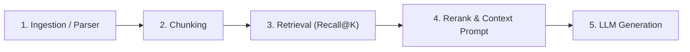

# Bài học Giai đoạn 5b — Phần 5: Mục Tiêu Đạt Được & Chuẩn Bị Mốc Tuần 20

[← Phần 4: Thiết kế & Nâng cấp RAG Production](./02-thuc-hanh-rag-production.md) · [Quay lại GĐ 5b README](./README.md)

---

## Mục tiêu 1 — Vẽ và giải thích được kiến trúc RAG trong 10 phút, có phần chi phí

### Kịch bản thuyết trình 10 phút (dùng cho Mock & Phỏng vấn)

| Thời gian | Phần trình bày | Nội dung cốt lõi cần nói ra miệng |
| :---: | :--- | :--- |
| **0:00 – 02:00** | **1. Làm rõ & Ước lượng** | Chốt số user / queries ngày (vd `100k` req/ngày ≈ `1.2 QPS`, peak `6 QPS`). Tính ngay **Input + Output tokens/ngày** và ước lượng chi phí hàng tháng để chứng minh tại sao cần kiểm soát token! |
| **02:00 – 05:00** | **2. Offline Ingestion** | Tài liệu → Parser (giữ cấu trúc bảng) → Chunking (`400–600 tokens`, overlap `10–15%`, hoặc Parent-Child) → Embedding → Upsert vào **Vector Store + BM25** kèm **Metadata RBAC** (`tenant_id`, `roles`). |
| **05:00 – 08:30** | **3. Online Query & Serving** | Input Guardrail (PII/Injection) → **Semantic Cache** (`>= 0.95`) → **Hybrid Search (Dense + BM25 + RRF)** → **Cross-Encoder Reranker (Top 30 → Top 5)** → LLM Router/Fallback (**SSE Streaming** giảm TTFT) → Output Guardrail. |
| **08:30 – 10:00** | **4. Eval, Observability & Tối ưu chi phí** | Đo **Recall@5** & **Faithfulness**, trace từng request (`TTFT`, `tokens`, `cost`), dùng **Model Tiering + Prompt Caching + Semantic Cache** để cắt 40–60% chi phí. |

---

## Mục tiêu 2 — Playbook Debug khi RAG trả lời sai dù tài liệu đúng CÓ TỒN TẠI

Đây là câu hỏi phỏng vấn AI Engineering kinh điển. Trả lời theo đúng **thứ tự đường đi dữ liệu từ dưới lên (5 bước cô lập lỗi bằng Trace)**:

| Tầng kiểm tra | Triệu chứng nhận biết trong Trace | Nguyên nhân phổ biến & Cách sửa |
| :--- | :--- | :--- |
| **1. Ingestion / Parser** | Tìm thẳng keyword trong Vector DB cũng không thấy đoạn text đúng | PDF bảng biểu / 2 cột bị parse vỡ nát thành chữ vô nghĩa; ảnh scan chưa qua OCR. **Sửa:** Đổi parser (Layout-aware / Vision parser) chuyển bảng sang Markdown/JSON. |
| **2. Chunking** | Đoạn văn đúng bị cắt làm đôi (nửa câu hỏi ở Chunk A, đáp án ở Chunk B) | Chunk quá nhỏ hoặc không có overlap / mất tiêu đề cha (heading). **Sửa:** Thêm overlap `10–15%`, chèn tiêu đề tài liệu/mục vào đầu mỗi chunk (*Contextual Chunking*), hoặc dùng **Parent-Child Retrieval**. |
| **3. Retrieval (Không lọt Top-K)** | Trong Trace, `doc_id` đúng **không có mặt trong Top-30 lấy ra** (`Recall@30 = 0`) | • Câu hỏi chứa **mã lỗi, SKU, tên riêng** mà Vector search không bắt được → **Thêm Hybrid Search (BM25 + Dense + RRF)**. • Câu hỏi người dùng mơ hồ, viết tắt → **Thêm Query Rewriting / Multi-query expansion**. • Lọc metadata quá chặt sau khi search (post-filtering) làm mất ứng viên → chuyển sang **Pre-filtering**. |
| **4. Rerank & Prompt Packing** | `doc_id` đúng **CÓ trong Top-30**, nhưng bị rớt khi lọc Top-5 hoặc nằm lọt thỏm ở giữa Top-15 | • Embedding similarity không chính xác bằng Cross-Encoder → **Thêm Cross-Encoder Reranker**. • Nhồi quá nhiều chunk (15–20 chunks) gây hiệu ứng **"Lost in the Middle"** khiến LLM bỏ sót đoạn giữa → giảm xuống **Top 3–5 chunks** chất lượng cao! |
| **5. Generation (LLM bịa / bảo thủ sai)** | Trace cho thấy Context đưa vào Prompt **đã chứa đáp án đúng**, nhưng LLM vẫn trả lời sai hoặc bịa thêm | • System prompt quá yếu hoặc nhiệt độ `temperature` cao → đặt `temperature = 0–0.2`, ép trả lời *"Nếu context không có thông tin, hãy nói không biết"* và bắt buộc **trích dẫn `[chunk_id]`**. • Tài liệu mâu thuẫn với kiến thức cũ của LLM hoặc Prompt quá dài vượt context window. |

---

## Mục tiêu 3 — Tư duy Keep It Simple First (KISS) trước khi thêm thành phần

> Không bao giờ đập vào bài toán một kiến trúc gồm Agent đa tầng + Knowledge Graph + Fine-tuning ngay từ ngày đầu! Hãy đi theo **thang tiến hóa có đo lường bằng Eval Metric**:

1. **Level 1 — Baseline đơn giản nhất (Ngày 1):**
   - Chunking chuẩn + Embedding tốt + `pgvector`/Qdrant + Prompt chặt (`temperature = 0`) + Bộ **Golden Dataset (30–50 câu)** đo `Recall@5` & `Faithfulness`.
2. **Level 2 — Chỉ thêm khi Eval/Trace chỉ ra đúng bệnh:**
   - Nếu `Recall@5` trượt ở từ khóa/mã SKU → mới thêm **Hybrid Search (BM25 + RRF)**.
   - Nếu tài liệu đúng nằm ở rank 10–30 → mới thêm **Cross-Encoder Reranker**.
   - Nếu `TTFT` chậm hoặc hóa đơn LLM tăng cao vì câu hỏi lặp lại → mới thêm **SSE Streaming**, **Semantic Cache** và **Model Routing**.
3. **Level 3 — Khi cần hành động động hoặc dữ liệu live:**
   - Lúc đó mới bổ sung **Agent Tool Calling** (kèm `max_iterations`, Auth JWT, Sandbox, Guardrails).
   - *(Chỉ cân nhắc Fine-tuning khi đã tối ưu hết Prompt + RAG mà vẫn cần đổi giọng văn/format chuyên sâu hoặc domain thuật ngữ quá hẹp).*

---

## Mục tiêu & Sản phẩm tổng kết lộ trình 20 Tuần (Mốc Tuần 20)

> **Mốc Tuần 20:** Mock tổng hợp gồm 1 đề AI · **Sản phẩm:** *Hồ sơ portfolio và bản thiết kế RAG*

### Checklist Portfolio sẵn sàng đi phỏng vấn sau 20 tuần

- [ ] **GitHub Portfolio sạch sẽ (3 điểm nhấn định lượng được):**
  1. **TechStore Distributed E-commerce:** Scale với Nginx LB (`p99` k6), PostgreSQL Primary/Replica (`AbstractRoutingDataSource`), Redis Cache-Aside + Mutex Stampede + Token Bucket Lua Rate Limiter, Kafka Outbox (`FOR UPDATE SKIP LOCKED`), 3 Microservices Saga + Resilience4j Circuit Breaker, và Payment Idempotency + Reconciliation.
  2. **Mini Case Study (GĐ 4):** URL Shortener / Notification Service hoàn chỉnh kèm load test `k6` và **Sổ Trade-off 8 bài** Xu Vol.1.
  3. **Production RAG System (GĐ 5b):** Bản nâng cấp RAG có Semantic Cache, SSE Streaming, Log Latency/Token Cost mỗi request và kết quả đánh giá **Recall@K / MRR** trước–sau trên Golden Dataset + **Bản thiết kế hệ thống RAG 100k users**.
- [ ] **Mock tổng hợp cuối kỳ (90 phút):**
  - **Đề 1 (45 phút — System Design cổ điển):** Chọn ngẫu nhiên từ GĐ 4/5a (vd *Payment System* hoặc *Chat System*).
  - **Đề 2 (45 phút — AI/LLM System Design):** *"Thiết kế hệ thống RAG hỗ trợ khách hàng / Chatbot tài liệu 100k users"* — có đủ sơ đồ, tính token cost, debug playbook và eval metrics!
