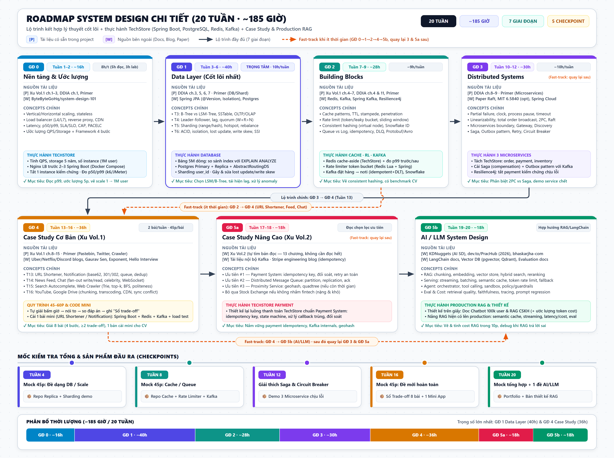
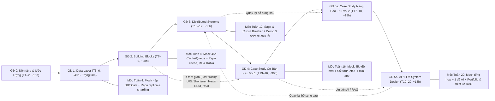
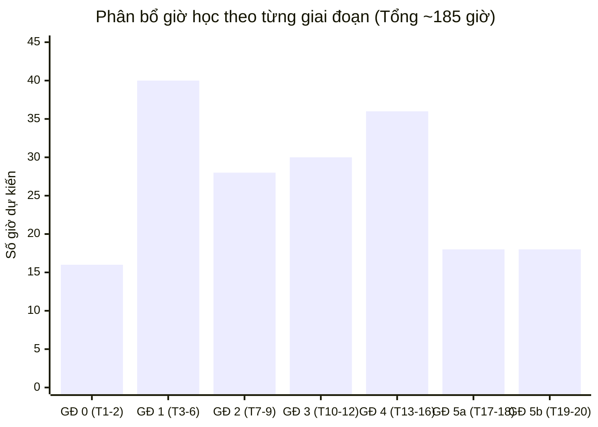

# Roadmap System Design Chi Tiết (20 Tuần · ~185 Giờ)

> **Quy ước ký hiệu tài liệu**
> - **`[P]`**: Tài liệu có sẵn trong project (`Xu Vol.1`, `DDIA`, `system-design-primer`).
> - **`[W]`**: Nguồn bên ngoài (tài liệu chính thức, engineering blog, paper, video).
> - **Cấu trúc mỗi giai đoạn**: gồm đủ 5 mục — *Thời lượng*, *Nguồn tài liệu*, *Concepts*, *Thực hành*, *Mục tiêu đạt được*.
> - **Dự án thực hành xuyên suốt**: **TechStore** (Spring Boot, PostgreSQL, Redis, Kafka, Resilience4j) + hệ thống **RAG / LLM**.

---

## 1. Sơ đồ Roadmap Tổng Quan

### Sơ đồ luồng học & nhánh rút gọn (Mermaid)

### Phân bổ thời lượng theo giai đoạn (~185 giờ)

> [!TIP]
> **Lộ trình rút gọn khi thời gian ít:**
> Giữ lại **`GĐ 0 → GĐ 1 → GĐ 2 → GĐ 4 (URL Shortener, News Feed, Chat) → GĐ 5b`**, sau đó quay lại **`GĐ 3`** và **`GĐ 5a`** khi có thêm thời gian.

---

## 2. Bảng Tổng Hợp Lộ Trình 20 Tuần

| GĐ | Nội dung | Tuần | Giờ dự kiến | Trọng tâm thực hành |
| :---: | :--- | :---: | :---: | :--- |
| **0** | Nền tảng & ước lượng | 1–2 | ~16 | Tính QPS/storage TechStore (1M user), Nginx LB + Docker Compose, đo p50/p99 (k6/JMeter) |
| **1** | Data layer *(dài & quan trọng nhất)* | 3–6 | ~40 | Bảng 5M dòng + `EXPLAIN ANALYZE`, PostgreSQL primary/replica lag, sharding `user_id`, lost update & write skew |
| **2** | Building blocks | 7–9 | ~28 | Redis cache-aside + stampede, rate limiter (Redis Lua), Kafka idempotent + DLT, Snowflake ID (Java) |
| **3** | Distributed systems | 10–12 | ~30 | Tách 3 service (`order`, `payment`, `inventory`), Saga + compensation, Resilience4j, Outbox pattern |
| **4** | Case study cơ bản (Xu Vol.1) | 13–16 | ~36 | Giải 8 bài (45p/bài), lập sổ trade-off, cài 1 bài mini (Spring Boot + Redis + Kafka + load test) |
| **5a** | Case study nâng cao (Xu Vol.2) | 17–18 | ~18 | Thiết kế lại luồng thanh toán TechStore (idempotency key, trạng thái, callback trùng, đối soát) |
| **5b** | AI/LLM system design | 19–20 | ~18 | Thiết kế chatbot 100k user & RAG CSKH, nâng RAG hiện có lên production (semantic cache, streaming, eval) |
| **Tổng** | **7 giai đoạn** | **20 tuần** | **~185** | **Hệ thống TechStore hoàn chỉnh + Mini Case Study + Production RAG + Portfolio** |

---

## 3. Chi Tiết Từng Giai Đoạn

### Giai đoạn 0: Nền tảng và ước lượng

#### 1. Thời lượng
- **2 tuần** (Tuần 1–2), **~16 giờ** (~8 giờ/tuần: **5h đọc**, **3h thực hành**).

#### 2. Nguồn tài liệu
- **`[P]`** Xu Vol.1 ch.1 (*Scale from zero*), ch.2 (*Back-of-the-envelope*), ch.3 (*Framework 4 bước*)
- **`[P]`** DDIA ch.1 (*Reliable, Scalable, Maintainable Applications*)
- **`[P]`** `system-design-primer`: các mục *Performance vs Scalability*, *Latency vs Throughput*, *Availability vs Consistency*, *CAP*, *Load balancer*, *CDN*
- **`[W]`** `ByteByteGoHq/system-design-101` để xem sơ đồ minh họa nhanh

#### 3. Concepts
- Vertical vs horizontal scaling, stateless vs stateful
- Load balancer (L4/L7), reverse proxy, CDN
- Latency, throughput, percentile (`p50`/`p99`), SLA/SLO, availability "số 9"
- CAP, PACELC (mức khái niệm)
- Ước lượng: QPS, peak QPS, storage, bandwidth, cache size, số server
- Framework 4 bước: làm rõ yêu cầu → high-level → deep dive → wrap-up

#### 4. Thực hành
- Tính QPS, storage 5 năm và số instance Spring Boot cho **TechStore** ở mức 1 triệu user (ghi rõ giả định và đơn vị).
- Đặt **Nginx** làm load balancer trước 2–3 instance Spring Boot bằng Docker Compose, rồi tắt 1 instance để quan sát hệ thống vẫn chạy.
- Đo `p50`/`p99` bằng **k6** hoặc **JMeter**.

#### 5. Mục tiêu đạt được
- [ ] Giải thích được vì sao nhìn `p99` chứ không nhìn trung bình
- [ ] Tự ước lượng một bài toán bất kỳ trong 5 phút với số liệu tròn
- [ ] Thuộc 4 bước của framework và biết mỗi bước làm gì
- [ ] Có 1 bản vẽ kiến trúc "scale từ 1 server đến 1 triệu user"

---

### Giai đoạn 1: Data layer

> Đây là giai đoạn **dài nhất và quan trọng nhất**.

#### 1. Thời lượng
- **4 tuần** (Tuần 3–6), **~40 giờ** (~10 giờ/tuần: **5h đọc**, **5h thực hành**).

#### 2. Nguồn tài liệu
- **`[P]`** DDIA ch.3 (*Storage & Retrieval*), ch.5 (*Replication*), ch.6 (*Partitioning*), ch.7 (*Transactions*)
- **`[P]`** `system-design-primer`: các mục *Database*, *SQL vs NoSQL*, *Replication*, *Sharding*, *Indexes*
- **`[W]`** Tài liệu Spring Data JPA/Hibernate về `@Version`, `@Transactional(isolation=…)`
- **`[W]`** Tài liệu PostgreSQL về streaming replication và `EXPLAIN`

#### 3. Concepts
- **Tuần 3:** B-Tree vs LSM-Tree, hash index, SSTable, row vs column store, OLTP vs OLAP
- **Tuần 4:** Replication leader–follower, sync vs async, replication lag, read-your-writes, monotonic reads, multi-leader, leaderless và quorum (`W + R > N`)
- **Tuần 5:** Partitioning theo key range và theo hash, hot spot, secondary index khi shard, rebalancing, request routing
- **Tuần 6:** ACID, isolation levels (`read committed`, `snapshot isolation`, `serializable`), lost update, write skew, phantom, 2PL, SSI

#### 4. Thực hành
- Tạo bảng khoảng **5 triệu dòng**, so sánh query khi có và không có index bằng `EXPLAIN ANALYZE`.
- Dựng **PostgreSQL primary + replica** bằng Docker Compose. Dùng `AbstractRoutingDataSource` để ghi vào primary và đọc từ replica, rồi tạo tình huống đọc lệch (lag).
- Mô phỏng sharding theo `user_id` trong ứng dụng, thử `hash mod N` rồi thêm một shard để thấy lượng dữ liệu phải di chuyển.
- Tự gây **lost update** và **write skew** bằng 2 thread/2 transaction, sau đó sửa bằng `@Version`, `SELECT … FOR UPDATE` và isolation cao hơn.

#### 5. Mục tiêu đạt được
- [ ] Giải thích được khi nào chọn LSM, khi nào chọn B-Tree
- [ ] Giải thích và tái hiện được replication lag cùng cách xử lý
- [ ] Phân biệt được các isolation level qua anomaly cụ thể (không chỉ thuộc tên)
- [ ] Chọn được chiến lược sharding cho một đề bài và nêu hậu quả của lựa chọn đó

---

### Giai đoạn 2: Building blocks

#### 1. Thời lượng
- **3 tuần** (Tuần 7–9), **~28 giờ** (~9 giờ/tuần).

#### 2. Nguồn tài liệu
- **`[P]`** Xu Vol.1 ch.4 (*Rate Limiter*), ch.5 (*Consistent Hashing*), ch.6 (*Key-Value Store*), ch.7 (*Unique ID Generator*)
- **`[P]`** DDIA ch.4 (*Encoding & Evolution*), phần đầu ch.11 (*messaging, log-based, CDC*)
- **`[P]`** `system-design-primer`: *Cache*, *Asynchronism*, *Message queue*, *Back pressure*, *Idempotent operations*
- **`[W]`** Tài liệu **Redis** (data types, eviction), **Kafka** (partition, consumer group, offset), **Spring Kafka**, **Resilience4j RateLimiter**

#### 3. Concepts
- **Cache:** cache-aside, read-through, write-through, write-behind, TTL, eviction (LRU/LFU), cache stampede, cache penetration, invalidation
- **Rate limiting:** token bucket, leaky bucket, sliding window
- **Consistent hashing:** virtual node
- **ID sinh phân tán:** UUID, Snowflake, ticket server
- **Queue vs log:** RabbitMQ vs Kafka, at-least-once / at-most-once / exactly-once, idempotency, dead-letter queue
- **Serialization:** JSON, Protobuf, Avro, schema evolution

#### 4. Thực hành
- Thêm **Redis cache-aside** cho API sản phẩm của TechStore. Đo `p99` trước/sau, tạo và xử lý **cache stampede** (lock hoặc TTL ngẫu nhiên).
- Viết **rate limiter token bucket** bằng Redis (Lua script) dưới dạng Spring filter.
- Tách luồng `"đặt hàng → gửi mail/thông báo"` qua **Kafka**. Viết consumer idempotent và cấu hình retry cùng dead-letter topic.
- Cài đặt **Snowflake ID generator** bằng Java.

#### 5. Mục tiêu đạt được
- [ ] Vẽ và giải thích được consistent hashing với virtual node
- [ ] Nêu được 3 vấn đề của cache và cách xử lý từng cái
- [ ] Giải thích được vì sao consumer phải idempotent
- [ ] Có số liệu đo trước/sau khi thêm cache để đưa vào CV

---

### Giai đoạn 3: Distributed systems

> Phần lý thuyết khó, nên đọc chậm và ưu tiên hiểu ý tưởng hơn là nhớ thuật toán.

#### 1. Thời lượng
- **3 tuần** (Tuần 10–12), **~30 giờ** (~10 giờ/tuần).

#### 2. Nguồn tài liệu
- **`[P]`** DDIA ch.8 (*Trouble with Distributed Systems*), ch.9 (*Consistency & Consensus*)
- **`[P]`** `system-design-primer`: *Consistency patterns*, *Microservices*, *Service discovery*
- **`[W]`** Paper Raft (*"In Search of an Understandable Consensus Algorithm"*) và trang visualization của Raft
- **`[W]`** *Tùy chọn nâng cao:* lab Raft của **MIT 6.5840** (xây hệ key/value chịu lỗi), viết bằng Go
- **`[W]`** Tài liệu **Spring Cloud** (Gateway, OpenFeign), **Resilience4j** (CircuitBreaker, Retry, Bulkhead, TimeLimiter)

#### 3. Concepts
- Partial failure, timeout, unreliable network, clock (monotonic vs time-of-day), process pause
- Linearizability, causal ordering, total order broadcast
- 2PC, consensus (Paxos/Raft ở mức ý tưởng), leader election, quorum
- Microservices: service boundary, API Gateway, service discovery
- Saga (choreography vs orchestration), outbox pattern, idempotency key
- Resilience: retry với backoff, circuit breaker, bulkhead, timeout

#### 4. Thực hành
- Tách TechStore (hoặc một bản demo nhỏ) thành **3 service**: `order`, `payment`, `inventory`.
- Cài **Saga** cho luồng `đặt hàng → thanh toán → trừ kho`, có bù trừ (compensation) khi một bước lỗi.
- Thêm timeout, retry và circuit breaker bằng **Resilience4j**. Tắt service `payment` giữa chừng để kiểm chứng hệ thống phản ứng đúng.
- Cài **outbox pattern** để đảm bảo ghi DB và gửi message Kafka nhất quán.

#### 5. Mục tiêu đạt được
- [ ] Giải thích được vì sao không dùng 2PC giữa các microservice và Saga đánh đổi điều gì
- [ ] Nói được "quorum" và "leader election" bằng ví dụ cụ thể
- [ ] Demo được hệ thống vẫn chạy khi một service chết
- [ ] Phân biệt được linearizability và eventual consistency qua ví dụ

---

### Giai đoạn 4: Case study cơ bản (Xu Vol.1)

#### 1. Thời lượng
- **4 tuần** (Tuần 13–16), **~36 giờ** (~9 giờ/tuần, **2 bài mỗi tuần**).
  > Một lộ trình cho fresher gợi ý luyện 2–3 bài mỗi tuần, mỗi bài **45 phút có bấm giờ**.

#### 2. Nguồn tài liệu
- **`[P]`** Xu Vol.1 ch.8–15 (*URL Shortener, Web Crawler, Notification, News Feed, Chat, Autocomplete, YouTube, Google Drive*)
- **`[P]`** `system-design-primer`: các bài mẫu (*Pastebin, Twitter timeline, Web crawler…*)
- **`[W]`** Engineering blog (danh sách có ở cuối sách Xu): Uber, Netflix, Discord, Shopify…
- **`[W]`** Playlist System Design của **Gaurav Sen**, và mock interview miễn phí trên **Exponent** hoặc **Hello Interview**

#### 3. Concepts theo từng bài

| Tuần | Bài | Ý chính |
| :---: | :--- | :--- |
| **13** | URL Shortener, Notification System | Sinh key (base62, ID generator), cache, redirect 301/302, queue, retry, dedup |
| **14** | News Feed, Chat System | Fan-out on write vs on read, celebrity problem, WebSocket, presence, message ordering, lưu lịch sử |
| **15** | Search Autocomplete, Web Crawler | Trie, top-k, cập nhật bất đồng bộ, BFS crawl, politeness, dedup nội dung |
| **16** | YouTube, Google Drive | Blob storage, chunking, transcoding pipeline, CDN, đồng bộ file, conflict |

#### 4. Thực hành
- **Quy trình luyện mỗi bài (45–60 phút):**
  1. Tự giải trước, bấm giờ, không nhìn đáp án.
  2. Vẽ sơ đồ và tự nói to quá trình giải thích.
  3. Đọc lời giải của Xu, ghi lại chỗ khác biệt và lý do.
  4. Viết vào **"sổ trade-off"**: *chọn A thay B vì…, đổi lại mất…*
- **Thực hành code:** Chọn **1 bài** (khuyến nghị **URL Shortener** hoặc **Notification**) và cài đặt bản thu nhỏ bằng **Spring Boot + Redis + Kafka**, có load test.

#### 5. Mục tiêu đạt được
- [ ] Giải được 8 bài trên trong 45 phút mỗi bài với đủ 4 bước
- [ ] Mỗi bài nêu được ít nhất 2 trade-off và 1 điểm nghẽn
- [ ] Biết tự đặt câu hỏi làm rõ yêu cầu thay vì lao vào vẽ
- [ ] Có 1 bản cài đặt mini để kể trong CV hoặc phỏng vấn

---

### Giai đoạn 5a: Case study nâng cao (Xu Vol.2)

> Không cần đọc hết toàn bộ sách.

#### 1. Thời lượng
- **2 tuần** (Tuần 17–18), **~18 giờ** (~9 giờ/tuần).

#### 2. Nguồn tài liệu
- **Xu Vol.2** *(không có trong project, cần tự tìm bản đọc được)*. Sách có 13 chương, gồm *Proximity Service, Nearby Friends, Distributed Message Queue, Gaming Leaderboard, Payment, Digital Wallet và Stock Exchange*.
- **`[W]`** Tài liệu **Kafka** về cách hoạt động nội bộ, **Stripe/engineering blog** về idempotency và payment.

#### 3. Concepts (chọn đọc theo mức ưu tiên)
1. **Ưu tiên 1 — Payment System:** idempotency key, reconciliation (đối soát), retry an toàn *(liên quan trực tiếp đến TechStore có tích hợp thanh toán)*.
2. **Ưu tiên 2 — Distributed Message Queue:** bổ trợ cho phần Kafka đã học.
3. **Ưu tiên 3 — Proximity Service:** geohash, quadtree *(nếu còn thời gian)*.
- **Bỏ qua** *Stock Exchange* nếu không nhắm vào fintech, vì chương này nặng và khó.

#### 4. Thực hành
- Thiết kế lại luồng thanh toán của **TechStore** theo **Payment System**:
  - Idempotency key
  - Quản lý trạng thái giao dịch
  - Xử lý callback trùng
  - Đối soát (reconciliation)

#### 5. Mục tiêu đạt được
- [ ] Giải thích được vì sao thanh toán cần idempotency và cách cài
- [ ] Thiết kế được hàng đợi phân tán ở mức partition, replication và ack
- [ ] Hiểu geohash đủ để giải thích trong 3 phút

---

### Giai đoạn 5b: AI/LLM system design

> Phần này hợp với hướng **RAG / LangChain** bạn đang làm.

#### 1. Thời lượng
- **2 tuần** (Tuần 19–20), **~18 giờ** (~9 giờ/tuần).

#### 2. Nguồn tài liệu
- **`[W]`** Bài hướng dẫn trả lời đề AI system design trên **KDNuggets** *(các đề hay gặp: AI chatbot, hệ thống hỏi đáp tài liệu/RAG, AI coding agent và voice agent)*
- **`[W]`** Hướng dẫn GenAI/LLM system design 2026 trên [dev.to/PracHub](http://dev.to/PracHub) *(câu trả lời tốt cần nói được token cost, semantic caching, streaming, guardrails và tracing)*
- **`[W]`** Ghi chú *"System Design for AI Interviews"* của **bhaskarjha-com** *(evaluation, observability, safety boundaries và cost là những điểm lặp lại, phân biệt prototype với hệ thống thật)*
- **`[W]`** Tài liệu **LangChain**, vector database (**pgvector**, **Qdrant**), và phần **Evaluation** của framework bạn đang dùng

#### 3. Concepts
- **Kiến trúc RAG:** chunking, embedding, vector store, hybrid search, reranking
- **Serving LLM:** streaming, batching, semantic cache, rate limit theo token, fallback model
- **Agent:** orchestrator, tool calling, sandbox, policy/guardrails
- **Đánh giá:** retrieval quality, answer faithfulness, tracing, regression test cho prompt
- **Chi phí và độ trễ:** chọn model, cache, giới hạn context

#### 4. Thực hành
- **Thiết kế trên giấy:**
  - *"Chatbot hỏi đáp tài liệu cho 100k người dùng"* (có sơ đồ, ước lượng chi phí token)
  - *"Hệ thống RAG hỗ trợ khách hàng"* (có sơ đồ, ước lượng chi phí token)
- **Nâng cấp hệ thống:** Nâng RAG hiện có lên mức **production**: thêm semantic cache, streaming, đo latency/chi phí mỗi request, và bộ test đánh giá retrieval.

#### 5. Mục tiêu đạt được
- [ ] Vẽ và giải thích được kiến trúc RAG trong 10 phút, có phần chi phí
- [ ] Nêu được cách debug khi câu trả lời sai dù tài liệu đúng có tồn tại
- [ ] Biết giữ thiết kế đơn giản trước, rồi mới thêm thành phần khi có lý do

---

## 4. Mốc Kiểm Tra Tổng & Sản Phẩm Đầu Ra

| Mốc | Kiểm tra | Sản phẩm đầu ra | Trạng thái |
| :---: | :--- | :--- | :---: |
| **Tuần 4** | Mock 45 phút (đề dạng DB/scale) | Repo replica + sharding demo | [ ] |
| **Tuần 8** | Mock 45 phút (cache/queue) | Repo cache + rate limiter + Kafka | [ ] |
| **Tuần 12** | Giải thích Saga và circuit breaker | Demo 3 service chịu lỗi | [ ] |
| **Tuần 16** | Mock 45 phút (đề mới hoàn toàn) | Sổ trade-off 8 bài + 1 bản cài mini | [ ] |
| **Tuần 20** | Mock tổng hợp gồm 1 đề AI | Hồ sơ portfolio và bản thiết kế RAG | [ ] |
